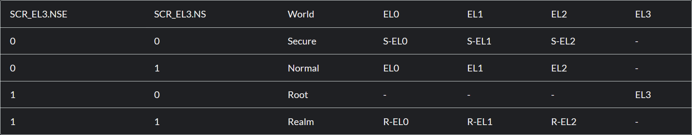
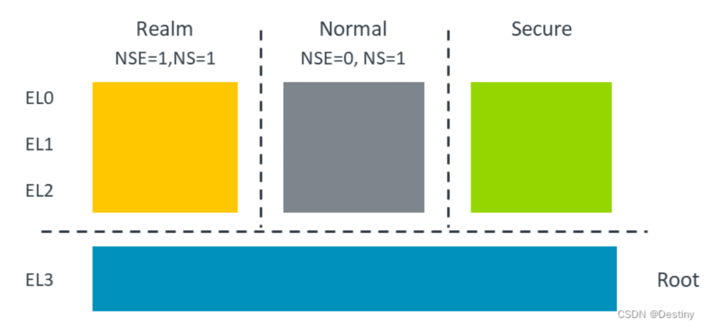
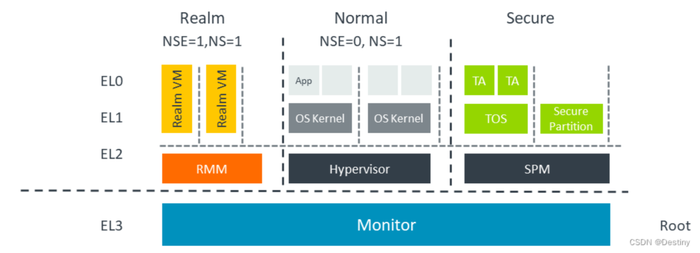
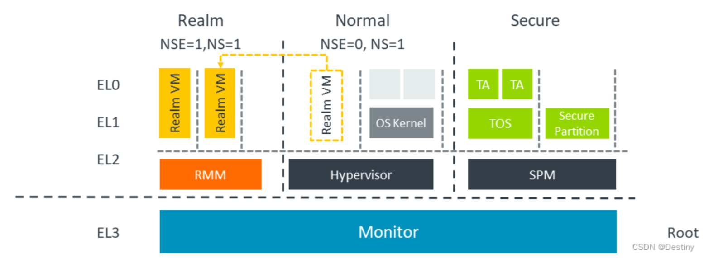
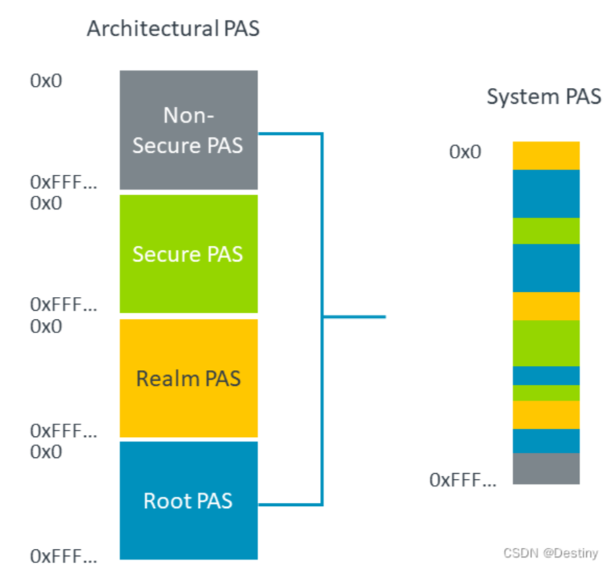
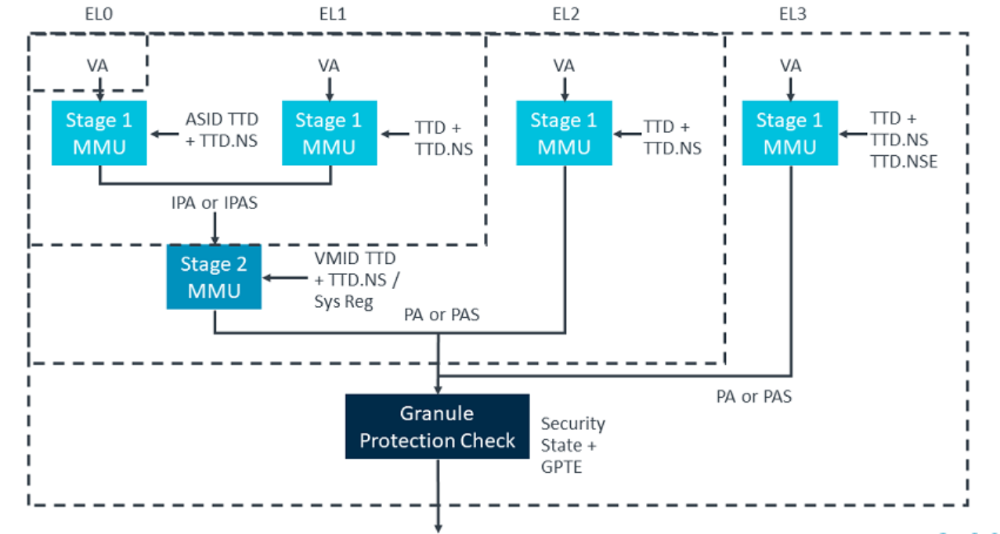
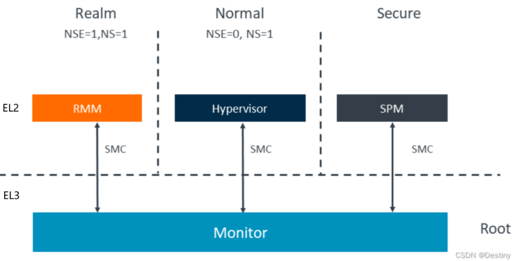
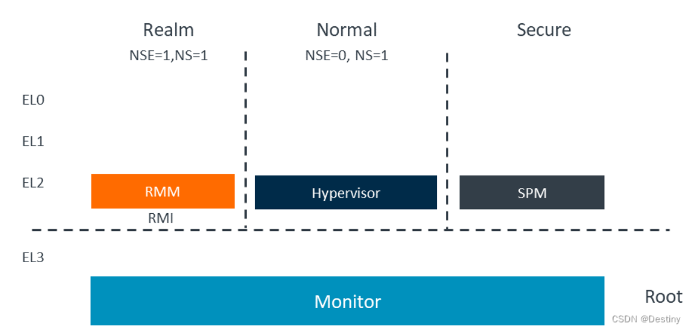
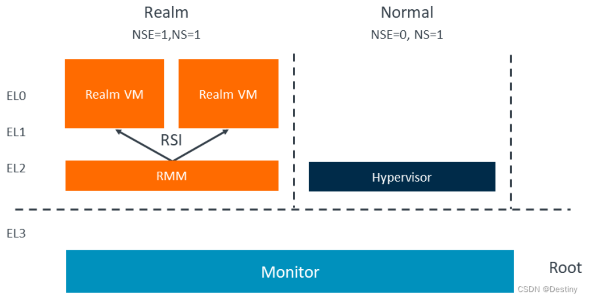

> 参考链接：
>
> [了解架构——介绍Arm机密计算架构](https://developer.arm.com/documentation/den0125/400/Overview)

# 1、概述

​	在本指南中，我们将探讨机密计算在现代计算平台中的作用，并解释机密计算的原理。然后，我们将介绍`Arm`机密计算架构（`Arm CCA`）如何在`Arm`计算平台中实现机密计算。

​	在本指南结束时，您将能够：

* 定义机密计算
* 描述一个复杂的系统信任链
* 了解`Realm`是由`Arm CCA`引入的受保护的执行环境
* 解释如何在`Arm CCA`的实现上创建、管理和执行`Realm`
* 定义可信执行环境（`TEE`）和`Realm`之间的区别
* 解释`Realm`所有者如何在`Realm`中建立信任

# 2、什么是机密计算？

## 2.1 定义

​	机密计算是指在基于硬件支持的可信的安全环境中运行计算任务，以此对使用中的数据进行保护。这种保护能让代码和数据免于被特权软件和硬件代理所监控和修改。

​	在机密计算环境中执行的任何应用程序或操作系统都将独立于系统的其他部分单独执行。任何由此独立执行所生成或消费的数据，在没有明确许可的情况下，都不会被同一平台上的任何其他角色监视。

## 2.2 `Arm CCA`相关要求

​	在`Arm CCA`系统中执行的代码不必信任在环境中执行的大型复杂软件堆栈或任何可能影响它的外围设备。例如，支持`DMA`的设备。`Arm CCA`消除了与软件堆栈或硬件开发人员建立许多关系的需要。

​	如果安全架构师在云服务器系统上部署负载，而它们可能不知道该系统的虚拟机管理程序开发人员是谁。由于虚拟机监控程序是未知的，这可能会导致在没有`Arm CCA`的情况下对平台上的执行缺乏信任。

​	`Arm CCA`允许应用程序开发人员安全地部署工作负载，而无需信任低层软件基础设施，例如在安全环境中运行的虚拟机管理程序或代码。

​	若要允许`Arm CCA`，平台必须提供以下信息：

* 一个能隔离所有不可信任者的执行环境
* 一个能将该执行环境初始化为值得信任的状态的机制。此初始化要求这个执行环境有自己的信任链（`Chain of Trust`），而此信任链是独立于平台上并行使用的不可信任环境的信任链。

# 3、`Arm CCA`扩展

​	`Arm CCA`让您能在部署应用程序或虚拟机的同时，阻止例如`hypervisor`等特权软件的访问。但是，内存等资源通常是由这些特权软件来管理。在这种情况下，特权软件就具有访问应用程序或虚拟机内存的权限。

​	`Arm CCA`允许虚拟机监控程序控制`VM`，但删除了访问该`VM`使用的代码、寄存器状态或数据的权限。

​	通过创建称为`Realms`的受保护`VM`执行空间来实现分离。`Realm`在代码执行和数据访问方面与正常世界完全隔离。`Arm CCA`通过架构硬件扩展和固件的组合来实现这种分离。

​	在`Arm CCA`中，`Arm`应用程序`PE`上的硬件扩展称为领域管理扩展（`RME`）。`RME`与领域控制的专用固件（称为领域管理监视器（`RMM`））和异常级别3的监视器代码进行交互。

## 3.1 `Realms`

​	`Realm`是一种`Arm CCA`环境，能被`Normal World`主机动态分配。主机是指能管理应用程序或虚拟机的监控软件。

​	`Realm`及其所在平台的初始化状态都可以得到验证。这一过程使`Realm`的所有者能在向它提供任何机密前就建立信任。`Realm`不必从控制它的非安全虚拟机管理程序继承信任。

​	主机可以分配和管理资源配置。主机可以管理`Realm`虚拟机操作的调度。但是，主机不能观察或修改`Realm`执行的指令。

​	在主机控制下，`Realm`可以被创建并被销毁。可以通过主机请求添加或删除页面，其方式类似于管理任何其他非机密虚拟机的虚拟机管理程序。

​	为了运行`CCA`系统，需要对主机进行修改。主机继续控制非机密虚拟机，但需要与`Arm CCA`固件（特别是领域管理监视器（`RMM`））进行通信。

## 3.2 `Realm world`和`Root world`

​	`Armv8-A TrustZone`扩展拥有两个独立的环境，分别是`Secure world`和`Normal world`，支持代码的安全执行和数据的隔离。

​	这里`World`是由`PE`的安全状态和物理地址空间组成。`PE`执行时的安全状态会决定`PE`能访问哪种物理地址空间。在安全状态下，`PE`可以访问安全和非安全的物理地址空间，但是在非安全的状态下，它只能访问非安全的物理地址空间。`Normal world`一般用来指非安全的状态和非安全的物理地址空间的组合。

​	`Arm CCA`是`Armv9-A`的一部分，引入了`Realm Management Extension(RME)`。该扩展引入了两个额外的`Wrold`，分别是`Realm world`和`Root world`：

* `Root world`引入了`Root`安全状态和`Root`物理地址空间。`PE`在`Exception level 3`运行时，处于`Root`安全状态。`Root PA`与`Secure PA`是分开的。这是与`Armv8-A TrustZone`的主要区别，在`Armv8-A TrustZone`中，异常级别3代码没有专用地址空间，而是使用安全`PA`。后者仍被`S_EL2/1/0`使用。监视器在`Root`世界中运行。
* `Realm world`与`TrustZone`技术下的安全环境类似。`Realm world`包括`Realm`安全状态和`Realm PA`。`Realm`状态代码可以在`R_EL2`，`R_EL1`和`R_EL0`上执行。在`Realm world`中运行的控制固件可以访问`Normal world`中的内存，支持共享缓冲。

​	在不支持`RME`的`PE`中的`world`切换由`SCR_EL3.NS`位控制。在切换为`Secure world`时，`Exception level 3`软件设置`NS`为0，切换为`Normal world`时设置`NS`为1。支持`RME`的`PE`中进行`world`切换是通过在`SCR_EL3`寄存器增加一个新的`SCR_EL3.NSE`位来扩展的。

​	下表显示了`SCR_EL3.NS`和`SCR_EL3.NSE`是如何控制四个环境之间的执行和访问的：

下图说明了四个基于`RME`的`world`以及它们与`SCR_EL3 NS`和`NSE`位之间的关系：

​	`Root world`支持可信的启动执行和不同环境之间的切换。`PE`复位到`Root world`中。

​	`Realm world`为虚拟机提供了一个与`Normal`和`Secure world`隔离的执行环境。虚拟机需要`Normal world`中主机的控制。为能全面控制`Realm`创建和执行，`Arm CCA`系统需要`RMM`（`Realm Management Monitor`），这是固件的一部分，用于按照`Normal world`主机的请求来管理`Realm`的创建和执行。

​	`RME`和`RMM`区别如下：

* `Realm Management Extension`：这是低层架构所要求的硬件扩展，让隔离的`Realm`虚拟机得以运行
* `Realm Management Monitor`：这属于固件的一部分，用于按照`Normal world`主机的请求来管理`Realm`的创建和执行

## 3.3 `Arm TrustZone`扩展和`Arm RME`之间的区别

​	所有`Arm A`系列的处理器都可以选择实施`Arm TrustZone`架构扩展。这些扩展支持开发隔离的执行和数据环境。可信操作系统（`trusted Operating System， TOS`）等组件可以服务在隔离环境中执行的可信应用程序，相应`Normal world`中运行的`Rich OS`的安全服务请求。

​	在`Armv8.4-A`中将虚拟化添加到安全世界中，允许您在安全环境中管理多个安全分区。此功能可以允许将多个`TOS`应用于一个系统。在`S-EL2`执行的安全分区管理器（`SPM`）是安全分区的管理者。`SMP`具有与普通世界中的虚拟机管理程序类似的功能。

​	在操作中，可信操作系统通常是信任链的一部分，它由更高权限的固件验证，在某些系统中，这可能是`SPM`。这意味着`TOS`依赖于与更高权限固件开发人员的关系。

​	有两种方法可以启动`TOS`的执行：

* `Rich OS`让步，`Rich OS`进入空闲循环，并通过监视器执行`SMC`指令调用`TOS`
* 针对受信任操作系统的中断，安全类型1中断用于执行`TOS`，在正常世界执行期间断言的安全类型1中断通过监视器调用`TOS`

​	`Realm`虚拟机不同于受信任操作系统或受信任应用程序，因为`Realm`虚拟机是由普通世界中的主机控制的。在创建和内存分配等方面，`Realm`虚拟机的行为与主机控制的任何虚拟机一样。

​	`Realm VM`执行和`Trusted OS`执行之间的区别在于`Realm`没有启用任何物理中断。`Realm`的所有中断都由虚拟机管理程序虚拟化，然后通过传递给`RMM`的命令向`Realm`发出信号。这意味着被入侵的虚拟机管理程序可能会阻止`Realm`虚拟机的执行，因此无法保证`Realm`的执行。

​	`Realm`的执行和内存访问由控制主机软件初始化。`Realm`不必由主机验证。`Realm`有一个独立的信任链，独立于正常和安全世界使用的信任链。`Realm`也与控制软件完全隔离，如果`Realm`是由`Host`初始化的，那么`Host`就无法查看`Realm`的数据或数据存储器。

​	使用`Realms`和`TOS`的主要区别在于安全执行和`Realm`执行之间的设计意图。

​	可信应用程序用于与系统开发关系密切的参与者和原始设备制造商所拥有的特定于平台的服务。

​	`Realm`执行的目的是允许普通开发人员在系统上执行代码，而无需与计算机系统中的开发人员建立复杂的业务关系。

​	`Arm CCA`允许在普通世界宿主的控制下按需创建和销毁领域。资源可以动态地添加或检索到`Realms`。

​	信任通常根据机密性、完整性和真实性进行定义，并在以下列表中进行了说明：

* 在机密性方面，`Arm CCA`环境的代码数据或状态无法被同一设备上运行的其他软件监视，即使这个软件具有更高的特权。
* 在完整性方面，`Arm CCA`环境的代码数据或状态无法被同一设备上运行的其他软件修改，即使这个软件具有更高的特权
* 在真实性方面，代码或数据可被运行在同一设备上的其他软件修改，但是任何修改都能被识别

​	可信应用程序和`TOS`为系统提供机密性、完整性和真实性。`Realm`执行可为系统提供机密性和完整性。

​	`Arm CCA`提供的四个`world`使`Secure world`和`Realm world`之间完全隔离开。这意味着可信应用程序无需担心任何`Realm`虚拟机的执行，`Realm`虚拟机也无需担心任何被执行的可信应用程序。

# 4、`Arm CCA`硬件架构

​	下图完整说明了`Realm`是如何配合`Arm CCA`系统的：

​	`Realm`世界必须能够执行代码，访问内存和可信设备，与所有其他非`Root`世界和设备完全隔离。

​	`Realm world`有三个异常级别，`R_EL0/1/2`。`Realm`虚拟机以`R_EL1`和`R_EL0`运行。`Realm Management Monitor(RMM)`在`R_EL2`中运行。`RMM`在`Arm CCA`软件堆栈中进行了描述。

​	隔离是通过架构`Realm Management Extension`在硬件上强制实施的，它允许控制内存管理，执行以及`Realm`的上下文和数据隔离。隔离意味着通过`PE`或加密或`Realm`和`Root`环境的错误异常来阻止访问。

​	在下图中，隔离的`Realm`虚拟机由虚拟机管理程序在`Normal world`中生成和控制，但物理执行在`Realm world`中：

​	`Realm`虚拟机的执行通过`hypervisor`命令初始化，这些命令被传达到`Monitor`，然后通过`Monitor`推送到`RMM`。

​	`Monitor`在不同的`world`之间扮演着守门人的角色。它控制着`Normal`，`Secure`和`Realm world`之间的通道，确保各个`world`之间的隔离能一直得以维持，同时在需要的地方支持通信和控制。

## 4.1 `Arm CCA`内存管理

​	实施`TrustZone`安全扩展的`Arm A`系列处理器具有两个物理地址空间（`Physical Address Space, PAS`）：

* `Non-Secure`物理地址空间
* `Secure`物理地址空间

​	`Realm Management Extension`增加了另外两个物理地址空间：

* `Realm`物理地址空间
* `Root`物理地址空间

​	下图描述了这些物理地址空间以及如何在工作系统中实施这些空间：

​	不同`world`之间的`PAS`访问由硬件强制执行，见下表：

| Security state | Non-secure PAS | Secure PAS | Realm PAS | Root PAS |
| -------------- | -------------- | ---------- | --------- | -------- |
| Non-secure     | yes            | no         | no        | no       |
| Secure         | yes            | yes        | no        | no       |
| Realm          | yes            | no         | yes       | no       |
| Root           | yes            | yes        | yes       | yes      |

​	为确保强制执行所有世界的隔离规则，上表中的物理内存访问控制由下游的内存管理单元（`MMU`）强制执行。此过程称为粒度保护检查（`GPC`）。

​	每个物理内存粒度的`PAS`分配在粒度保护表（`GPT`）中进行了描述。异常级别3中的监视器可以动态更新`GPT`，从而允许物理内存在世界之间移动。

​	任何访问控制冲突都会导致一种新型故障，称为粒度保护故障（`GPF`）。`GPC`的启用，`GPT`的内容和`GPF`的路由由`Root`状态控制。

​	属于`Realm`的资源必须位于`Realm`拥有的内存中，也就是`Realm PAS`的一部分，以确保隔离。但是，`Realm`可能需要访问非安全内存中保存的一些资源，例如启用消息传递。这意味着`Realm`需要能够访问`Non-secure PAS`和`Realm PAS`。

​	在`El3`转换区内，`RME`在转换表描述符中引入了一个额外的位，称为`NSE`。利用`NSE`与现有的`NS`位，`EL3`软件可以映射任意`Root`、`Non-Secure`、`Secure`和`Realm PAS`。

​	在`Realm EL1&0`和`Realm EL2&0`转换区内，`NS`位允许`R-EL2`上的软件映射`Realm PAS`和`Non-Secure PAS`。

​	`Normal world`、`Realm world`和`Secure world`都可以有`EL1`、`EL2`的`stage1`转换，如有必要，`El2`还可以有`stage2`转换。

# 5、`Arm CCA`软件架构

​	`Arm CCA`平台是由许多额外的硬件组合（如`PE`中的`RME`）和固件组件（特别是`Monitor`和`Realm Management Monitor`）组成。

## 5.1 软件栈概述

​	`Realm`虚拟机的执行旨在与`Normal world`隔离，`Realm`虚拟机由正常世界主机启动和控制。为了允许独立执行`Realm VM`，引入了一个名为`Realm Management Monitor`（`RMM`）的新组件，该组件在`R_EL2`时执行。

​	`RMM`负责管理通信和上下文切换。`RMM`不会做出策略决策，例如运行哪个`Realm`或分配给`Realm`什么内存。这些决定仍由主机虚拟机管理程序决定。

​	`RMM`通过`Realm world`中`stage2`页表将`Realm`彼此隔离开来。

​	`RMM`直接连接到`Monitor`，`Monitor`还与安全世界和正常世界连接。在异常级别3中运行的`Monitor`具有特定于平台的代码，这些代码必须为系统的所有受信任功能提供服务。`RMM`响应特定的接口，并具有完全定义的功能来管理来自主机和`Realm`的请求。由于此接口定义明确，因此`RMM`可以是所有`Arm CCA`系统的通用代码。

​	下图显示了在`Realm world`中运行机密`Realm VM`的完整`Arm CCA`平台：

​	`RMM`是`Realm world`中的控制软件，它对`Normal world`中`Hypervisor`的请求做出反应，从而允许管理`Realm VM`的执行。`RMM`通过`Root`环境中的`Monitor`进行通信，以控制`Realm`内存管理功能，以便在`NS PAS`和`Realm PAS`之间转换内存。

​	`SMC`指令允许`RMM`、虚拟机管理程序和`SPM`将控制权返回给监控器，并允许在所有异常级别2软件和`Monitor`之间实现通信通道。下图显示了`Monitor`与每个世界中不同软件控制软件之间的通信通道：

​	在每个`world`中，`EL2`可以通过执行`SMC`指令对`EL3`的`Monitor`进行调用。`SMC`指令的使用为个别`EL2`控制主机和`EL3 Monitor`之间的通信信道建立了基础。这就是`Normal world EL2`上的主机通过`Monitor`与`Realm world EL2`上的`RMM`建立通信的方法。

## 5.2 `Realm Management Monitor`

​	`RMM`是`Realm`世界的固件，用于管理`Realm`虚拟机的执行以及它们在`Normal`环境中与`hypervisor`的交互。`RMM`在`Realm world`中以`EL2`运行，称为`R_EL2`。

​	`RMM`在`Arm CCA`系统中有两组职责，`RMM`向主机提供服务，允许主机管理`Realms`，`RME`还直接向`Realm`提供服务。

​	主机服务可以分为“策略”和“机制”区域。

​	对于策略功能，主机拥有所有策略决策，包括以下内容：

* 何时创建或销毁`Realm`
* 何时在`Realm`中添加或删除内存
* 何时安排`Realm`的输入或输出

​	`RMM`通过提供以下功能来支持主机策略：

* 提供操作`Realm`页表的服务，这些页表用于创建或销毁以及添加或删除`Realm`内存
* 管理`Realm`上下文。这是调度中使用的上下文保存和恢复
* 中断支持
* `PSCI`呼叫拦截。这是电源管理请求。`RMM`还为`Realm`提供服务，主要是证明和加密服务。

​	最后，`RMM`还为`Realm`维护以下安全原语：

* `RMM`验证主机请求的正确性
* `RMM`将`Realm`彼此隔离

​	`RMM`规范定义了两个通信通道，允许在`Normal world`主机和`Realm VM`之间请求和控制所有功能。从主机到`RMM`的通信通道称为领域管理接口（`RMI`）。在`RMM`和`Realm VM`之间定义的第二个通道称为`Realm`服务接口（`RSI`）。`RSI`是从`RMM`请求服务的通道。

## 5.3 `Realm Management Interface`

​	`RMI`是`RMM`和`Normal world`主机之间的接口。

​	`RMI`允许`Normal world`虚拟机管理程序向将管理该领域的`RMM`发出指令。`RMI`使用来自主机虚拟机监控程序的`SMC`调用来请求`RMM`的管理控制。

​	`RMI`支持对`Realm`管理的控制，包括`Realm`的创建、填充、执行和销毁。

​	下图显示了在`Normal world`主机、`Monitor`和`RMM`之间实现`RMI`的位置：

## 5.4 `Realm Services Interface`

​	`RSI`是`Realm VM`和`RMM`之间的接口。

​	`RSI`允许外部服务有一个通道，某些`Realm`管理操作需要从`RMM`传递到`Realm`。这些服务可以包括加密服务和证明。`RSI`也是从`Realm VM`到`RMM`的内存管理请求的通道。

​	下图显示了`RMM`和每个`Realm VM`之间`RSI`的位置：

# 6、设备分配（`DA`）和内存加密上下文（`MEC`）

​	在多数情况下，任何`Realm`软件的执行都需要访问系统中可用的设备。默认情况下，系统中所有的设备都会被阻止访问所有`Realm`领域的内容。如果`Realm`需要使用某个设备，它必须首先证明该设备，然后向`RMM`表示同意才能授予访问权限。

​	此设备分配过程维护机密计算体系结构通过的安全保证。使用标准`RME`功能，可以保证对不支持`DMA`且具有固定地址范围的`Soc`外设的隔离。这可以使用`RMM`页表和`GPT`或完成器端`PAS`过滤器来实现，以允许或拒绝对该内存区域的访问。

​	但是，某些系统设备（如根端口输入）通过单个内存区域控制和访问多个设备。这意味着仅靠内存访问控制是不够的。此外，设备可能还具有自己的缓存，需要对其进行管理。

## 6.1 设备分配

​	设备分配（`DA`）是一种允许将设备唯一分配给单个`Realm`的方法，并允许`Realm`在授予设备访问`Realm`内容之前对设备进行认证的方法。`DA`可以防止`Realm`不信任的代理（包括其他`Realm`和`hypervisor`）访问或控制分配的设备。这包括保护设备`MMIO`接口和设备缓存。`DA`提供了一种标准机制，用于证明所有设备类型，而`RMM`对被证明的设备没有任何特殊知识，无论是静态内存映射还是`PCIe`根端口后面。`PCI SR-IOV`是最普遍的设备分配体系结构。

​	硬件设备通常支持多个接口，这些接口可以分配给各个虚拟机。主机虚拟机监控程序控制分配过程，从而生成可由特定虚拟机直接管理的设备的硬件接口。设备分配体系结构的典型属性如下：

* 它依赖于标准化。这使主机能够将设备分配给`VM`，而无需特定于设备的驱动程序（例如`GPU`驱动程序）。
* 设备接口的`MMIO`可供分配给它的`VM`访问。这意味着`VM`可以直接与设备接互。主机对`MMU`进行编程以启用此功能。
* 来自设备接口的直接内存访问（`DMA`）可以访问`VM`的内存。主机对`SMMU`进行编程以启用此功能。
* 来自设备接口的中断可由`VM`处理。主机确保转发这些中断。

​	在引入`RME`设备分配（`RME-DA`）之前，`RME`架构不允许从设备到`Realm`内存的`DMA`。为了与设备交互，`Realms`需要对设备接口进行编程，以允许`DMA`到非安全内存。`RME-DA`是`RME`架构的补充，它克服了这一限制，并描述了如何将设备接口分配给`Realms`。在功能级别上，`RME-DA`具有与分配给`VM`相同的属性：

* 分配方法依赖于标准化，使其与设备无关
* `Realm`可以访问设备接口的`MMIO`
* 设备接口可以对分配的`Realm`内存执行`DMA`
* `Realm`接受与设备接口相关的中断

​	虽然`RME-DA`在功能上类似于向`VM`分配设备，但`RME-DA`也支持`Realm`安全模型。这导致了以下安全模型和安全保证：

* `Realm`可以根据认证过程决定是否接受设备接口进入其可信计算库（`TCB`）。被`Realm`接受的设备接口可以访问`Realm`的内存。但是，任何不被`Realm`接受的设备接口都不能访问该`Realm`使用的内存区域。
* 所有`Realm`数据都受到保护，不会处于非安全状态
* 对于支持多个接口的设备，`Realm`必须信任该设备来隔离它为每个接口保存的设备上下文
* 可以通过设备接口上的不受信任的通道建立和控制对设备的信任
* 如果设备是离散的，并且与主机不在同一`SoC`上，则必须保护它们之间的物理链路（用于通信`Realm`转换）免受物理攻击。链路保护方案必须提供机密性、完整性和重放保护。

​	为了实现这种安全模型，主机体系结构必须提供必要的保护和机制。`RME-DA`描述了这种架构，由两部分组成：

* `Arm`系统架构规格：
  * `RME-DA`的`SMMU`架构
  * `RME`系统架构
* `PCI`规格
  * `TEE`设备接口安全协议（`TDISP`）规范
  * 完整性和数据加密（`IDE`）

​	设备分配的生命周期由`RMM`管理，并使用`TDSP`（`TEE`设备接口安全协议）实现。主机平台保护`RMM`和`Realm`免受未通过证明接受的设备的影响。
