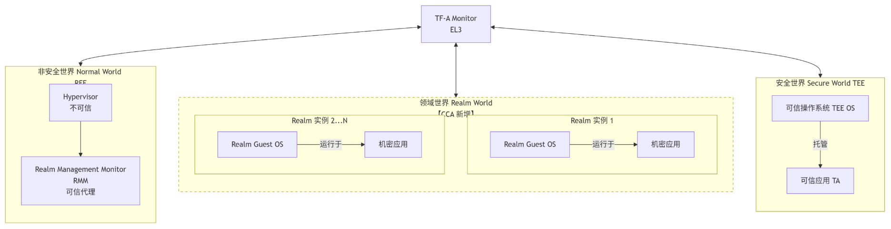

# ARMv9 CCA架构演进技术解析

> 参考链接：[ARMv9 CCA机密计算架构演进技术解析：重塑云原生时代的数据安全基石](https://blog.csdn.net/openHiTLS/article/details/153044327)

## 引言：云计算的“最后一道安全防线”

​	在云计算成为数字世界基石的今天，我们习惯于将计算和数据托付给远端的数据中心。然而，一个根本的安全问题始终萦绕心头：我们如何能信任云服务提供商或其低层软件栈？即使数据在传输和静态存储时被加密，一旦它在内存中被解密以供计算，云厂商的管理员或有权限的恶意软件便有可能访问到这些明文数据。

 ## 1、`ARM TrustZone`与`TEE/REE`的演进

​	要理解`CCA`，我们首先要了解其前身——`ARM TructZone`及其建立的`TEE/REE`模型。

​	`TrustZone`通过将计算资源划分为两个隔离的世界来提供安全功能：

* `REE`：富执行环境，即正常世界。运行通用的操作系统（如`Linux`、`Android`）和应用程序。
* `TEE`：可信执行环境，即安全世界。运行可信操作系统（如OP-TEE）和敏感应用（如指纹支付、数字版权管理）。

​	这两个世界由硬件隔离，`REE`的代码无法访问`TEE`的资源。这就像在一栋大楼里隔出了一个绝对的”安全屋“。

​	传统的`TEE/REE`模型在手机、物联网等终端设备上取得了巨大成功，但在面向多租户、动态分配的云服务器场景下，它显露出以下根本性局限：

1. ”安全屋“是单一且静态的：整个系统只有一个`TEE`。它通常由设备制造商在出厂时固化，难以被云租户动态创建和定制。
2. 粒度太粗，多租户支持弱：所有可信应用都运行在同一个`TEE`内，依赖于`TEE`操作系统来进行互相隔离。这不符合云环境中”每一个租户一个独立飞地“的需求。
3. 功能边界固定：`TEE`通常用于运行特定的、小型的可信应用，而非一个完整的、带通用操作系统的虚拟机。

​	`ARM CCA`在`TrustZone`的思想上进行了革命性的扩展，它不是取代`TEE`，而是引入了一个全新的、专为云原生设计的世界——领域世界，从而形成了一个三足鼎立的全新架构。

## 2、`ARM CCA`核心概念解析

​	想象一下，我们现在要为一栋大楼（计算系统）设计一套更精细的安全租赁方案。

| 角色           | 对应`CCA`组件      | 说明                                                         | 对比传统`TEE/REE`                                            |
| -------------- | ------------------ | ------------------------------------------------------------ | ------------------------------------------------------------ |
| 大楼管理员     | `Non-Secure world` | 传统的云平台和`Hypervisor`，负责资源调度，但不再被完全信任   | 角色基本一致，都是不受信任的富环境                           |
| 金库           | `Secure World`     | 最高安全区域，用于系统固件、支付根等，与租户隔离             | 角色基本保留，用于最高权限、最静态的安全服务                 |
| 独立办公室     | `ARM CCA Realm`    | 租户（云用户）可动态租用的、带高级门禁和保险柜的保密空间     | 【核心革新】：区别于单一的、静态的”金库“，这是可动态创建、按需租用的多个安全空间 |
| 办公室管理系统 | `RMM`              | 唯一被授权管理所有办公室的安保系统，管理员通过它申请办公室，但进不去 | 【全新组件】：传统`TEE/REE`中没有该角色。`Hypervisor`直接管理`TEE`，而这里`RMM`作为”可信代理“介入 |
| 大楼总控中心   | `TF-A Monitor`     | 控制整栋大楼的核心枢纽，负责三个区域间的安全切换             | 【角色增强】：从管理两个世界（`REE/TEE`）切换，升级为管理三个世界（`REE/TEE/Realm`）的切换 |

 	下面，我们深入介绍每个角色，并重点突出革新点。

### 2.1 `ARM CCA Realm`：超越`TEE`动态安全飞地

​	`Realm`是`CCA`的核心，是机密工作负载执行的容器。

* 动态创建`vs`静态固化：与传统`TEE`的静态性不同，`Realm`由云用户（通过`Hypervisor`动态申请创建），生命周期短暂灵活，完美契合云资源的按需分配模式。
* 多租户硬件隔离`vs`单示例软件隔离：传统`TEE`是一个单一环境，其内部多个`TA`之间的隔离依赖于`TEE OS`的软件策略。而`CCA`通过硬件支持同时存在多个`Realms`，且每个`Realm`之间都由硬件强制隔离，实现了真实的硬件级多租户。
* 承载完整操作系统`vs`运行小型应用：与一些仅支持单个应用的“飞地”技术（或传统`TA`）不同，`Realm`内可以运行一个轻量级的`Realm`内核和其上的应用程序，形成一个完整的机密计算示例，适用性更广。

### 2.2 `RMM`：引入“可信代理”，解耦管理与信任

​	`RMM`是一个运行在非安全世界`EL2`特权级别的、经过严格验证的固件。

* 位置与角色的革新：在传统模型中，`Hypervisor`直接与`TEE`交互，它必须被部分信任来管理`TEE`资源。`CCA`引入了`RMM`这个身在“曹营”（非安全世界）但心在“汉”（可信计算基）的可信代理。
* 核心职责：它负责管理`Realm`的生命周期和内存，将`Hypervisor`从可信计算基中彻底移除。`Hypervisor`现在只能通过标准接口请求`RMM`，而无法知晓`Realm`内部状态。

### 2.3 `Non-Secure World`：角色从“管理者”降级为“资源提供者”

​	这就是传统的`REE`，但在`CCA`架构中，其角色和受信任程度发生了关键变化。

* 职责的转变：在`CCA`中，`Non-Secure World`的核心组件`Hypervisor`的主要职责被缩减为物理资源的抽象和调度，从而失去了对机密工作负载内容的洞察和管理权。
* 信任关系的革新：在传统模型中，`TEE`在一定程度上需要信任`REE`内核或`Hypervisor`能正确传递请求和保护其内存。在`CCA`中，通过`RMM`和硬件机制，`Realm`完全不信任`Hypervisor`。`Hypervisor`可以尝试破坏`Realm`，但硬件回确保其攻击无法成功（如导致`Realm`优雅退出而非数据泄漏）。

### 2.4 `Secure World`：职责聚焦，成为“安全的基石”

​	这就是传统的`TEE`，在`CCA`架构中，他依然存在且至关重要，但其职责更加纯粹。

* 职责的聚焦：`Secure World`不再负责运行租户提供的机密应用（这是`Realm`的工作）。它转而专注于提供最核心的、与平台强相关的安全服务，例如：
  * 平台固件保护与管理
  * 硬件根信任的认证服务
  * 密钥管理根
* 与`Realm`的隔离：这是一个关键区别`Secure World`和`Realm World`是硬件隔离的平行世界。一个`Realm`无法访问`Secure World`的资源，反之亦然。这避免了`Realm`中可能存在的漏洞影响到最核心的平台安全服务，实现了安全的职责分离。

### 2.5 `TF-A Monitor`：从“双门卫”升级为“三维交通枢纽”

​	`TF-A Monitor`是运行在最高特权级别`EL3`的固件，是系统安全的基石。

* 职能的扩展：在传统`TEE/REE`模型中，`Monitor`主要负责`REE`和`TEE`这两个世界之间的上下文切换。在`CCA`中，它的职责扩展为管理`Non-Secure World`、`Secure World`和`Realm World`这三个世界的所有安全切换。
* 系统的仲裁者：任何从`Non-Secure World`进入`Realm World`的请求，都必须经过`TF-A Monitor`的检查和路由。它是确保三个世界隔离边界不被逾越的最终守护者。当`CPU`需要从一个世界切换到另一个世界时（例如，从`Realm`处理一个虚拟中断到`Hypervisor`），`TF-A Monitor`负责安全地保存和恢复所有`CPU`状态，确保世界之间的状态不会泄漏。

## 3、`ARM CCA`的协同工作流程与架构全景

​	让我们通过一个架构图来直观感受`CCA`的三世界架构，并与传统模型进行对比。

**架构对比解析**

* 从“二分天下”到“三足鼎立”：传统的`TEE/REE`是简单的二分架构，而`CCA`引入了`Realm World`，成为了一个独立的、与`TEE`平级的世界。
* 隔离颗粒度的演进：`TEE`内部是软件隔离（`TA vs TA`），而`Realm`之间是硬件隔离（`Realm vs Realm`）。这提供了更强的安全保障和性能隔离。
* 管理模型的革新：在`TEE`中，`REE`的`Hypervisor`或内核在一定程度上管理`TEE`。在`CCA`中，`REE`的`Hypervisor`被`RMM`隔离在外，无法直接管理`Realm`，实现了更彻底的信任解耦。

## 4、`ARM CCA`的巨大价值与未来展望

1. 赋能真正的云原生机密计算：与传统`TEE`主要服务设备本地应用不同，`CCA`生来就是为了云。它支持动态、多租户的机密计算实例，为医疗、金融、政务等敏感行业上云扫清了障碍。
2. 重塑供应链信任模型：即使硬件供应链、固件或低层`Hypervisor`存在潜在风险，`Realm`内的内容依然受到保护。这比将信任寄托于`Hypervisor`的传统云模型前进了一大步。
3. 实现灵活的“无信任”基础设施：`CCA`通过`RMM`实现了“默认不信任，通过技术验证”的零信任安全理念，将`Hypervisor`从必须被信任的角色转变为可被验证和监督的角色。
4. 融合而非取代，`CCA`与`TEE`的共存：`CCA`的推出并不意味着`TEE`的消亡。在未来系统中，三者将共存并各司其职：
   * `REE`：运行通用的、性能敏感的非敏感工作负载
   * `Realm`：运行租户提供的、需要机密性的完整操作系统和应用
   * `TEE`：运行平台固有的、对延迟和确定性要求极高的核心安全服务

## 结论

​	`ARM CCA`并非一次简单的技术迭代，而是一次对计算安全架构的深刻重构。它批判性地继承了传统`TEE/REE`模型的隔离思想，并针对云环境的动态性、多租户特性进行了范式上的革新。通过引入`Realm`这一新的抽象和`RMM`这一可信代理，它成功地构建了一个比传统模型更灵活、更安全、更适用于云原生场景的机密计算架构。

​	随着支持`CCA`的`ARM`服务器芯片逐步上市，我们正站在一个新时代的起点。未来，机密计算将不再是可选项，而是云计算的默认配置。在这个未来，`TEE`、`REE`和`Realm`将协同工作，共同构筑起数据安全在云原生时代的最后一道也是最坚固的一道防线。