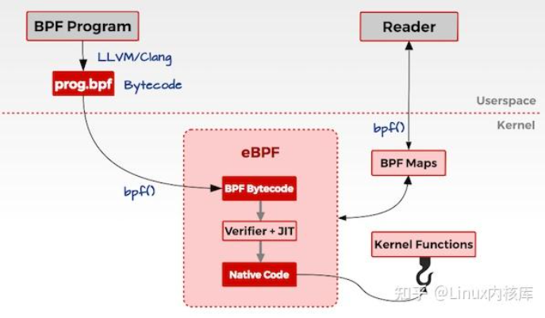

# `eBPF`

> 参考链接：
>
> [一文看懂eBPF、eBPF的使用](https://zhuanlan.zhihu.com/p/480811707)


## 1、什么是`eBPF`

​	`ebpf`全称`extended Berkeley Packet Filter`，即扩展的伯克利包过滤器。一般来说，要向内核添加新功能，需要修改内核源代码或者编写内核模块来实现。而`eBPF`允许程序在不修改内核源代码，或添加额外的内核模块情况下运行。

​	从`eBPF`的名字看，好像是专门为了过滤网络包而创造的。其实，`eBPF`是从`BPF`（也称为`cBPF: classic Berkeley Packet Filter`）发展而来的，`BPF`是专门为过滤网络数据包而创造的。但随着`eBPF`不断完善和加强，现在的`eBPF`已经不再限于过滤网络数据包了。

## 2、`eBPF`架构

​	`eBPF`架构如下图所示：



**用户态**

1、用户编写`eBPF`程序，可以使用`eBPF`汇编或者`eBPF`特有的`C`语言来编写。

2、使用`LLVM/CLang`编译器，将`eBPF`程序编译成`eBPF`字节码。

3、调用`bpf()`系统调用把`eBPF`字节码加载到内核。

**内核态**

1、当用户调用`bpf()`系统调用把`eBPF`字节码加载到内核时，内核先会对`eBPF`字节码进行安全验证。

2、使用`JIF`（`Just In Time`）技术将`eBPF`字节编译成本地机器码（`Native Code`）。

3、然后根据`eBPF`程序的功能，将`eBPF`机器码挂载到内核的不同运行路径上（如用于跟踪内核运行状态的`eBPF`程序将会挂载在`kprobe`的运行路径上）。当内核运行到这些路径时，就会触发执行相应路径上的`eBPF`机器码。
## 3、`eBPF`使用

​	在介绍`eBPF`的实现前，我们先来介绍一下如何使用`eBPF`来跟踪`fork()`系统调用的运行情况。编写`eBPF`程序有多种方式，比如使用原生`eBPF`汇编来编写，但使用原生`eBPF`汇编编写程序的难度较大，所以一般不建议。也可以使用`eBPF`受限的`C`语言来编写，难度比使用原生`eBPF`汇编简单些，但对初学者来说也不是十分友好。最简单的是使用`BCC`工具来编写，`BCC`工具帮我们简化了很多繁琐的工作，比如不用编写加载器。下面我们将使用`BCC`工具来介绍怎么编写一个`eBPF`程序。

> 注意：由于`eBPF`对内核的版本有较高的要求，不同版本的内核对`eBPF`的支持可能有所不同。

### 3.1 `BCC`工具安装

​	在`Ubuntu`系统中安装`BCC`工具是比较简单的，可以使用以下命令：

```shell
$ apt-get install bpfcc-tools linux-headers-$(uname -r)
```

### 3.2 编写`eBPF`版的`hello world`

​	一般编程课的第一步都是编写著名的`hello world`程序，所以我们也以编写`hello world`程序作为第一步。使用`BCC`编写`eBPF`程序的步骤如下：

1）使用`C`语言编写`eBPF`程序的内核态功能，即运行在内核态的`eBPF`程序

2）使用`Python`编写加载代码和用户态功能

​	为什么不能全部使用`Python`编写呢？这是因为`LLVM/Clang`只支持将`C`语言编译成`eBPF`字节码，而不支持将`Python`代码编译成`eBPF`字节码。所以`eBPF`内核态程序只能使用`C`语言编写，而`eBPF`的用户态程序可以使用`Python`进行编写，这样就能简化编写难度。

**使用`C`编写`eBPF`程序**

​	新建一个`hello.c`文件，并输入如下内容：

```c
int hello_world(void *ctx)
{
    bpf_trace_printk("Hello, World!");
    return 0;
}
```

**使用`Python`和`BCC`工具开发一个用户态程序**

​	新建一个`hello.py`文件，并输入如下内容：

```python
#!/usr/bin/env python3
# 1) 加载 BCC 库
from bcc import BPF

# 2) 加载 eBPF 内核态程序
b = BPF(src_file="hello.c")

# 3) 将 eBPF 程序挂载到 kprobe
b.attach_kprobe(event="do_sys_openat2", fn_name="hello_world")

# 4) 读取并且打印 eBPF 内核态程序输出的数据
b.trace_print()
```

​	具体步骤如下：

​		1）导入了`BCC`库的`BPF`模块，以便接下来调用；

​		2）调用`BPF()`函数加载`eBPF`内核态程序，即调用我们编写的`hello.c`

​		3）将`BPF`程序挂载到内核探针（简称`kprobe`），其中`do_sys_openat2()`是系统调用`openat()`在内核中的实现；

​		4）读取内核调试文件`/sys/kernel/debug/tracing/trace_pipe`的内容（`bpf_trace_printk()`函数会将信息写入到此文件），并打印到标准输出中。

**运行`eBPF`程序**

​	用户态程序开发完成之后，最后一步就是执行它了。需要注意的是，`eBPF`程序需要以`root`用户来运行：

```bash
$ sudo python3 hello.py
```

​	运行后，可以看到如下输出：

```bash
$ sudo python3 hello.py
b'         python3-31683   [001] .... 614653.225903: 0: Hello, World!'
b'         python3-31683   [001] .... 614653.226093: 0: Hello, World!'
b'         python3-31683   [001] .... 614653.226606: 0: Hello, World!'
b'           <...>-31684   [000] .... 614654.387288: 0: Hello, World!'
b'      irqbalance-669     [000] .... 614658.232433: 0: Hello, World!'
...
```

