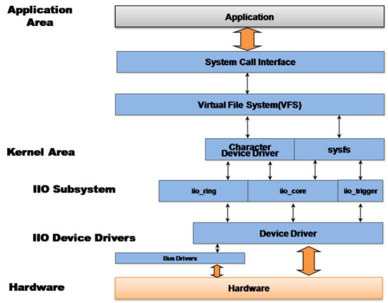

# `IIO`子系统——`IIO`框架及`IIO`数据结构

> 参考链接：
>
> [Linux设备驱动之IIO子系统——IIO框架及IIO数据结构](https://www.cnblogs.com/yongleili717/p/10744252.html)


​	工业`I/O`（`IIO`）是专用于数模转换器（`DAC`）和模数转换器（`ADC`）的内核子系统。随着越来越多的具有不同代码实现的传感器（具有模拟到数字或数字到模拟功能的测量设备）分散在内核源上，收集它们变得必要。这就是`IIO`框架以通用的方式所做的事情。

​	加速度计，陀螺仪，电流/电压测片，光传感器，压力传感器等都属于`IIO`系列器件。

​	`IIO`模型基于设备和通道架构：

​		1）设备代表芯片本身。它是层次结构的顶级。

​		2）通道代表设备的单个采集线。设备可以具有一个或多个通道。

​	`IIO`芯片是物理和硬件传感器或转换器。它作为字符设备暴露给用户空间，以及包含一组文件的`sysfs`目录条目，其中一些文件代表通道。单个通道用单个`sysfs`文件条目表示。

​	下面是从用户空间与`IIO`驱动程序交互的两种方式：

​		1）`/sys/bus/iio/iio:deviceX/`：表示传感器及其通道

​		2）`/dev/iio:deviceX`：表示导出设备事件和数据缓冲区的字符设备

​	驱动程序使用`IIO`核心公开的一组工具和`API`来管理硬件并向`IIO`核心报告处理，然后，`IIO`子系统通过`sysfs`接口和字符设备将整个底层机制抽象到用户空间，用户可以在其上执行系统调用。`IIO`框架如下：



​	上图显示了如何在内核和用户空间之间组织`IIO`框架。驱动程序使用`IIO`核心公开的一组工具和`API`来管理硬件并向`IIO`核心报告处理。然后`IIO`子系统通过`sysfs`接口或字符设备将整个底层机制抽象到用户空间，用户可以在其上执行系统调用。

​	`IIO API`分布在多个头文件中，如下：

```c
#include <linux/iio/iio.h>    /* mandatory */
#include <linux/iio/sysfs.h>  /* mandatory since sysfs is used */
#include <linux/iio/events.h> /* For advanced users, to manage iio events */
#include <linux/iio/buffer.h> /* mandatory to use triggered buffers */
#include <linux/iio/trigger.h>/* Only if you implement trigger in your driver (rarely used)*/
```

## 1、关键数据结构

### 1.1 `iio_dev`

#### 1.1.1 `iio_dev`结构体

​	`IIO`子系统使用结构体`iio_dev`来描述一个具体`IIO`设备，`iio_dev`结构体定义如下（只列出部分重要参数）：

```c
struct iio_dev {
	int				modes;
	int				currentmode;
	struct device			dev;

	struct iio_buffer		*buffer;
	struct list_head		buffer_list;
	int				scan_bytes;
	struct mutex			mlock;

	const unsigned long		*available_scan_masks;
	unsigned			masklength;
	const unsigned long		*active_scan_mask;
	bool				scan_timestamp;
	unsigned			scan_index_timestamp;
	struct iio_trigger		*trig;
	bool				trig_readonly;
	struct iio_poll_func		*pollfunc;
	struct iio_poll_func		*pollfunc_event;

	struct iio_chan_spec const	*channels;
	int				num_channels;

	struct list_head		channel_attr_list;
	struct attribute_group		chan_attr_group;
	const char			*name;
	const struct iio_info		*info;
	clockid_t			clock_id;
	struct mutex			info_exist_lock;
	const struct iio_buffer_setup_ops	*setup_ops;
	struct cdev			chrdev;
};
```

* `modes`：设备支持的模式，常用的可选模式如下：

  | 模式                        | 描述             |
  | --------------------------- | ---------------- |
  | `INDIO_DIRECT_MODE`         | 提供`sysfs`接口  |
  | `INDIO_BUFFER_TRIGGERED`    | 支持硬件缓冲触发 |
  | `INDIO_BUFFER_SOFTWARE`     | 支持软件缓冲触发 |
  | `INDIO_BUFFER_HARDWARE`     | 支持硬件缓冲区   |
  | `INDIO_EVENT_TRIGGERED`     | 支持事件触发     |
  | `INDIO_HARDWARE_TRIGGERED`  | 支持硬件触发     |
  | `INDIO_ALL_BUFFER_MODES`    | 支持所有缓冲模式 |
  | `INDIO_ALL_TRIGGERED_MODES` | 支持所有触发模式 |
* `currentmode`：当前模式
* `buffer`：缓冲区
* `scan_bytes`：捕获并馈送到缓冲区的字节数
* `avaliable_sacn_mask`：可选的扫描位掩码，使用触发缓冲区的时候可以通过设置掩码来确定使能哪些通道，使能以后的通道会将捕获到的数据发送到`IIO`缓冲区
* `active_scan_mask`：缓冲区已经开启的通道掩码。只有使能了的通道数据才能被发送到缓冲区
* `scan_timestamp`：扫描时间戳，如果使能以后会将捕获时间戳放到缓冲区里面
* `trig`：`IIO`设备当前触发器，当使用缓冲模式的时候
* `pollfunc`：在接收到的触发器上运行
* `channels`：`IIO`设备通道，为`struct iio_chan_spec`结构体类型
* `num_channels`：`IIO`设备通道数
* `name`：`IIO`设备名字
* `info`：为`struct iio_info`结构体类型。该结构体里有很多函数，需要驱动开发人员编写。我们从用户空间读取`IIO`设备内部数据，最终调用的就是`iio_info`里面的函数
* `setup_ops`：为`struct iio_buffer_setup_ops`结构体类型。该结构体里有一些回调函数，在使能或禁用缓冲区的时候会调用这些函数，如果未指定的话则默认使用`iio_triggered_buffer_setup_ops`

#### 1.1.2 `iio_dev`的`API`

**`iio_dev`申请与释放**

```c
struct iio_dev *iio_device_alloc(int sizeof_priv)
void iio_device_free(struct iio_dev *indio_dev)
```

**`iio_dev`注册与注销**

```c
int iio_device_register(struct iio_dev *indio_dev)
void iio_device_unregister(struct iio_dev *indio_dev)
```

### 1.2 `iio_chan_spec`

​	`IIO`的核心就是通道，一个传感器可能有多路数据，比如一个`ADC`芯片支持8路采集，那么这个`ADC`就有8个通道。`Linux`内核使用`struct iio_chan_spec`结构体来描述通道，定义在`include/linux/iio/iio.h`头文件中，内容如下：

```c
struct iio_chan_spec {
	enum iio_chan_type	type;
	int			channel;
	int			channel2;
	unsigned long		address;
	int			scan_index;
	struct {
		char	sign;
		u8	realbits;
		u8	storagebits;
		u8	shift;
		u8	repeat;
		enum iio_endian endianness;
	} scan_type;
	long			info_mask_separate;
	long			info_mask_separate_available;
	long			info_mask_shared_by_type;
	long			info_mask_shared_by_type_available;
	long			info_mask_shared_by_dir;
	long			info_mask_shared_by_dir_available;
	long			info_mask_shared_by_all;
	long			info_mask_shared_by_all_available;
	const struct iio_event_spec *event_spec;
	unsigned int		num_event_specs;
	const struct iio_chan_spec_ext_info *ext_info;
	const char		*extend_name;
	const char		*datasheet_name;
	unsigned		modified:1;
	unsigned		indexed:1;
	unsigned		output:1;
	unsigned		differential:1;
};
```

* `type`：通道类型，`enum iio_chan_type`为一个枚举类型，可选的通道类型定义在`include/uapi/linux/iio/types.h`文件中。目前`Linux`内核支持的传感器类型非常丰富，而且支持类型也会不断的增加。如果是`ADC`，那就是`IIO_VOLTAGE`类型，如果是`ICM20608`这样的多轴传感器，那么就是复合类型：陀螺仪部分是`IIO_ANGL_VEL`类型，加速度计部分是`IIO_ACCEL`类型，温度部分是`IIO_TEMP`。

  ```c
  enum iio_chan_type {
  	IIO_VOLTAGE, /* 电压类型 */
  	IIO_CURRENT, /* 电流类型 */
  	IIO_POWER, /* 功率类型 */
  	IIO_ACCEL, /* 加速度类型 */
  	IIO_ANGL_VEL, /* 角度类型(陀螺仪) */
  	IIO_MAGN, /* 电磁类型(磁力计) */
  	IIO_LIGHT, /* 灯光类型 */
  	IIO_INTENSITY, /* 强度类型(光强传感器) */
  	IIO_PROXIMITY, /* 接近类型(接近传感器) */
  	IIO_TEMP, /* 温度类型 */
  	IIO_INCLI, /* 倾角类型(倾角测量传感器) */
  	IIO_ROT, /* 旋转角度类型 */
  	IIO_ANGL, /* 转动角度类型(电机旋转角度测量传感器) */
  	IIO_TIMESTAMP, /* 时间戳类型 */
  	IIO_CAPACITANCE, /* 电容类型 */
  	IIO_ALTVOLTAGE, /* 频率类型 */
  	IIO_CCT, /* 笔者暂时未知的类型 */
  	IIO_PRESSURE, /* 压力类型 */
  	IIO_HUMIDITYRELATIVE, /* 湿度类型 */
  	IIO_ACTIVITY, /* 活动类型(计步传感器) */
  	IIO_STEPS, /* 步数类型 */
  	IIO_ENERGY, /* 能量类型(卡路里) */
  	IIO_DISTANCE, /* 距离类型 */
  	IIO_VELOCITY, /* 速度类型 */
  	IIO_CONCENTRATION, /* 浓度类型 */
  	IIO_RESISTANCE, /* 电阻类型 */
  	IIO_PH, /* PH 类型 */
  	IIO_UVINDEX, /* 紫外线类型 */
  	IIO_ELECTRICALCONDUCTIVITY, /* 电导率类型 */
  	IIO_COUNT, /* 计数类型 */
  	IIO_INDEX, /* 笔者暂时未知的类型 */
  	IIO_GRAVITY, /* 重力类型 */
  	IIO_POSITIONRELATIVE, /* 相对位置类型 */
  	IIO_PHASE, /* 相位类型 */
  	IIO_MASSCONCENTRATION, /* 颗粒物浓度类型 */
  };
  ```

* `channel`：当同级的成员变量`indexed`为1时，该参数为通道索引

* `channel2`：当同级的成员变量`modified`为1的时候，该参数为通道修饰符。`Linux`内核给出的可用通道修饰符定义在`include/uapi/linux/types.h`文件里。比如`ICM20608`的加速度计部分，通过`channel2`的通道修饰符来区分，`X`轴、`Y`轴、`Z`轴分别对应`IIO_MOD_X`、`IIO_MOD_Y`、`IIO_MOD_Z`。通道修饰符主要影响的是`sysfs`下的通道文件名字，后续会讲解`sysfs`下通道文件名字组成形式。

* `address`：用户可以自定义，一般设置为此通道对应的芯片数据寄存器地址。比如`ICM20608`的加速计`X`轴这个通道，它的数据首地址就是`0x3B`。`address`也可以用作其它功能，也可以不使用`address`，一切以实际情况为准。

* `scan_index`：使用触发缓冲区的时候，用作扫描索引

* `scan_type`：是一个结构体，描述数据在缓冲区中的存储格式，各成员变量涵义如下：

  * `sign`：为`u`表示数据为无符号类型，为`s`表示数据为有符号类型
  * `realbits`：数据真实的有效位数，比如很多传感器说的10位`ADC`，其真实有效数据就是10位
  * `storagebits`：存储位数，有效位数+填充位。比如有些传感器的`ADC`是12位，那么我们存储的话要用到2个字节，即16位，这16位就是存储位数。
  * `shift`：右移位数，也就是存储位数和有效位数不一致的时候，需要右移的位数，这个参数不总是需要的，一切以实际芯片的数据手册为准。
  * `repeat`：实际或存储位的重复数量
  * `endianness`：数据的大小端模式，可以设置为`IIO_CPU`、`IIO_BE`（大端）或`IIO_LE`（小端）

* `info_mask_seqarate`：标记某些属性专属于此通道。`include/linux/iio/types.h`文件中的`enum iio_chan_info_enum`枚举类型描述了可选的属性值，如下所示

  ```c
  enum iio_chan_info_enum {
  	IIO_CHAN_INFO_RAW = 0,		/* 原始数据 */
  	IIO_CHAN_INFO_PROCESSED,
  	IIO_CHAN_INFO_SCALE,		/* 分辨率 */
  	/* ... */
  	IIO_CHAN_INFO_DEBOUNCE_TIME,
  	IIO_CHAN_INFO_CALIBEMISSIVITY,
  	IIO_CHAN_INFO_OVERSAMPLING_RATIO,
  };
  ```

* `info_mask_shared_by_type`：标记导出的信息由相同类型的通道共享，也就是`iio_chan_spec.type`相同的通道。
* `info_mask_shared_by_dir`：标记导出的信息由相同方向的通道共享，也就是`iio_chan_spec.output`相同的通道。
* `info_mask_shared_by_all`：标记导出的信息由所有通道共享
* `modified`：为1的时候，`channel2`为通道修饰符
* `indexed`：为1的时候，`channel`为通道索引
* `output`：设置输入还是输出。如果不设置，则为0，表示输入，如果设置为1，表示输出。
* `differential`：差分通道

> ​	有关`info_mask_xxx`成员变量如何设置对应的属性。以`ICM20608`传感器为例，3路加速度计`X`、`Y`、`Z`三轴对应三个通道。每个轴都有对应加速度的原始数据，即每个通道的`info_mask_seqarate`使能`IIO_CHAN_INFO_RAW`属性。每个轴都有相同的分辨率，即每个通道的`info_mask_shared_by_type`使能`IIO_CHAN_INFO_SCALE`。

​	以`ICM20608`传感器为例，其`struct iio_chan_spec`结构体描述如下：

```c
#define ICM20608_CHAN(_type, _channel2, _index)                    \
	{                                                             \
		.type = _type,                                        \
		.modified = 1,                                        \
		.channel2 = _channel2,                                \
		.info_mask_shared_by_type = BIT(IIO_CHAN_INFO_SCALE), \
		.info_mask_separate = BIT(IIO_CHAN_INFO_RAW) |	      \
				      BIT(IIO_CHAN_INFO_CALIBBIAS),   \
		.scan_index = _index,                                 \
		.scan_type = {                                        \
				.sign = 's',                          \
				.realbits = 16,                       \
				.storagebits = 16,                    \
				.shift = 0,                           \
				.endianness = IIO_BE,                 \
			     },                                       \
	}

static const struct iio_chan_spec icm20608_channels[] = {
	/* 温度通道 */
	{
		.type = IIO_TEMP,
		.info_mask_separate = BIT(IIO_CHAN_INFO_RAW)
				| BIT(IIO_CHAN_INFO_OFFSET)
				| BIT(IIO_CHAN_INFO_SCALE),
		.scan_index = INV_ICM20608_SCAN_TEMP,
		.scan_type = {
				.sign = 's',
				.realbits = 16,
				.storagebits = 16,
				.shift = 0,
				.endianness = IIO_BE,
			     },
	},

	ICM20608_CHAN(IIO_ANGL_VEL, IIO_MOD_X, INV_ICM20608_SCAN_GYRO_X),	/* 陀螺仪X轴 */
	ICM20608_CHAN(IIO_ANGL_VEL, IIO_MOD_Y, INV_ICM20608_SCAN_GYRO_Y),	/* 陀螺仪Y轴 */
	ICM20608_CHAN(IIO_ANGL_VEL, IIO_MOD_Z, INV_ICM20608_SCAN_GYRO_Z),	/* 陀螺仪Z轴 */

	ICM20608_CHAN(IIO_ACCEL, IIO_MOD_Y, INV_ICM20608_SCAN_ACCL_Y),	/* 加速度X轴 */
	ICM20608_CHAN(IIO_ACCEL, IIO_MOD_X, INV_ICM20608_SCAN_ACCL_X),	/* 加速度Y轴 */
	ICM20608_CHAN(IIO_ACCEL, IIO_MOD_Z, INV_ICM20608_SCAN_ACCL_Z),	/* 加速度Z轴 */
};
```

​	以`AP3216C`传感器为例，其`struct iio_chan_spec`结构体描述如下：

```c
static const struct iio_chan_spec ap3216c_channels[] = {
	/* ALS通道 */
	{
		.type = IIO_INTENSITY,
		.modified = 1,
		.channel2 = IIO_MOD_LIGHT_BOTH,
		.address = AP3216C_ALSDATALOW,
		.info_mask_separate = BIT(IIO_CHAN_INFO_RAW) |
			BIT(IIO_CHAN_INFO_SCALE),
		.scan_index = AP3216C_ALS,
		.scan_type = {
			.sign = 'u',
			.realbits = 16,
			.storagebits = 16,
			.endianness = IIO_LE,
		},
	},

	/* PS通道 */
	{
		.type = IIO_PROXIMITY,
		.address = AP3216C_PSDATALOW,
		.info_mask_separate = BIT(IIO_CHAN_INFO_RAW),
		.scan_index = AP3216C_PS,
		.scan_type = {
			.sign = 'u',
			.realbits = 10,
			.storagebits = 16,
			.endianness = IIO_LE,
		},
	},

	/* IR通道 */
	{
		.type = IIO_INTENSITY,
		.modified = 1,
		.channel2 = IIO_MOD_LIGHT_IR,
		.address = AP3216C_IRDATALOW,
		.info_mask_separate = BIT(IIO_CHAN_INFO_RAW),
		.scan_index = AP3216C_IR,
		.scan_type = {
			.sign = 'u',
			.realbits = 10,
			.storagebits = 16,
			.endianness = IIO_LE,
		},
	},
};
```

### 1.3 `iio_info`

​	`struct iio_info`结构用于声明`IIO`内核使用的钩子，以读取/写入通道属性值。其定义在`include/linux/iio/iio.h`头文件中，内容如下：

```c
struct iio_info {
    const struct attribute_group	*event_attrs;
    const struct attribute_group	*attrs;
    
	int (*read_raw)(struct iio_dev *indio_dev,
			struct iio_chan_spec const *chan,
			int *val,
			int *val2,
			long mask);
	int (*write_raw)(struct iio_dev *indio_dev,
			 struct iio_chan_spec const *chan,
			 int val,
			 int val2,
			 long mask);
    /* ... */
};
```

* `attrs`：表示设备属性
* `read_raw()`：这是用户读取设备`sysfs`文件属性时的回调函数。`mask`参数是一个位掩码，它允许我们知道请求了哪种类型的值，如`IIO_CHAN_INFO_RAW`。`chan`为通道。
* `write_raw()`：这是用户写入设备`sysfs`文件属性时的回调函数。

## 2、通道文件命名方式

​	以`ICM20608`的加速度计的`X`轴的通道为例，其通道描述展开如下；

```c
ICM20608_CHAN(IIO_ACCEL, IIO_MOD_X, INV_ICM20608_SCAN_ACCL_X)
    
.type = IIO_ANGL_VEL,
.modified = 1,
.channel2 = IIO_MOD_X,
.info_mask_shared_by_type = BIT(IIO_CHAN_INFO_SCALE),
.info_mask_separate = BIT(IIO_CHAN_INFO_RAW) |
					BIT(IIO_CHAN_INFO_CALIBBIAS),
.scan_index = INV_ICM20608_SCAN_GYRO_X,
.scan_type = {
	.sign = 's',
	.realbits = 16,
	.storagebits = 16,
	.shift = 0,
	.endianness = IIO_BE,
}, 
```

​	第6行，设置了`IIO_CHAN_INFO_SCALE`这个共享属性	

​	第7-8行，设置了`IIO_CHAN_INFO_RAW`和`IIO_CHAN_INFO_CALIBBIAS`这两个专属属性

​	通道属性命名方式为：`[direction]_[type]_[index]_[modifier]_[info_mask]`

### 2.1 `direction`

​	`direction`为属性对应的方向，`struct iio_direction`结构体定义了方向描述，`iio_chan_spec.output`设置通道方向，内容如下：

```c
static const char * const iio_direction[] = {
	[0] = "in",
	[1] = "out",
};

iio_direction[chan->output]
```

### 2.2 `type`

​	`type`为通道类型，`struct iio_chan_type_name_spec`结构体定义了类型描述，`iio_chan_spec.type`设置了通道类型，内容如下：

```c
static const char * const iio_chan_type_name_spec[] = {
	[IIO_VOLTAGE] = "voltage",
	[IIO_ACCEL] = "accel",
	/* ... */
	[IIO_PHASE] = "phase",
	[IIO_MASSCONCENTRATION] = "massconcentration",
};

iio_chan_type_name_spec[chan->type]
```

### 2.3 `index`

​	`index`控制通道索引，如果配置通道的时候设置了`indexed=1`，那么就会使用通道的`channel`成员变量来替代此部分命名。一般情况下，设置了`index=1`后，不同通道的`channel`值从0开始加一。

### 2.4 `modifier`

​	`modifier`控制通道修饰符，`struct iio_modifier_names`结构体定义了修饰符描述，`iio_chan_spec.channel2`设置了通道修饰符，内容如下：

```c
static const char * const iio_modifier_names[] = {
	[IIO_MOD_X] = "x",
	[IIO_MOD_Y] = "y",
	[IIO_MOD_Z] = "z",
	/* ... */
	[IIO_MOD_PM4] = "pm4",
	[IIO_MOD_PM10] = "pm10",
};

iio_modifier_names[chan->channel2]
```

### 2.5 `info_mask`

​	`info_mask`为属性掩码，不同属性对应的字符如下所示：

```c
static const char * const iio_chan_info_postfix[] = {
	[IIO_CHAN_INFO_RAW] = "raw",
	[IIO_CHAN_INFO_PROCESSED] = "input",
	[IIO_CHAN_INFO_SCALE] = "scale",
	/* ... */
	[IIO_CHAN_INFO_OVERSAMPLING_RATIO] = "oversampling_ratio",
};
```


​	综上所述，`ICM20608`的加速度计`X`轴通道会生成`in_accel_x_raw`、`in_accel_x_calibbias`两个专属属性文件及`in_accel_scale`一个共享属性文件在`/sys/bus/iio/devices/iio:devicex/`目录下。

> ​	如果我们将加速度计`X`轴通道描述如下：
>
> ```c
> .type = IIO_ANGL_VEL,
> .index = 1,
> .channel = 0,
> .info_mask_shared_by_type = BIT(IIO_CHAN_INFO_SCALE),
> .info_mask_separate = BIT(IIO_CHAN_INFO_RAW) |
> 					BIT(IIO_CHAN_INFO_CALIBBIAS),
> .scan_index = INV_ICM20608_SCAN_GYRO_X,
> .scan_type = {
> 	.sign = 's',
> 	.realbits = 16,
> 	.storagebits = 16,
> 	.shift = 0,
> 	.endianness = IIO_BE,
> }, 
> ```
>
> ​	则会生成`in_accel0_raw`、`in_accel0_calibbias`两个专属属性文件及`in_accel_scale`一个共享属性文件。

## 3、`IIO`触发缓冲区

​	触发缓冲区就是基于某种信号来触发数据采集，这些信号就是触发器，比如：

​	1）传感器数据就绪中断

​	2）周期性中断

​	3）用户空间下读取`sysfs`下的指定文件

​	触发器肯定是触发数据的采集，数据采集到之后会填充到缓冲区里面，最终会以字符设备形式提供给用户空间，用户空间之间读取缓冲区文件即可。

### 3.1 `IIO`触发器

​	`Linux`内核中使用`iio_trigger`结构体表示触发器，定义在`include/linux/iio/trigger.h`文件中，内容如下：

```c
struct iio_trigger {
	const struct iio_trigger_ops	*ops;
	struct module			*owner;
	int				id;
	const char			*name;
	struct device			dev;

	struct list_head		list;
	struct list_head		alloc_list;
	atomic_t			use_count;

	struct irq_chip			subirq_chip;
	int				subirq_base;

	struct iio_subirq subirqs[CONFIG_IIO_CONSUMERS_PER_TRIGGER];
	unsigned long pool[BITS_TO_LONGS(CONFIG_IIO_CONSUMERS_PER_TRIGGER)];
	struct mutex			pool_lock;
	bool				attached_own_device;
};

struct iio_trigger_ops {
	int (*set_trigger_state)(struct iio_trigger *trig, bool state);
	int (*try_reenable)(struct iio_trigger *trig);
	int (*validate_device)(struct iio_trigger *trig,
			       struct iio_dev *indio_dev);
};
```

​	第2行，触发器的操作函数结构体。

​	第22行，`set_trigger_state()`函数用于设置触发器状态，即打开/关闭触发器。如果用中断作为触发器的话，此函数一般设置传感器的中断使能状态

​	第23行，`try_reenable()`函数在用户计数为0时尝试重新使能触发器

​	第24行，`validate_device()`函数用于当触发器改变的时候，使设备生效

**申请和释放触发器**

```c
struct iio_trigger *iio_trigger_alloc(const char *fmt, ...)
void iio_trigger_free(struct iio_trigger *trig)

struct iio_trigger *devm_iio_trigger_alloc(struct device *dev, const char *fmt, ...)
```

**注册和注销触发器**

```c
int iio_trigger_register(struct iio_trigger *trig_info)
void iio_trigger_unregister(struct iio_trigger *trig_info)
    
int devm_iio_trigger_register(struct device *dev, struct iio_trigger *trig_info)
```

### 3.2 `IIO`缓冲区

​	`IIO`缓冲区就是保存采集到的数据，用户空间可以直接通过访问字符设备`/dev/iio:devicex`来读取缓冲区中的数据。编写驱动的时候我们需要先创建缓冲区，一般使用如下函数创建缓冲区：

```c
int iio_triggered_buffer_setup(struct iio_dev *indio_dev,
					irqreturn_t (*h)(int irq, void *p),
					irqreturn_t (*thread)(int irq, void *p),
					const struct iio_buffer_setup_ops *setup_ops)

int devm_iio_triggered_buffer_setup(struct device *dev,
				    struct iio_dev *indio_dev,
				    irqreturn_t (*h)(int irq, void *p),
				    irqreturn_t (*thread)(int irq, void *p),
				    const struct iio_buffer_setup_ops *setup_ops)
```

* `indio_dev`：需要创建缓冲的`iio_dev`

* `h`：触发器中断上半部，上半部程序一定要简单，执行速度越快越好，一般就是提供捕获时间戳，可以直接使用`IIO`框架提供的`iio_pollfunc__store_time`函数

* `thread`：触发器中断下半部，重要的处理就在这个函数里面，此函数中我们需要将传感器中的数据和上半部获取到的时间戳一起推送到缓冲区中.

* `setup_op`：缓冲区操作函数集，其结构体内容如下。如果设置为`NULL`，则会使用默认的操作集`iio_triggered_buffer_setup_ops`。

  ```c
  struct iio_buffer_setup_ops {
  	int (*preenable)(struct iio_dev *);
  	int (*postenable)(struct iio_dev *);
  	int (*predisable)(struct iio_dev *);
  	int (*postdisable)(struct iio_dev *);
  	bool (*validate_scan_mask)(struct iio_dev *indio_dev,
  				   const unsigned long *scan_mask);
  };
  ```

  