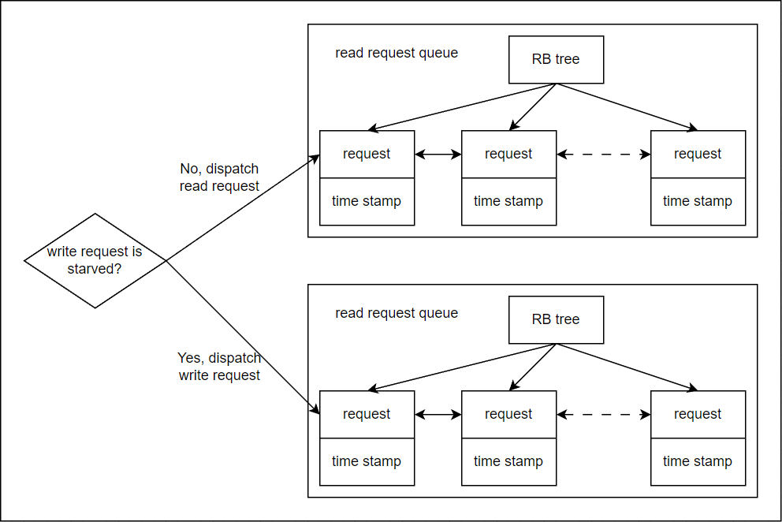

# IO Scheduler——5、Deadline算法

Deadline这种调度器对读写request进行了分类管理，并且在调度处理的过程中读请求具有较高优先级。这主要是因为读请求往往是同步操作，对延迟时间比较敏感，而写操作往往是异步操作，可以尽可能的将相邻访问地址的请求进行合并，但是，合并的效率越高，延迟时间会越长。因此，为了区别对待读写请求类型，deadline采用两条链表对读写请求进行分类管理。但是，引入分类管理之后，在读优先的情况下，写请求如果长时间得不到调度，会出现饿死的情况，因此，deadline算法考虑了写饿死的情况，从而保证在读优先调度的情况下，写请求不会被饿死。

Deadline这种调度算法的基本思想可以采用下图进行描述：



读写请求被分成了两个队列，并且采用两种方式将这些request管理起来。一种采用红黑树（RB tree）的方式将所有request组织起来，通过request的访问地址作为索引；另一种方式是采用队列的方式将request管理起来，所有request采用先来后到的方式进行排序，即FIFO队列。每个request会被分配一个time stamp，这样就可以知道这个request算法已经长时间没有得到调度，需要优先处理。在请求调度的过程中，读队列是优先得到处理的，除非写队列长时间没有得到调度。

在请求处理的过程中，Deadline算法会优先处理那些访问地址临近的请求，这样可以最大程度的减少磁盘抖动的可能性。只有在有些request即将被饿死的时候，或者没有办法进行磁盘序列化操作的时候，deadline才会放弃地址优先策略，转而处理那些即将被饿死的request。

总体来讲，deadline算法对request进行了优先权控制调度，主要表现在如下几个方面：

1）读写请求分离，读请求具有高优先调度权，除非写请求即将被饿死的时候，才会去调度处理写请求。这种处理可以保证读请求的延迟时间最小化。

2）对请求的顺序批量处理。对那些地址临近的顺序化请求，deadline给予了高优先级处理权。例如一个写请求得到调度后，其临近的request会在紧接着的调度过程中被处理掉。这种顺序批量处理的方法可以最大程度的减少磁盘抖动。

3）保证每个请求的延迟时间。每个请求都赋予了一个最大延迟时间，如果达到延迟时间的上限，那么这个请求就会被提前处理掉，此时，会破坏磁盘访问的顺序化特征，会影响性能，但是，保证了每个请求都能被处理到。

与deadline相关的请求调度发送函数是deadline_dispatch_requests，该函数的实现、分析如下：

```c
/*
 * deadline_dispatch_requests selects the best request according to
 * read/write expire, fifo_batch, etc
 */
static int deadline_dispatch_requests(struct request_queue *q, int force)
{
	struct deadline_data *dd = q->elevator->elevator_data;
	const int reads = !list_empty(&dd->fifo_list[READ]);
	const int writes = !list_empty(&dd->fifo_list[WRITE]);
	struct request *rq, *next_rq;
	int data_dir;

	/*
	 * batches are currently reads XOR writes
	 */
	rq = deadline_next_request(dd, WRITE);
	if (!rq)
		rq = deadline_next_request(dd, READ);

	if (rq && dd->batching < dd->fifo_batch)
		/* we have a next request are still entitled to batch */
		goto dispatch_request;

	/*
	 * at this point we are not running a batch. select the appropriate
	 * data direction (read / write)
	 */

	if (reads) {
		BUG_ON(RB_EMPTY_ROOT(&dd->sort_list[READ]));

		if (deadline_fifo_request(dd, WRITE) &&
		    (dd->starved++ >= dd->writes_starved))
			goto dispatch_writes;

		data_dir = READ;

		goto dispatch_find_request;
	}

	/*
	 * there are either no reads or writes have been starved
	 */

	if (writes) {
dispatch_writes:
		BUG_ON(RB_EMPTY_ROOT(&dd->sort_list[WRITE]));

		dd->starved = 0;

		data_dir = WRITE;

		goto dispatch_find_request;
	}

	return 0;

dispatch_find_request:
	/*
	 * we are not running a batch, find best request for selected data_dir
	 */
	next_rq = deadline_next_request(dd, data_dir);
	if (deadline_check_fifo(dd, data_dir) || !next_rq) {
		/*
		 * A deadline has expired, the last request was in the other
		 * direction, or we have run out of higher-sectored requests.
		 * Start again from the request with the earliest expiry time.
		 */
		rq = deadline_fifo_request(dd, data_dir);
	} else {
		/*
		 * The last req was the same dir and we have a next request in
		 * sort order. No expired requests so continue on from here.
		 */
		rq = next_rq;
	}

	/*
	 * For a zoned block device, if we only have writes queued and none of
	 * them can be dispatched, rq will be NULL.
	 */
	if (!rq)
		return 0;

	dd->batching = 0;

dispatch_request:
	/*
	 * rq is the selected appropriate request.
	 */
	dd->batching++;
	deadline_move_request(dd, rq);

	return 1;
}
```

Deadline调度器需要处理的核心数据结构是deadline_data，该结构描述如下：

```c
struct deadline_data {
	// 采用红黑树管理所有的request，请求地址作为索引值
	struct rb_root sort_list[2];
    // 采用FIFO队列管理所有的request，所有请求按照时间先后次序排列
	struct list_head fifo_list[2];

	// 批量处理请求过程中，需要处理的下一个request
	struct request *next_rq[2];
    // 计数器：统计当前已经批量处理完成的request
	unsigned int batching;
    // 计数器：统计写队列是否即将饿死
	unsigned int starved;

	// 配置信息：读写请求的超时时间值
	int fifo_expire[2];
    // 配置信息：批量处理的request数量
	int fifo_batch;
    // 配置信息：写饥饿值
	int writes_starved;
	int front_merges;
};
```

