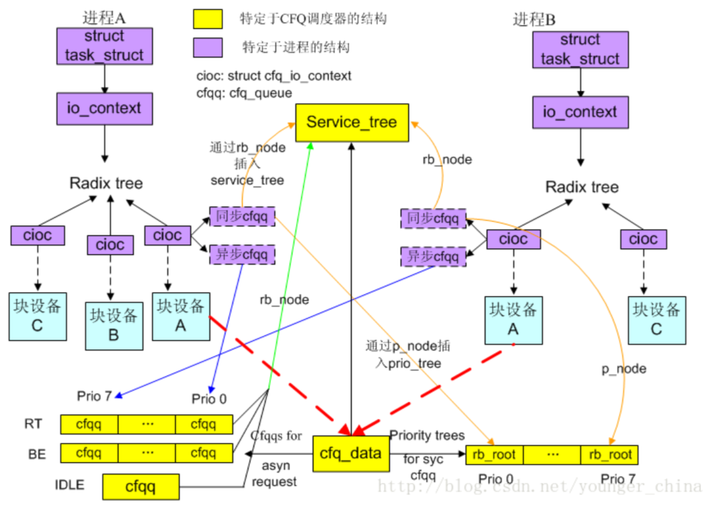

# IO Scheduler——6、CFQ算法

> 参考链接：
>
> [18 IO调度器 - CFQ](https://blog.csdn.net/younger_china/article/details/72356276)

## 原理

CFQ试图为竞争块设备使用权的所有进程分配一个请求队列和一个时间片，在调度器分配给进程的时间片内，进程可以将其读写请求发送给底层块设备，当进程的时间片消耗完，进程的请求队列将被挂起，等待调度。

每个进程的时间片和每个进程的队列长度取决于进程的IO优先级，每个进程都会有一个IO优先级，CFQ调度器将会将其作为考虑的因素之一，来确定该进程的请求队列何时可以获取块设备的使用权。

IO优先级从高到低可以分为三大类：RT（real time），BE（best try），IDLE（idle），其中RT和BE又可以再划分为8个子优先级。实际上，我们已经知道CFQ调度器的公平是针对于进程而言的，而只有同步请求（read或syn write）才是针对进程而存在的，他们会放入进程自身的请求队列，而所有同优先级的异步请求，无论来自哪个进程，都会被放入公共的队列，异步请求的队列总共有8（RT）+8（BE）+1（IDLE）=17个。

## 数据结构

CFQ调度器在整个工作过程中所涉及到的结构比较多，可以把这些结构分为两类，一类是用来描述调度器本身相关的结构，由于CFQ将进程作为考虑对象，因此另一类结构就是特定于进程的结构，对于这些结构，我们只选择其内部的重要元素进行分析。和调度器相关的数据结构主要有两个，一个是描述调度器的`struct cfq_data`，一个是描述队列的`struct cfq_queue`。

```c
struct cfq_data {
    // 指向块设备对应的request_queue
	struct request_queue *queue;
	// 所有带调度的队列都被添加进该红黑树，等待调度获取时间片
	struct cfq_rb_root grp_service_tree;
	struct cfq_group *root_group;

	/*
	 * The priority currently being served
	 */
	enum wl_class_t serving_wl_class;
	enum wl_type_t serving_wl_type;
	u64 workload_expires;
	struct cfq_group *serving_group;

	/*
	 * 对应8个优先级的红黑树，所有优先级类别为RT或BE的进程的同步请求队列，都会
	 * 根据优先级添加至相应的红黑树
	 */
	struct rb_root prio_trees[CFQ_PRIO_LISTS];

    // 用于计算service_tree中有多少个队列在等待调度
	unsigned int busy_queues;
	unsigned int busy_sync_queues;

	int rq_in_driver;
	int rq_in_flight[2];

	/*
	 * queue-depth detection
	 */
	int rq_queued;
	int hw_tag;
	/*
	 * hw_tag can be
	 * -1 => indeterminate, (cfq will behave as if NCQ is present, to allow better detection)
	 *  1 => NCQ is present (hw_tag_est_depth is the estimated max depth)
	 *  0 => no NCQ
	 */
	int hw_tag_est_depth;
	unsigned int hw_tag_samples;

	/*
	 * idle window management
	 */
	struct hrtimer idle_slice_timer;
	struct work_struct unplug_work;

    // 指向当前占有块设备的队列
	struct cfq_queue *active_queue;
	struct cfq_io_cq *active_cic;

	sector_t last_position;

	// 用于计算在一个队列的时间片内，最多发放多少个请求到底层的块设备
	unsigned int cfq_quantum;
	unsigned int cfq_back_penalty;
	unsigned int cfq_back_max;
	unsigned int cfq_slice_async_rq;
	unsigned int cfq_latency;
    // 同步、异步请求的响应期限时间
	u64 cfq_fifo_expire[2];
    // 同步、异步请求队列的时间片长度
	u64 cfq_slice[2];
	u64 cfq_slice_idle;
	u64 cfq_group_idle;
	u64 cfq_target_latency;

	/*
	 * Fallback dummy cfqq for extreme OOM conditions
	 */
	struct cfq_queue oom_cfqq;

	u64 last_delayed_sync;
};

struct cfq_queue {
	/* reference count */
	int ref;
	/* various state flags, see below */
	unsigned int flags;
	/* 指向队列所属的cfq_data */
	struct cfq_data *cfqd;
	/* 用于将队列插入service_tree */
	struct rb_node rb_node;
	/* 红黑树节点关键值，用于确定队列在service_tree中的位置，该值
	 * 要综合jiffies，进程的IO优先级等因素进行计算 
	 */
	u64 rb_key;
	/* 用于将队列插入对应优先级的prio_tree */
	struct rb_node p_node;
	/* 对应的prio_tree树根 */
	struct rb_root *p_root;
	/* 组织队列内的请求用的红黑树，按请求的起始扇区进行排序 */
	struct rb_root sort_list;
	/* if fifo isn't expired, next request to serve */
	struct request *next_rq;
	/* requests queued in sort_list */
	int queued[2];
	/* currently allocated requests */
	int allocated[2];
	/* 组织队列内的请求用的链表头，按请求的响应期限排序 */
	struct list_head fifo;

	/* time when queue got scheduled in to dispatch first request. */
	u64 dispatch_start;
	u64 allocated_slice;
    /* 在时间片内发送的请求数 */
	u64 slice_dispatch;
	/* time when first request from queue completed and slice started. */
	u64 slice_start;
    /* 指明时间片何时消耗完 */
	u64 slice_end;
	s64 slice_resid;

	/* pending priority requests */
	int prio_pending;
	/* number of requests that are on the dispatch list or inside driver */
	int dispatched;

	/* 进程的当前IO优先级 */
	unsigned short ioprio, org_ioprio;
	unsigned short ioprio_class, org_ioprio_class;

	pid_t pid;

	u32 seek_history;
	sector_t last_request_pos;

	struct cfq_rb_root *service_tree;
	struct cfq_queue *new_cfqq;
	struct cfq_group *cfqg;
	/* Number of sectors dispatched from queue in single dispatch round */
	unsigned long nr_sectors;
};
```

相对于进程的结构有`struct io_context`和`struct cfq_io_context`。`io_context`的核心结构是一个基数树，里面组织了进程所访问的所有块设备所对应的`cfq_io_context`。`cfq_io_context`中的核心结构是两个队列，也就是进程在一个CFQ调度器所关系到的队列，一个是同步的，一个是异步的。



## 接口函数

```c
static struct elevator_type iosched_cfq = {
	.ops.sq = {
		.elevator_merge_fn = 		cfq_merge,
		.elevator_merged_fn =		cfq_merged_request,
		.elevator_merge_req_fn =	cfq_merged_requests,
		.elevator_allow_bio_merge_fn =	cfq_allow_bio_merge,
		.elevator_allow_rq_merge_fn =	cfq_allow_rq_merge,
		.elevator_bio_merged_fn =	cfq_bio_merged,
		.elevator_dispatch_fn =		cfq_dispatch_requests,
		.elevator_add_req_fn =		cfq_insert_request,
		.elevator_activate_req_fn =	cfq_activate_request,
		.elevator_deactivate_req_fn =	cfq_deactivate_request,
		.elevator_completed_req_fn =	cfq_completed_request,
		.elevator_former_req_fn =	elv_rb_former_request,
		.elevator_latter_req_fn =	elv_rb_latter_request,
		.elevator_init_icq_fn =		cfq_init_icq,
		.elevator_exit_icq_fn =		cfq_exit_icq,
		.elevator_set_req_fn =		cfq_set_request,
		.elevator_put_req_fn =		cfq_put_request,
		.elevator_may_queue_fn =	cfq_may_queue,
		.elevator_init_fn =		cfq_init_queue,
		.elevator_exit_fn =		cfq_exit_queue,
		.elevator_registered_fn =	cfq_registered_queue,
	},
	.icq_size	=	sizeof(struct cfq_io_cq),
	.icq_align	=	__alignof__(struct cfq_io_cq),
	.elevator_attrs =	cfq_attrs,
	.elevator_name	=	"cfq",
	.elevator_owner =	THIS_MODULE,
};
```

### cfq_find_rq_fmerge

```c
static struct request *
cfq_find_rq_fmerge(struct cfq_data *cfqd, struct bio *bio)
{
	struct task_struct *tsk = current;
	struct cfq_io_cq *cic;
	struct cfq_queue *cfqq;

	cic = cfq_cic_lookup(cfqd, tsk->io_context);
	if (!cic)
		return NULL;

	cfqq = cic_to_cfqq(cic, op_is_sync(bio->bi_opf));
	if (cfqq)
		return elv_rb_find(&cfqq->sort_list, bio_end_sector(bio));

	return NULL;
}
```

`cfq_find_rq_fmerge()`进行实际的搜索工作，要确定bio的归属request，必须先确定进程的通信对象是谁（因为一个进程有可能和多个块设备通信），也就是要找到进程对应的`cfq_io_context`结构，其中包含了进程的同步请求队列和异步请求队列的地址，只要找到了相应的`cfq_io_context`，就可以通过bio的同异步性确定对应的`cfq_queue`了，最后再判断对应的`cfq_queue`是否存在可以容纳bio的request。推导`cfq_io_context`的关键在于以块设备CFQ调度器的描述结构`cfq_data`的地址为关键值，在进程的`io_context`的基数树中进行搜索。

### cfq_set_request

```c
static int
cfq_set_request(struct request_queue *q, struct request *rq, struct bio *bio,
		gfp_t gfp_mask)
{
	struct cfq_data *cfqd = q->elevator->elevator_data;
	struct cfq_io_cq *cic = icq_to_cic(rq->elv.icq);
	const int rw = rq_data_dir(rq);
	const bool is_sync = rq_is_sync(rq);
	struct cfq_queue *cfqq;

	spin_lock_irq(q->queue_lock);

	check_ioprio_changed(cic, bio);
	check_blkcg_changed(cic, bio);
new_queue:
	cfqq = cic_to_cfqq(cic, is_sync);
	if (!cfqq || cfqq == &cfqd->oom_cfqq) {
		if (cfqq)
			cfq_put_queue(cfqq);
		cfqq = cfq_get_queue(cfqd, is_sync, cic, bio);
		cic_set_cfqq(cic, cfqq, is_sync);
	} else {
		/*
		 * If the queue was seeky for too long, break it apart.
		 */
		if (cfq_cfqq_coop(cfqq) && cfq_cfqq_split_coop(cfqq)) {
			cfq_log_cfqq(cfqd, cfqq, "breaking apart cfqq");
			cfqq = split_cfqq(cic, cfqq);
			if (!cfqq)
				goto new_queue;
		}

		/*
		 * Check to see if this queue is scheduled to merge with
		 * another, closely cooperating queue.  The merging of
		 * queues happens here as it must be done in process context.
		 * The reference on new_cfqq was taken in merge_cfqqs.
		 */
		if (cfqq->new_cfqq)
			cfqq = cfq_merge_cfqqs(cfqd, cic, cfqq);
	}

	cfqq->allocated[rw]++;

	cfqq->ref++;
	cfqg_get(cfqq->cfqg);
	rq->elv.priv[0] = cfqq;
	rq->elv.priv[1] = cfqq->cfqg;
	spin_unlock_irq(q->queue_lock);

	return 0;
}
```

在通用层`__make_request()`函数中，如果bio找不到接收对象，那么就要重新创建一个request来接收它。分配一个request必须进行初始化，需要调用`cfq_set_request()`函数。和前面的过程比较类似的是，request要先找到接收它的cfq_queue，然后这里出现了一个问题，如果这个request是进程的第一个同步请求或者异步请求，那么就要分配新的cfq_queue来接收request。同步请求和异步请求的处理情况有点区别，因为进程独自拥有自己的同步请求队列，而进程的异步请求都是共享cfq_data中的异步请求队列的，所以只有当request是同步请求时才需要进行cfq_queue的分配。

### cfq_insert_request

```c
static void cfq_insert_request(struct request_queue *q, struct request *rq)
{
	struct cfq_data *cfqd = q->elevator->elevator_data;
	struct cfq_queue *cfqq = RQ_CFQQ(rq);

	cfq_log_cfqq(cfqd, cfqq, "insert_request");
	cfq_init_prio_data(cfqq, RQ_CIC(rq));

	rq->fifo_time = ktime_get_ns() + cfqd->cfq_fifo_expire[rq_is_sync(rq)];
	list_add_tail(&rq->queuelist, &cfqq->fifo);
	cfq_add_rq_rb(rq);
	cfqg_stats_update_io_add(RQ_CFQG(rq), cfqd->serving_group,
				 rq->cmd_flags);
	cfq_rq_enqueued(cfqd, cfqq, rq);
}
```

当一个request创建初始化，就要将其插入到相应的队列中，cfq_insert_request()函数完成这个功能，和deadline调度器相似，request会被放入两个队列里，一个是按照起始扇区号排列的红黑树（sort_list），一个是按响应期限排列的链表（fifo）。

### cfq_merged_requests

```c
static void
cfq_merged_requests(struct request_queue *q, struct request *rq,
		    struct request *next)
{
	struct cfq_queue *cfqq = RQ_CFQQ(rq);
	struct cfq_data *cfqd = q->elevator->elevator_data;

	/*
	 * reposition in fifo if next is older than rq
	 */
	if (!list_empty(&rq->queuelist) && !list_empty(&next->queuelist) &&
	    next->fifo_time < rq->fifo_time &&
	    cfqq == RQ_CFQQ(next)) {
		list_move(&rq->queuelist, &next->queuelist);
		rq->fifo_time = next->fifo_time;
	}

	if (cfqq->next_rq == next)
		cfqq->next_rq = rq;
	cfq_remove_request(next);
	cfqg_stats_update_io_merged(RQ_CFQG(rq), next->cmd_flags);

	cfqq = RQ_CFQQ(next);
	/*
	 * all requests of this queue are merged to other queues, delete it
	 * from the service tree. If it's the active_queue,
	 * cfq_dispatch_requests() will choose to expire it or do idle
	 */
	if (cfq_cfqq_on_rr(cfqq) && RB_EMPTY_ROOT(&cfqq->sort_list) &&
	    cfqq != cfqd->active_queue)
		cfq_del_cfqq_rr(cfqd, cfqq);
}
```

当一个request纳入一个新的bio后，要考虑是否能和其他request进行合并，加入是将bio插入到链表的末尾，那么就要在sort_list中获取request后面的一个request（通过函数`elv_rb_latter_request()`来获取），然后判断前者的结束扇区和前者的起始扇区是否一样，这些工作都是在通用层代码中完成的，当两个request通过了通用层的审核，并完成合并操作后，将调用cfq_merged_requests进行一些针对队列的额外工作。

### cfq_dispatch_requests

```c
static int cfq_dispatch_requests(struct request_queue *q, int force)
{
	struct cfq_data *cfqd = q->elevator->elevator_data;
	struct cfq_queue *cfqq;

	if (!cfqd->busy_queues)
		return 0;

	if (unlikely(force))
		return cfq_forced_dispatch(cfqd);

	cfqq = cfq_select_queue(cfqd);
	if (!cfqq)
		return 0;

	/*
	 * Dispatch a request from this cfqq, if it is allowed
	 */
	if (!cfq_dispatch_request(cfqd, cfqq))
		return 0;

	cfqq->slice_dispatch++;
	cfq_clear_cfqq_must_dispatch(cfqq);

	/*
	 * expire an async queue immediately if it has used up its slice. idle
	 * queue always expire after 1 dispatch round.
	 */
	if (cfqd->busy_queues > 1 && ((!cfq_cfqq_sync(cfqq) &&
	    cfqq->slice_dispatch >= cfq_prio_to_maxrq(cfqd, cfqq)) ||
	    cfq_class_idle(cfqq))) {
		cfqq->slice_end = ktime_get_ns() + 1;
		cfq_slice_expired(cfqd, 0);
	}

	cfq_log_cfqq(cfqd, cfqq, "dispatched a request");
	return 1;
}
```

最后分析的依然是每个调度器最重要的函数——elevator_dispatch_fn

CFQ调度器在发送request到底层块设备时的流程大致如下：

1、选择一个cfq_queue

2、从cfq_queue中选择一个request进行发送

选择cfq_queue的思路如下：

1、如果当前的cfq_queue的时间片还没用完，则继续当前的cfq_queue

2、如果当前的cfq_queue的时间片消耗完了，则优先在对应的prio_tree中选择一个cfq_queue，该cfq_queue的第一个访问扇区与整个调度器最后处理的扇区之间的差值必须小于一个阈值，如果OK的话就选择这个cfq_queue。

3、如果找不到这样的cfq_queue，再从service_tree中调度其他的cfq_queue

