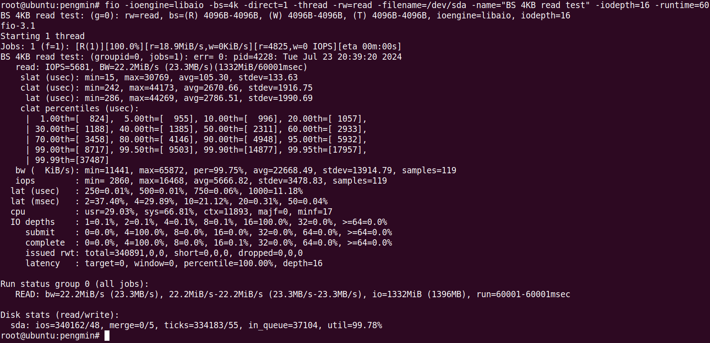

# FIO工具详解

> 参考链接：
>
> [Fio工具详解[强大的IO性能压测工具]](https://blog.csdn.net/henu_student/article/details/127342977)

## 1、FIO压测工具操作

```shell
fio -name=iouring_test -filename=/mnt/vdd/testfile -iodepth=128 -thread -rw=randread -ioengine=io_uring -sqthread_poll=1 -direct=1 -bs=4k -size=10G -numjobs=1 -runtime=120 -group_reporting

```

## 2、常用参数

### [time]

#### `runtime=time`

告诉fio在指定的时间段后终止处理。很难确定指定作业将运行多长时间，因此此参数可以方便的将总运行时间限制为给定时间。当省略单位时间，该数值以秒为单位进行解释。

#### `time_based`

如果设置，即使文件被完全读取或写入，fio也将在指定的运行期间运行。他会在runtime准许时间内多次循环相同的工作负载。

#### `ramp_time=time`

如果设置，fio将在记录任何性能数据之前这段时间内运行指定的工作负载。有助于在记录结果之前，让性能稳定下来，从而最大限度的减少稳定结果所需的运更新的时间。请注意，ramp_time被认为是作业的提前信息，因此如果指定了特殊的超时或者运行时间，他将增加总运行时间。当省略单位时，该值以秒为单位。可以减少日志对高速IO的影响。

### [I/O type]

#### `direct=bool`

是否使用`direct io`，测试过程不使用OS自带的buffer，使测试磁盘的结果更真实。Linux读写的时候，内核维护了缓存，数据线写到缓存，后面在后台写到SSD。读的时候也优先读缓存里的数据。这样速度可以加快，但是一旦掉电，缓存里的数据就没有了。所以有一种模式叫做`direct io`，跳过缓存，直接读写SSD。

#### `rw=randwrite`

测试随机读写的I/O，顺序IO是指读写操作的访问地址顺序连接，顺序的操作磁道搜索时间显著减少，因为磁头可以以最小的移动访问下一块（数据备份和日志记录都是顺序I/O业务）。随机I/O是指读写操作时间连续，但是访问地址不连续，随机分布在磁盘的地址空间中。产生随机I/O的业务有OLTP服务，SQL等。

#### `rwmixwrite=int`

在混合读写模式下，写占用的百分比

### [Blocks size]

#### `bs=int`

单次IO的块文件大小，默认为4K

#### `bsrange=1k-4k,2k-8k,1k-4k`

指定数据块的大小范围，可以为读取、写入和修剪指定逗号分割的范围

#### `size=int`

每个线程读写的数据量

### [Job description]

#### `name=str`

一个任务的名字，重复了也没关系。

#### `numjobs=int`

创建此作业的指定数量的克隆。每个作业克隆都作为一个独立的线程或者进程产生（执行相同工作的进程或者线程）。

#### `filename=str`

测试文件的名称。指定相对路径或者绝对路径，没有的话会自行创建。

### [Threads,processes and job synchronization]

#### `thread`

FIO默认使用fork创建作业，如果给出此选项，将会以`pthread_create(3)`创建作业。使用fork创建线程的开销比较大。

#### `threads=int`

指定线程的数量

### [I/O engine]

#### `ioengine=str`

| str          | 说明                                          |
| ------------ | --------------------------------------------- |
| sync         | 基本的同步读写操作                            |
| psync        | 基于pread或者pwrite进行IO操作                 |
| io_uring     | 快速的Linux原生异步I/O，支持直接和缓冲I/O操作 |
| io_uring_cmd | 用于传递命令的快速Linux本机异步I/O            |
| libaio       | linux异步I/O                                  |

#### `userspace_reap:[libaio]`

通常，在使用libaio引擎的情况下，fio将使用`io_getevents`系统调用来获取新返回的事件。打开此标志后，将直接从客户空间读取AIO环以获取事件。提高异步IO的收割速度。当轮询至少0个事件时候，收割模式才会启动。

### [I/O depth]

#### `iodepth=int`

队列的深度。在异步模式下，CPU不能一直无限的发命令到SSD。比如SSD执行读写如果发生了卡顿，那有可能系统会一直不停的发命令，这样一方面SSD扛不住，另一方面这么多命令会很占内存，系统也要挂掉了。

> 大致把延迟分为两部分，第一部分是读写本身需要的时间ts，第二部分是路上的网络、上下文切换时间tl。
>
> iodepth可降低tl占比，提高ts占比：
>
> * iodepth可以批量提交请求，所以可以降低上下文切换的次数
> * 当ts本身占比很高的时候，那就没有提升的空间了
> * 如果ts占比较低，通过提高iodepth就可以提升iops

### [Buffers and memory]

#### `lockmem=int`

使用`mlock`固定指定数量的内存。可用于模拟较小的内存量，只使用指定内存进行测试。

#### `zero_buffers`

用全零初始化缓冲区。默认值：用随机数据填充缓冲区。

### [Target file/device]

#### `nrfiles=int`

用于此作业文件数，默认为1.除非文件大小明确指定大小，否则文件大小将是数据量除以nrfiles的大小。文件是为每个线程单独创建的。默认情况下，每个文件的名称中都有一个文件编号。

#### `opendir=str`

让fio递归的添加目录下和子目录下的所有文件

### [command line options]

#### `--output=filename`

输出日志信息到指定的文件

#### `--output-format=format`

指定输出文件的格式。将日志格式设置为normal、terse、json或者json+。可以选择多种格式，以逗号分隔。terse是一种基于CSV的格式。json+类似于json，只是他添加了延迟存储桶的完整转储。

### [Measurements and reporting]

#### `group_reporting`

关于显示结果的，汇总每个进程的信息

#### `stats=bool`

默认情况下，fio收集并显示所有运行的作业的最终输出结果。如果此选项设置为0，则fio将在最终统计输出中忽略它

#### `write_bw_log=str`

如果给定，为此作业编写带宽日志。可以用于存储作业在其生命周期内的宽带数据

#### `write_lat_log=str`

与`write_lat_log`相同，只是此选项创建I/O提交（例如，name_salt.x.log）、完成（例如，name_clat.x.log）和总（例如，name_lat.x.log）延迟文件。

#### `write_hist_log=str`

与`write_bw_log`相同，但改为写入I/O完成延迟直方图

## 3、fio压测示例

```shell
#针对io_uring的fixedufs特性
fio -threads=8 -size=10G -name=test -group_reporting -filename=./io.tmp -runtime=60 --ioengine=io_uring --iodepth=512 --fixedbufs 

#针对io_uring的sqthread_poll特性
fio -threads=8 -size=10G -name=test -group_reporting -filename=./io.tmp -runtime=60 --ioengine=io_uring --iodepth=512 --sqthread_poll 1

```

## 4、日志数据说明



| 参数        | 内容                                                         |
| ----------- | ------------------------------------------------------------ |
| bw          | 平均IO带宽                                                   |
| iops        | IOPS                                                         |
| runt        | 线程运行时间                                                 |
| slat        | 提交延迟，提交该IO请求到kernel所花的时间（不包括kernel处理的时间） |
| clat        | 完成延迟，提交该IO请求到kernel后，处理所花的时间             |
| lat         | 响应时间                                                     |
| bw          | 带宽                                                         |
| cpu         | 利用率                                                       |
| IO depths   | io队列                                                       |
| IO submit   | 单个IO提交要提交的IO数                                       |
| IO complete | Like the above submit number, but for completions instead    |
| IO issued   | 发出的读写请求数量，以及数量不足的请求                       |
| IO laency   | IO完成延迟的分布                                             |

| 参数     | 内容                      |
| -------- | ------------------------- |
| aggrb    | group总带宽               |
| minb     | 最小平均带宽              |
| maxb     | 最大平均带宽              |
| mint     | group中线程的最短运行时间 |
| maxt     | group中线程的最长运行时间 |
| ios      | 所有group总共执行的IO数   |
| merge    | 总共发生的IO合并数        |
| ticks    | 磁盘处于繁忙状态的节拍数  |
| io_queue | 花费在队列上的总共时间    |
| util     | 磁盘利用率                |

