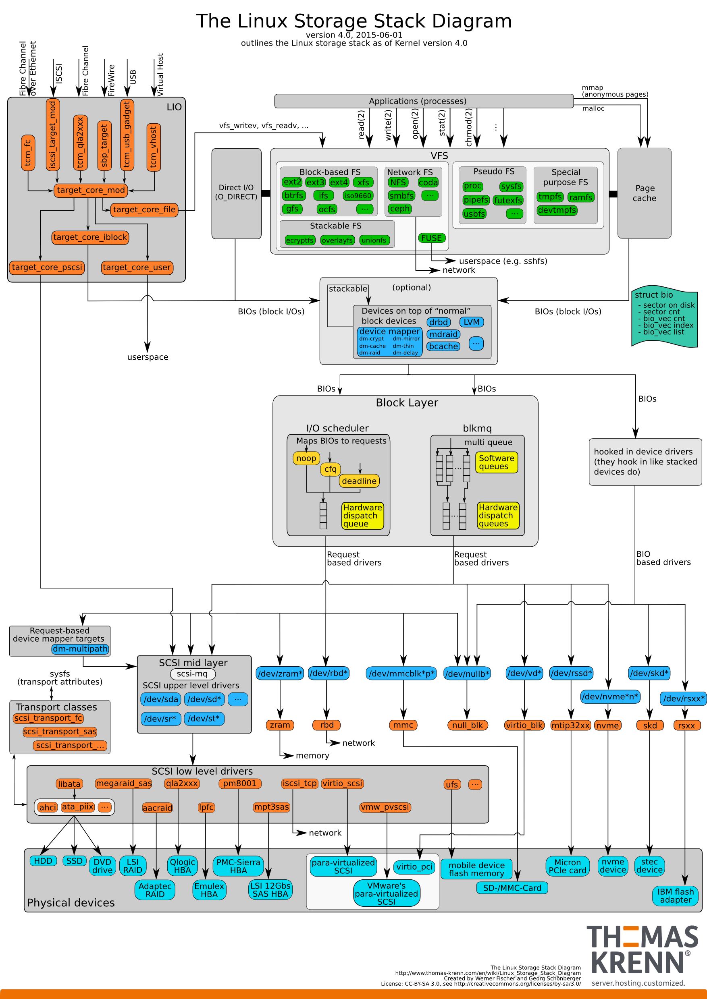
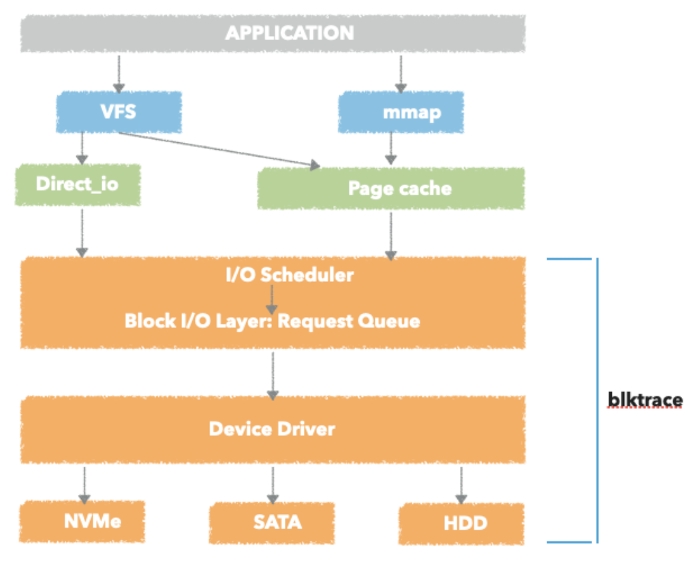
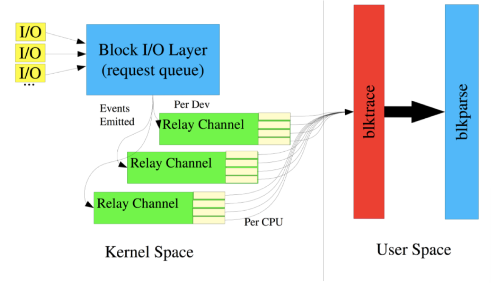
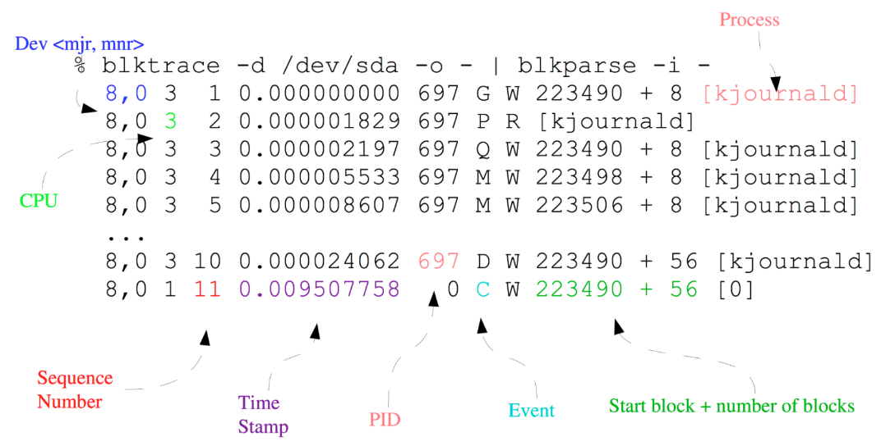

# blktrace工具详解

> [blktrace工具集使用及其实现原理](https://blog.csdn.net/Z_Stand/article/details/116304288)

## Linux内核I/O栈



​	`Linux`内核`I/O`栈分为6层，如下：

* 文件系统层

​	提供了`open()`、`read()`、`write()`等文件操作的系统调用给应用程序使用，并且Linux提供了文件系统的统一抽象`vfs`，使得Linux中可适配各种类型的文件系统，如`ext4`、`btrfs`、`zfs`、`fat32`、`ntfs`等，而我们常说的磁盘格式化，实际上就是在安装文件系统，重新写入相关文件系统的初始元数据信息到磁盘。

* 卷管理层

​	比如我们常听到的`Device Mapper`、`LVM`、`soft raid`就属于这一层，用于将多个磁盘合为一个，或将一个磁盘拆分为多个。

* 块存储层

​	这一层主要实现`io`调度逻辑，比如将一个大`io`请求拆分为多个小的`io`请求，将相邻的`io`请求合并，实现各种`io`调度算法等，常见`io`调度算法有`CFQ`、`NOOP`、`Deadline`、`AS`等。

* 存储驱动层

​	每一个硬件都需要驱动程序，硬盘也不例外，如常听到的`SCSI`、`ACHI`、`NVME`等，且如`/dev/sda`这样的设备抽象文件，也由这一层实现。

* 硬件层

​	硬件层就是具体的硬盘实物了，我们常听到的`ATA`、`SATA`、`SCSI`、`PCIe`、`SAS`等这样的名词，这是不同的硬盘接口规范，就像手机充电线有`Type-A`、`Type-B`、`Type-C`一样。

## blktrace原理

​	`blktrace`是对通用块层（block layer）的`I/O`跟踪机制，它能抓取详细的`I/O`请求（request），发送到用户空间。

​	一个`I/O`请求的处理过程，可以梳理为如下这样一张简单的图：



​	`blktrace`统计的主要是`I/O进入通用块层-->I/O调度层-->块设备驱动层`完成落盘返回的整个过程，上图并未体现通用块层，其实是在`I/O Scheduler`之上的一层`I/O`封装。

* 通用块层：接收`direct_io/page_cache flush`下来的请求，做一层请求封装，一般是4k大小。
* `I/O`调度层：将请求加入调度队列，通过一系列调度算法来调度封装好的`I/O`请求到对应的`device-driver`（sata/nvme/scsi等）。
*  块设备驱动层：这里就是每一个物理块设备封装好的对接自己物理磁盘空间的内核驱动，请求到这里会按照对应设备的逻辑进入到底层物理磁盘中。

​	一个`I/O`请求进入`blkck layer`之后，可能会经历下面的过程：

* `I/O`进入`block`层：

  * Remap：可能被remap到其他设备DM（Device Mapper）或MD（Multiple Device，Software RAID）

  * Split：可能会因为`I/O`请求与扇区边界未对齐，或者size太大等而被拆分成多个物理`I/O`

  * 被添加到请求队列

  * Merge：与队列中的前一个条目合并，所有`I/O`在某个时间点都在请求队列中结束

* `I/O`被发送到设备驱动，并提交给设备
* `I/O`由设备及其驱动程序完成

​	`blktrace`追踪过程大体可以用如下这张官方的图来描述：



## blktrace使用

​	`blktrace`用于采集数据。

```bas
blktrace [-d] [device] [-o] [filename] [-w] [time]vi
```

-d：指定具体的设备名。

-o：生成文件的前缀名，每个CPU都会有一个文件，文件名组成：\<filename\>.blktrace.\<cpu\>，如果不加该参数，则`filename`默认为设备名。

-w：指定时间，如果没有指定时间，则使用`Ctrl+C`中止。

```bash
$ blktrace -d /dev/sda
^C=== sda ===
  CPU  0:                  477 events,       23 KiB data
  CPU  1:                 1089 events,       52 KiB data
  CPU  2:                  216 events,       11 KiB data
  CPU  3:                  122 events,        6 KiB data
  Total:                  1904 events (dropped 0),       90 KiB data
  
$ ls -l *blktrace*
-rw-r--r-- 1 root root 22928 2022-02-12 16:11:37 sda.blktrace.0
-rw-r--r-- 1 root root 52304 2022-02-12 16:11:37 sda.blktrace.1
-rw-r--r-- 1 root root 10408 2022-02-12 16:11:37 sda.blktrace.2
-rw-r--r-- 1 root root  5864 2022-02-12 16:11:37 sda.blktrace.3
```

## blkparse使用

​	`blkparse`用于分析数据，它会把不同`CPU`的`I/O trace`文件合并，并解析、格式化输出为对用户可读友好的`I/O`信息的工具。

```bash
blkparse [-i] [device] [-d] [outfile] [-o] [recordfile]
```

-i：设备名（也可能是前缀名，即`blktrace`指令使用`-o`配置项的名字），一般情况下为sda、sdb、sdc之类，而不是`/dev/sda`。

-d：合并及解析后的输出文件名。

-o：整个过程log输出文件名。如果`blktrace`采集的数据过多，则建议加该参数，否则串口输出log信息很久，不便于btt对合并解析后的文件做进一步解析。

```bash
$ blkparse -i sda
  8,0    3        1     0.000000000 3064475  A   W 367809144 + 8 <- (8,1) 367807096
  8,0    3        2     0.000001498 3064475  Q   W 367809144 + 8 [kworker/u256:3]
  8,0    3        3     0.000013880 3064475  G   W 367809144 + 8 [kworker/u256:3]
  8,0    3        4     0.000016012 3064475  P   N [kworker/u256:3]
  8,0    3        5     0.000025289 3064475  A   W 367809136 + 8 <- (8,1) 367807088
  8,0    3        6     0.000025867 3064475  Q   W 367809136 + 8 [kworker/u256:3]
...
Total (sda):
 Reads Queued:          14,      220KiB  Writes Queued:         299,     1556KiB
 Read Dispatches:       14,      220KiB  Write Dispatches:      213,     1556KiB
 Reads Requeued:         0               Writes Requeued:         0
 Reads Completed:       14,      220KiB  Writes Completed:      213,     1556KiB
 Read Merges:            0,        0KiB  Write Merges:           86,      348KiB
 IO unplugs:            34               Timer unplugs:          39

Throughput (R/W): 4KiB/s / 30KiB/s
Events (sda): 1766 entries
Skips: 0 forward (0 -   0.0%)
```

​	`log`信息说明如下：



第一个字段：设备号，`major device ID`和`minor device ID`。

第二个字段：CPU。

第三个字段：序号。

第四个字段：时间戳。

第五个字段：`PID`本次`IO`对应的进程`ID`。

第六个字段：`Event`，反映了`IO`进行到了哪一步。

第七个字段：R（Read），W（Write），D（Block），B（Barrier Operation）。

第八个字段：`offset`和`size`。

第九个字段：进程名。

​	其中第六个字段非常有用，每一个字母代表了`I/O`请求经历的某个阶段：

```less
Q – 即将生成 I/O 请求  
|
G – I/O 请求生成
|
I – I/O 请求进入 I/O Scheduler 队列
|
D – I/O 请求进入 Driver
|
C – I/O 请求执行完毕
```

​	由于每个`Event`都有出现的时间戳，根据这个时间戳就可以计算出`I/O`请求在每个阶段所消耗的时间，常见阶段如下：

```less
 Q------->G------------>I--------->M------------------->D----------------------------->C
 |-Q time-|-Insert time-|
 |--------- merge time ------------|-merge with other IO|
 |----------------scheduler time time-------------------|---driver,adapter,storagetime--|
 
 |----------------------- await time in iostat output ----------------------------------|
```

Q2Q：发送到`block layer`的请求之间的时间，即2个`I/O`请求间隔的时间。

Q2G：从`block I/O`排队到获得分配给它的请求的时间，即生成`I/O`请求所消耗的时间。

G2I：从请求被分配到它被插入设备队列的时间，即`I/O`请求进入`I/O Scheduler`所消耗的时间。

Q2M：从`block I/O`排队到与现有请求合并的时间

I2D：从请求被插入设备队列到实际向设备发出请求的时间，即`I/O`请求在`I/O Scheduler`中等待的时间，可以作为`I/O Scheduler`性能的指标

M2D：从`block I/O`与现有请求合并到向设备发出请求的时间

D2C：设备请求的服务时间，`I/O`请求在驱动和硬件上所消耗的时间，可以作为硬件性能的指标

Q2C：请求在`block layer`中花费的总时间，即整个`I/O`请求所消耗的时间

​	以上各个阶段所消耗的时间，实际上只有在使用`btt`指令对`blkparce`合并解析后的文件做进一步解析后才能看到。后续笔者将介绍`btt`指令。

## btt使用

```bash
# 先合并为一个文件
$ blkparse -i sda -d sda.blktrace.bin -o recordfile.txt

# 使用btt分析sda.blktrace.bin
$ btt -i sda.blktrace.bin
==================== All Devices ====================

            ALL           MIN           AVG           MAX           N
--------------- ------------- ------------- ------------- -----------

Q2Q               0.000000410   0.165743313   5.193234517         312
Q2G               0.000000297   0.000169175   0.004261675         227
G2I               0.000000341   0.000023664   0.000284838         225
Q2M               0.000000108   0.000000336   0.000002798          86
I2D               0.000000716   0.000708445   0.003329311         227
M2D               0.000004063   0.000106955   0.000737934          84
D2C               0.000111877   0.000718769   0.004067916         313
Q2C               0.000134521   0.001402772   0.008234969         313

==================== Device Overhead ====================

       DEV |       Q2G       G2I       Q2M       I2D       D2C
---------- | --------- --------- --------- --------- ---------
 (  8,  0) |   8.7464%   1.2126%   0.0066%  36.6269%  51.2391%
---------- | --------- --------- --------- --------- ---------
   Overall |   8.7464%   1.2126%   0.0066%  36.6269%  51.2391%

==================== Device Merge Information ====================

       DEV |       #Q       #D   Ratio |   BLKmin   BLKavg   BLKmax    Total
---------- | -------- -------- ------- | -------- -------- -------- --------
 (  8,  0) |      313      227     1.4 |        8       15      200     3552

==================== Device Q2Q Seek Information ====================

       DEV |          NSEEKS            MEAN          MEDIAN | MODE
---------- | --------------- --------------- --------------- | ---------------
 (  8,  0) |             313      24620107.8               0 | 0(94)
---------- | --------------- --------------- --------------- | ---------------
   Overall |          NSEEKS            MEAN          MEDIAN | MODE
   Average |             313      24620107.8               0 | 0(94)

==================== Device D2D Seek Information ====================

       DEV |          NSEEKS            MEAN          MEDIAN | MODE
---------- | --------------- --------------- --------------- | ---------------
 (  8,  0) |             227      35300234.0               0 | 0(10) 8
---------- | --------------- --------------- --------------- | ---------------
   Overall |          NSEEKS            MEAN          MEDIAN | MODE
   Average |             227      35300234.0               0 | 0(10)
                                                               ...(more)
```


`blktrace`启动追踪的时候会让每一个CPU（每一个请求都是由对应的CPU来调度处理的）绑定一个`relay-channel`，通过`ioctl`下发的触发信息会让内核将每一个请求的信息通过`trace`函数添加到`relay-channel`对应的`trace`文件，当`blktrace`停止追踪时会告知内核将`relay-flush`每一个`relay-channel`，将`trace`文件信息拷贝到用户态。

​	那么`blktrace`是如何从外部获取到这一些请求的信息呢？下面将对该问题做详细解释，说明`blktrace`这个外部工具如何在不影响内核`I/O`性能的情况下拿到这一些`I/O`请求的详细信息的。