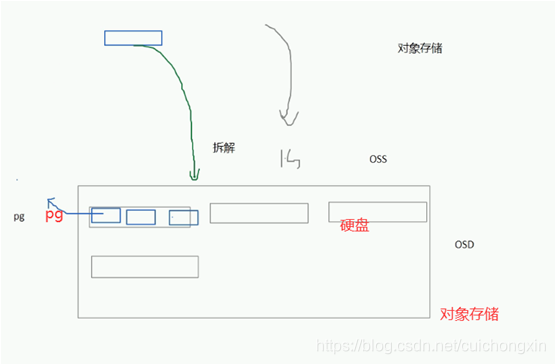
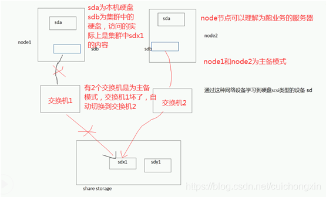
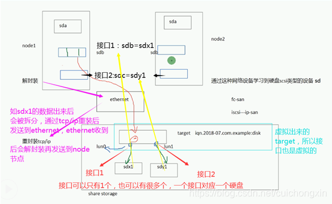
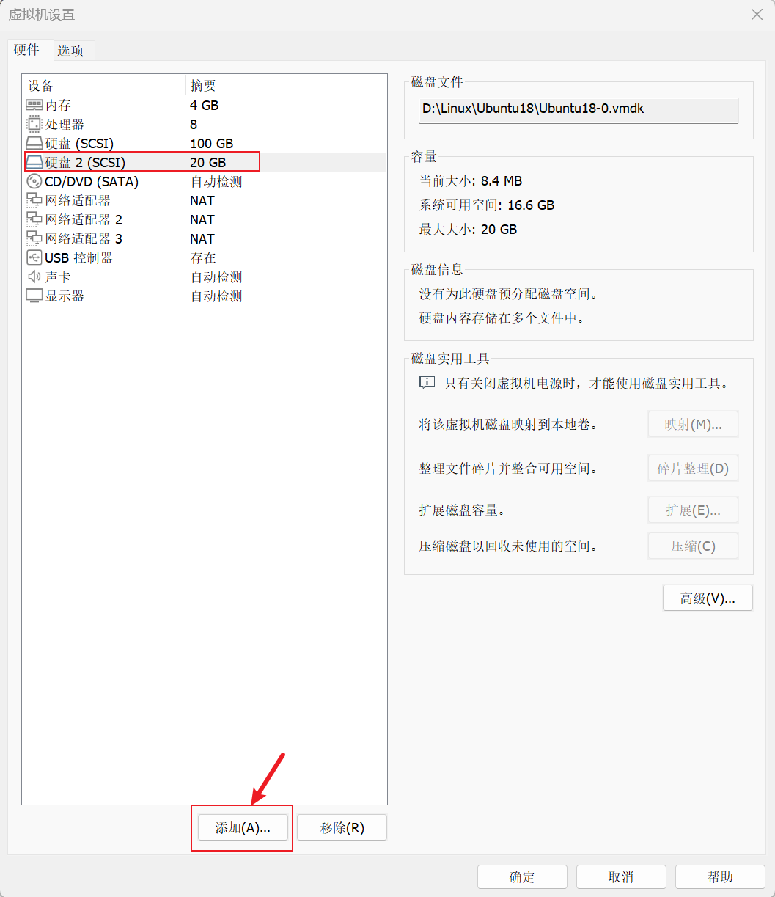
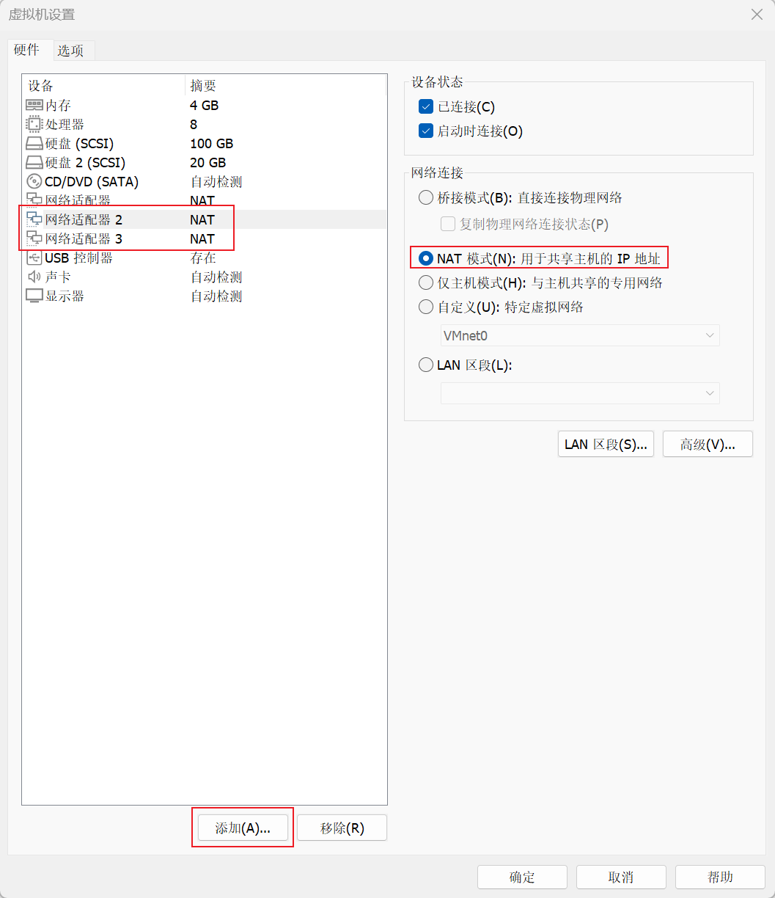
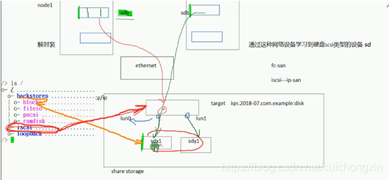

# `iscsi`存储搭建

> 参考链接：
>
> [Linux运维篇-iscsi存储搭建](https://blog.csdn.net/qq_52494169/article/details/143799423?ops_request_misc=%257B%2522request%255Fid%2522%253A%2522dd138dc3f972273a217c9044161216fd%2522%252C%2522scm%2522%253A%252220140713.130102334.pc%255Fblog.%2522%257D&request_id=dd138dc3f972273a217c9044161216fd&biz_id=0&utm_medium=distribute.pc_search_result.none-task-blog-2~blog~first_rank_ecpm_v1~rank_v31_ecpm-1-143799423-null-null.nonecase&utm_term=iscsi&spm=1018.2226.3001.4450)
>
> [Redhat平台配置iscsi共享](https://blog.csdn.net/lucky_ykcul/article/details/102574637)
>
> [](https://blog.csdn.net/cuichongxin/article/details/103982207)

## 概念

​	`iscsi`是一种在`internet`协议上，特别是以太网上进行数据块传输的标准，它是一种基于`IP Storage`理论的存储技术，该技术是将存储行业广泛应用的`scsi`接口技术与`IP`网络技术相结合，可以在`IP`网络上构建`SAN`存储区域网，简单地说，`iscsi`就是在`IP`网络上运行`scsi`协议的一种网络存储技术。

### `iscsi`的作用

​	基于客户端和服务端架构的虚拟磁盘技术，服务端提供磁盘空间，客户端连接并且可以当成本地磁盘来用。

### `iscsi`磁盘的构成

- backstore 后端存储：对应到服务端提供实际存储空间的设备，需要起一个管理名称。
- target 磁盘组：是客户端的访问目标，作为一个框架，由多个lun组成。
- lun 逻辑单元：每一个lun需要关联到某一个后端存储设备，在客户端会视为一块虚拟硬盘

​	简单来说共享存储如同其名字所隐喻的，是物理存储器中一段可由两个以上的进程共享的存储空间。共享存储段具有大小和物理存储地址。想要访问共享存储段的进程可以连接这段存储区域到自己的地址空间中任何适合的地方，其他进程也一样。这样，多个进程便可以访问相同的物理存储


存储类型分为3大类：文件存储 、块存储 、对象存储
1、文件存储类似于我们共享一个文件夹
NFS/SAMBA/ftp
NAS-网络区域存储
2、块存储： 把一个硬盘/分区 直接 给你共享出去
fs
iscsi
SAN—存储区域网
DAS—直接附加存储（性能低下）
3、对象存储： 给你一个很大的空间，但这个空间是由很多硬盘组成的（这些硬盘不一定是一个机器上的），其中一个硬盘可以理解为一个osd，每个osd又由很多pg组成，如现在需要读取（或写入）1G的信息，其中每个osd有200M，这样读取速度就会很快。



组成集群的每个服务器–称之为 节点（node）
集群是由若干存储服务器组成（只有系统和硬盘，加入集群中）

利用交换机使用集群
下图node1和node2是主备模式，node1坏了自动切换到node2，node1和node2中的sdb盘的内容都是集群中的sdb1盘里的内容，所以node1坏了数据并不会丢失，也可以配置成 高性能模式（双活），高性能的集群可以理解为“读写分离”，其本质是将访问压力分散到集群中的多个节点，但是没有分散存储压力。



利用网络使用集群
交换机很贵 一个也要几十上百万，所以 一般小企业是不会用交换机作为中转的，而是用网络
在node节点上看到的实际上和本地硬盘一模一样，也和本地硬盘一样的正常使用，但实际数据是存放在集群中的。
比如在node1上给sdb硬盘分区，被分区的硬盘实际是集群中的硬盘，因为node2和node1都是共享集群中的硬盘，所以在node1上分区硬盘后，node2上看到的硬盘也被分区了，所以需要分区硬盘只需要在一个节点上执行，如果node1上分区了再去node2上分区，会损坏磁盘数据。



## 实验介绍

​	使用`iscsi`共享存储来模拟存储实际挂载到操作系统中的情况，我这里使用两张网卡模拟两条路径的存储挂载。

| IP                             | 用途                               |
| ------------------------------ | ---------------------------------- |
| 192.168.31.160，192.168.31.158 | 存储端IP，使用两个IP模拟多路径挂载 |
| 192.168.31.157                 | 客户端IP                           |

### 环境准备

​	一共需要两台虚拟机，一台用作存储端，另一台用作客户端。

​	存储端需要两张网卡，一块磁盘做共享存储；客户端需要一张网卡。

#### 存储端

##### 添加硬盘

​	打开虚拟机设置，添加新的磁盘，如下图所示：



​	添加完磁盘后，启动虚拟机，进入系统后对该硬盘做分区和格式化操作，如下：

```bash
# lsblk
NAME	MAJ:MIN	RM	SIZE	RO	TYPE	MOUNTPOINT
sda		  8:0	 0	100G	 0	disk
⨽sda1	  8:1	 0	100G	 0	part	/
sdb		  8:16	 0	 20G	 0	disk
# fdisk /dev/sdb
Welcome to fdisk (util-linux 2.31.1).
Changes will remain in memory only, until you decide to write them.
Be careful before using the write command.

Device does not contain a recognized partition table.
Created a new DOS disklabel with disk identifier 0x7e8b0fcf.

Command (m for help): n ('做分区')
Partition type
   p   primary (0 primary, 0 extended, 4 free)
   e   extended (container for logical partitions)
Select (default p): ('回车')

Using default response p.
Partition number (1-4, default 1): ('回车')
First sector (2048-41943039, default 2048): ('回车')
Last sector, +sectors or +size{K,M,G,T,P} (2048-41943039, default 41943039): 

Created a new partition 1 of type 'Linux' and of size 20 GiB.

Command (m for help): w('保存')
The partition table has been altered.
Calling ioctl() to re-read partition table.
Syncing disks.
# lsblk
NAME	MAJ:MIN	RM	SIZE	RO	TYPE	MOUNTPOINT
sda		  8:0	 0	100G	 0	disk
⨽sda1	  8:1	 0	100G	 0	part	/
sdb		  8:16	 0	 20G	 0	disk
⨽sdb1	  8:17	 0	 20G	 0	part
# mkfs.ext4 /dev/sdb1
mke2fs 1.44.1 (24-Mar-2018)
Creating filesystem with 5242624 4k blocks and 1310720 inodes
Filesystem UUID: 91fac941-cc2a-4b16-80f7-77a45e7843c3
Superblock backups stored on blocks: 
	32768, 98304, 163840, 229376, 294912, 819200, 884736, 1605632, 2654208, 
	4096000

Allocating group tables: done                            
Writing inode tables: done                            
Creating journal (32768 blocks): done
Writing superblocks and filesystem accounting information: done
```

​	建议挂载一下该硬盘并在其中添加一些文本文件，以便后续测试客户端连接到该硬盘时，能否获取到其中的文件。

##### 添加网卡

​	打开虚拟机设置，添加新的网卡，如下图所示：



​	添加完网卡后，启动虚拟机，进入系统后使用`ifconfig`指令查看`IP`地址，如下：

```bash
# ifconfig
ens33: flags=4163<UP,BROADCAST,RUNNING,MULTICAST>  mtu 1500
        inet 192.168.31.170  netmask 255.255.255.0  broadcast 192.168.31.255
        inet6 fe80::87e2:7284:fb14:68f4  prefixlen 64  scopeid 0x20<link>
        ether 00:0c:29:fd:08:87  txqueuelen 1000  (Ethernet)
        RX packets 833  bytes 583062 (583.0 KB)
        RX errors 0  dropped 0  overruns 0  frame 0
        TX packets 427  bytes 65984 (65.9 KB)
        TX errors 0  dropped 0 overruns 0  carrier 0  collisions 0

ens38: flags=4163<UP,BROADCAST,RUNNING,MULTICAST>  mtu 1500
        inet 192.168.31.160  netmask 255.255.255.0  broadcast 192.168.31.255
        inet6 fe80::a99c:c844:3c9f:1379  prefixlen 64  scopeid 0x20<link>
        ether 00:0c:29:fd:08:91  txqueuelen 1000  (Ethernet)
        RX packets 288  bytes 40869 (40.8 KB)
        RX errors 0  dropped 0  overruns 0  frame 0
        TX packets 87  bytes 8543 (8.5 KB)
        TX errors 0  dropped 0 overruns 0  carrier 0  collisions 0

ens39: flags=4163<UP,BROADCAST,RUNNING,MULTICAST>  mtu 1500
        inet 192.168.31.158  netmask 255.255.255.0  broadcast 192.168.31.255
        inet6 fe80::6ffd:1582:1527:c52a  prefixlen 64  scopeid 0x20<link>
        ether 00:0c:29:fd:08:9b  txqueuelen 1000  (Ethernet)
        RX packets 273  bytes 38859 (38.8 KB)
        RX errors 0  dropped 0  overruns 0  frame 0
        TX packets 77  bytes 7929 (7.9 KB)
        TX errors 0  dropped 0 overruns 0  carrier 0  collisions 0

lo: flags=73<UP,LOOPBACK,RUNNING>  mtu 65536
        inet 127.0.0.1  netmask 255.0.0.0
        inet6 ::1  prefixlen 128  scopeid 0x10<host>
        loop  txqueuelen 1000  (Local Loopback)
        RX packets 227  bytes 19258 (19.2 KB)
        RX errors 0  dropped 0  overruns 0  frame 0
        TX packets 227  bytes 19258 (19.2 KB)
        TX errors 0  dropped 0 overruns 0  carrier 0  collisions 0
```

##### 使用`targetcli`来管理`iscsi`共享存储

​	首先安装必要的软件包，并启动`tgt`服务。

```bash
# apt-get install tgt targetcli-fb
# systemctl start tgt
# systemctl enable tgt
```

​	然后使用`targetcli`命令进入交互模式，修改服务端配置信息。



```bash
# targetcli 
targetcli shell version 2.1.fb43
Copyright 2011-2013 by Datera, Inc and others.
For help on commands, type 'help'.

/> ls
o- / ......................................................................................................................... [...]
  o- backstores .............................................................................................................. [...]
  | o- block .................................................................................................. [Storage Objects: 0]
  | o- fileio ................................................................................................. [Storage Objects: 0]
  | o- pscsi .................................................................................................. [Storage Objects: 0]
  | o- ramdisk ................................................................................................ [Storage Objects: 0]
  o- iscsi ............................................................................................................ [Targets: 0]
  o- loopback ......................................................................................................... [Targets: 0]
  o- vhost ............................................................................................................ [Targets: 0]
/> backstores/block create dev=/dev/sdb1 name=lun0
Created block storage object lun0 using /dev/sdb1.
/> ls
o- / ......................................................................................................................... [...]
  o- backstores .............................................................................................................. [...]
  | o- block .................................................................................................. [Storage Objects: 1]
  | | o- lun0 ......................................................................... [/dev/sdb1 (20.0GiB) write-thru deactivated]
  | o- fileio ................................................................................................. [Storage Objects: 0]
  | o- pscsi .................................................................................................. [Storage Objects: 0]
  | o- ramdisk ................................................................................................ [Storage Objects: 0]
  o- iscsi ............................................................................................................ [Targets: 0]
  o- loopback ......................................................................................................... [Targets: 0]
  o- vhost ............................................................................................................ [Targets: 0]
/> iscsi/ create 
Created target iqn.2003-01.org.linux-iscsi.ubuntu.x8664:sn.6b0f08450851.
Created TPG 1.
Default portal not created, TPGs within a target cannot share ip:port.
/> ls
o- / ......................................................................................................................... [...]
  o- backstores .............................................................................................................. [...]
  | o- block .................................................................................................. [Storage Objects: 1]
  | | o- lun0 ......................................................................... [/dev/sdb1 (20.0GiB) write-thru deactivated]
  | o- fileio ................................................................................................. [Storage Objects: 0]
  | o- pscsi .................................................................................................. [Storage Objects: 0]
  | o- ramdisk ................................................................................................ [Storage Objects: 0]
  o- iscsi ............................................................................................................ [Targets: 1]
  | o- iqn.2003-01.org.linux-iscsi.ubuntu.x8664:sn.6b0f08450851 .......................................................... [TPGs: 1]
  |   o- tpg1 ............................................................................................... [no-gen-acls, no-auth]
  |     o- acls .......................................................................................................... [ACLs: 0]
  |     o- luns .......................................................................................................... [LUNs: 0]
  |     o- portals .................................................................................................... [Portals: 0]
  o- loopback ......................................................................................................... [Targets: 0]
  o- vhost ............................................................................................................ [Targets: 0]
/> cd iscsi/iqn.2003-01.org.linux-iscsi.ubuntu.x8664:sn.6b0f08450851/tpg1/
/iscsi/iqn.20...08450851/tpg1> luns/ create /backstores/block/lun0 lun=lun0
Created LUN 0.
/iscsi/iqn.20...08450851/tpg1> acls/ create iqn.2003-01.org.linux-iscsi.ubuntu.x8664:sn.6b0f08450851
Created Node ACL for iqn.2003-01.org.linux-iscsi.ubuntu.x8664:sn.6b0f08450851
Created mapped LUN 0.
/iscsi/iqn.20...08450851/tpg1> set attribute generate_node_acls=1
Parameter generate_node_acls is now '1'.
/iscsi/iqn.20...08450851/tpg1> portals/ create 192.168.31.158 20
Created network portal 192.168.31.158:20.
/iscsi/iqn.20...08450851/tpg1> portals/ create 192.168.31.160 20
Created network portal 192.168.31.160:20.
/iscsi/iqn.20...08450851/tpg1> ls
o- tpg1 ........................................................................................................ [gen-acls, no-auth]
  o- acls ................................................................................................................ [ACLs: 1]
  | o- iqn.2003-01.org.linux-iscsi.ubuntu.x8664:sn.6b0f08450851 ................................................... [Mapped LUNs: 1]
  |   o- mapped_lun0 ........................................................................................ [lun0 block/lun0 (rw)]
  o- luns ................................................................................................................ [LUNs: 1]
  | o- lun0 ............................................................................................... [block/lun0 (/dev/sdb1)]
  o- portals .......................................................................................................... [Portals: 2]
    o- 192.168.31.158:20 ...................................................................................................... [OK]
    o- 192.168.31.160:20 ...................................................................................................... [OK]
/iscsi/iqn.20...08450851/tpg1>cd ../../../
/>ls
o- / ......................................................................................................................... [...]
  o- backstores .............................................................................................................. [...]
  | o- block .................................................................................................. [Storage Objects: 1]
  | | o- lun0 ........................................................................... [/dev/sdb1 (20.0GiB) write-thru activated]
  | o- fileio ................................................................................................. [Storage Objects: 0]
  | o- pscsi .................................................................................................. [Storage Objects: 0]
  | o- ramdisk ................................................................................................ [Storage Objects: 0]
  o- iscsi ............................................................................................................ [Targets: 1]
  | o- iqn.2003-01.org.linux-iscsi.ubuntu.x8664:sn.6b0f08450851 .......................................................... [TPGs: 1]
  |   o- tpg1 .................................................................................................. [gen-acls, no-auth]
  |     o- acls .......................................................................................................... [ACLs: 1]
  |     | o- iqn.2003-01.org.linux-iscsi.ubuntu.x8664:sn.6b0f08450851 ............................................. [Mapped LUNs: 1]
  |     |   o- mapped_lun0 .................................................................................. [lun0 block/lun0 (rw)]
  |     o- luns .......................................................................................................... [LUNs: 1]
  |     | o- lun0 ......................................................................................... [block/lun0 (/dev/sdb1)]
  |     o- portals .................................................................................................... [Portals: 2]
  |       o- 192.168.31.158:20 ................................................................................................ [OK]
  |       o- 192.168.31.160:20 ................................................................................................ [OK]
  o- loopback ......................................................................................................... [Targets: 0]
  o- vhost ............................................................................................................ [Targets: 0]
/>exit
Global pref auto_save_on_exit=true
Last 10 configs saved in /etc/rtslib-fb-target/backup.
Configuration saved to /etc/rtslib-fb-target/saveconfig.json
```

> 需要注意如下事项：
>
> 1、使用`iscsi/ create`指令创建`iscsi target`时，会自动生成其名称，当然也可以自行命名，不过其命名有规范，建议还是使用自动生成的名称。
>
> 2、`iscsi target`的名称与`acls`下的名称是一样的，有些博客中这两个名称不一样，笔者怀疑是其作者写错了，为此还困惑了笔者许久。
>
> 3、`portals`下的`IP`为本服务端的`IP`地址，端口号如果未指定则默认使用3260，而且很多博客中都是使用该端口号，但是笔者发现3260端口号在笔者的虚拟机上无法正常创建，而端口号20是可以正常使用的。为此耗费了笔者许多时间。
>
> 4、使用`backstores/block create dev=/dev/sdb1 name=lun0`指令之后，就无法再在服务端挂载上`/dev/sdb1`设备，除非使用`backstores/block delete lun0`指令删除之前创建的`lun0`之后，才能重新在服务端挂载`/dev/sdb1`设备。其它分支的删除指令类似。

​	至此，服务端的配置就完成了。

​	如果所有配置均无误，但是客户端还是无法访问到服务端的硬盘，可能是防火墙未关闭。可以在客户端使用`telnet [IP]`指令访问服务端，查看是否能访问成功，如果不能，则关闭防火墙后重新测试。

```bash
/* 关闭firewalld */
/* 临时关闭 */
# systemctl stop firewalld
/* 永久关闭 */
# systemctl disable firewalld

/* 关闭selinux */
/* 临时关闭 */
# setenforce 0
/* 永久关闭，修改SELINUX=disable即可（笔者虚拟机中未找到该文件） */
# vim /etc/sysconfig/selinux
```

#### 客户端

​	首先安装`open-iscsi`软件包，修改`iscsi`配置后启用。

```bash
# apt-get install open-iscsi

/* 修改InitiatorName值为服务端创建的iscsi target名字 */
# vim /etc/iscsi/initiatorname.iscsi
InitiatorName=iqn.2003-01.org.linux-iscsi.ubuntu.x8664:sn.6b0f08450851

# systemctl restart iscsi
# systemctl enable iscsi
```

​	然后扫描`iscsi`服务端的存储资源。

```bash
# iscsiadm -m discovery -t st -p 192.168.31.158:20
192.168.31.158:20,1 iqn.2003-01.org.linux-iscsi.ubuntu.x8664:sn.6b0f08450851
192.168.31.160:20,1 iqn.2003-01.org.linux-iscsi.ubuntu.x8664:sn.6b0f08450851
# iscsiadm -m node -l
Logging in to [iface: default, target: iqn.2003-01.org.linux-iscsi.ubuntu.x8664:sn.6b0f08450851, portal: 192.168.31.160,20]
Logging in to [iface: default, target: iqn.2003-01.org.linux-iscsi.ubuntu.x8664:sn.6b0f08450851, portal: 192.168.31.158,20]
Login to [iface: default, target: iqn.2003-01.org.linux-iscsi.ubuntu.x8664:sn.6b0f08450851, portal: 192.168.31.160,20] successful.
Login to [iface: default, target: iqn.2003-01.org.linux-iscsi.ubuntu.x8664:sn.6b0f08450851, portal: 192.168.31.158,20] successful.
# lsblk
NAME	MAJ:MIN	RM	SIZE	RO	TYPE	MOUNTPOINT
sda		  8:0	 0	 40G	 0	disk
⨽sda1	  8:1	 0	 40G	 0	part	/
sdb		  8:16	 0	 20G	 0	disk
⨽mpathc	253:0	 0	 20G	 0	mpath	/media/pm/91fac941-cc2a-4b16-80f7-77a45e7843c3
sdc		  8:32	 0	 20G	 0	disk
⨽mpathc	253:0	 0	 20G	 0	mpath	/media/pm/91fac941-cc2a-4b16-80f7-77a45e7843c3
```

