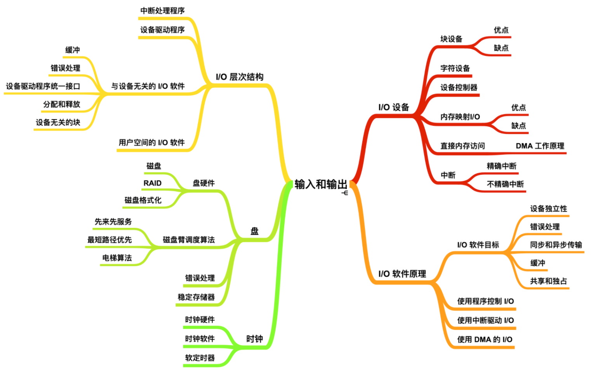
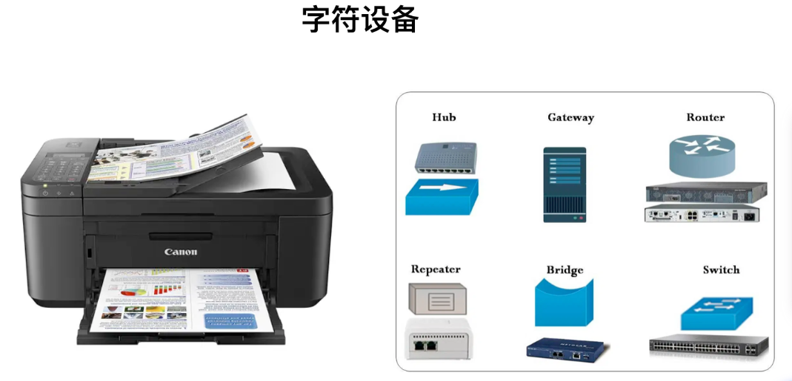
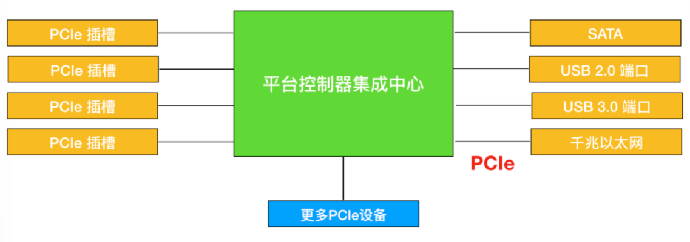
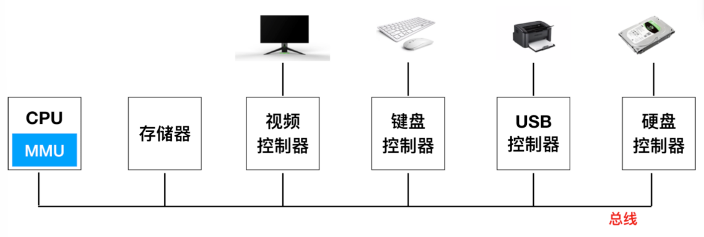
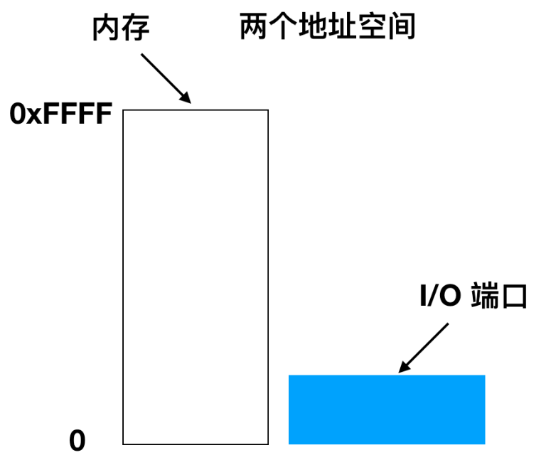

# 操作系统`I/O`全流程详解

> 原文链接：
>
> [操作系统I/O全流程详解](https://www.cnblogs.com/cxuanBlog/p/13156493.html)



​	操作系统有三个抽象——进程、地址空间、文件，除此之外，操作系统还要控制所有的`I/O`设备。操作系统必须向设备发送命令、捕捉中断并处理错误。它还应该在设备和操作系统的其余部分之间提供一个简单易用的接口。操作系统如何管理`I/O`是我们接下来的重点。

​	不同的人对`I/O`硬件的理解也不同。对于电子工程师而言，`I/O`硬件就是芯片、导线、电源和其他组成硬件的物理设备。而我们程序员眼中的`I/O`其实就是硬件提供给软件的接口，比如硬件接受到的命令、执行的操作以及反馈的错误。我们着重探讨的是如何对硬件进行编程，而不是其工作原理。

## `I/O`设备

​	`I/O`设备又叫做输入/输出设备，它是人类用来和计算机进行通信的外部硬件。输入/输出设备能够向计算机发送数据（输出）并从计算机接收数据（输入）。`I/O`设备可以分成两种：块设备和字符设备。

### 块设备

​	块设备是一个能存储固定大小块信息的设备，它支持以固定大小的块、扇区或群集读取和写入数据。每个块都有自己的物理地址。通常块的大小在512-65536之间。所有传输的信息都以连续的块为单位。块设备的基本特征是每个块都较为对立，能够独立的进行读写。常见的块设备有硬盘、蓝光光盘、`USB`盘。

​	与字符设备相比，块设备通常需要较少的引脚。


#### 块设备的缺点

​	基于给定固态存储器的块设备比基于相同类型的存储器的字节寻址要慢一些，因为必须在块的开头开始读取或写入。所以，要读取该块的任何部分，必须寻找到该块的开始，读取整个块，如果不使用该块，则将其丢弃。要写入块的一部分，必须寻找到块的开始，将整个块读入内存，修改数据，再次寻找到块的开头处，然后将整个块写回设备。

### 字符设备

​	字符设备以字符为单位发送或接收一个字符流，而不考虑任何块结构。字符设备是不可寻址的，也没有任何寻道操作。常见的字符设备有打印机、网络设备、鼠标以及大多数与磁盘不同的设备。



### 常见设备数据速率

| Device                                   | Data rate      |
| ---------------------------------------- | -------------- |
| `Keyboard`（键盘）                       | 10`bytes/sec`  |
| `Mouse`（鼠标）                          | 100`bytes/sec` |
| `56K modem`（56K调制解调器）             | 7`KB/sec`      |
| `Scanner at 300 dpi`（`300dpi`扫描仪）   | 1`MB/sec`      |
| `Digital camcorde`（数据便携式摄像机）   | 3.5`MB/sec`    |
| `4x Blu-ray disc`（4倍蓝光光盘）         | 18`MB/sec`     |
| `802.11n Wireless`（``802.11n`无线）     | 37.5`MB/sec`   |
| `USB 2.0`                                | 60`MB/sec`     |
| `FireWire 800`（火线800）                | 100`MB/sec`    |
| `Gigabit Ethernet`（千兆以太网）         | 125`MB/sec`    |
| `SATA 3disk drive`（`SATA 3`磁盘驱动）   | 300`MB/sec`    |
| `USB 3.0`                                | 625`MB/sec`    |
| `SCSI Ultra 5 bus`（`SCSI Ultra 5`总线） | 640`MB/sec`    |
| `Single-lane PCIe 3.0 bus`               | 985`MB/sec`    |
| `Thunderbolt 2 bus`                      | 2.5`GB/sec`    |
| `SONET OC-768 network`                   | 5`GB/sec`      |

### 设备控制器

​	设备控制器是处理`CPU`传入和传出信号的系统。设备通过插头和插座连接到计算机，并且插座连接到设备控制器。设备控制器从连接的设备处接收数据，并将其存储在控制器内部的一些特殊目的存储器，也就是本地缓冲区中。

> 特殊用途存储器，顾名思义就是仅为一项任务而设计的寄存器，例如：`cs`、`ds`、`gs`和其他段寄存器属于特殊目的寄存器，因为它们的存在是为了保存段号。`eax`、`ecx`等是一般用途寄存器，因为你可以无限制地使用它们。例如，你不能移动`ds`，但是可以移动`eax`、`ebx`。
>
> 通用目的寄存器比如有：`eax`、`ebx`、`ecx`、`edx`、`esi`、`edi`、`ebp`、`esp`
>
> 特殊目的寄存器比如有：`cs`、`ds`、`ss`、`es`、`fs`、`gs`、`eip`、`flag`

​	每个设备控制器都会有一个应用程序与之对应，设备控制器通过应用程序的接口通过中断与操作系统进行通信。设备控制器是硬件而设备驱动程序是软件。

​	`I/O`设备通常由机械组件（`mechanical component`）和电子组件（`electronic component`）构成。电子组件被称为设备控制器的适配器（`adapter`）。在个人计算机上，它通常采用可插入（`PCIe`）扩展插槽的主板上的芯片或印刷电路卡的形式。

​	电子组件组成如下：



​	机械组件组成如下：



​	控制器卡上通常会有一个连接器，通向设备本身的电缆可以插入到这个连接器中，很多控制器可以操作多个相同的设备。

​	控制器与设备之间的接口通常是一个低层次的接口。例如，磁盘可能被格式化为`2,000,000`个扇区，每个磁道512字节。然而，实际从驱动出来的却是一个串行的比特流，从一个前导符开始，然后是一个扇区中的4096位，最后是一个校验和或`ECC`错误校验码。前导符是在对磁盘进行格式化的时候写上去的，它包括柱面数、扇区号、扇区大小以及类似的数据，此外还包含同步信息。

​	控制器的任务是把串行的位流转换为字节块，并进行必要的错误校正工作。字节块通常会在控制器内部的一个缓冲区按位进行组装，然后再对校验和进行校验并证明字节块没有错误后，再将它复制到内存中。

### 内存映射`I/O`

​	每个控制器都会有几个寄存器用来和`CPU`进行通信。通过写入这些寄存器，操作系统可以命令设备发送数据，接收数据，开启或关闭设备等。通过从这些寄存器中读取信息，操作系统能够知道设备的状态，是否准备接受一个新命令等。

​	为了控制寄存器，许多设备都会有数据缓冲区，来供系统进行读写。例如，在屏幕上显示一个像素的常规方法是使用一个视频`RAM`，这一`RAM`基本上只是一个数据缓冲区，用来供程序和操作系统写入数据。

​	那么问题来了，`CPU`如何与设备寄存器和设备数据缓冲区进行通信呢？存在两个可选的方式。第一种方法是，每个控制器寄存器都被分配一个`I/O`端口号，这是一个8位或16位的整数。所有`I/O`端口的集合形成了受保护的`I/O`端口空间，以便普通用户程序无法访问它。使用特殊的`I/O`指令像是：

```
/* cpu读取PORT寄存器内容并存放在REG寄存器中 */
IN REG, PORT

/* CPU将REG内容写到PORT寄存器中 */
OUT PORT, REG
```

​	大多数早期计算机，包括几乎所有大型主机，如`IBM 360`及其所有后续机型，都是以这种方式工作的。

> 控制器寄存器是一个处理器寄存器而改变或控制的一般行为`CPU`或其他数字设备。控制寄存器执行的常见任务包括中断控制，切换寻址模式，分页控制和协处理器控制。

​	在这一方案中，内存地址空间和`I/O`地址空间是不相同的，如下图所示：



```
/* 下面指令中的4代表不同且不相关的地址空间 */
/* 读取IO端口4的内容并将其放入R0 */
IN R0,4

/* 读取存储器字4的内容并将其放入R0 */
MOV R0,4
```

​	内存映射的`I/O`是在`CPU`与其连接的外围设备之间交换数据和指令的一种方式，这种方式是处理器和`I/O`设备共享同一内存位置的内存，即处理器和`I/O`设备使用内存地址进行映射。

​	在大多数操作系统中，分配给控制寄存器的地址位于或靠近地址的顶部附近

​	当`CPU`想要读入一个字的时候，无论是从内存中读入还是从`I/O`端口读入，它都要将需要的地址放到总线地址线上，然后在总线的一条控制线上调用一个`READ`信号。还有第二条信号线来表明需要的是`I/O`空间还是内存空间。如果只有内存空间，那么每个内存模块和每个`I/O`设备都会将地址线和它所服务的地址范围进行比较。如果地址落在这一范围之内，他就会响应请求。绝对不会出现地址既分配给内存又分配给`I/O`设备，所以不会存在歧义和冲突。

#### 内存映射`I/O`的优点和缺点

​	如果需要特殊`I/O`指令
