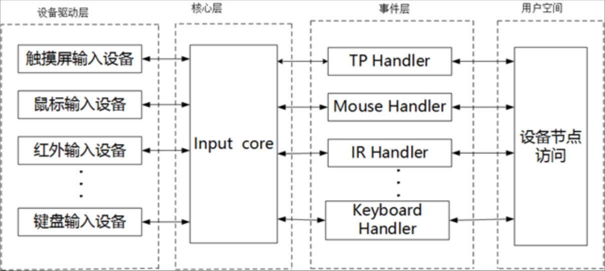
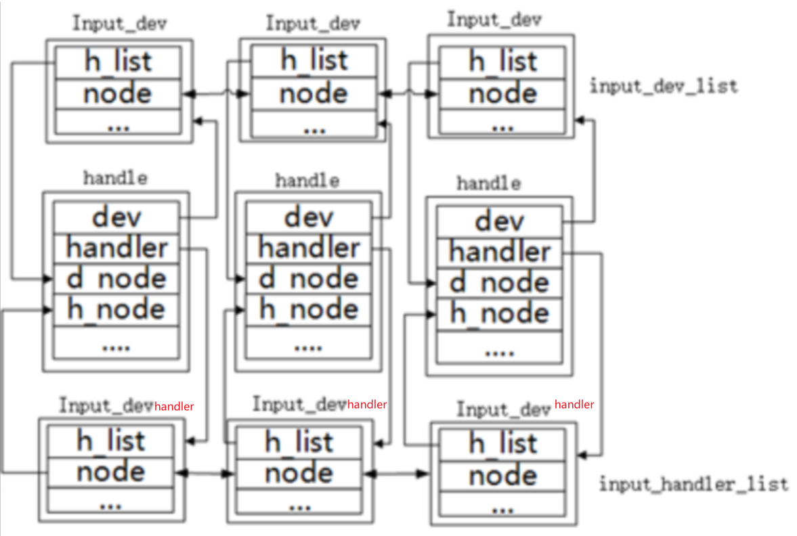
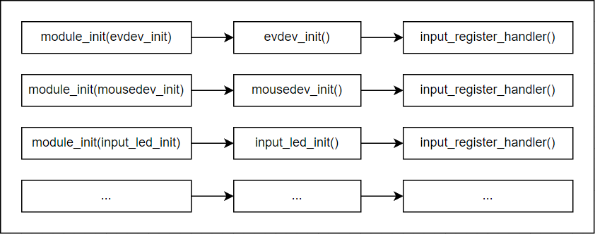
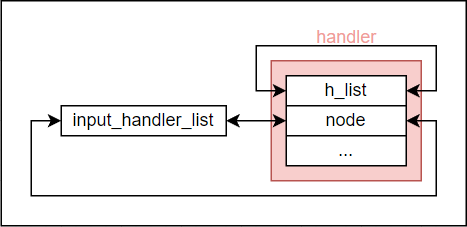
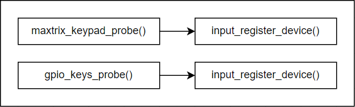
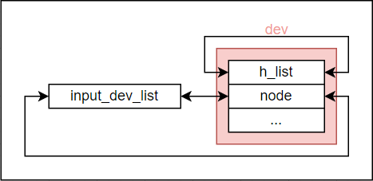
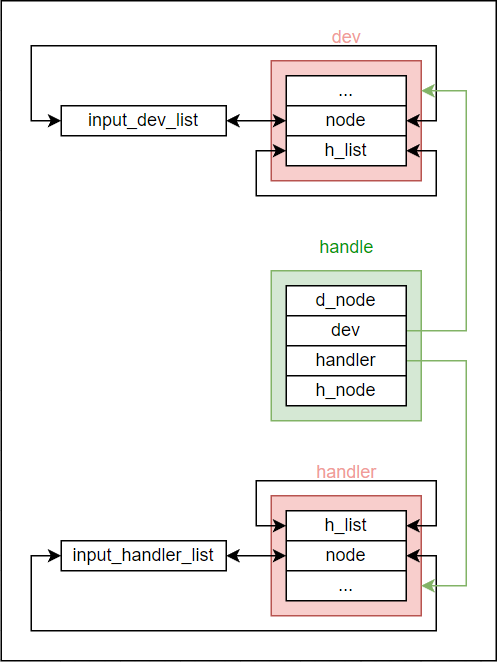
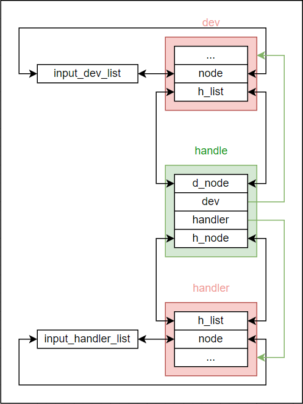
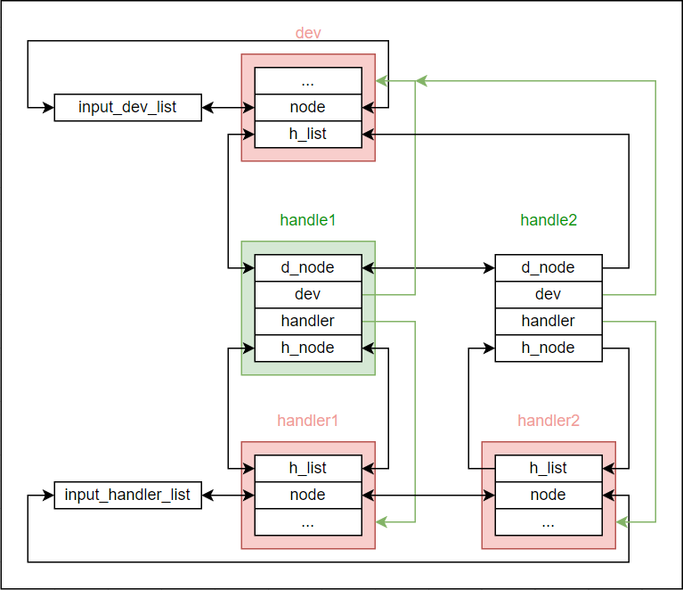

# `input_dev`、`handle`、`handler`的关系

> ​	在阅读本文前，请先了解`Input`子系统的基本概念（可以通过以下链接了解）。
>
> [Linux input子系统详解](https://www.cnblogs.com/yikoulinux/p/15208238.html)







## 1、`handler`

​	`input_handler`是事件处理层，代表一个事件处理器，与之相关的文件有如`drivers/input/evdev.c`、`drivers/input/mousedev.c`、`drivers/input/input-leds.c`等。在内核启动之后都会通过以下流程去注册一个事件处理器，如下：



```c
static LIST_HEAD(input_handler_list);
int input_register_handler(struct input_handler *handler)
{
    /* ... */
	list_add_tail(&handler->node, &input_handler_list);
	list_for_each_entry(dev, &input_dev_list, node)
		input_attach_handler(dev, handler);
	/* ... */
}
```

​	第5行，将新增的`&handler->node`加入到`&input_handler_list`中。



​	第6-7行，遍历`&input_dev_list`链表，找到和该`handler`匹配的`dev`，然后给它们构建连接关系。需要注意的是，该`handler`可能与多个`dev`都能够匹配。我们假设此时没有任何`dev`被注册，这便于我们一步一步将`dev`、`handle`、`handler`的关系图建立出来。

## 2、`input_dev`

​	`input_dev`是硬件驱动层，代表一个`input`设备，与之相关的文件有`drivers/input/keybord/gpio_keys.c`、`drivers/input/keyboard/matrix_keypad.c`等。在设备树的`compatible`与驱动的`compatible`相匹配时去注册一个`input`设备，如下：



```c
static LIST_HEAD(input_dev_list);
int input_register_device(struct input_dev *dev)
{
    /* ... */
    list_add_tail(&dev->node, &input_dev_list);
	list_for_each_entry(handler, &input_handler_list, node)
		input_attach_handler(dev, handler);
    /* ... */
}
```

​	第4行，将新增的`&dev->node`加入到`&input_dev_list`链表中。



​	第6-7行，遍历`&input_handler_list`链表，找到和该`dev`匹配的`handler`，然后给它们构建关系。需要注意的是，该`dev`可能与多个`handler`都能够匹配。

## 3、`dev`和`handler`匹配流程

```c
static int input_attach_handler(struct input_dev *dev, struct input_handler *handler)
{
	const struct input_device_id *id;
	int error;

	id = input_match_device(handler, dev);
	if (!id)
		return -ENODEV;

	error = handler->connect(handler, dev, id);
	if (error && error != -ENODEV)
		pr_err("failed to attach handler %s to device %s, error: %d\n",
		       handler->name, kobject_name(&dev->dev.kobj), error);

	return error;
}
```

​	第6行，找到相匹配的`dev`和`handler`，匹配规则本文不做详述。

​	第10行，链接相匹配的`dev`和`handler`，事件处理层有该回调函数的定义。

```c
static struct input_handler evdev_handler = {
	.event		= evdev_event,
	.events		= evdev_events,
	.connect	= evdev_connect,
	.disconnect	= evdev_disconnect,
	.legacy_minors	= true,
	.minor		= EVDEV_MINOR_BASE,
	.name		= "evdev",
	.id_table	= evdev_ids,
};

static int evdev_connect(struct input_handler *handler, struct input_dev *dev,
			 const struct input_device_id *id)
{
    /* ... */
    /* 笔者感觉下面一行和evdev->handle.dev = dev是等价的 */
	evdev->handle.dev = input_get_device(dev);
    evdev->handle.handler = handler;
    input_register_handle(&evdev->handle);
    /* ... */
}
```

​	第17-18行，构建`handle`、`dev`、`handler`三者的简单连接关系。



## 4、`handle`

```c
int input_register_handle(struct input_handle *handle)
{
    /* ... */
    list_add_tail_rcu(&handle->d_node, &dev->h_list);
    list_add_tail_rcu(&handle->h_node, &handler->h_list);
    /* ... */
```

​	第4-5行，使用`handle`将`dev`和`handler`连接起来。



​	如果是一个`dev`匹配多个`handler`，则三者关系如下：

