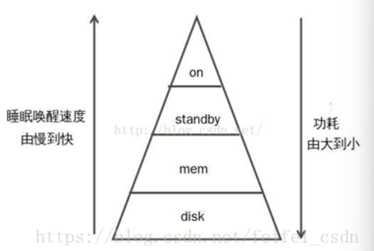

# Linux的4种休眠模式

​	Linux中有4种休眠模式（S1，S2，S3，S4），可以通过以下指令进入不同的休眠模式：

```shell
echo on > /sys/power/state
echo standby > /sys/power/state
echo mem > /sys/power/state
echo disk > /sys/power/state
```

​	

| 休眠模式      | 描述                                                         |
| ------------- | ------------------------------------------------------------ |
| S1（on）      | 运行中                                                       |
| S2（standby） | CPU和RAM在运行                                               |
| S3（mem）     | 挂起到内存（待机），关闭硬盘、外设等设备                     |
| S4（disk）    | 挂起到硬盘（休眠），关闭硬盘、外设等设备，进入关机状态。<br />此时计算机完全关闭，不耗电 |

