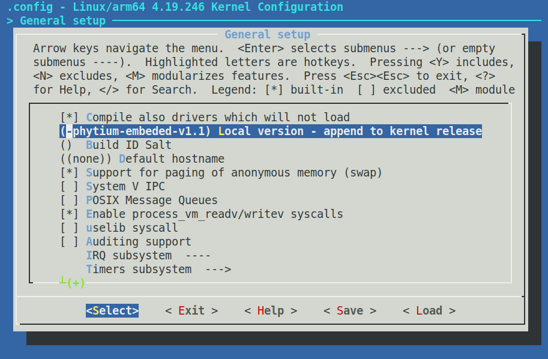
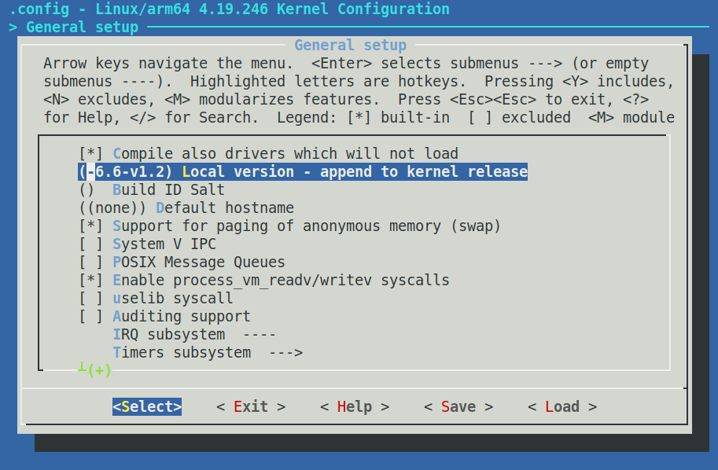
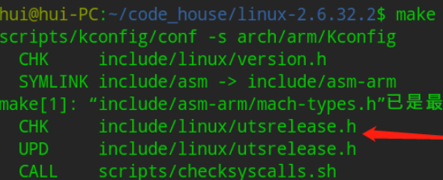

# `insmod`安装模块出错

> 参考链接：
>
> [insmod驱动时提示版本与内核不一样](https://blog.csdn.net/m0_48922815/article/details/114781976)


## 问题现象

​	在`linux`驱动开发中，会遇到需要编译某个驱动模块放到开发板上安装的情况，但是在安装时经常遇到报错驱动版本与内核不一致，情况如下：

```
spi-phytium: version magic '6.6.0-phytium-embeded-v1.1+ SMP preempt mod_unload aarch64' should be '6.6.0-6.6-v1.2 SMP preempt mod_unload aarch64'
insmod: can't insert 'spi-phytium.ko': invalid module format
```

## 问题原因

​	使用`modinfo xxx.ko`查看驱动模块的版本，使用`uname -a`查看当前内核版本，两者不相同就会出现驱动模块安装报版本不一致的问题，如下：

```shell
$ modinfo spi-phytium.ko
filename:       /work1/pengmin/linux-1/spi-phytium.ko
license:        GPL
description:    Driver for Phytium SPI controller core
author:         Chen Baozi <chenbaozi@phytium.com.cn>
author:         Zhu Mingshuai <zhumingshuai@phytium.com.cn>
depends:        
intree:         Y
name:           spi_phytium
vermagic:       6.6.0-phytium-embeded-v1.1+ SMP preempt mod_unload modversions aarch64
```

```shell
$ uname -a
Linux ubuntu 6.6.0-6.6-v1.2 #246 SMP Wed Nov 13 18:40:19 PST 2024 aarch64 aarch64 aarch64 GNU/Linux
```

​	明显可以看出，驱动模块的`vermagic`为`6.6.0-phytium-embeded-v1.1+`，而当前内核版本为`6.6.0-6.6-v1.2`，两者不一致并且符合安装模块时的报错信息。

## 解决方法

### 1、内核自带的驱动

1. 进入编译驱动模块的内核源码目录

2. 使用`make menuconfig`命令调出配置菜单，选择`General setup ---> ()Local version - append to kernel release`，如下：

   

3. 选中该选项，编辑为目标内核版本描述，如下：

   

4. 也可以直接修改`.config`文件中的`CONFIG_LOCALVERSION`的值，如下：

   ```
   # 修改前
   CONFIG_LOCALVERSION=“-phytium-embeded-v1.1”
   # 修改后
   CONFIG_LOCALVERSION=“-6.6-v1.2"
   ```

5. 保存配置后重新编译内核，所有编译成`m`的驱动模块的`vermagic`均为`6.6.0-6.6-v1.2`版本

### 2、非内核自带的驱动

1. 进入编译驱动模块的内核源码目录

2. 修改`include/generated/utsversion.h`文件，该文件中只有一个宏定义，就是编译出模块的驱动版本的描述。如下：

   ```c
   /* 修改前 */
   #define UTS_RELEASE "6.6.0-phytium-embeded-v1.1+"
   /* 修改后 */
   #define UTS_RELEASE "6.6.0-6.6-v1.2"
   ```

3. 重新编译驱动模块，编译完成后使用`modinfo`指令查看模块信息，会发现驱动模块的内核版本被修改，如下：

   ```shell
   $ modinfo my_driver.ko
   filename:       /work1/pengmin/linux-1/my_driver.ko
   license:        GPL
   description:    My Driver
   author:         Peng Min <pengmin1540@phytium.com.cn>
   depends:        
   intree:         Y
   name:           my_driver
   vermagic:       6.6.0-6.6-v1.2 SMP preempt mod_unload modversions aarch64
   ```

## 其它

​	在修改完`.config`后，直接编译内核源码会使`include/generated/utsrelease.h`文件中的宏`UTS_RELEASE`被修改，如下：

1. 先查看`include/generated/utsrelease.h`文件，如下：

   ```
   $ cat include/generated/utsrelease.h
   #define UTS_RELEASE "2.6.32.2"
   ```

2. 再修改`.config`文件中的`CONFIG_LOCALVERSION`的值，如下：

   ```
   # 修改前
   CONFIG_LOCALVERSION=“”
   # 修改后
   CONFIG_LOCALVERSION=“-FriendlyARM”
   ```

3. 再重新编译内核，会发现如下信息：

   

4. 最后查看`include/generated/utsrelease.h`文件，如下：

   ```
   $ cat include/generated/utsrelease.h
   #define UTS_RELEASE "2.6.32.2-FriendlyARM"
   ```

   