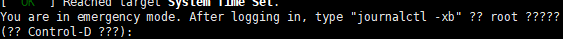
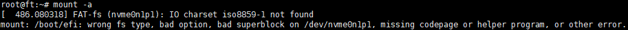

# 启动进入救援模式

## 问题现象

​	开发板开机后进入救援模式，如下。

## 问题分析

​	网上简单搜索该问题是挂载硬盘出错导致的。

​	首先输入密码登录`root`账户，然后执行命令`mount -a`查看是否有错误日志输出，如下。

​	分析报错信息为字符集`iso8859-1`找不到，该字符集与`fs/nls/nls_iso8859-1.c`相关，查询内核配置发现与该驱动相关的配置`CONFIG_NLS_ISO8859_1`没有打开。

## 解决方法

​	打开内核配置`CONFIG_NLS_ISO8859_1`，重新编译内核并重启。

> 注意：该问题是出现在我直接使用`Image/uImage`和设备树去启动系统时出现的。在编译该`Image/uImage`时，`CONFIG_NLS_ISO8859_1`是编译成`m`的，但是盘里面并没有对应的`/lib/modules/xxx/kernel/drivers/`目录，所以不会自动加载模块。
>
> 笔者建议，在编译完内核源码后，使用`make bindeb-pkg -j48`指令去生成相应的`deb`包，然后再安装该`deb`包，这样就会生成`/lib/modules/xxx/kernel/drivers/`目录，从而会自动加载编译成`m`的模块了。