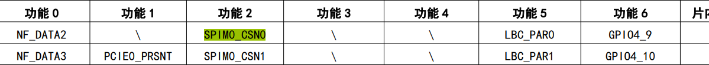
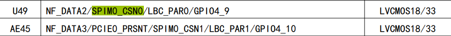
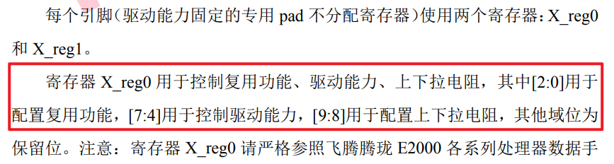
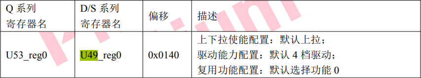
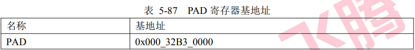
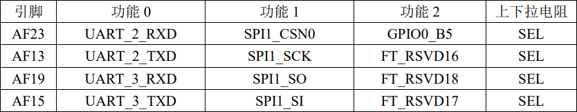
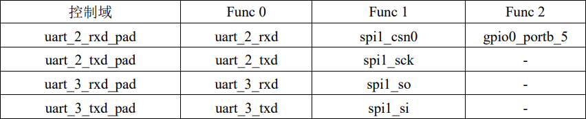
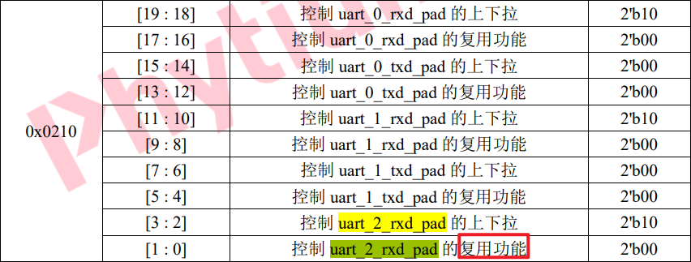
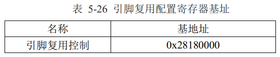

# 如何配置引脚复用

​	本文以给不同机器配置`SPI`的引脚复用为例进行详细讲解。参考《飞腾`XXXX`软件编程手册》和《飞腾`XXXX`数据手册》。

## 1、`E2000`

### 1.1 原理

​	1）查看`《飞腾腾珑E2000数据手册V1.0版本-D.pbf》`文档，搜索`SPIM0_CSN0`。





​	由上图可以发现，`SPIM0_CSN0`是`U49`引脚的功能2的复用。

​	2）查看《飞腾腾珑E2000系列处理器软件编程手册v0.8.pbf》中“外设→PAD复用”章节。



​	由上图及第一步可知，`U49`引脚对应的寄存器名为`U49_reg0`，且功能2对应的`bit[2:0]`为`0b010`。

​	3）查看`《飞腾腾珑E2000系列处理器软件编程手册v0.8.pbf》`中“外设→PAD复用”章节，搜索`U49_reg0`。



​	由上图可知，`U49_reg0`寄存器的偏移地址为`0x0140`

​	4）查看`《飞腾腾珑E2000系列处理器软件编程手册v0.8.pbf》`中“外设→PAD复用”章节。



​	由上图可知，`PAD`寄存器基地址为`0x32B30000`，则`U49_reg0`地址为`0x32B30140`。


​	综上所述，`SPIM0_CS0`在`E2000D`机器上的引脚复用命令如下：

```
mw.l 0x32B30140 0x72
```

> ​	注意，上述内容只讲解了`SPIM0_CS0`在`E2000D`机器上的引脚复用。此外，还有`SPIM0_SCLLK`、`SPIM0_TXD`、`SPIM0_RXD`、`SPIM0_CS1`等引脚复用，方法类似，笔者不再赘述。
>
> ​	我们可以将`SPIM0_CS0`、`SPIM0_CS1`复用同时配置，这样并不会产生冲突。`SPI0`控制器具体使用哪个片选最终是由机器上的片选拨码开关决定的。

### 1.2 实例

```
/* E2000D机器上的SPI0复用 */
mw.l 0x32b30134 0x72
mw.l 0x32b30138 0x72
mw.l 0x32b3013c 0x72
mw.l 0x32b30140 0x72
mw.l 0x32b30144 0x72
mw.l 0x32b30148 0x72
mw.l 0x32b3014c 0x72

/* E2000D机器上的SPI2复用 */
mw.l 0x32b300e8 0x70
mw.l 0x32b300ec 0x70
mw.l 0x32b300f0 0x70
mw.l 0x32b300f4 0x70
```

## 2、`D2000`

### 2.1 原理

​	1）查看`《飞腾腾锐D2000系列处理器数据手册.pbf》`，搜索`SPI1_CSN0`。



​	由上图可知，`SPI1_CSN0`是`AF23`引脚的功能1的复用。

​	在`《飞腾腾锐D2000软件编程手册.pbf》`中“复用功能表”章节，也有同样的描述，如下：



​	由上图可知，`SPI1_CSN0`是`uart_2_rxd_pad`控制域的功能1的复用。（`uart_2_rxd_pad`控制域就是`AF23`引脚）

​	2）查看`《飞腾腾锐D2000软件编程手册.pbf》`中“复用功能表”章节，搜索`AF23`发现为空，搜索`uart_2_rxd_pad`，结果如下：



​	由上图可知，`uart_2_rxd_pad`控制域的偏移地址为`0x0210`，其功能1对应的`bit[1:0]`为`0b01`。

​	3）查看`《飞腾腾锐D2000软件编程手册.pbf》`中“复用功能表”章节。



​	由上图可知，引脚复用配置寄存器基址为`0x28180000`，则`uart_2_rxd_pad`控制域的地址为`0x28180210`。


​	综上所述，`SPI1_CS0`在`D2000`机器上的引脚复用命令如下：

```
mw.l 0x28180210 0x1
```

### 2.2 实例

