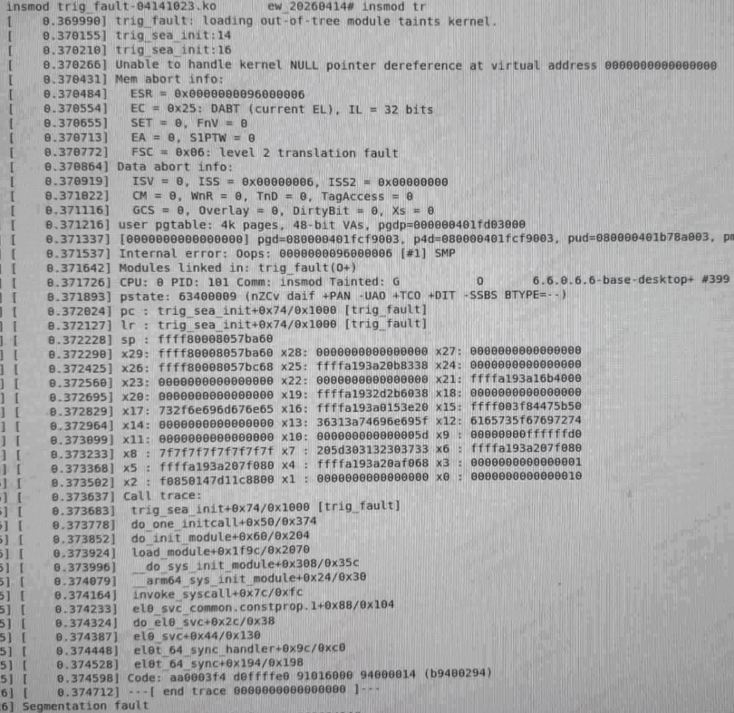

# 常见异常信息分析

**问题现象**

​	有一个用于触发异常的驱动模块，部分代码如下：

```c
#define my_ioremap(addr, size)		ioremap_prot((addr), (size), PORT_NORMAL)
vaddr = my_ioremap(0xffffffffffffffff, 0x1000);
value = __raw_readl(vaddr);
```

​	以上代码实现了对一个不存在的地址做`PORT_NORMAL`属性的映射，然后再访问映射后的地址，以此来触发异常，报错信息如下图：



​	我们提取以下几个关键信息：

```c
ESR = 0x0000000096000006
EC = 0x25: DABT (current EL), IL = 32bits
    
do_el0_svc+0x2c/0x38
el0_svc+0x44/0x130
el0t_64_sync_handler+0x9c/0xc0
```

​	同时我们查询内核代码中有关异常向量表处理函数，如下：

```c
asmlinkage void noinstr el0t_64_sync_handler(struct pt_regs *regs)
{
	unsigned long esr = read_sysreg(esr_el1);

	switch (ESR_ELx_EC(esr)) {
	case ESR_ELx_EC_SVC64:
		el0_svc(regs);
		break;
	case ESR_ELx_EC_DABT_LOW:
		el0_da(regs, esr);
		break;
	case ESR_ELx_EC_IABT_LOW:
		el0_ia(regs, esr);
		break;
	xxx
    }
}
```

​	我们可以发现，报错信息中的`ESR`和`EC`分别对应内核代码中的`esr`和`ESR_ELx_EC(esr)`，根据回调栈信息可知`ESR_ELx_EC(esr)`的值为`ESR_ELx_EC_SVC64`，即`0x15`。但是其值又和报错信息中的`EC = 0x25`不符。

**问题原因**

​	`Call trace`（调用栈）展示的不是触发当前异常的函数，而是导致这次异常的系统调用（`System Call`）的入口路径。

​	整个过程可以看作一个“请求-失败”的链条：

1. **请求阶段 (系统调用)**
   用户空间的应用程序通过执行 `svc #0` 指令发起一个系统调用（例如 `read()` 或 `write()`）。这条指令会触发一个同步异常，使CPU从用户态（EL0）陷入内核态（EL1）。
2. **入口阶段 (el0_svc)**
   硬件根据异常向量表跳转到内核的 `el0t_64_sync_handler` 函数。该函数读取 `ESR_EL1` 寄存器，发现异常类别（EC）是 `0x15`（`ESR_ELx_EC_SVC64`），于是调用 `el0_svc` 函数来处理这个系统调用请求。`el0_svc` 会进一步调用具体的系统调用处理函数，比如 `do_el0_svc`。
3. **失败阶段 (数据中止)**
   在 `do_el0_svc` 的执行过程中，内核代码需要访问一块内存。但这块内存对应的物理页可能尚未分配，或者访问权限不足。当CPU尝试访问这个无效的虚拟地址时，会再次触发一个同步异常，这次是**数据中止（Data Abort）**。
4. **异常报告**
   这个新的数据中止异常会被内核捕获并报告出来。此时：
   - **`ESR_EL1` 的值**：反映的是**最新**的异常原因，即数据中止。所以你会看到 `EC = 0x25`，这正是 `ESR_ELx_EC_DABT_LOW` 的值。
   - **`Call trace` 的内容**：展示的是从异常发生点回溯的函数调用链。这个调用链的起点，正是导致问题发生的那个系统调用处理路径，即 `do_el0_svc` -> `el0_svc` -> `el0t_64_sync_handler`。

**结论**

​	现象是完全合理的：

- **`EC = 0x25`** 告诉你**发生了什么错误**：一个发生在EL0（用户态）上下文中的数据访问中止（Data Abort）。
- **`Call trace` 中的 `el0_svc`** 告诉你**错误是在哪里发生的**：在处理一个从用户态发起的系统调用（`svc`）的过程中。

你的调用栈清晰地表明：**一个用户程序发起的系统调用，在内核执行时因为访问了非法内存地址而崩溃了**。接下来你应该根据 `Call trace` 中更详细的内核函数信息，去定位是哪一行内核代码触发了这次非法内存访问。
