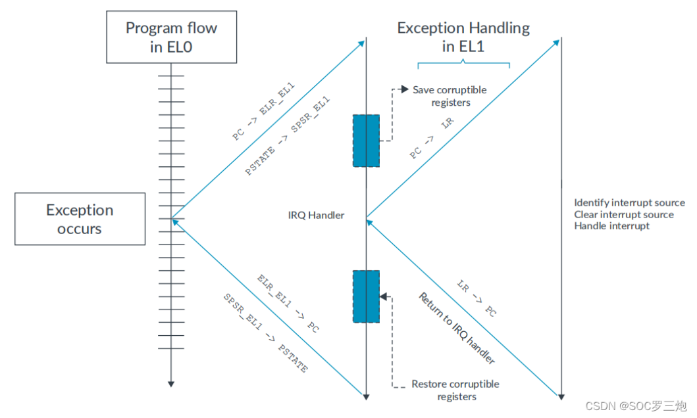

# 异常处理示例

> 参考链接：
>
> [ARMv8-aarch64的异常处理模型详解之异常处理详解（同步异常核异步异常的分析和处理）](https://blog.csdn.net/luolaihua2018/article/details/136243889)

## 1、同步异常的处理示例

​	假设有如下场景：执行在`EL0`的`aarch32`应用程序需要向执行在`EL1`的`aarch64`操作系统请求一个堆的内存分配，它需要执行一个`SVC`指令，产生一个`SVC`同步异常，这将发生如下事件：

* 当前的处理器状态`PSTATE`将会保存到`SPSR_EL1`中
* 产生异常指令（`SVC`）的下一条指令的地址将会被写入到`ELR_EL1`中
* 异常诊断信息（导致异常发生的原因）将会被记录到`ESR_EL1`寄存器中
* 目标执行状态取决于`HCR_EL2.RW`位
* 当前的处理器状态`PSTATE`将会被更新：异常等级将会切到`EL1`，执行状态更新到`aarch64`
* `PC`将会跳转到`VBAR_EL1 + 0x600`的异常向量。因为是同步异常，有来自低异常等级的异常等级切换，并且执行状态为`aarch32`，所以根据异常向量的选择要求，将选择`VBAR_EL1 + 0x600`处的异常向量作为异常处理器
* 在`top exception handler`中，在进行异常处理前，当前处理器的寄存器上下文将会被压入到`SP_EL1`中
* 在`top exception handler`中，根据`ESR_EL1`中的信息，知道当前异常为`SVC`异常，所以跳转到指定的`SVC`异常处理函数中
* 在`SVC`异常处理函数执行完成后，回到`top exception handler`
* 在`top exception handler`中，将之前压入到`SP_EL1`中的寄存器上下文恢复，并执行`eret`指令
* `eret`指令包括两个步骤：先将`SPSR_EL1`的值恢复到`PSTATE`中，再将`ELR_EL1`中的值写入到`PC`中

​	以上就是执行`SVC`指令从`EL0`进入到`EL1`进行异常处理，然后返回的一般流程。

​	上述场景还尚未考虑到安全状态的切换，如果是`EL0 + aarch32 + Non-secure`状态下，要进入`EL1 + aarch64 + secure`状态进行某些操作，则处理流程将更加复杂。之前文章提到过，`secure`状态的切换必须经过`EL3`，所以要想实现此操作，中间还需要执行`SMC`指令进入到`EL3`。

## 2、异步异常的处理示例

​	异步异常，比如中断，是来自处理器外部的信号，又比如`SError`，是来自内存系统的错误反馈。`ARM`没有规定异步异常应该什么时候发生，并且，关于异步异常和同步异常的优先级问题，如果同步异常和异步异常同时发生，那么处理器先处理哪一个，这个是由处理器的具体实现定义的。

​	假设有如下场景：当处理器在`EL0 aarch32`状态下执行用户程序时，发生了一个`IRQ`中断，假设`HCR_EL2`和`SCR_EL3`都已经被配置成将当前`IRQ`中断路由到`EL1 aarch64`状态下处理，下图为该中断的处理流程：

* 当前的处理器状态`PSTATE`将会保存到`SPSR_EL1`中
* 中断发生时，第一条未被执行完成的指令的地址将会被写入到`ELR_EL1`中
* 异常诊断信息（导致异常发生的原因）将会被记录到`ESR_EL1`寄存器中
* 目标执行状态取决于`HCR_EL2.RW`位
* 当前处理器状态`PSTATE`将会被更新：异常等级将会切到`EL1`，执行状态更新到`aarch64`
* `PC`将会跳转到`VBAR_EL1 + 0x680`的异常向量。因为是`IRQ`中断，有来自低异常等级的异常等级切换，并且执行状态为`aarch32`，所以根据异常向量的选择要求，将选择`VBAR_EL1 + 0x680`处的异常向量作为异常处理器
* 在`top exception handler`中，在进行异常处理前，当前处理器的寄存器上下文将会被压入到`SP_EL1`中
* 在`top exception handler`中，跳转到指定的`IRQ`异常处理函数中
* 在`IRQ`处理函数执行完成后，回到`top exception handler`
* 在`top exception handle`中，将之前压入到`SP_EL1`中的寄存器上下文恢复，并执行`eret`指令
* `eret`指令包括两个步骤：将`SPSR_EL1`的值恢复到`PSTATE`中（包括异常等级`EL0`，执行状态为`aarch32`），然后将`ELR_EL1`中的值写入到`PC`中

​	以上就是进行`IRQ`中断异常处理并且返回的一般流程。需要注意的是，处理器或者说是`IRQ handler`并没有能力判断中断源，只是收到了`IRQ`中断信号，并开始`IRQ`中断处理。至于具体的中断源判断、中断优先级以及中断属性配置的工作，由`GIC`来完成。通过读取`GIC`的`IAR`（`Interrupt Acknowledge Register`）寄存器，处理器可以知道当前中断源的中断号。一旦中断被处理完成，处理器可以配置`GIC`的`EOIR`（`End of Interrupt Register`）寄存器，来通知`GIC`当前中断已经被处理完成，并且该中断的状态也随即会变成`inactive`。