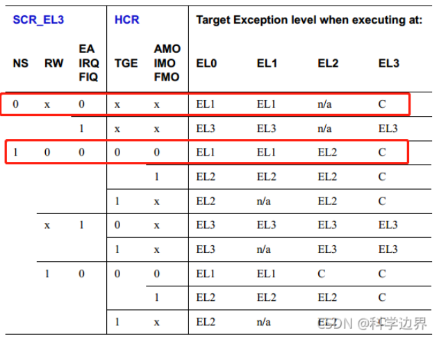
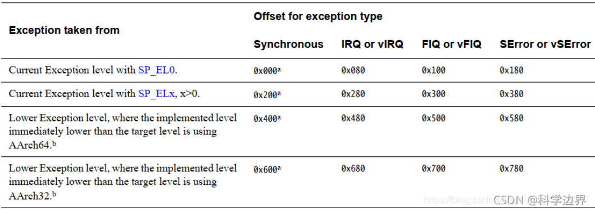
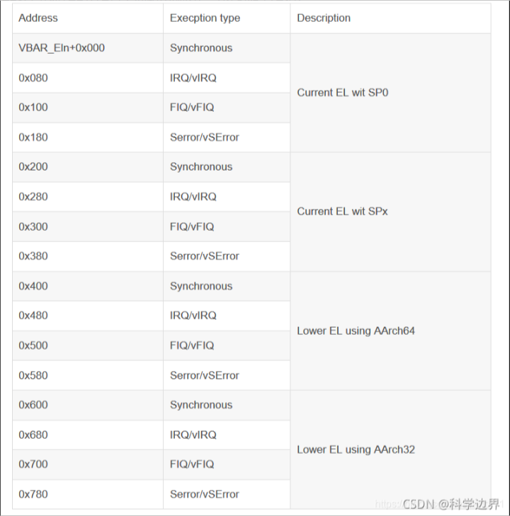

# 异常模式及异常向量表

> 参考链接：
>
> [ARM64基础12:ARM64的异常模式及异常向量表](https://blog.csdn.net/luteresa/article/details/120263414)


## 1、`ARM64`的异常等级

​	`ARM64`包含4个异常等级：

​		1）`EL0`：非特权模式，常用来跑应用程序；

​		2）`EL1`：特权模式，常用来跑内核；

​		3）`EL2`：虚拟化监控程序，例如`hypervisor`；

​		4）`EL3`：安全模式，例如`secure monitor`；

## 2、同步异常和异步异常

​	同步异常是由正在运行的指令出错造成的异常，或是由指令运行的结果造成的异常。同步异常包括：

​		1）系统调用，`svc`、`hvc`、`SMC`等；

​		2）`MMU`引发的异常；

​		3）`SP`和`PC`对齐检查；

​		4）未分配的指令；

​	异步异常则不必由运行的指令造成，可以在程序运行中的任意时刻发生。

​		1）`IRQ`中断；

​		2）`FIQ`中断；

​		3）`SError`；

## 3、异常入口

​	当异常发生时刻：

​	a）`CPU`做了哪些事情：

​		1）`PSTATE`保存到`SPSR_ELx`；

​		2）返回地址保存到`ELR_ELx`；

​		3）`PSTATE`寄存器里的`DAIF`域都设置为1，相当于把调试异常、系统错误关闭；

​		4）更新`ESR_ELx`寄存器，该寄存器包含同步异常发生的原因；

​		5）切换到对应的`EL`，然后跳转到异常向量表里执行；

​	b）操作系统做哪些事情：

​		1）根据异常发生的类型，跳转到合适的异常向量表；

​		2）异常向量表的每个表项，保存有一个异常处理的跳转函数，跳转到对应的异常处理函数处理异常；

## 4、异常的返回

​	1）操作系统执行一条`eret`语句；

​	2）从`ELR_ELx`寄存器恢复`PC`指针；

​	3）从`SPSR_ELx`寄存器恢复处理器的状态；

## 5、异常返回地址

​	返回地址的两个寄存器：

​		`x30`：子函数的返回地址，使用`ret`指令来返回；

​		`ELR_ELx`：异常返回地址，使用`eret`返回；

​			1）对于异步异常，它是中断发生时的下一条指令，或没有执行的第一条指令；

​			2）对于不是`system call`（系统调用）的同步异常，它是触发同步异常的那一条指令；

​			3）对于`system call`，它是`svc`指令的下一条指令；

## 6、异常处理的路由

​	1）异常发生时，异常处理可以在当前或更高`EL`，`EL0`不能处理异常；

​	2）同步异常是可以在当前`EL`处理的，比如在`EL1`里发生的同步异常；

​	3）对于异步异常，可以路由到`EL1/EL2/EL3`处理，需要配置`HCR`以及`SCR`相关寄存器；

### 6.1 选择异常级别

​	当异常发生时，`PC`可以有三个基地址`VBAR_EL1`、`VBAR_EL3`、`VBAR_EL1(secure)`供选择，路由规则如下：



​	第一个红框内容表示：在此种配置（安全模式）下，`EL0`和`EL1`状态下产生的异步异常，会导致`CPU`进入`EL1`。

​	第二个红框内容表示：在此种配置（非安全模式）下，`EL0`和`EL1`状态下产生的异步异常，会导致`CPU`进入`EL1`，而`EL2`状态下产生的异常则不会导致`EL`（`exception level`）切换。


​	`Linux`内核只支持`EL0`和`EL1`，`EL0`对应用户态，`EL1`对应内核态，当`CPU`运行在用户态时，产生的异步异常会导致`CPU`切换到`EL1`，当`CPU`运行在内核态时，产生的异步异常不会导致`EL`切换。

​	配置为非安全模式`VBAR_EL1`：

```
// set vetor table addr to vbar
	ldr x10, =vectors
	msr vbar_el1, x10
	isb
```

### 6.2 选择异常级别相关的偏移

​	配置好基地址后，再根据下表配置异常向量表的偏移地址：



​	说明：

​	1）实际上有四张表，每张表有四个异常入口，分别对应`Synchronous`、`IRQ`、`FIQ`和`SError`（第一个为同步异常，后三个为异步异常）。

​	2）每一个异常入口占用`0x80 bytes`空间（不同于`ARMv7`之前的`4bytes`），也就是说，每一个异常入口可以放置多条指令，而不仅仅是一条跳转指令。

​	四张表类型如下：

​	1）如果发生异常并不会导致`EL`切换，并且使用的栈指针是`SP_EL0`，那么使用第一张异常向量表。

​	2）如果发生异常并不会导致`EL`切换，并且使用的栈指针是`SP_EL1/2/3`，那么使用第二张异常向量表。

​	3）如果发生异常会导致`EL`切换，并且比目的的`EL`低一级的`EL`运行在`AARCH64`模式，那么使用第三张异常向量表。

​	4）如果发生异常会导致`EL`切换，并且比目的的`EL`低一级的`EL`运行在`AARCH32`模式，那么使用第四张异常向量表。

### 6.3 路由规则结论

​	在`Linux`中，由于`EL0`对应用户态，`EL1`对应内核态，结合上述规则，可以得到如下结论：

​	1）第一张异常向量表用不到，因为`EL0`使用`SP_EL0`，但发生`EL0`异常会路由到`EL1`；

​	2）第二张异常向量表，用于`CPU`运行在`EL1`，即`CPU`运行在内核态，发生异常时，`EL`不发生切换；

​	3）第三张异常向量表，用于`CPU`运行在`EL0`的`AARCH64`模式，发生异常时，`EL`发生切换；

​	4）第四张异常向量表，用于`CPU`运行在`EL0`的`AARCH32`模式，发生异常时，`EL`发生切换；



## 7、栈的选择

​	1）每个异常登记`EL`都有对应的栈指针寄存器`SP`：`SP_EL0/1/2/3`；

​	2）栈必须16字节对齐，硬件可以检测栈指针对齐；

​	3）当异常发生时，跳转到目标异常等级时，硬件会自动选择`SP_ELx`；

​	4）操作系统负责分配和保证，每个异常等级`EL`对应的栈是可用的。

## 8、异常处理的执行模式

​	1）异常发生时，切换到更高级别`EL`，这个`EL`运行在哪个模式下？

​		`HCR_EL2.RW`记录`EL1`要运行的哪个模式，1：`aarch64`，0：`aarch32`

​	2）异常发生后，执行模式可以改变

​		一个`aarch32`模式运行的应用程序，异常出现后，可以在`aarch64`模式处理异常

## 9、异常返回的执行模式

​	从一个异常返回时，`SPSR`寄存器记录了：

​	1）返回到哪个`EL`？`SPSR.M[3:0]`

​	2）返回目标`EL`的执行模式？`SPSR.M[4]`，1表示`aarch32`，0表示`aarch64`

## 10、异常向量表

​	1）每个异常等级`EL`都有自己的异常向量表，`EL0`除外；

​	2）异常向量表的基地址需要设置到`VBAR_ELx`寄存器中；

​	3）`VBAR_EL1`寄存器必须以`2KB`对齐；

​	4）每个表项可存放32条指令，一共128字节；

​	5）大的异常类型分类有4类，分别是`sync/irq/fiq/error`。

​	内核里的异常向量表实现如下：

```
// arch/arm64/kernel/entry.S

/*
 * Exception vectors.
 *
 * ARM64的异常向量表一共占用2048个字节，分成4组，每组4个表项，每个表项占128字节
 * .align 11表示2048字节对齐
 */
	.pushsection ".entry.text", "ax"

	.align	11
SYM_CODE_START(vectors)
	/* 用不到第一张表 */
	kernel_ventry	1, t, 64, sync		// Synchronous EL1t
	kernel_ventry	1, t, 64, irq		// IRQ EL1t
	kernel_ventry	1, t, 64, fiq		// FIQ EL1h
	kernel_ventry	1, t, 64, error		// Error EL1t

	/* 在内核态发生异常 */
	kernel_ventry	1, h, 64, sync		// Synchronous EL1h
	kernel_ventry	1, h, 64, irq		// IRQ EL1h
	kernel_ventry	1, h, 64, fiq		// FIQ EL1h
	kernel_ventry	1, h, 64, error		// Error EL1h

	/* 在用户态的aarch64程序发生异常 */
	kernel_ventry	0, t, 64, sync		// Synchronous 64-bit EL0
	kernel_ventry	0, t, 64, irq		// IRQ 64-bit EL0
	kernel_ventry	0, t, 64, fiq		// FIQ 64-bit EL0
	kernel_ventry	0, t, 64, error		// Error 64-bit EL0

	/* 在用户态的aarch32程序发生异常 */
	kernel_ventry	0, t, 32, sync		// Synchronous 32-bit EL0
	kernel_ventry	0, t, 32, irq		// IRQ 32-bit EL0
	kernel_ventry	0, t, 32, fiq		// FIQ 32-bit EL0
	kernel_ventry	0, t, 32, error		// Error 32-bit EL0
SYM_CODE_END(vectors)
```

## 11、同步异常的解析

### 11.1 异常链接寄存器`ELR_EL1`

​	`ELR_ELx`：异常返回地址，使用`eret`返回；

​			1）对于异步异常，它是中断发生时的下一条指令，或没有执行的第一条指令；

​			2）对于不是`system call`的同步异常，它是触发同步异常的那一条指令；

​			3）对于`system call`，它是`svc`he指令的下一条指令；

### 11.2 异常综合信息寄存器`ESR_EL1`


### 11.3 失效地址寄存器`FAR_EL1`

​	`FAR_EL1`寄存器保存发生异常时刻的虚拟地址。