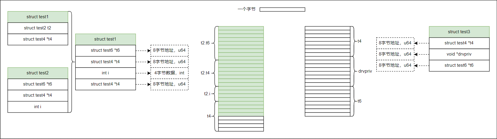

# 结构体转换关系

​	假设存在如下结构体强制转换。

```c
/* 结构体1 */
struct test1 {
	struct test2 t2;
    struct test4 *t4;
};

/* 结构体2 */
struct test2 {
    struct test6 *t6;
    struct test4 *t4;
    int i;
};

/* 结构体3 */
struct test3 {
    struct test4 *t4;
    void *drvpriv;
    struct test6 *t6;
};

/* 以下这种强制转换会报错 */
struct test1 *pm1;
struct test3 *pm3 = (struct test1 *)pm1;

/* 以下这种强制转换不会报错，其类似于xxx_get_drvdata()这种形式 */
struct test1 *pm1;
void *pm_t = (void *)pm1;
struct test3 *pm3 = (struct test3 *)pm_t;
```

​	当将`struct test1`强制转换成`struct test3`时，不管是结构体指针，还是结构体参数，或是其它类型的参数，本质都是以数据的形式进行存储的，所以强制转换后，其结果如下图所示。



​	根据上图可以知道，`pm3->t4`实际上是`pm1->t2.t6`，`pm3->t6`实际上是`pm1->t2.i`和`pm1->t4`的高4字节地址位共同组成的（这个组合而来的地址大概率是个非法地址）。这是如果我们要去访问`pm3->t6`这个结构体，大概率会报地址错误。