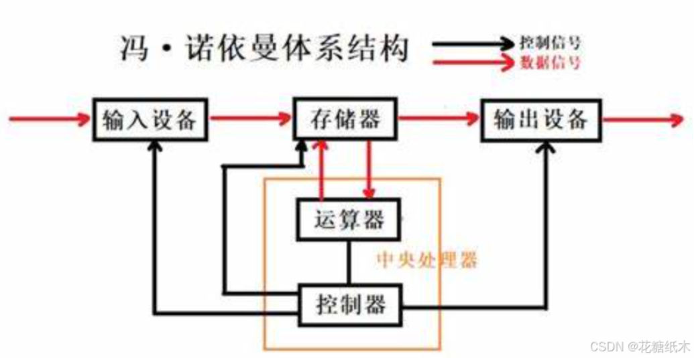
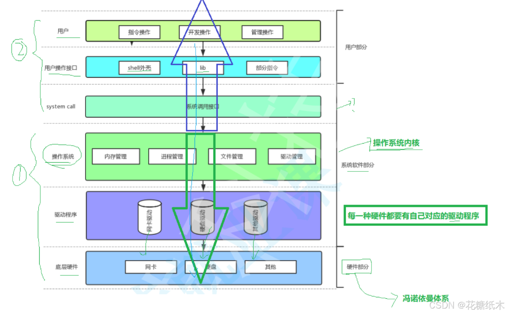
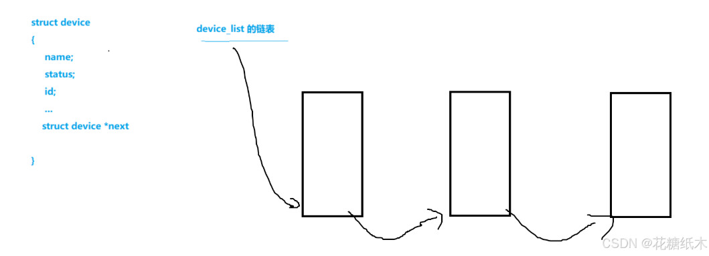
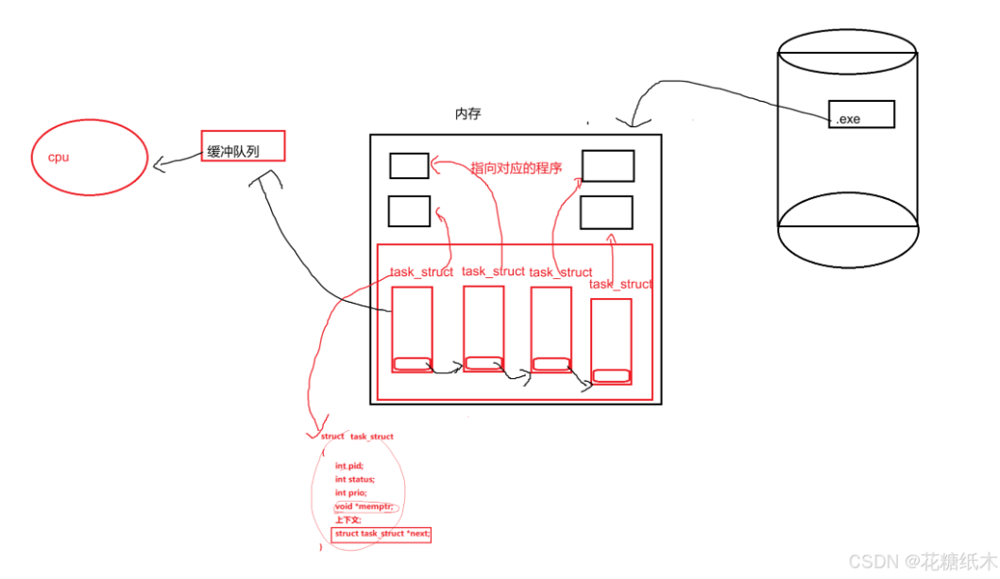

# 进程的基本概念

> 参考链接：
>
> [【Linux】进程的基本概念](https://blog.csdn.net/2302_80652761/article/details/142568905)


## 1、冯诺依曼体系结构

​	我们常见的计算机，如笔记本，我们不常见的计算机，如服务器，大部分都遵守冯诺依曼体系结构。



​	截至目前为止，我们所认识的计算机，都是由一个个硬件组件组成的：

* 输入单元：包括键盘、鼠标、扫描仪、写板等
* 中央处理器（`CPU`）：含有运算器和控制器等
* 输出单元：显示器、打印机等


​	关于冯诺依曼体系结构，必须强调以下几点：

* 这里存储器指的是内存

* 不考虑缓存情况，`CPU`只能对内存进行读写，不能访问外设（输入与输出设备）
* 外设要输入或输出数据，也只能通过内存进行写入与读取
* 所有设备都只能和内存打交道
* 任何程序运行的时候，都先从磁盘加载到内存中


​	数据在计算机内进行传输，从一个设备到另一个设备，本质上就是数据的拷贝，所以拷贝的效率决定计算机的整体效率。

​	当进行运算数据的时候，`CPU`直接从内存中进行读取，大大减少了数据直接从输入设备传入`CPU`的传输时间，如果没用了存储器，直接从输入设备传输数据给`CPU`，而`CPU`的计算速度极快，运算效率远大于输入设备的传入效率，根据木桶定律，这样计算机的整体效率就会取决于数据的传输效率，这样速度就太慢了，所以当有存储器的出现，这里存储器（内存）就相当于巨大缓存区，数据都加载入缓存区，大大减少了数据直接传输给`CPU`的时间，大大提高了效率，这就是冯诺依曼体系结构的优秀之处。

## 2、操作系统（`Operator System`）

**概念**

​	任何计算机都包含一个基本的程序集合，称为操作系统，操作系统包括内核（进程管理、文件管理、内存管理、驱动管理）和其它程序（如数据库、shell程序等）。

**设计`OS`的目的**

​	与硬件交互、管理所有的软硬件资源

​	为用户程序提供一个稳定的、高效的、安全的运行环境

**如何理解管理**

1. 管理的例子
2. 描述被管理的对象
3. 组织被管理的对象
4. 先描述再组织



**操作系统如何对下进行硬件管理**

​	操作系统不能直接进行控制硬件设备，需要通过驱动程序来管理对应的底层硬件，那么如何通过驱动程序来管理的呢？其实就是依靠内存中的数据结构来进行管理，如下所示。



​	定义一个`struct device`结构体，代表一个设备，通过链表来进行链接起来，这样就可以很好的管理，就是对硬件的增加和减少相当于对链表的增删查改。即先描述再组织。

**系统调用和库函数的概念**

* 在开发角度，操作系统对外会表现为一个整体，但是会暴露自己的部分接口，供上层开发使用，这部分由操作系统提供的接口，叫做系统调用
* 系统调用在使用上，功能比较基础，对用户的要求相对也比较高，所以有心的开发者可以对部分系统调用进行适度封装，从而形成库，有了库，就很有利于更上层用户或者开发者进行二次开发

## 3、进程的概念

**基本概念**

* 课本概念：程序的一个执行实例，一个正在执行的程序等

* 内核观点：担当分配系统资源（`CPU`时间、内存）的实体

**描述进程`PCB`**

* 进程的信息放在一个叫做进程控制块的数据结构中，可以理解为进程属性的集合
* 这种数据结构被称为`PCB`，`linux`下`PCB`为`task_struct`

```c
struct task_struct {
    int pid;
    int status;
    int prio;
    void *memptr;
    /* 上下文 */
    struct task_struct *next;
    
};
```

**操作系统如何进行进程管理**

​	一个程序运行时，从磁盘中被拷贝进内存，同时在内存中形成负载管理改程序的`task_struct`结构体把进程属性数据进行集合在结构体中，当有多个运行程序时，就会分别形成对应的`task_struct`结构体，然后这些结构体通过高效的数据结构根据优先级进行链接起来，然后这些结构体就被很好并且有序的管理起来，然后进入缓冲队列依次被`CPU`处理。如下图所示。



进程 = `task_struct` + 程序的代码和数据