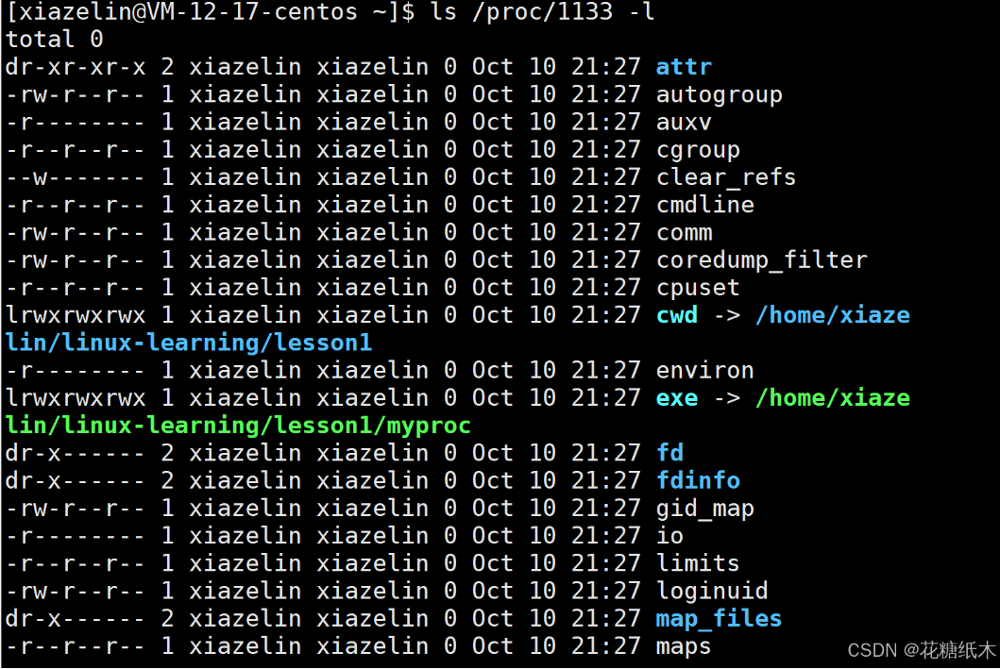
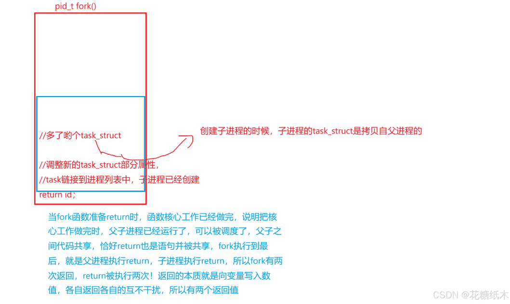

# 标识符`pid`

> 参考链接：
>
> [【Linux】进程的属性：标识符pid](https://blog.csdn.net/2302_80652761/article/details/142831399)


## 1、进程的启动

​	在`Linux`下命令行输入的大多数指令本质上就是启动一个进程，但这个进程很快就被`CPU`运行完，如`ls`、`pwd`等。当然，还有一些常驻进程，需要等到用户退出。

## 2、标识符`pid`

​	`pid`相当于是一个进程的编号，每个进程都有一个属于自己的`pid`，但是进程没错启动关闭后，进程的`pid`也会发生变化。

​	可以使用`ps axj | grep my_process`指令来查看我们想看见的进程。

## 3、获取`pid`

​	可以使用系统调用函数`getpid()`获得进程的标识符，如下所示。

```
NAME
	getpid, getppid - get process identification
SYNOPSIS
	#include <sys/types.h>
	#include <unistd.h>
	
	pid_t getpid(void);
	pid_t getppid(void);
```

​	`pid_t`是`long int`的封装。


​	`Linux`下万物皆文件，在根目录下有个目录`/proc/`，但`/proc/`不是磁盘级别的文件，是把内存中数据以文件形式存储下来。在`proc`目录中存放了以数字命名的目录，这个数字其实就是指定进程的`pid`，这些目录里包含的就是每个进程的属性。当进程启动的时候，`/proc/`目录中就会迅速创建一个以该进程`pid`命名的目录文件，并且把该进程属性存入该文件中。当进程关闭的时候，`/proc/`目录就会把对应的目录删除。

## 4、`cwd`文件和`exe`文件

​	`/proc/`目录下以进程`pid`命名的目录中存在两个特别的文件——`cwd`和`exe`文件。

​	`exe`就是该可执行程序在磁盘中的位置，如果该可执行程序正在进行时，把该可执行程序删除，此时该程序还在运行，因为该程序已经加载进内存，删除只是删除该程序在磁盘中的位置，所有该程序还在运行，但此时这个`exe`属性就会变。

​	`cwd`是`current work dir`缩写，即当前工作目录。



## 5、`ppid`

​	一个进程启动时，除了要有自己的`pid`，也要有自己的`ppid`（即父进程`pid`）。启动进程再关闭进程再重新启动进程，会发现父进程（`ppid`）不变，`pid`会改变。

​	一般来说，父进程是一个名叫`bash`的进程，`bash`就是命令行解释器`shell`。在命令行中，执行命令/执行程序，本质就是`-bash`进程，创建的子进程，由子进程执行我们的代码与指令。

## 6、使用系统调用创建进程

```
NAME
	fork - create a child process
SYNOPSIS
	#include <unistd.h>
	
	pid_t fork(void);
RETURN VALUE
	成功，在父进程中返回子进程的pid，子进程返回0；失败，返回-1
	给父进程，没有子进程创建
```

​	有如下程序代码：

```c
int main()
{
    printf("我已经是一个进程！pid: %d, ppid: %d\n", getpid(), getppid());
    pid_t id = fork();
    (void)id;
    printf("我是一个分支！pid: %d, ppid: %d\n", getpid(), getppid());
    sleep(1);
}
```

​	上面程序运行结果如下：

```
[xiazelin@VM-12-17-centos lesson1]$ ./my_process
我已经是一个进程！pid: 27176, ppid: 11424
我是一个分支！pid: 27176, ppid: 11424
我是一个分支！pid: 27177, ppid: 27176
[xiazelin@VM-12-17-centos lesson1]$ 
```

​	经过`fork()`函数后，会多产生一条打印，根据打印结果发现，第三行的`ppid`就是第二行的`pid`，第二行就是第三行的父进程，所有，经过`fork()`函数，两条分支，一个为父进程，一个为子进程，父进程就是这串代码进程自己，子进程就是父进程创建出来新的执行流。

**如何理解代码是共享的**

​	可执行程序从磁盘中加载到内存中，就相当于代码和数据加载到内存，同时操作系统为了管理这个进程，也会为它创建对应`PCB`（父），对应`PCB`指向代码，后来`CPU`调度进程当他执行到函数`fork()`时，所有在系统层面上创建一个新的进程（子），新创建的子进程并没有从磁盘中加载新的代码和可执行程序让子进程跑，也就是这个子进程创建出来，只有内核数据结构没用代码和数据，可是这个子进程创建出来不就是让他帮忙办事的吗？所以系统的设定上就直接要求子进程在创建时指向父进程的代码，也就是让子进程与父进程共享代码，因为子进程并没有做加载。子进程的代码是从父进程继承下来的。

​	`fork()`下来后`printf()`打两次就是因为子进程继承父进程的代码。

**为什么数据是各自私有一份的**

​	进程具有很强的独立性，多个进程之间，运行时互不影响，即便是父子进程（比如说：手机上多个进程启动时，其中一个挂了，剩余进程依旧可以正常使用）

​	有如下程序代码：

```c
  1 #include<stdio.h>                                                                                                        
  2 #include<unistd.h>                                                                                                       
  3 #include<sys/types.h>                                                                                                    
  4                                                                                                                          
  5 int gval = 0;                                                                                                            
  6                                                                                                                          
  7 int main()                                                                                                               
  8 {                                                                                                                        
  9     printf("我已经是一个进程! pid: %d,ppid: %d\n",getpid(),getppid());                                                   
 10     pid_t id = fork();                                                                                                   
 11                                                                                                                          
 12     if(id>0)                                                                                                             
 13     {                                                                                                                    
 14         while(1)                                                                                                         
 15         {                                                                                                                
 16             printf("我是父进程，pid: %d,ppid: %d,ret id: %d,gval: %d\n",getpid(),getppid(),id,gval);                     
 17             sleep(1);                                                                                                    
 18         }                                                                                                                
 19     }                                                                                                                    
 20     else if(id==0)                                                                                                       
 21     {                                                                                                                    
 22         while(1)                                                                                                         
 23         {                                                                                                                
 24             printf("我是子进程，pid: %d,ppid: %d,ret id: %d,gval: %d\n",getpid(),getppid(),id,gval);                     
 25             gval++;                                                                                                      
 26             sleep(1);                                                                                                    
 27         }                                                                                                                
 28     }            
 47     return 0;                                                                                                            
 48 }   
```

​	上面程序运行结果如下：

```
[xiazelin@VM-12-17-centos lesson1]$ ./my_process
我已经是一个进程！pid: 27547, ppid: 26673
我是父进程，pid: 27547,ppid: 26673,ret id: 27548,gval: 0
我是子进程，pid: 27548,ppid: 27547,ret id: 0,gval:0
我是父进程，pid: 27547,ppid: 26673,ret id: 27548,gval: 0
我是子进程，pid: 27548,ppid: 27547,ret id: 0,gval:1
我是子进程，pid: 27548,ppid: 27547,ret id: 0,gval:2
我是父进程，pid: 27547,ppid: 26673,ret id: 27548,gval: 0
我是子进程，pid: 27548,ppid: 27547,ret id: 0,gval:3
我是父进程，pid: 27547,ppid: 26673,ret id: 27548,gval: 0
我是子进程，pid: 27548,ppid: 27547,ret id: 0,gval:4
```

**理解创建子进程**

​	一个`fork()`函数为什么会有两个返回值？



​	一个变量为什么会有不同值？因为进程之间需要独立性。

​	`fork()`之后，父子进程谁先运行，由`OS`的调度器自主决定。