# 进程的状态

> 参考链接：
>
> [【Linux】进程属性：进程的状态](https://blog.csdn.net/2302_80652761/article/details/143333114)


## 1、进程的状态

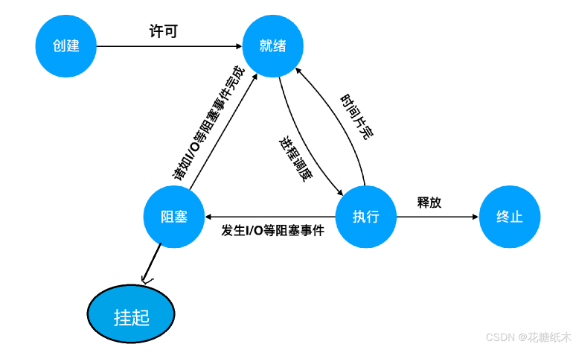

### 1.1并行与并发

​	`CPU`在指向进程代码时，不是把一个进程代码执行完毕再去执行下一个进程，而是`CPU`会给每一个进程分配一个时间片，`CPU`基于这个时间片进行调度轮转（单`CPU`下）。

​	单`CPU`下，`CPU`基于时间片进行轮转的策略（也就是进程切换），让多个进程在一段时间内，得以推进的一个情况被称作并发。

​	`CPU`切换和运行的速度极快，用户感知不到

​	并行指在同一时刻，多个处理器或者多核处理器上同时处理多个任务。并发指在一个时间段内，有多个任务都处于启动到运行完毕之间的状态，这些任务在同一个处理器上运行。并发并不是真正意义上的“同时进行”，而是`CPU`通过时间片轮转的方式，使得用户感觉到好像是多个应用程序同时在进行。

### 1.2 时间片

​	`Linux/Windows`这种民用级操作系统，一般都是分时操作系统，调度任务追求的是公平。

​	于此相对的还有实时操作系统，比如车载系统，例如在遇到危险时需要踩刹车，如果此时是分时操作系统，就会导致不能在第一时间进行刹车，如果是实时操作系统，就会提高踩刹车这一动作的优先级，让他先进行调度。

### 1.3 进程具有独立性

​	一个进程出现问题不会影响另一个进程，因为进程具有独立性。多进程运行时互不干扰，需要独享各种资源。

### 1.4 等待的本质

​	`OS`给每个`CPU`都会提供一个运行队列也就是`struct_runqueue`，这个结构体里面就会有一个`task_struct`指针，链接上所有被加载进来的进程的`PCB`，从而形成基于链式结构的调度队列，然后`CPU`就会基于时间片轮转进行进程调度。

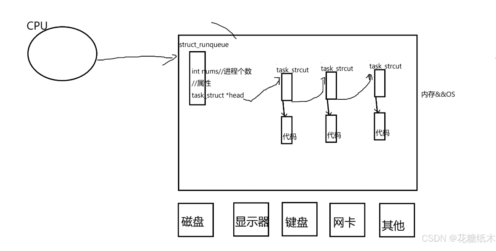

​	只要进程在运行队列中，可以随时被调度，该进程就叫运行状态。对进程的管理就变成对链表的增删查改。

​	同时我们的`OS`也会对底层硬件进行管理，先描述再组织。每一个硬件设备对应一个结构体`struct_device`，然后通过链表结构链接起来，同时`OS`层面上定义一个指针指向第一个设备，从而可以访问到所有设备。

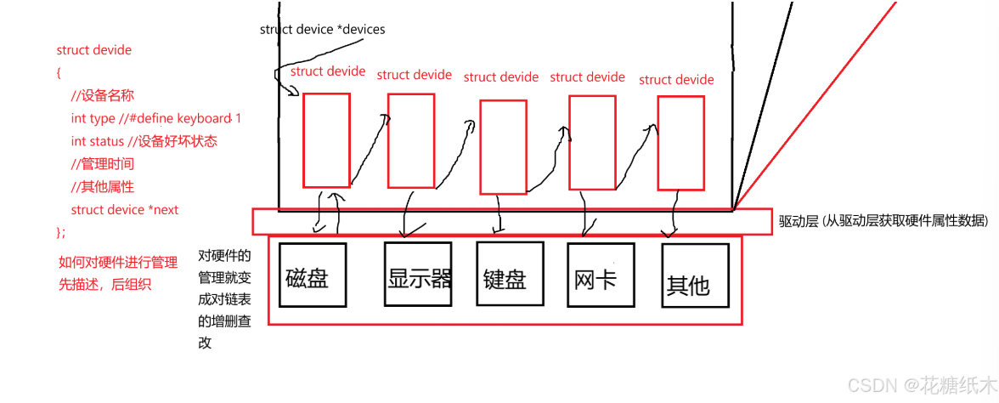

​	我们的代码进程里面肯定会包含一些`IO`操作，也就是少不了一些外设的访问，根据冯诺依曼体系，只要我们不是在进行加减乘除这种简单的计算，剩下的大部分在进行访问外设操作。比如`scanf`，当`CPU`执行到`scanf`时，需要等待从键盘上获取数据，在这个等待的过程中就不能把该进程放入运行队列中，此时就要被设置为阻塞状态，当获取键盘数据就绪后，再次放回运行队列中。

​	那么怎么知道获取硬件设备数据就绪了呢？

​	每一个设备描述结构体里，有一个指针`task_struct *wait_queue`来代表等待队列，当设备变成阻塞状态后，此时操作系统就要把该进程从运行队列里面剥夺下来，放入等待队列，等待硬件传来的数据。

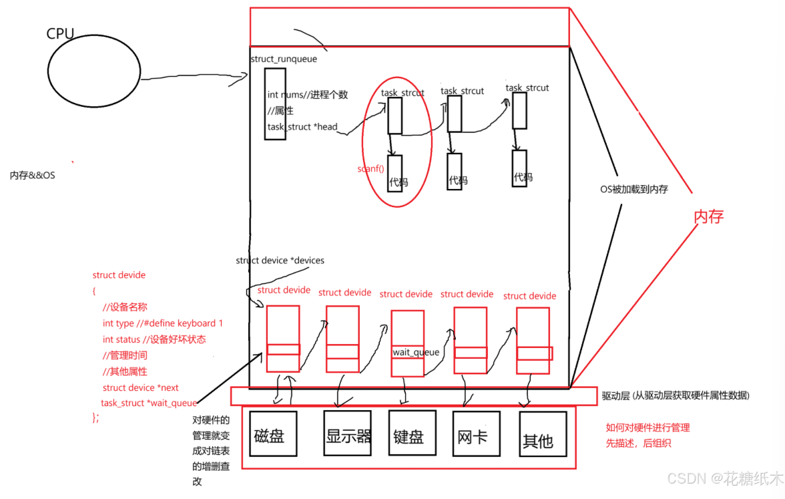

​	当`CPU`调度运行到画圈的进程时执行到`scanf()`时，就会被剥夺下来链接到描述键盘设备的结构体对象中的`wait_queue`上变成阻塞状态，如果有多个进程需要从键盘访问数据，根据优先级依次以链式结构链接起来，在键盘上等待。

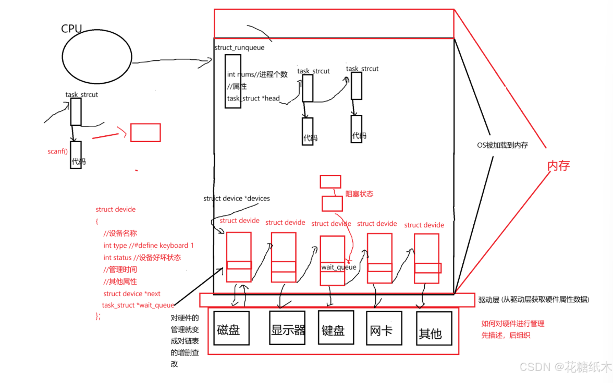

​	`CPU`调度进程才能运行推进代码，当链入到等待队列中，不会运行推进代码，等待硬件的数据，此时卡顿住。卡顿两种情况，要么`CPU`不调度了，要么进程太多，`CPU`调度不过来，上层用户就可以感知到卡顿。

​	那么当进程获取到从硬件传来的数据后，此时该进程`PCB`就要从等待队列中重新链入运行队列中继续被`CPU`调度运行。

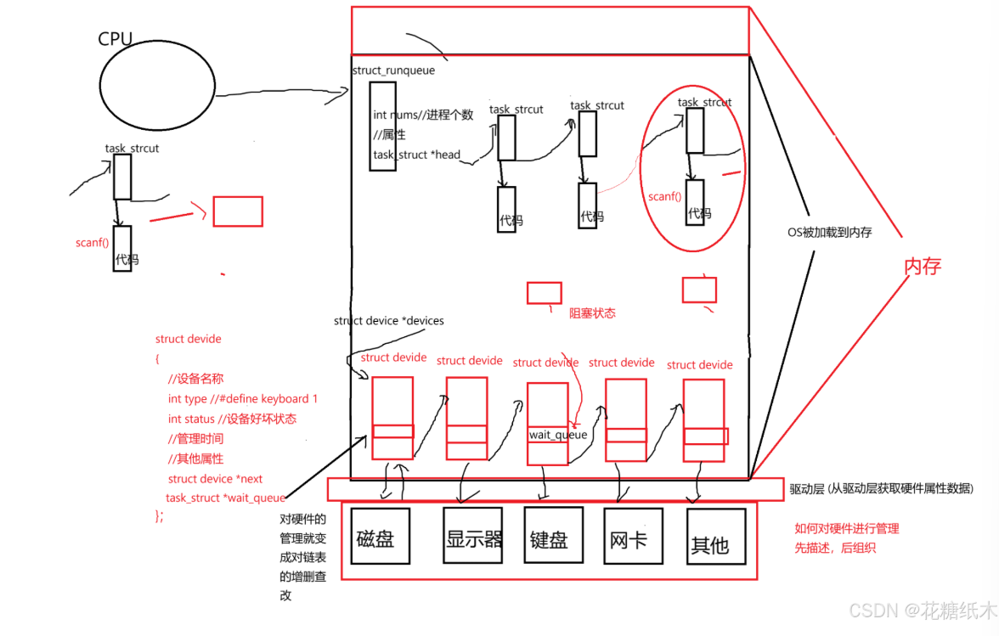

​	本质上运行状态与阻塞状态没区别，运行状态所有进程竞争`CPU`资源，阻塞状态所有进程竞争对应硬件资源。运行与阻塞的本质就是让进程`PCB`处于不同的队列中。运行状态与阻塞状态不断转换的过程就是队列的头部移除与尾插，整个调度就变成了数据结构的增删查改。

​	所以等待的本质就是：链入目标外设里，`CPU`不调度！！！


​	当在阻塞等待期间内存资源严重不足时，会出现挂起。

​	在阻塞状态时，进程不会被调度，但是该进程对应的代码数据依旧会占用内存数据，`OS`为了保证系统安全运行，就会把该进程的代码数据换入磁盘中去，保留该进程`PCB`，当阻塞状态结束后，再把代码数据换出来，重新链入运行队列中，被`cpu`调度。磁盘中有一个专门处理换入换出的区域叫做`swap`分区。此时被换出的进程被叫做阻塞挂起状态。

​	在运行状态也会有挂起，但是一般风险太大，`OS`一般没开启，因为`CPU`调度太快了。运行挂起就算当进程太多时，尾部的一些进程长时间不会被调度，此时`OS`就会把尾部的一些进程对应的代码换入到磁盘中去，这就是运行时挂起状态。

​	如果`OS`进行换入换出解决不了，`OS`就可能会直接杀死该进程。应用闪退就是如此。

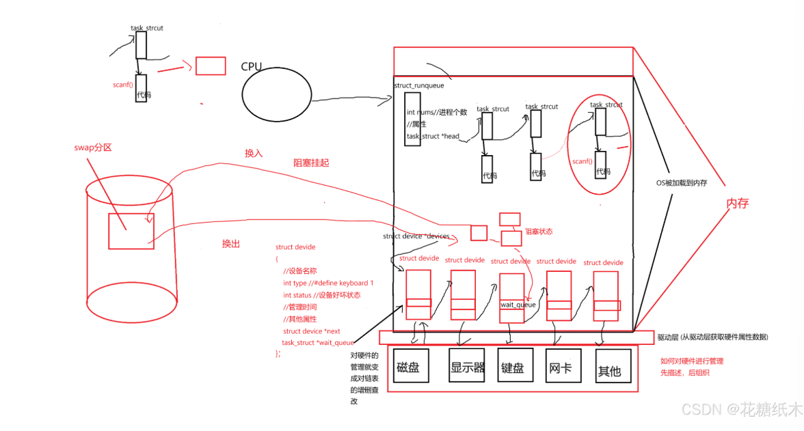

​	挂起的本质就是用时间换空间。

​	一般云服务器上会把`swap`分区给禁止，因为在大型互联网公司上，更倾向于时间，而换入换出本质就是在做`IO`操作不断于硬件设备外设进行交互，所以时间大大增加。所以更倾向于买更多服务器，使机房承载能力增强，和优化软件。

## 2、`Linux`下进程的状态

​	`Linux`下运行状态有如下几种：

```
static const char * const task_state_array[] = {
	"R (running)",		/* 0 */
	"S (sleeping)",		/* 1 */
	"D (disk sleep)",	/* 2 */
	"T (stopped)",		/* 4 */
	"t (tracing stop)",	/* 8 */
	"x (dead)",			/* 16 */
	"Z (zombie)",		/* 32 */
};
```

| 运行状态 | 描述                                                         | 备注         |
| -------- | ------------------------------------------------------------ | ------------ |
| R        | 并不意味着进程一定在运行中，它表明进程要么是在运行中要么在运行队列里 | 运行状态     |
| S        | 进程在等待事件完成，这里的睡眠有时候也叫做可中断睡眠         | 睡眠状态     |
| D        | 有时候也叫不可中断休眠状态，在这个状态的进程通常会等待`IO`的结束 | 磁盘休眠状态 |
| T        | 可以通过发送`SIGSTOP`信号给进程来停止进程，这个被暂停的进程可以通过发送`SIGCONT`信号让进程继续运行 | 停止状态     |
| X        | 这个状态只是一个返回状态，你不会在任务列表里看到这个状态     | 死亡状态     |

### 2.1 `S`与`R`状态

​	运行如下代码并查看状态：

```c
#include<stdio.h>
#include<unistd.h>
 
int main()
{
    int cun = 0;
    while(1)
    {
        printf("hello word cun: %d\n",cun++);
    }
    return 0;
}
```

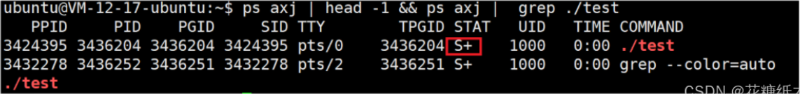

​	再运行如下代码并查看状态：

```c
#include<stdio.h>
#include<unistd.h>
 
int main()
{
    int cun = 0;
    while(1)
    {
        //printf("hello word cun: %d\n",cun++);
    }
    return 0;
}
```

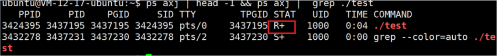


​	两段类似的代码，为什么有`printf()`和没有`printf()`的运行状态不一样呢？

​	一个进程时间片是非常短的，根据冯诺依曼体系，`printf()`并不是直接往显示器上打的，是往内存里打的，显示器也有自己的缓存，死循环打印`printf()`很快就把缓存写满了，不能保证显示器时时刻刻是就绪的，虽然每一次看到了打出来的消息，但是`printf()`打印就会有`IO`，并且`IO`操作速度非常慢，大部分时间都在做`IO`（`S`状态），极少的时间是在运行代码（`R`状态），一直在等待显示器，所以是阻塞状态等待状态（即`S`状态）。所以没有`printf()`打印时就不用进行`IO`交互，一直处于运行队列中，所以一直是运行状态（即`R`状态）。


​	为什么说`S`是阻塞等待状态，运行如下代码并查看状态：

```c
#include<stdio.h>
#include<unistd.h>
 
int main()
{
    int cun = 0;
    while(1)
    {
        scanf("%d",&cun);
        printf("hello word cun: %d\n",cun++);
    }
    return 0;
}
```

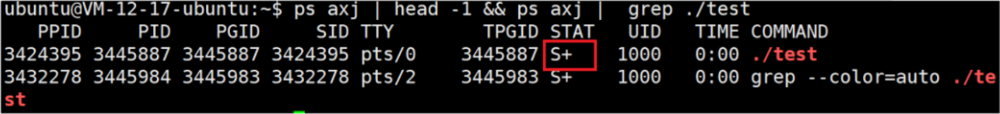

​	运行该代码，此时正在等待键盘输入，此时为阻塞状态，并且在阻塞状态时，可以被指令`kill -9 [pid]`杀死，所以`S`状态是可中断睡眠，即浅睡眠。

### 2.2 `D`状态

​	当要向磁盘中永久保存数据时：

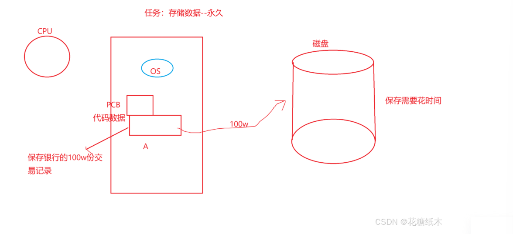

​	进程`A`的目的就是要向磁盘中保存`100w `份数据，而磁盘保存数据需要花费时间，所以进程`A`在保存数据时，所处的状态就是阻塞等待状态（该过程是先从运行队列下剥夺下来，链入等待队列中，并且更改状态），等待磁盘保存完毕，但此时阻塞等待状态不能被终止，一旦被终止，数据写入失败，就会发生数据丢失大型事故，所以这种状态被称为深度睡眠状态——不可中断睡眠，所以该状态不能被`OS`给杀死。

​	如何演示这种情况：使用指令`dd`。用`dd`命令来做磁盘级的拷贝，但是很容易把`OS`干挂掉。

​	`dd`命令是一个非常强大的工具，但如果使用不当，可能会导致数据丢失。特别是在对磁盘等存储设备进行操作时，一定要确保操作的目标是正确的，并且备份好重要的数据。

​	由于`dd`命令可能会对系统资源进行大量占用，在执行`dd`命令时，要注意系统的负载情况，避免对其他正在运行的程序产生过大的影响。

​	所以操作系统就一个阻塞概念，而在操作系统内核下就是不同解决方案，这就是操作系统与具体操作系统的差别。

​	在百分之九十健康的`OS`中，很难出现`D`状态，也是一种瞬时状态。一般如果查到`D`状态，一般就是磁盘或者系统要挂掉了，磁盘老化或者磁盘空间严重不足了，磁盘一直在做碎片数据和合并节省空间，一直让进程等。

​	查到`D`状态，有两种情况，一种是高`IO`，保存几百`GB`数据周期比较长可以看到，另一种是磁盘响应不过来，导致查到，在企业里单台机器拷贝几百`GB`数据是非常少的，大部分是拷贝少量数据，然后因为磁盘的问题，导致`IO`一直没有完成，所以`D`状态就出现了，所以在正常磁盘下查到`D`状态差不多就要挂掉了。

### 2.3 `T`状态

​	运行如下进程代码：

```c
#include<stdio.h>
#include<unistd.h>
 
int main()
{
    int cun = 0;
    while(1)
    {
        //scanf("%d",&cun);
        printf("hello word cun: %d\n",cun++);
    }
    return 0;
}
```

​	这里认识两个信号：`18: SIGCONT`和`19: SIGSTOP`。对上面循环打印进程使用信号19，有如下结果。

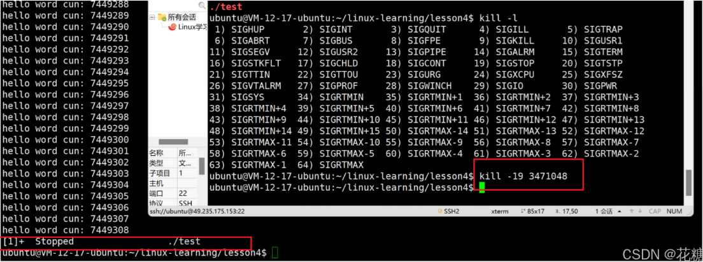

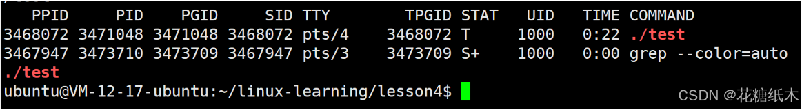

​	如果想要让该进程重新处于运行状态，可以对上面进程使用信号18。

> ​	对于一个普通进程（与终端关联），当进行打印操作（例如使用`printf()`）时，数据会先进入标准输出缓冲区。通常，缓冲区在遇到换行符或者缓冲区满等情况时，会将数据输出到终端显示。
>
> ​	当一个进程成为后台进程后，如果它尝试向终端进行打印操作，由于它和终端的关联已经改变，这个打印操作会变得复杂。因为后台进程的输出可能会干扰终端正在进行的其他操作。
>
> ​	在后台进程中，如果没有对输出进行合适的重定向，当它试图向终端写入数据时，系统会根据终端的当前状态和配置来处理。如果终端处于一种不接受或者无法接受新数据的状态（例如正在进行其他的输入操作或者终端的缓冲区已满），那么后台进程的打印操作可能会被暂停。
>
> ​	例如，假设终端正在等待用户输入密码，此时一个后台进程试图向终端输出大量数据。由于终端当前的焦点是在密码输入上，后台进程的输出可能会被阻塞，直到终端的状态允许接收这些数据，从现象上看就是打印操作暂停了。

### 2.4 `t`状态

​	当我们进行对可执行程序进行调试的时候，就会出现`t`状态，可追踪式暂停。

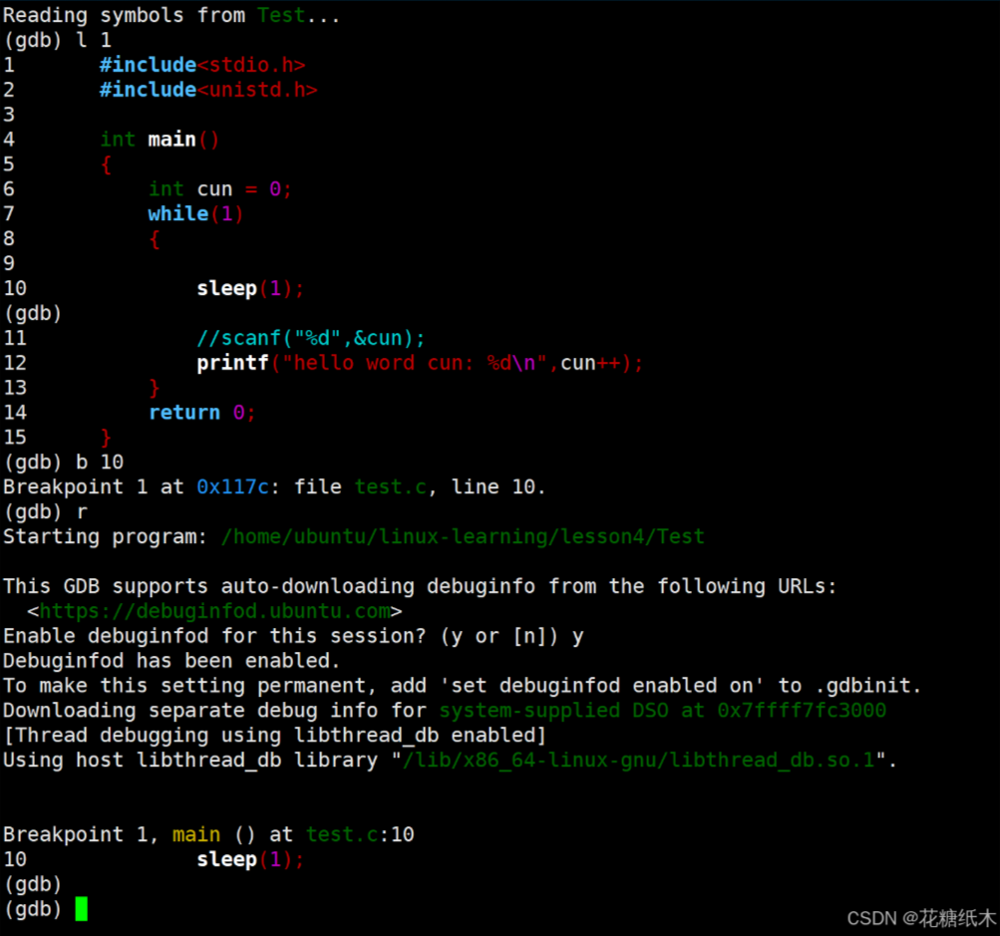

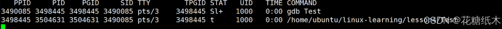

### 2.5 `S、D、T、r`状态的区别

​	`S`和`D`主要是等待某种资源偏向阻塞的概念，而`T`和`t`是操作的需要把进程暂停，或者进程非法被`OS`给暂停，或者这个进程被其他进程追踪了，比如`gdb`。

​	`T`也可以理解成阻塞，但是由用户来决定是否可以进行访问资源，如果非法就阻止，如果操作没问题用户就可以允许进行访问。

* 非法操作是指进程违反了操作系统设定的一些规则或者访问了它没有权限访问的资源。例如，进程可能试图访问另一个进程的内存空间，而没有得到相应的授权，或者试图修改操作系统内核的某些关键数据结构，这些行为都是不被允许的。

* 不致命意味着这种操作虽然是错误的，但不会立即导致系统崩溃或进程无法恢复。例如，一个进程试图读取一个受保护的系统文件，但没有足够的权限，这是非法操作，但系统可以通过暂停该进程来阻止它继续进行这种错误行为，而不是直接终止它，因为有可能通过一些措施（如赋予正确的权限）来使进程恢复正常运行。

### 2.6 `X`状态

​	`X`状态表示死亡状态，首先我们要知道进程为什么要被创建——为例完成某种任务。如何确定该进程成功完成了该任务？所以我们需要知道该进程的退出状态。

​	这里介绍一个指令：`echo $？`。表示查看最近一次进程的退出信息。

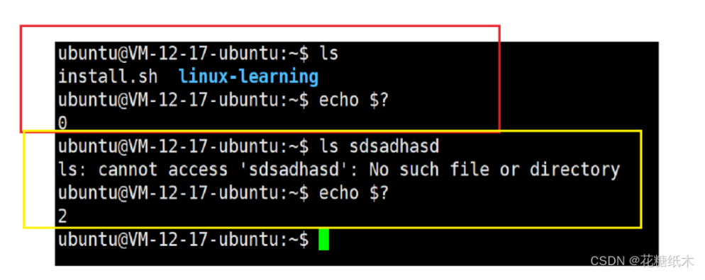

​	`ls`是一个进程，当他执行成功时，使用`echo $？`显示0，表示最近一次程序执行成功，当显示非0，表示最近一次进程执行失败。

​	`ls`命令是由`C`语言写的，它也有`main()`函数，`main()`函数里也有`return`。`return`返回的数字就是该程序的返回值，返回值确定了该程序是否执行正确，`main()`函数返回值告诉父进程或者`OS`执行结果是否正确。通过返回值告诉父进程或者`OS`，把任务完成的怎么样。

### 2.7 `Z`状态

​	维持退出信息，方便父进程和`OS`进行查询。但是如果父进程不对退出信息进行回收，子进程就一直不会退出，一直等待父进程回收，这个时候就是僵尸状态，`task_struct`一直消耗内存，这时就会造成内存泄漏，直到父进程拿到退出信息才会变成`X`状态，彻底被回收。

​	进程退出：进程 = 内核数据结构（先创建后释放）+ 代码数据

	1. 代码不会执行，首先释放的是进程对应的代码数据
	1. 进程退出要有退出信息（进程退出码），该信息保存在进程的`task_struct`内部
	1. 管理结构`task_struct`必须被`OS`给维护起来，方便用户未来进行获取进程退出信息
	1. 释放代码数据维护内核数据结构的这个过程就叫做僵尸

​	如何去看到僵尸状态？创建子进程-->父子进程同时存在-->让子进程退出，父进程存活，父进程什么都不做。

```c
#include <stdio.h>
#include <unistd.h>
 
int main()
{
    printf("父进程运行: pid: %d,ppid: %d\n", getpid(), getppid());
    pid_t id = fork();
    if (id == 0)
    {
        // 子进程
        int cut = 10;
        while (cut)
        {
            printf("我是子进程,我的pid: %d,ppid: %d,cut: %d\n", getpid(), getppid(), cut);
            sleep(2);
            cut--;
        }
    }
    else
    {
        // 父进程
        while (1)
        {
            printf("父进程运行: pid: %d,ppid: %d\n", getpid(), getppid());
            sleep(1);
        }
    }
    return 0;
}
```

​	上述代码执行后，子进程循环十次就结束，父进程一直循环不做任何处理，当子进程执行完毕结束后，就会由`S`变为`Z`状态，维护自己的`task_struct`，方便未来父进程读取退出状态，如果父进程一直不读取，`task_struct`就会一直消耗内存，这时就会造成内存泄漏。

​	语言层面的内存泄露问题，如果发生在常驻内存的进程中，影响就很大，因为不断消耗内存。

> 僵尸进程的危害：
>
> 1. 进程的退出状态必须被维持下去，因为他要告诉关心它的进程（父进程），你交给我的任务，我办的怎么样了。可父进程如果一直不读取，那子进程就一直处于`Z`状态。
> 2. 维护退出状态本身就是要用数据维护，也属于进程基本信息，所以保存在`task_struct(PCB)`中，换句话说，`Z`状态一直不退出，`PCB`一直都要维护。
> 3. 一个父进程创建了很多子进程，就是不做回收，就会造成内存资源的浪费。因为数据结构对象本身就要占用内存，想想`C`中定义一个结构体变量（对象），是要在内存的某个位置进行开辟空间的。
> 4. 造成内存泄漏。

### 2.8 孤儿进程

​	在子进程父进程同时存在时，把父进程给杀掉，父进程就会被父进程的父进程给回收，此时子进程就会变成孤儿进程，同时子进程的父进程就会变成系统进程（较新版本叫`systemd`，老一点的叫`init`）。


​	父进程退出，子进程会被系统领养（孤儿进程），父进程不退，子进程退出，就要看父进程是否回收，如果不回收，子进程就会变成僵尸进程，如果回收，子进程就直接退出。