# 进程切换

> 参考链接：
>
> [【Linux】进程属性：优先级。进程切换](https://blog.csdn.net/2302_80652761/article/details/143449237)


## 1、进程优先级

​	`CPU`资源分配的先后顺序，就是指进程的优先权（`priority`）。优先权高的进程有优先执行的权利。配置进程优先权对多任务环境的`Linux`很有用，可以改善系统性能。还可以把进程运行到指定的`CPU`上，这样一来，这不重要的进程安排到某个`CPU`，可以大大改善系统整体性能。

​	当目标资源比较少（`CPU`或硬件资源），而进程数量比较多，所以需要依靠优先级确定调度顺序。优先级和权限有所不同，权限的本质是解决能不能的问题，而优先级是已经确定能，只不过是谁先谁后的问题。

​	要有优先级，进程`PCB`内部必须维护优先级属性。

​	`task_struct`-->优先级属性-->特定的几个`int`类型的变量表示优先级（优先级数字越小，代表优先级越高）

​	可以使用`ps -l`默认查看当前终端的进程相关信息，重点是进程本身的运行状态、优先级等信息。`ps -al`查看整个系统的进程信息，包括其他终端、后台运行的进程。

​	`PRI(priority)`就是表示`Linux`进程的优先级，`NI(nice)`指的是优先级的修正数据。最终优先级 = `PRI` + `NI`。

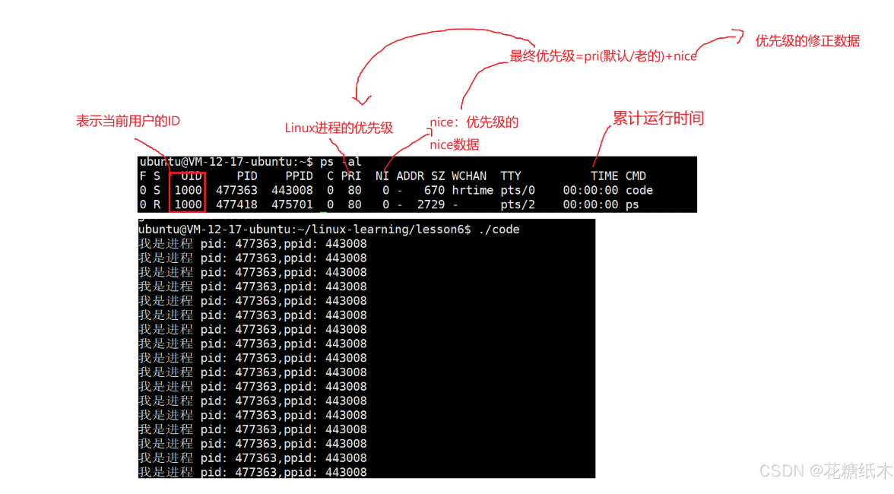

​	为什么要用这样的确定优先级的方式进行修改，而不是直接对`PRI`进行修改来确定优先级呢？

​	因为实际运行时，可能在特定的某种情况下，想去更改当前进程的优先级，`Linux`没有直接设计为，直接对`PRI`值进行更改，主要是因为直接更改会存在一些特殊情况，比如，这个进程正在被调度，这时候如果把优先级调高调低，那么他此时优先级算高还是算低呢？所以`Linux`设计出`NI`，修改优先级，只能更改`NI`值，通过修改`NI`值的方法，下一次再调度这个进程的时候，由系统来更新这个进程的优先级，这样就避免了很多特殊情况。

​	进程的优先级竞争的是`CPU`资源。

### 1.1 `UID`

​	每一个进程都会有一个用户名，并且在`OS`内部会为用户维护有一个当前进程的用户`ID`的东西，因为用户名是字符串，字符串无论是做修改还是比较，所花费的时间复杂度比较高，所以就会有一个`int`类型的变量来代表用户名，就是`UID`。

​	使用`ls -ln`查看`UID`，这里的`n`就表示把所有能显示成数字的都显示成数字，而不是字符串。

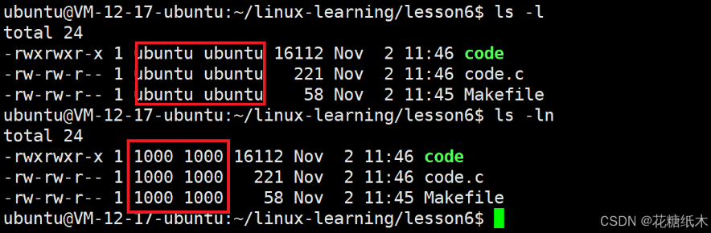

​	`UID`可以区分文件是属于谁的，也可以区分进程是谁启动的。

​	为什么要知道进程是谁启动的，有什么意义？

1. 文件会记录下拥有者，所属组和对应权限
2. `Linux`下一切皆文件
3. 所有操作都是进程操作，进程会记录谁启动的
4. 通过进程自己的`UID`与文件的拥有者和所属组进行比较，就可以进行权限的控制

### 1.2 修改优先级

​	修改优先级的方法：指令和代码

​	进程优先级的修改不是特别高频的动作，因为用户没有全局视角，不能很好的确定哪个进程更重要，不能很好的进行修改优先级。建议使用系统默认设定的优先级，不建议用户修改优先级。

**通过指令方法修改优先级**

​	指令：`top-->r-->进程pid-->修改大小`

​	执行如下程序代码并查看状态：

```c
#include <stdio.h>
#include <unistd.h>
 
int gval = 0;
 
int main()
{
    while(1)
    {
        printf("我是进程 pid: %d,ppid: %d\n",getpid(),getppid());
        sleep(1);
    }
    return 0;
}
```

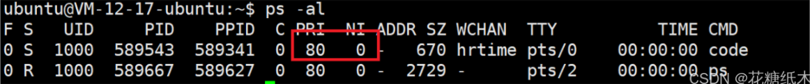

​	进程的优先级是80，接着对优先级进行修改`top-->r-->589543-->100`，看看最终`PRI`的值，如下所示。

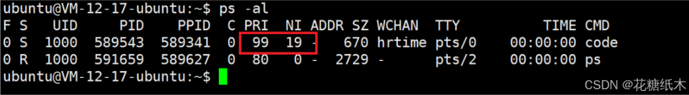

​	这时`NI`的值变成19，所以说明`NI`的值有个最大范围19。接着再对进程优先级进行修改`top-->r-->589543-->-100`，看看最终`PRI`的值，如下所示。（注意使用`sudo top`指令进行操作，不然系统不允许频繁修改优先级）

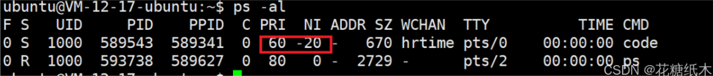

​	这时`NI`值变成-20，所以说明`NI`的值有个最小范围-20。所以`NI`的取值范围`[-20,19]`，共四十种优先级。

​	我们还可以注意到，`PRI`先变成了99再变成了60，都是基于默认的`PRI`（该实例中默认`PRI`值为80）来进行加减的。公式为：`最终优先级 = PRI + NI`。

​	为什么`NI`不能设置任意大小，而是设置在可控范围内呢？

​	因为我们用的`OS`是分时操作系统，在进行调度的时候，要保持尽量公平，用户层面才不会明显感觉到优先级的存在，如果我们可以任意设置`NI`值，那用户可能会对某一种进程优先级设置的特别高，进而导致我们系统每次调度都优先调度该进程，久而久之，这样就变得不公平了，所以只有把`NI`设置在可控范围内，才不会影响整体的公平调度。

**补充概念**

​	竞争性：有竞争性的存在才会有优先级的概念，比竞争性更靠前的是资源稀缺，系统进程数量多，`CPU`资源少，所以进程之间就会有竞争性的存在，所以优先级的本质就是为了高效完成任务，更加合理竞争相关资源。

## 2、进程切换

### 2.1 概念

1. 时间片到了，进程就要被切换
2. `Linux`是基于时间片进行调度轮转
3. 一个进程在时间片到了的时候，并不一定跑完了，可以在任何地方重新被调度切换
4. 感性理解进程切换

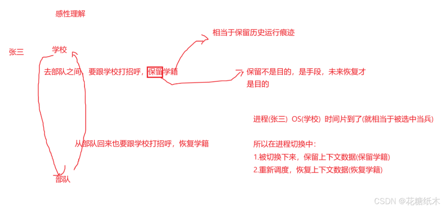

### 2.2 切换过程

​	进程在运行的时候，会有很多临时数据，都在`CPU`的寄存器中保存。

**`EIP`寄存器**

​	认识一个寄存器`EIP`，存有一个`PC`指针，用于保存正在执行指令的下一个指令的地址或者计数器。

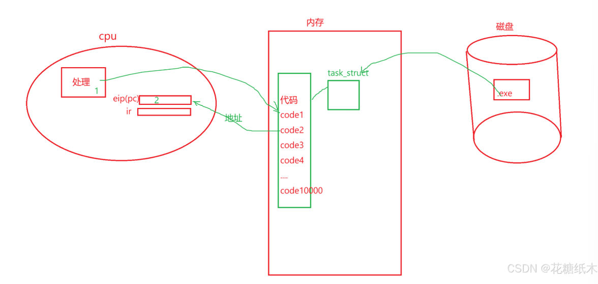

​	假如`CPU`正在处理`code1`代码，那么`EIP`寄存器里面就会存放下一个要执行代码`code2`的地址，当正要执行`code2`时，地址就增加到下一个执行代码的地址。如果`code1`要调用`code1000`，那么`EIP`寄存器里存放的就是`code1000`的地址。

**`IR`寄存器**

​	再认识一个寄存器`IR`，用于存放正在执行的代码指令。

​	当`CPU`开始读取`EIP`里面地址或者计数器对应的指令时，`CPU`就把该指令代码数据从内存加载到`CPU`的`IR`寄存器，然后再在`CPU`内部把该指令代码数据执行完毕，`EIP`寄存器就可以更新成下一个要执行代码数据的地址或计数器。这样就形成了一个循环往复的闭环操作。


​	第一步`CPU`先读取第一个代码指令比如`main`函数，把`main`函数地址存放在`EIP`寄存器中。然后进行上述闭环操作。

​	`CPU`把代码分解交给其它通用寄存器进行处理。

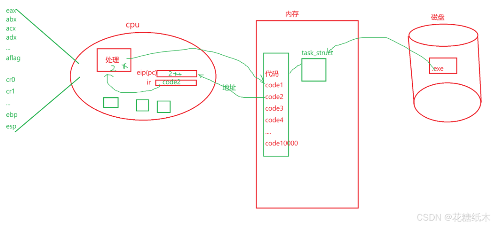

​	`CPU`内部寄存器的数据，是进程执行瞬时状态信息数据，这个信息数据就是上下文数据。

**深入理解切换过程**

​	认识一下新的指令：`objdump [options] file`，其中`options`是各种选项，用于指定要显示的信息类型，`file`是要分析的目标文件、库文件和可执行文件的名称。该指令用于查看反汇编。

​	有一个指针指向正要被调度的进程的`PCB`。调度这个进程，首先第一步把`main`函数的地址加载入`PC`指针，`PC`指针就指向了进程的第一行。然后第二步`CPU`把`PC`指针对应的指令读到`IR`寄存器里面，第三步分析`IR`寄存器里的指令。当`CPU`正要执行这条指令时，`PC`指针自动更新到下一条指令地址，然后执行这条指令时，把该指令对应的操作加载到相应的寄存器中，然后又开始重复执行第二步，把`PC`指针对应的指令读到`IR`寄存器内，然后又重复第三步，周而复始的进行上述操作，整个过程就轮转开了。同时寄存器里面的数据就是当前进程的上下文数据。

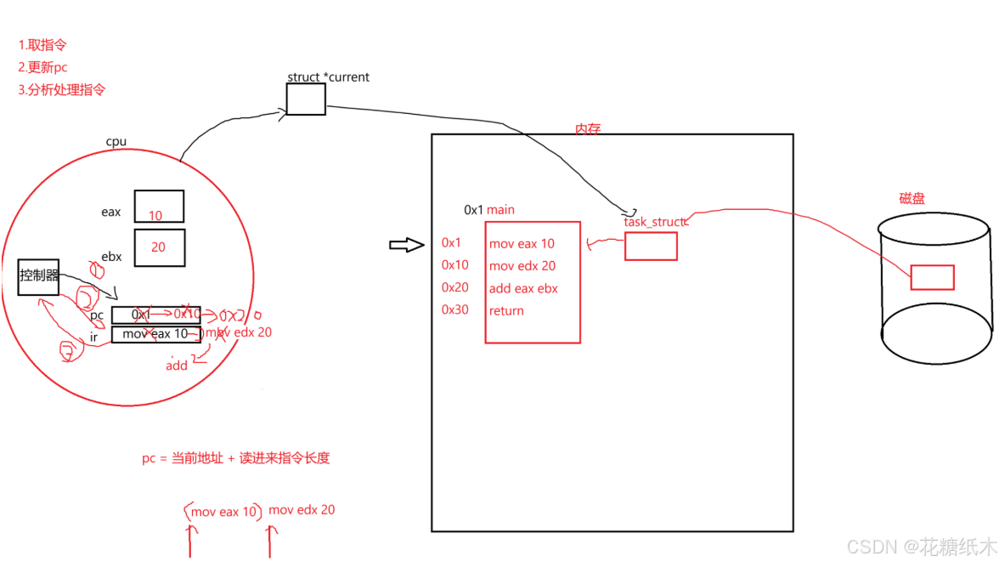

​	在进程切换不做保护的情况下，当上述图片过程执行到`0x20`时，此时突然来了一个进程，然后`task_struct`时间片到了，要被切走了，执行`task_struct2`进程，`task_struct`被放回调度队列中，`struct *current`指向`task_struct2`，开始调度，此时如果直接把第二个进程`main`函数地址加载到`PC`指针里去，`IR`寄存器内容也被更新，那么第一个进程下一次调度位置地址就会被覆盖，`IR`内指令也被覆盖，然后第二个进程进行上述轮转操作，等时间片一到，准备调度第一个进程，这时`CPU`就不能知道第一个进程这次执行要从哪个位置开始，只能从头开始。如下图所示：

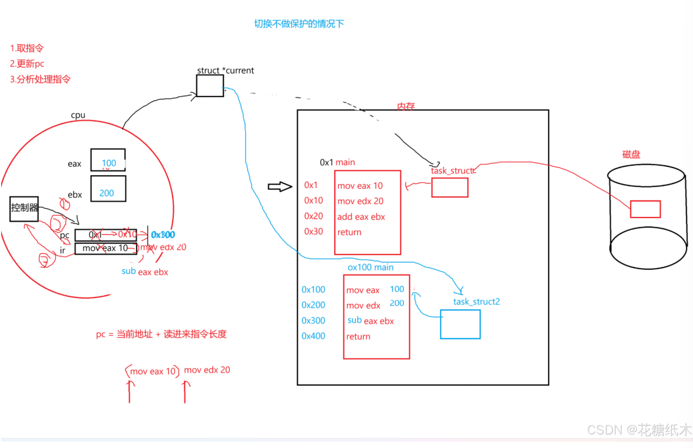

​	在做保护情况下，第一个进程要被切走了，`OS`在某个地方（这个地方肯定不是`CPU`内部）有个空间，用于保存寄存器内部数据，也就是第一个进程上下文数据，把数据拷贝到这个空间去。保存完毕后，`CPU`就可以开始调度第二个进程了，此时覆不覆盖都无所谓了，因为已经把数据给保存起来了。

​	当第二个进程时间片到了，然后又把寄存器内部数据再保存起来，然后又要开始调度第一个进程，此时，直接把第一个进程在上一次结束前，保存的起来的数据，重新拷贝回寄存器内部，然后`CPU`进行调度时，就知道从哪个地方开始执行。

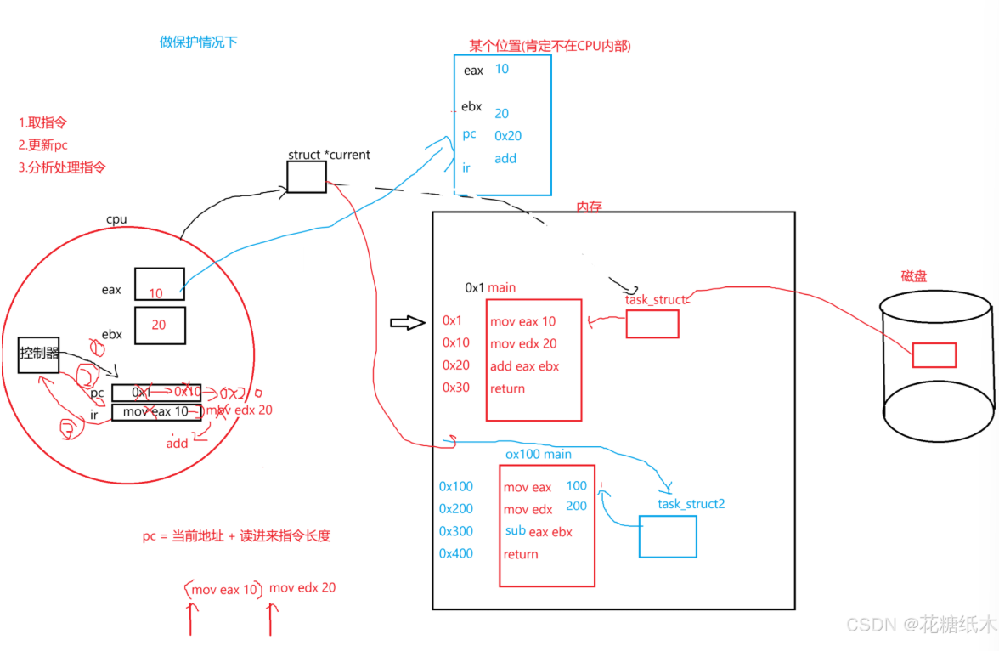

* 进程切换的核心点：进程上下文数据的保存与恢复
* 所以保护就是**切走**：将相关寄存器数据保存起来。恢复就是**切回**：将保存起来的数据恢复到寄存器内
* 所有进程都要做这个工作，不管是新的还是老的
* 每次切换，保存上下文数据后，`CPU`都是全新的
* 每个进程都要有自己的上下文数据，最后要被恢复到`CPU`内部的，寄存器只有一套，多个进程共享使用一套寄存器

​	上述说过保存到某个位置，这个位置肯定不是在`CPU`内部，因为`CPU`是共享的，如果在`CPU`里，一加载就又被覆盖了，所以一定是在内存里。

​	`CPU`里面数据也是临时数据，而每个进程都有一个`PCB`，我们只要认为进程的上下文寄存器数据被保存到`PCB`内部就可以了。

​	所以`PCB`里就有两个属性，程序计数器（`PC`指针），上下文数据。

​	下图是第一代`Linux`内核中，`task_struct`包含的属性：

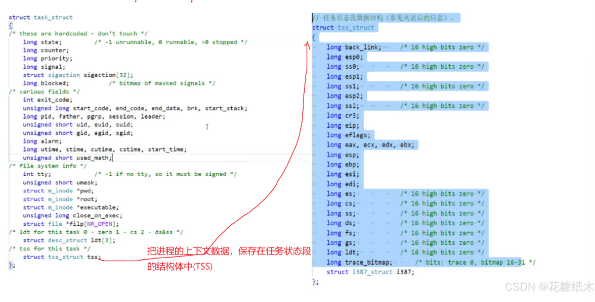
