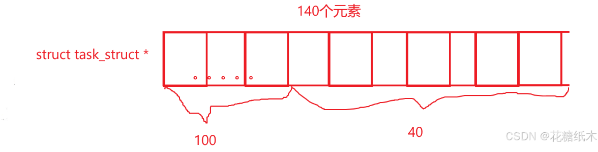
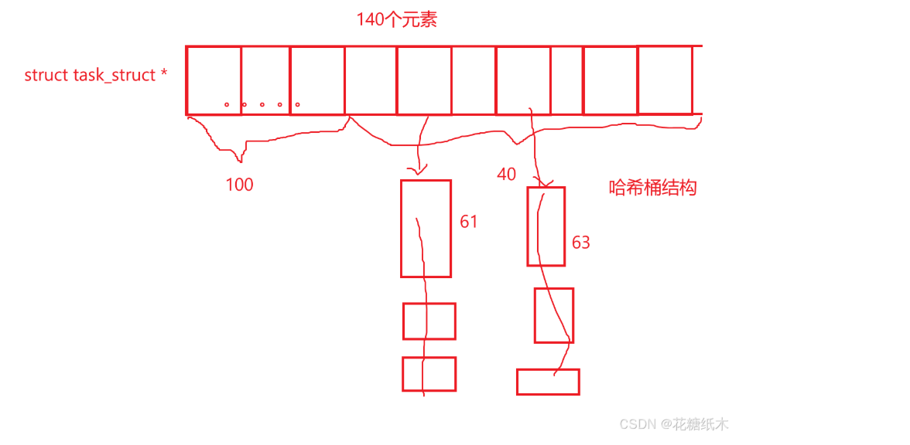
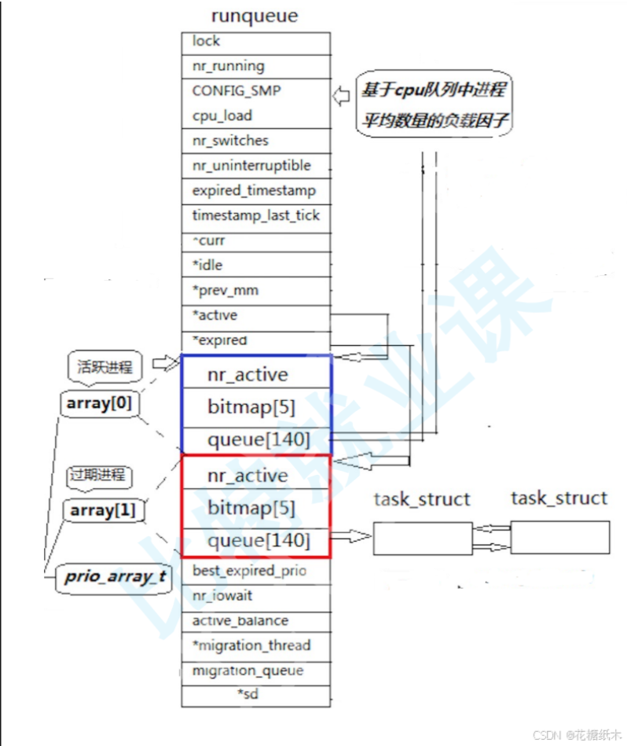
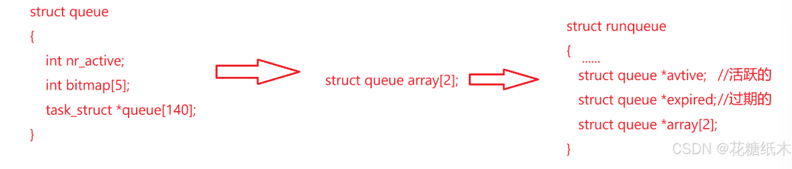
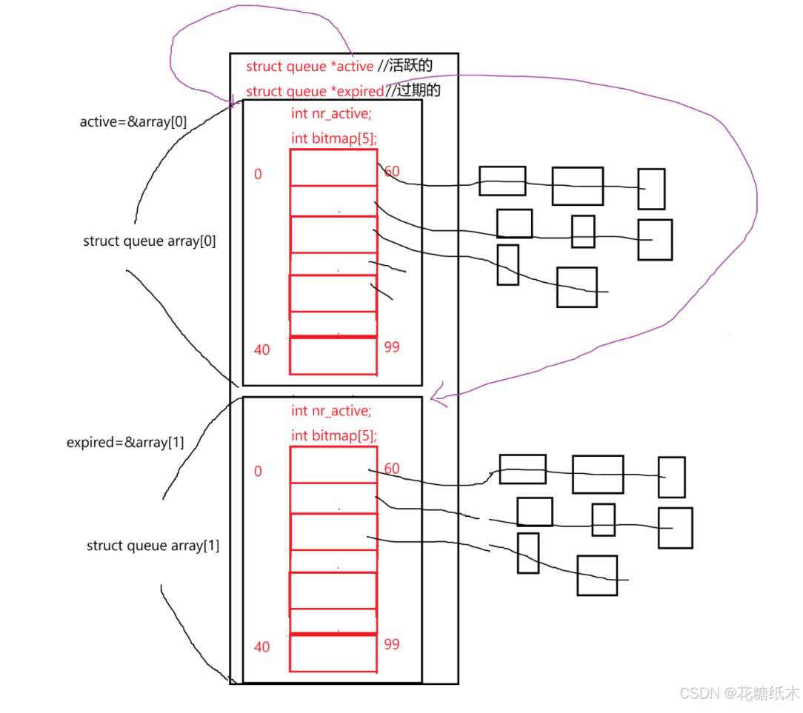

# 进程的调度

> 参考链接：
>
> [【Linux】进程的调度(超详细解读)](https://blog.csdn.net/2302_80652761/article/details/143512619)

​	在特别老的操作系统中，进程的调度是根据`FIFO`调度算法进行调度，先进先出式的调度，其实就是队列，但是不能很好的体现进程的优先级，在上节讲解的进程优先级，知道`NI`值范围是`[-20,19]`，然后创建一个进程默认优先级为80，所以真实的优先级范围是`[60,99]`。如果使用`FIFO`调度算法不能体现出进程优先级，虽然可以根据优先级队列插队，但是插队就会面临遍历，一旦遍历，时间复杂度就会大于`O(1)`。而且调度是一个非常频繁的过程，所以不可能让他的时间复杂度大于`O(1)`。

## 1、`Linux`中真实的调度算法

​	实际上`Linux`操作系统为了体现优先级，它首先在自己的结构中有一个哈希，简单的说也就是数组，它的大小为140个元素，这个数组的类型是`struct task_struct *(name)[140]`，每个元素类型为`task_struct`。前一百个元素是给实时进程分配的，还剩四十个。

​	在上节说到进程的`NI`值范围刚好也是四十个数，刚好就对应了这剩下的四十个位置。为什么是四十个数，就是因为哈希表设置的大小是四十位。不能太多，否则就影响了公平性。

​	这时如果来了一个进程，他的优先级为61，这时我们根据算法：`pir - statpir(60) + 100`，然后就可以确定该进程的位置，把该进程就可以挂在对应位置，因为上面说了元素类型为`task_struct *`，如果又来了一个相同优先级的进程，就挂在它后面，相同优先级的挂在一起，优先级较小的就挂在数组靠后位置，这样做法时间复杂度就是`O(1)`。

​	调度他们的时候，就是从60位置开始往后依次找，如果该队列为空就往下找，不为空就取出调度。这样从前往后找，就是根据优先级来查找。

​	每一个`CPU`都有自己的运行队列，而这个队列中有两个这个哈希表。

​	根据上图，得出下面关系：

`nr_active`表示有多少个有效进程。`bitmap[5]`是一个位图。

​	`active`指向第一个数组位置，`expired`指向第二个数组位置。

1. `CPU`只会从`active`指向的数组中选择进程进行调度，时间片到了就选择下一个进程。`CPU`首先在`runqueue`中找到`active`，然后直接访问哈希表，从上往下进行扫描，为空就扫描下一个，不为空就在该散列头部选取进程进行调度，纵向表示根据优先级顺序排队，横向根据先后顺序排队。
2. 调度有三种情况：
   * 运行退出--->不放回调度队列
   * 不退出，但是时间片到了
   * 有新的进程产生

​	借着有新的进程产生来说，为什么要维护两个队列呢？

​	先分析如果只有一个队列会有什么问题：如果`CPU`正在调度一个队列，`CPU`可能正在选择这个队列有哪些进程需要被选择，但是这时，如果突然出现了一个新进程，是不是要放在合适的位置，这时就会存在一个问题，对于这个新进程要插入，就是让`OS`进行插入，而`CPU`让`OS`进行调度，这时是新建还是调度呢？无论是哪种情况，都面临着新进程不断越来越多，只会影响当前进程的调度，更关键的是，我们有个非常重要的认识：调度器要非常均衡的进行进程调度。

​	调度器要非常均衡的进行进程调度，可是这与有一个概念非常冲突——优先级，优先级高的先被调度，如果新来的进程优先级特别高，一直插入在前面，那么`CPU`就一直在前面进行调度，导致后面的进程根本没时间进行调度。

​	所以一个进程优先级可以很高，但是不代表优先级越高就一定要一直优先。

​	如果只有一个队列，只要把一个进程不断调高，或者用户启动跟高优先级的进程，最后导致后面的进程一直不被调度，这种问题叫饥饿问题。

​	所以需要维护两个队列，一个`active`指向的队列，一个`expired `指向的队列，新建的进程不能进入`active`指向的队列中，只能进入`expired`队列中，同时，不退出时间片到了的进程也不能进入`active`指向的队列中，只能进入`expired`队列中，这样就可以保证`active`指向的队列永远是一个存量进程竞争的情况，即`active`队列中进程只会越来越少，不会增多。

​	而当`active`中进程全部调度完后，`OS`只需要交换`active`与`expired`指向的内容，让`active`指向第二个队列，`expired`指向第一个队列。

**好处**

1. `swap`之前按照优先级进行调度
2. `swap`之后给了其它优先级高低的进程的调度机会
3. 这样可以保证`CPU`可以非常均衡的进行调度

​	再回过头来看，为什么要在队列中维护一个`nr_active`呢？因为`nr_active`决定了`OS`是否要进行交换。

​	为什么要有`bitmap[5]`呢？如果新增一个进程，它插入时的时间复杂度是`O(1)`，但如果后续调度呢？`CPU`要从这么多进程中进行选择，从上往下进行遍历哈希表，从60开始遍历检测数组，虽然拿取的是`O(1)`，但是检测数组那个位置为空，按个位置不为空，这样的遍历虽然可以，但还是太慢了。

​	这时就维护了一个`bitmap[5]`来解决这个问题。为什么数组大小是5呢？因为`bitmap`是`int`类型32个比特位，`5x32=160`可以覆盖140个位置，用`bitmap`充当一个位图，`bitmap`第0个元素代表第一个位置，第一个元素代表第二个位置，以此类推。`bitmap`元素都是0或1，0表示位置为空，1表示该位置有进程，所以`OS`不需要遍历整个数组，只需要查看对应的位图就可以了，为0的不查，为1的直接拿对应位置的进程。

​	这就是`Linux`内核`O(1)`调度算法。
