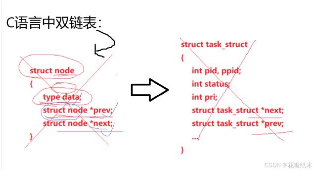
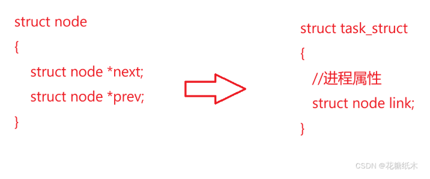
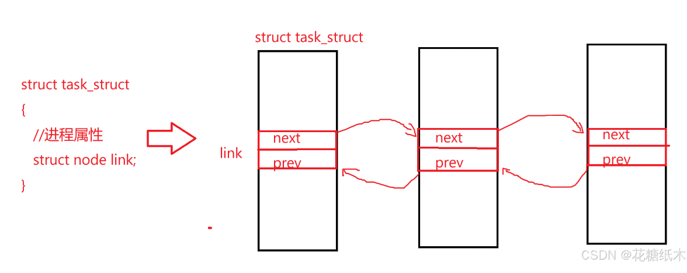
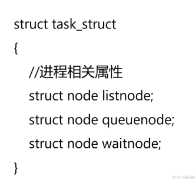

# 进程链接结构

> 参考链接：
>
> [【Linux】Linux下进程链接结构，命令行参数，环境变量](https://blog.csdn.net/2302_80652761/article/details/143644694)

​	`bash`是一种`shell`。在`Linux`系统中，当我们在终端输入命令时，通常是在一个`shell`环境下进行的。如果这个`shell`是`bash`，那么所有命令行执行的命令都是`bash`的子进程。

## 1、`Linux`下进程链接结构

​	所有进程都要以链表方式链接；进程可以在调度队列里，也可以在阻塞队列里等等。

​	`Linux`中链式结构：双链表结构

​	如果按照`C`语言中设定的链表结构，然后把进程属性与链接字段放在一起，这样就会显得不优雅，过于臃肿，更重要的是可扩展性小。所以`Linux`设计模式，只有链接字段，没有属性字段。

​	结构体中，存放两个指针，前驱指针与后驱指针，用来表示双链表，然后进程`PCB`中管理一个该结构体成员，可以通过该结构体成员，使用了`node`结构体的双向链表进而来链接其它进程，管理起来。

​	`Linux`采用了内部数据结构，属性在数据结构外部的方法，进而对进程进行管理链接。

​	那么意义是什么呢？

