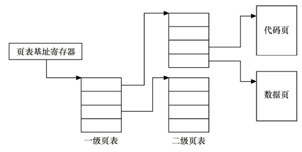
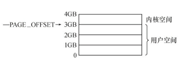
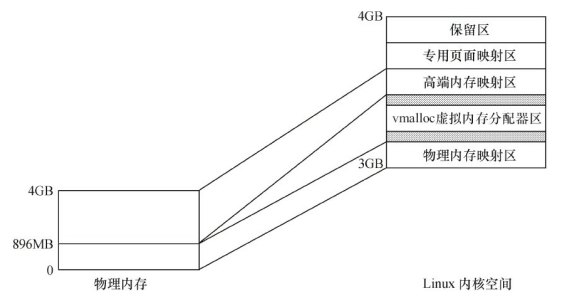
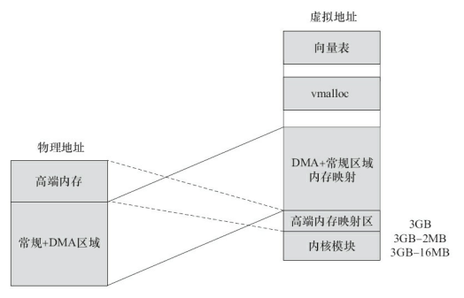
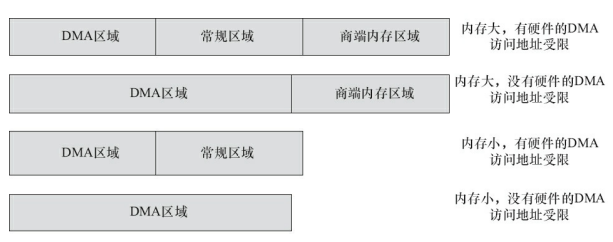
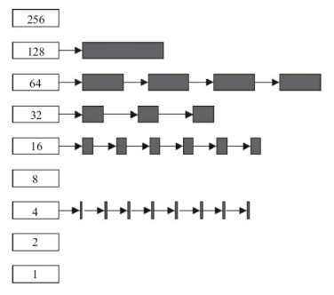

# 内存与I/O访问

## 1、CPU与内存、I/O

## 1.1 内存空间与I/O空间

​	在`X86`处理器中存在着`I/O`空间的概念，`I/O`空间是相对于内存空间而言的，它通过特定的指令`in`、`out`来访问。端口号标识了外设的寄存器地址。`Intel`语法中的`in`、`out`指令格式如下：

```c
IN 累加器, {端口号|DX}
OUT {端口号|DX}, 累加器
```

​	目前，大多数嵌入式微控制器（如`ARM`、`PowerPC`等）中并不提供`I/O`空间，而仅存在内存空间。内存空间可以直接通过地址、指针来访问，程序及在程序运行中使用的变量和其他数据都存在于内存空间中。

​	内存地址可以直接由`C`语言指针操作，例如在`186`处理器中执行如下代码：

```c
unsigned char *p = (unsigned char *)0xF000FF00;
*p=11;
```

​	以上程序的意义是在绝对地址`0xFFF00`（`186`处理器使用16位段地址和16位偏移地址）中写入11。

​	而在`ARM`、`PowerPC`等未采用段地址的处理器中，`p`指向的内存空间就是`0xF000FF00`，而`*p=11`就是在该地址写入11。

​	再如，`186`处理器启动后会在绝对地址`0xFFFF0`（对应的`C`语言指针是`0xF000FFF0`，`0xF000`为段地址，`0xFFF0`为段内偏移）中执行，代码如下：

```c
typedef void (*lpFunction) ( ); /* 定义一个无参数、无返回类型的函数指针类型 */
lpFunction lpReset = (lpFunction)0xF000FFF0; /* 定义一个函数指针，指向 */
/* CPU启动后所执行的第一条指令的位置 */
lpReset(); /* 调用函数 */
```

​	在以上程序中，没有定义任何一个函数实体，但是程序却执行了这样的函数调用：`lpReset()`，它实际上起到了“软重启”的作用，跳转到`CPU`启动后第一条要执行的指令的位置。因此，可以通过函数指针调用一个没有函数体的“函数”，这本质上只是换一个地址开始执行。

​	即便是在`X86`处理器中，虽然提供了`I/O`空间，如果由我们自己设计电路板，外设仍然可以只挂接在内存空间中。此时，`CPU`可以像访问一个内存单元那样访问外设`I/O`端口，而不需要设立专门的`I/O`指令。因此，内存空间是必需的，而`I/O`空间是可选的。下图给出了内存空间和`I/O`空间的对比。


## 1.2 内存管理单元

​	高性能处理器一般会提供一个内存管理单元（`MMU`），该单元辅助操作系统进行内存管理，提供虚拟地址和物理地址的映射、内存访问权限保护和`Cache`缓存控制等硬件支持。操作系统内核借助`MMU`可以让用户感觉到程序好像可以使用非常大的内存空间，从而使得编程人员在写程序时不用考虑计算机中物理内存的实际容量。

​	为了理解基本的`MMU`操作原理，需先明晰几个概念。

​	1）`TLB`（`Translation Lookaside Buffer`）：即转换旁路缓存，`TLB`是`MMU`的核心部件，它缓存少量的虚拟地址与物理地址的转换关系，是转换表的`Cache`，因此也经常被称为“快表”。

​	2）`TTW`（`Translation Table walk`）：即转换表漫游，当`TLB`中没有缓冲对应的地址转换关系时，需要通过对内存中转换表（大多数处理器的转换表为多级页表，如下图）的访问来获得虚拟地址和物理地址的对应关系。`TTW`成功后，结果应写入`TLB`中。



​	下图给出了一个典型的`ARM`处理器访问内存的过程，其他处理器也执行类似过程。当`ARM`要访问存储器时，`MMU`先查找`TLB`中的虚拟地址表。如果`ARM`的结构支持分开的数据`TLB`（`DTLB`）和指令`TLB`（`ITLB`），则除了取指令使用`ITLB`外，其他的都使用`DTLB`。`ARM`处理器的`MMU`如下图所示：


​	若`TLB`中没有虚拟地址的入口，则转换表遍历硬件并从存放于主存储器内的转换表中获取地址转换信息和访问权限（即执行`TTW`），同时将这些信息放入`TLB`，它或者被放在一个没有使用的入口或者替换一个已经存在的入口。之后，在`TLB`条目中控制信息的控制下，当访问权限允许时，对真实物理地址的访问将在`Cache`或者在内存中发生，如下图所示：


​	`ARM`内`TLB`条目中的控制信息用于控制对对应地址的访问权限以及`Cache`的操作。

​	`C`（高速缓存）和`B`（缓冲）位被用来控制对应地址的高速缓存和写缓冲，并决定是否进行高速缓存。

​	访问权限和域位用来控制读写访问是否被允许。如果不允许，`MMU`则向`ARM`处理器发送一个存储器异常，否则访问将被允许进行。

​	上述描述的`MMU`机制针对的虽然是`ARM`处理器，但`PowerPC`、`MIPS`等其他处理器也均有类似的操作。

​	在`Linux 2.6.11`之前，`Linux`内核硬件无关层使用了三级页表`PGD`、`PMD`和`PTE`：从`Linux 2.6.11`开始，为了配合64位`CPU`的体系结构，硬件无关层则使用了4级页表目录管理的方式，即`PGD`、`PUD`、`PMD`和`PTE`。注意这仅仅是一种软件意义上的抽象，实际硬件的页表级数可能少于4。如下代码给出了一个典型的从虚拟地址得到`PTE`的页表查询（`Page Table Walk`）过程，它取自`arch/arm/lib/uaccess_with_memcpy.c`。

```c
static int
pin_page_for_write(const void __user *_addr, pte_t **ptep, spinlock_t **ptlp)
{
	unsigned long addr = (unsigned long)_addr;
	pgd_t *pgd;
	pmd_t *pmd;
	pte_t *pte;
	pud_t *pud;
	spinlock_t *ptl;

	pgd = pgd_offset(current->mm, addr);
	if (unlikely(pgd_none(*pgd) || pgd_bad(*pgd)))
		return 0;

	pud = pud_offset(pgd, addr);
	if (unlikely(pud_none(*pud) || pud_bad(*pud)))
		return 0;

	pmd = pmd_offset(pud, addr);
	if (unlikely(pmd_none(*pmd)))
		return 0;

	/*
	 * A pmd can be bad if it refers to a HugeTLB or THP page.
	 *
	 * Both THP and HugeTLB pages have the same pmd layout
	 * and should not be manipulated by the pte functions.
	 *
	 * Lock the page table for the destination and check
	 * to see that it's still huge and whether or not we will
	 * need to fault on write, or if we have a splitting THP.
	 */
	if (unlikely(pmd_thp_or_huge(*pmd))) {
		ptl = &current->mm->page_table_lock;
		spin_lock(ptl);
		if (unlikely(!pmd_thp_or_huge(*pmd)
                     || pmd_hugewillfault(*pmd)
                     || pmd_trans_splitting(*pmd))) {
			spin_unlock(ptl);
			return 0;
		}

		*ptep = NULL;
		*ptlp = ptl;
		return 1;
	}

	if (unlikely(pmd_bad(*pmd)))
		return 0;

	pte = pte_offset_map_lock(current->mm, pmd, addr, &ptl);
	if (unlikely(!pte_present(*pte) || !pte_young(*pte) ||
                 !pte_write(*pte) || !pte_dirty(*pte))) {
		pte_unmap_unlock(pte, ptl);
		return 0;
	}

	*ptep = pte;
	*ptlp = ptl;

	return 1;
}
```

​	第1行的类型为`struct`，`mm_struct`的参数`mm`用于描述`Linux`进程所占有的内存资源。上述代码中的`pgd_offset`、`pud_offset`、`pmd_offset`分别用于得到一级页表、二级页表和三级页表的入口，最后通过`pte_offset_map_lock`得到目标页表项`pte`。而且第33行还通过`pmd_thp_or_huge()`判断是否有巨页的情况，如果是巨页，就直接访问`pmd`。

​	但是，`MMU`并不是对所有的处理器都是必需的，例如常用的`SAMSUNG`基于`ARM7TDMI`系列的`S3C44B0X`不附带`MMU`，新版的`Linux 2.6`支持不带`MMU`的处理器。在嵌入式系统中，仍存在大量无`MMU`的处理器，`Linux 2.6`为了更广泛地应用于嵌入式系统，融合了`mClinux`，以支持这些无`MMU`系统，如`Dragonball`、`ColdFire`、`Hitachi H8/300`、`Blackfin`等。

# 2、`Linux`内存管理

​	对于包含`MMU`的处理器而言，`Linux`系统提供了复杂的存储管理系统，使得进程所能访问的内存达到`4GB`。

​	在`Linux`系统中，进程的`4GB`内存空间备分为两个部分——用户空间和内核空间。用户空间的地址一般分布为`0-3GB`，内核空间地址一般分布为`3-4GB`，如下图所示。



​	用户进程通常只能访问用户空间的虚拟地址，不能访问内核空间的虚拟地址。用户进程只有通过系统调用等方式才可以访问到内核空间。

​	每个进程的用户空间都是完全独立、互不相关的，用户进程各自有不同的页表。而内核空间是由内核负责映射，它并不会跟着进程改变，是固定的。内核空间和虚拟地址到物理地址映射是被所有进程共享的，内核的虚拟空间独立于其他程序。

​	`Linux`中`1GB`的内核地址空间又被划分为物理内存映射区、`vmalloc`虚拟内存分配器区、高端内存映射区、专用页面映射区和系统保留映射区这几个区域，如下图所示：



​	对于`x86`系统而言，一般情况下，物理内存映射区最大长度为`896MB`，系统的物理内存被顺序映射在内核空间的这个区域中。当系统物理内存大于`896MB`时，超过物理内存映射区的那部分内存称为高端内存（而未超过物理内存映射区的内存通常被称为常规内存），内核在存取高端内存时必须将它们映射到高端页面映射区。

​	`Linux`保留内核空间最顶部`FIXADDR_TOP~4GB`的区域作为保留区。

​	紧接着最顶端的保留区以下的一段区域为专用页面映射区（`FIXADDR_START~FIXADDR_TOP`），它的总尺寸和每一页的用途由`fixed_address`枚举结构在编译时预定义，用`__fix_to_virt(index)`可获取专用区内预定义页面的逻辑地址。其开始地址和结束地址宏定义如下：

```c
#define FIXADDR_START (FIXADDR_TOP - __FIXADDR_SIZE)
#define FIXADDR_TOP ((unsigned long)__FIXADDR_TOP)
#define __FIXADDR_TOP 0xfffff000
```

​	接下来，如果系统配置了高端内存，则位于专用页面映射区之下的就是一段高端内存映射区，其起始地址为`PKMAP_BASE`，定义如下：

```c
#define PKMAP_BASE ( (FIXADDR_BOOT_START - PAGE_SIZE * (LAST_PKMAP + 1)) & PMD_MASK )
```

​	其中所设计的宏定义如下：

```c
#define FIXADDR_BOOT_START (FIXADDR_TOP - __FIXADDR_BOOT_SIZE)
#define LAST_PKMAP PTRS_PER_PTE
#define PTRS_PER_PTE 512
#define PMD_MASK (~(PMD_SIZE-1))
#define PMD_SIZE (1UL << PMD_SHIFT)
#define PMD_SHIFT 21
```

​	在物理区和高端映射区之间为虚拟内存分配器区（`VMALLOC_START~VMALLOC_END`），用于`vmalloc()`函数，它的前部与物理内存映射区有一个隔离带，后部与高端映射区也有一个隔离带，`vmalloc`区域定义如下：

```c
#define VMALLOC_OFFSET (8*1024*1024)
#define VMALLOC_START (((unsigned long) high_memory +
vmalloc_earlyreserve + 2*VMALLOC_OFFSET-1) & ~(VMALLOC_OFFSET-1))
#ifdef CONFIG_HIGHMEM /* 支持高端内存 */
# define VMALLOC_END (PKMAP_BASE-2*PAGE_SIZE)
#else /* 不支持高端内存 */
#define VMALLOC_END (FIXADDR_START-2*PAGE_SIZE)
#endif
```

​	当系统物理内存超过`4GB`时，必须使用`CPU`的扩展分页（`PAE`）模式所提供的64位页目录项才能存取到`4GB`以上的物理内存，这需要`CPU`的支持。加入了`PAE`功能的`Intel Pentium Pro`及以后的`CPU`允许内存最大可配置到`64GB`，它们具备36位物理地址空间寻址能力。

​	由此可见，对于32位的`x86`而言，在`3-4GB`之间的内核空间中，从低地址到高地址依次为：物理内存映射区→隔离带→`vmalloc`虚拟内存分配器区→隔离带→高端内存映射区→专用页面映射区→保留区。

​	直接进行映射的`896MB`物理内存其实又分为两个区域，在低于`16MB`的区域，`ISA`设备可以做`DMA`，所以该区域为`DMA`区域（内核为了保证`ISA`驱动在申请`DMA`缓冲区的时候，通过`GFP_DMA`标记可以确保申请到`16MB`以内的内存，所以必须把这个区域列为一个单独的区域管理），`16-896MB`之间的为常规区域。高于`896MB`的就称为高端内存区域了。

​	32位`ARM Linux`的内核空间地址映射与`x86`不太一样，内核文档`Documentation/arm/memory.txt`给出了`ARM Linux`的内存映射情况。`0xffff0000~0xffff0fff`是`CPU vector page`，即向量表的地址。`0xffc00000~0xffefffff`是`DMA`内存映射区域，`dma_alloc_xxx`族函数把`DMA`缓冲区映射在这一段，`VMALLOC_START~VMALLOC_END - 1`是`vmalloc`和`ioremap`区域（在`vmalloc`区域的大小可以配置，通过`vmalloc=`这个启动参数可以指定），`PAGE_OFFSET~high_memory - 1`是`DMA`和正常区域的映射区域，`MODULES_VADDR~MODULES_END - 1`是内核模块区域，`PKMAP_BASE~PAGE_OFFSET - 1`是高端内存映射区。假设我们把`PAGE_OFFSET`定义为`3GB`，实际上`Linux`内核模块位于`3GB - 16MB~3GB - 2MB`，高端内存映射区则通常位于`3GB - 2MB~3GB`。

​	下图给出了32位`ARM`系统`Linux`内核地址空间中的内核模块区域、高端内存映射区、`vmalloc`、向量表区域等。我们假定编译内核的时候选择的是`VMSPLIT_3G`(`3G/1G user/kernel split`)。如果用户选择的是`VMSPLIT_2G`（`2G/2G user/kernel split`），则下图中的内核模块开始于`2GB - 16MB`，`DMA`和常规内存区域映射区页开始于`2GB`。



​	`ARM`系统的`Linux`之所以把内核模块安置在`3GB`或者`2GB`附近的`16MB`范围内，主要是为了实现内核模块和内核本身的代码段之间的短跳转。

​	对于`ARM SoC`而言，如果芯片内部有的硬件组件的`DMA`引擎访问内存时有地址空间限制（某些空间访问不到），比如假设`UART`控制器的`DMA`只能访问`32MB`，那么这个低`32MB`就是`DMA`区域，`32MB`到高端内存地址的这段称为常规区域，在之上的称为高端内存区域。

​	下图给出了几种`DMA`、常规、高端内存区域可能的分布，在第一种情况下，有硬件的`DMA`引擎不能访问全部地址，且内存较大而无法全部在内核空间虚拟地址映射下，存放有3个区域，第二种情况下，没有硬件的`DMA`引擎不能访问全部地址，且内存较大而无法全部在内核空间虚拟地址映射下，则常规区域实际退化为0，第三种情况下，有硬件的`DMA`引擎不能访问全部地址，且内存较小可以全部在内核空间虚拟地址映射下，则高端内存区域实际退化为0，第四种情况下，没有硬件的`DMA`引擎不能访问全部地址，且内存较小可以全部在内核空间虚拟地址映射下，则常规和高端内存区域实际退化为0。



​	如下图所示，`DMA`、常规、高端内存这3个区域都采用`buddy`算法进行管理，把空闲的页面以$2^n$为单位进行管理，因此`Linux`最底层的内存申请都是以$2^n$为单位的。`Buddy`算法最主要的优点是避免了外部碎片，任何时候区域里的空闲内存都能以$2^n$进行拆分或合并。



​	`/proc/buddyinfo`会显示每个区域里面`2n`的空闲页面分布情况，比如：

```
$cat /proc/buddyinfo
Node 0, zone DMA		8		5		2		7		8		3		0		0
0		1		0
Node 0, zone Normal  2002	 1252	  524	  187	  183	   71		7		0
0		1		1
```

​	上述结果显示高端内存区域为0，`DMA`区域里1页空闲的内存还有8个，连续2页空闲的有5个，连续4页空闲的有2个，以此类推；常规区域里面1页空闲的还有2002个，连续2页空闲的有1252个，以此类推。

​	对于内核物理内存映射区的虚拟内存（即从`DMA`和常规区域映射过来的），使用`virt_to_phys()`可以实现内核虚拟地址转化为物理地址。与之对应的函数为`phys_to_virt()`，它将物理地址转化为内核虚拟地址。

> 注意：上述`virt_to_phys()`和`phys_to_virt()`函数仅适用于`DMA`和常规区域，高端内存的虚拟地址与物理地址之间不存在如此简单的换算关系。

# 3、内存存取

## 3.1 用户空间内存动态申请

​	在用户空间中动态申请内存的函数为`malloc()`，这个函数在各种操作系统上的使用都是一致的，`malloc()`申请的内存的释放函数为`free()`。对于`Linux`而言，`C`库的`malloc()`函数一般通过`brk()`和`mmap()`两个系统调用从内核申请内存。

​	由于用户空间`C`库的`malloc`算法实际上具备一个二次管理能力，所以并不是每次申请和释放内存都一定伴随着对内核的系统调用。比如，如下代码的应用程序可以从内核拿到内存后，立即调用`free()`，由于`free()`之前调用了`mallopt(M_TRIM_THRESHOLD, -1)`和`mallopt(M_MMAP_MAX, 0)`，这个`free()`并不会把内存还给内核，而只是还给了`C`库的分配算法（内存仍然属于这个进程），因此之后所有的动态内存申请和释放都在用户态下进行。

```c
#include <malloc.h>
#include <sys/mman.h>

#define SOMESIZE (100*1024*1024) // 100MB

int main(int argc, char *argv[])
{
	unsigned char *buffer;
	int i;

	if (mlockall(MCL_CURRENT | MCL_FUTURE))
		mallopt(M_TRIM_THRESHOLD, -1);
	mallopt(M_MMAP_MAX, 0);

	buffer = malloc(SOMESIZE);
	if (!buffer)
		exit(-1);

	/*
	 * Touch each page in this piece of memory to get it
	 * mapped into RAM
	 */
	for (i = 0; i < SOMESIZE; i += page_size)
		buffer[i] = 0;
	free(buffer);
	/* <do your RT-thing> */

	return 0;
}
```

​	另外，`Linux`内核总是采用按需调页（`Demand Paging`），因此当`malloc()`返回的时候，虽然是成功返回，但是内核并没有真正给这个进程内存，这个时候如果去读申请的内存，内存全部是0，这个页面的映射是只读的。只有当写到某个页面的时候，内核才在页错误后，真正把这个页面给这个进程。

## 3.2 内核空间内存动态申请

​	在`Linux`内核空间中申请内存涉及的函数主要包括`kmalloc()`、`__get_free_pages()`和`vmalloc()`等。`kmalloc()`和`__get_free_pages()`（及此类函数）申请的内存位于`DMA`和常规区域的映射区，而且在物理上也是连续的，它们与真实的物理地址只有一个固定的偏移，因此存在比较简单的转换关系。

**1.`kmalloc()`**

```c
void *kmalloc(size_t size, int flags);
```

​	给`kmalloc()`的第一个参数是要分配的块的大小，第二个参数是分配标志，用于控制`kmalloc()`的行为。

​	最常用的分配标志是`GFP_KERNEL`，其含义是在内核空间的进程中申请内存。`kmalloc()`的底层依赖于`__get_free_pages()`来实现，分配标志的前缀`GFP`正好是这个底层函数的缩写。使用`GFP_KERNEL`标志申请内存时，若暂时不能满足，则进程会睡眠等待页，即会引起阻塞，因此不能在中断上下文或持有自旋锁的时候使用`GFP_KERNE`申请内存。

​	由于在中断处理函数、`tasklet`和内核定时器等非进程上下文中不能阻塞，所以此时驱动应当使用`GFP_ATOMIC`标志来申请内存。当使用`GFP_ATOMIC`标志申请内存时，若不存在空闲页、则不等待，直接返回。

​	其他的申请标志还包括：

​	`GFP_USER`：用来为用户空间页分配内存，可能阻塞

​	`GFP_HIGHUSER`：类似`GFP_USER`，但是它从高端内存分配

​	`GFP_DMA`：从`DMA`区域分配内存

​	`GFP_NOIO`：不允许任何`I/O`初始化

​	`GFP_NOFS`：不允许进行任何文件系统调用

​	`__GFP_HIGHMEM`：指示分配的内存可以位于高端内存

​	`__GFP_COLD`：请求一个较长时间不访问的页

​	`__GFP_NOWARN`：当一个分配无法满足时，阻止内核发出警告

​	`__GFP_HIGH`：高优先级请求，允许获得被内核保留给紧急状况使用的最后的内存页

​	`__GFP_REPEAT`：分配失败，则尽力重复尝试

​	`__GFP_NOFAIL`：标志只许申请成功，不推荐

​	`__GFP_NORETRY`：若申请不到，则立即放弃

​	使用`kmalloc()`申请的内存应使用`kfree()`释放，这个函数的用法和用户空间的`free()`类似。

**2.`__get_free_pages()`**

​	`__get_free_pages()`系列函数/宏本质上是`Linux`内核最底层用于获取空闲内存的方法，因为底层的`buddy`算法以`2n`页为单位管理空闲内存，所以最底层的内存申请总是以`2n`页为单位的。

​	`__get_free_pages()`系列函数/宏包括`get_zeroed_page()`、`get_free_page()`和`__get_free_pages()`。

```c
/* 返回一个指向新页的指针并且将该页清零 */
get_zeroed_page(unsigned int flags);

/* 返回一个指向新页的指针但是该页不清零 */
#define __get_free_page(gfp_mask) \
		__get_free_pages((gfp_mask),0)
__get_free_page(unsigned int flags);
```

​	`__get_free_pages()`函数可分配多个页并返回分配内存的首地址，分配的页数为`2order`，分配的页也不清零。`order`允许的最大值是10（即1024页）或者11（即2048页），这取决于具体的硬件平台。

​	`__get_free_pages()`和`get_zeroed_page()`在实现中调用了`alloc_pages()`函数，`alloc_pages()`既可以在内核空间分配，也可以在用户空间分配，其原型为：

```c
struct page * alloc_pages(int gfp_mask, unsigned long order);
```

​	参数含义与`__get_free_pages()`类似，但它返回分配的第一个页的描述符而非首地址。

​	使用`__get_free_pages()`系列函数/宏申请的内存应使用下列函数释放：

```c
void free_page(unsigned long addr);
void free_pages(unsigned long addr, unsigned long order);
```

​	`__get_free_pages()`等函数在使用时，其申请标志的值与`kmalloc()`完全一样，各标志的含义也与`kmalloc()`完全一致，最常用的是`GFP_KERNEL`和`GFP_ATOMIC`。

**3.`vmalloc()`**

​	`vmalloc()`一般只为存在于软件中（没有对应的硬件意义）的较大的顺序缓冲区分配内存，`vmalloc()`远大于`__get_free_pages()`的开销，为了完成`vmalloc()`，新的页表项需要被建立。因此，只是调用`vmalloc()`来分配少量的内存（如1页以内的内存）是不妥的。

​	`vmalloc()`申请的内存应使用`vfree()`释放，`vmalloc()`和`vfree()`的函数原型如下：

```c
void *vmalloc(unsigned long size);
void vfree(void * addr);
```

​	`vmalloc()`不能用在原子上下文中，因为它的内部实现使用了标志为`GFP_KERNEL`的`kmalloc()`。

​	使用`vmalloc()`函数的一个例证函数是`create_module()`系统调用，它利用`vmalloc()`函数来获取被创建模块需要的内存空间。

​	`vmalloc()`在申请内存时，会进行内存的映射，改变页表项，不像`kmalloc()`实际用的是开机过程中就映射好的`DMA`和常规区域的页表项。因此`vmalloc()`的虚拟地址和物理地址不是一个简单的线性映射。

**4.`slab`与内存池**

​	一方面，完全使用页为单元申请和释放内存容易导致浪费（如果要申请少量字节，也需要用1页）；另一方面，在操作系统的运作过程中，经常会涉及大量对象的重复生成、使用和释放内存问题。在`Linux`系统中所用到的对象，比较典型的例子是`inode`、`task_struct`等。如果我们能够用合适的方法是的对象在前后两次被使用时分配在同一块内存或同一类内存空间且保留了基本的数据结构，就可以大大提高效率。`slab`算法就是针对上述特点设计的。实际上`kmalloc()`就是使用`slab`机制实现的。

​	`slab`是建立在`buddy`算法之上的，它从`buddy`算法拿到`2n`页面后再次进行二次管理，这一点和用户空间的`C`库很像。`slab`申请的内存以及基于`slab`的`kmalloc()`申请的内存，与物理内存之间也是一个简单的线性偏移。

​	（1）创建`slab`缓存

```c
struct kmem_cache *kmem_cache_create(const char *name, size_t size,
					size_t align, unsigned long flags,
					void (*ctor)(void*, struct kmem_cache *, unsigned long),
					void (*dtor)(void*, struct kmem_cache *, unsigned long));
```

​	`kmem_cache_create()`用于创建一个`slab`缓存，它是一个可以保留任意数目且全部同样大小的后备缓存。参数`size`是要分配的每个数据结构的大小，参数`flag`是控制如何进行分配的位掩码，包括`SLAB_HWCACHE_ALIGN`（每个数据对象被对齐到一个缓存行）、`SLAB_CACHE_DMA`（要求数据对象在`DMA`区域中分配）等。

​	（2）分配`slab`缓存

```c
void *kmem_cache_alloc(struct kmem_cache *cachep, gfp_t flags);
```

​	上述函数在`kmem_cache_create()`创建的`slab`后备缓存中分配一块并返回首地址指针。

​	（3）释放`slab`缓存

```c
void kmem_cache_free(struct kmem_cache *cachep, void *objp);
```

​	上述函数释放由`kmem_cache_alloc()`分配的缓存。

​	（4）收回`slab`缓存

```c
int kmem_cache_destroy(struct kmem_cache *cachep);
```


​	下面代码给出了`slab`缓存的使用范例。

```c
/* 创建slab缓存 */
static kmem_cache_t *xxx_cachep;
xxx_cachep = kmem_cache_create("xxx", sizeof(struct xxx),
                               0, SLAB_HWCACHE_ALIGN|SLAB_PANIC, NULL, NULL);
/* 分配slab缓存 */
struct xxx *ctx;
ctx = kmem_cache_alloc(xxx_cachep, GFP_KERNEL);
/* 使用slab缓存 */
/* 释放slab缓存 */
kmem_cache_free(xxx_cachep, ctx);
kmem_cache_destroy(xxx_cachep);
```

​	在系统中通过`/proc/slabinfo`节点可以获知当前`slab`的分配和使用情况，运行`cat /proc/slabinfo`：

```c
# cat /proc/slabinfo
slabinfo - version: 2.1
# name <active_objs> <num_objs> <objsize> <objperslab> <pagesperslab> :
tunables <limit> <batchcount> <sharedfactor> : slabdata <active_slabs>
<num_slabs> <sharedavail>
isofs_inode_cache	66 66 360 22 2		: tunables 0 0 0 : slabdata 3 3 0
ext4_groupinfo_4k	156 156 104 39 1	: tunables 0 0 0 : slabdata 4 4 0
UDPLITEv6			0 0 768 21 4		: tunables 0 0 0 : slabdata 0 0 0
UDPv6				84 84 768 21 4		: tunables 0 0 0 : slabdata 4 4 0
tw_sock_TCPv6		0 0 192 21 1		: tunables 0 0 0 : slabdata 0 0 0
TCPv6				88 88 1472 22 8		: tunables 0 0 0 : slabdata 4 4 0
zcache_objnode		0 0 272 30 2		: tunables 0 0 0 : slabdata 0 0 0
kcopyd_job			0 0 2344 13 8		: tunables 0 0 0 : slabdata 0 0 0
dm_uevent			0 0 2464 13 8		: tunables 0 0 0 : slabdata 0 0 0
```

