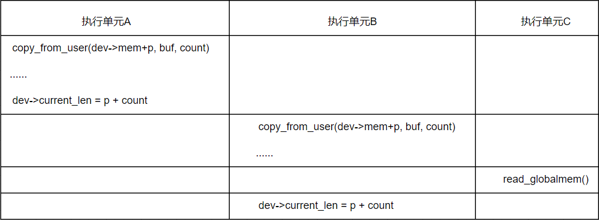
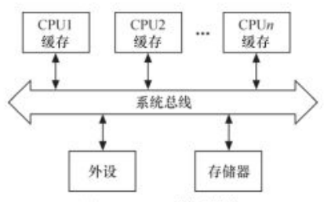
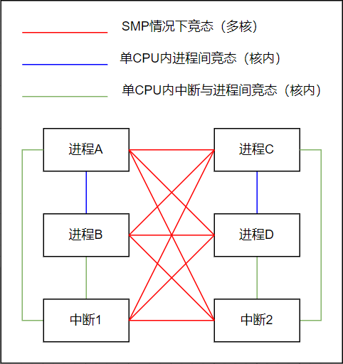
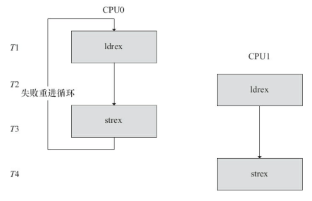
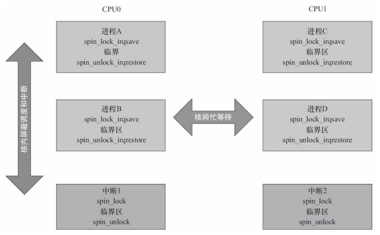
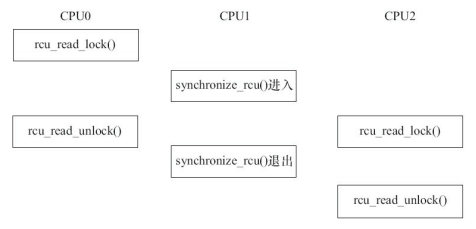
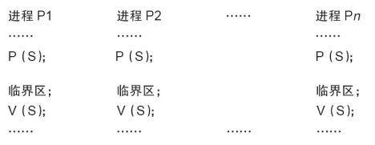

# 1、并发与竞态

​	并发（Concurrency）指的是多个执行单元同时、并行被执行，而并发的执行单元对共享资源（硬件资源和软件上的全局变量、静态变量等）的访问则很容易导致竞态（Race Conditions）。例如，对于`globalmem`设备，假设一个执行单元A对其写入3000个字符a，另一个执行单元B对其写入4000个字符b，第三个执行单元C读取`globalmem`的所有字符，当他们交错执行的时候，可能出现如下情况，虽然写入字符数有4000个，但是读出只有3000个字符b。



​	比上述情况更复杂、更混乱的并发大量存在于设备驱动中，只要并发的多个执行单元存在对共享资源的访问，竞态就有可能发生。在Linux内核中，主要的竞态发生于如下几种情况。

**1. 对称多处理器（SMP）的多个CPU**

​	SMP是一种紧耦合、共享存储的系统模型，它的特点是多个CPU使用共同的系统总线，因此可访问共同的外设和存储器。其体系结构如下



​	在SMP的情况下，两个核的竞态可能发生于`CPU0`和`CPU1`的进程之间，`CPU0`的进程和`CPU1`的中断之间，`CPU0`的中断和`CPU1`的中断之间。

**2. 单CPU内进程与抢占它的进程**

​	`Linux2.6`以后的内核支持内核抢占调度，一个进程在内核执行的时候可能耗完了自己的时间片（timeslice），也可能被另一个高优先级的进程打断，进程与抢占它的进程访问共享资源的情况类似于SMP的多个CPU。

**3. 单CPU的中断与进程之间**

​	中断可以打断正在执行的进程，如果中断服务程序访问进程正在访问的资源，则竞态也会发生。

​	中断也有可能被更高优先级的中断打断，因此，多个中断之间本身也可能引起并发而导致竞态。但是`Linux2.6.35`之后就取消了中断的嵌套。


​	上述并发的发生除了SMP是真正的并行以外，其他的都是单核上的“宏观并行，微观串行”。



​	解决竞态问题的途径是保证对共享资源的互斥访问，所谓互斥访问是指一个执行单元在访问共享资源的时候，其他的执行单元被禁止访问。

​	访问共享资源的代码区域称为临界区（Critical Sections），临界区需要被以某种互斥机制加以保护。中断屏蔽、原子操作、自旋锁、信号量、互斥体等是Linux设备驱动中可采用的互斥途径。

# 2、编译乱序和执行乱序

​	理解Linux内核的锁机制，还需要理解编译器和处理器的特点。比如下面一段代码，写端申请一个新的`struct foo`结构体并初始化其中的a、b、c，之后把结构体地址赋值给全局`gp`指针：

```c
struct foo {
    int a;
    int b;
    int c;
};
struct foo *gp = NULL;
/* ...... */
p = kmalloc(sizeof(*p), GFP_KERNEL);
p->a = 1;
p->b = 2;
p->c = 3;
gp = p;
```

​	而读端如果简单做如下处理，则程序的运行可能是不符合预期的：

```c
p = gp;
if (p != NULL) {
    do_something_with(p);
}
```

​	有两种可能的原因会造成程序出错，一种可能是编译乱序，另一种可能性是执行乱序。

​	关于编译方面，`p->a = 1; p->b = 2; p->c = 3; gp = p;`的编译结果可能是`gp`的赋值指令发生在a、b、c的赋值指令之前。现代的高性能编译器在目标码优化上都具备对指令进行乱序优化的能力。编译器可以对访存的指令进行乱序，减少逻辑上不必要的访存，以及尽量提高Cache命中率和CPU的`Load/Store`单元的工作效率。因此在打开编译器优化以后，看到生成的汇编码并没有按照代码的逻辑顺序，这是正常的。

​	关于执行方面，就算编译器编译出的结果为`gp`的赋值指令在a、b、c的赋值指令之后，也可能出现处理器在执行的时候由于某种原因导致a、b、c赋值指令的执行在`gp`赋值指令执行之后。（此处只是用a、b、c和`gp`举例）

​	编译乱序是编译器的行为，执行乱序是处理器的行为。

## 2.1 编译乱序

​	比如，下面一段代码在`e = d[4095]`和`b = a`之间没有设置屏障：

```c
int main(int argc, char *argv[])
{
	int a = 0, b, c, d[4096], e;
	e = d[4095];
	b = a;
	c = a;
	printf("a:%d b:%d c:%d e:%d\n", a, b, c, e);
	return 0;
}
```

用“arm-linux-gnueabihf-gcc-O2”优化编译，反汇编结果如下：

```
int main(int argc, char *argv[])
{
	831c: b530 push {r4, r5, lr}
	831e: f5ad 4d80 sub.w sp, sp, #16384 ; 0x4000
	8322: b083 sub sp, #12
	8324: 2100 movs r1, #0
	8326: f50d 4580 add.w r5, sp, #16384 ; 0x4000
	832a: f248 4018 movw r0, #33816 ; 0x8418
	832e: 3504 adds r5, #4
	8330: 460a mov r2, r1			-> b= a;
	8332: 460b mov r3, r1			-> c= a;
	8334: f2c0 0000 movt r0, #0
	8338: 682c ldr r4, [r5, #0]
	833a: 9400 str r4, [sp, #0]		-> e = d[4095];
	833c: f7ff efd4 blx 82e8 <_init+0x20>
}
```

​	显然，尽管源代码级别`b = a`发生在`e = d[4095]`之后，但是目标代码的`b = a`指令发生在`e = d[4095]`之前。

​	解决乱序编译的问题，需要通过`barrier()`编译屏障进行。我们可以在代码中设置`barrier()`屏障，这个屏障可以阻挡编译器的优化。对于编译器来说，设置编译屏障可以保证屏障前的语句和屏障后的语句不乱“串门”。`barrier()`定义如下：

```c
#define barrier() __asm_volatile__("": : :"memory")
```

​	在`b = a`和`e = d[4095]`之间加上编译屏障之后，再次优化编译，反汇编结果如下：

```
int main(int argc, char *argv[])
{
	831c: b510 push {r4, lr}
	831e: f5ad 4d80 sub.w sp, sp, #16384 ; 0x4000
	8322: b082 sub sp, #8
	8324: f50d 4380 add.w r3, sp, #16384 ; 0x4000
	8328: 3304 adds r3, #4
	832a: 681c ldr r4, [r3, #0]
	832c: 2100 movs r1, #0
	832e: f248 4018 movw r0, #33816 ; 0x8418
	8332: f2c0 0000 movt r0, #0
	8336: 9400 str r4, [sp, #0]		-> e = d[4095];
	8338: 460a mov r2, r1			-> b= a;
	833a: 460b mov r3, r1			-> c= a;
	833c: f7ff efd4 blx 82e8 <_init+0x20>
}
```

​	关于解决编译乱序的问题，C语言的`volatile`关键字的作用比较弱，它更多的只是避免内存访问行为的合并，对C编译器而言，`volatile`是暗示除了当前的执行线索以外，其他的执行线索也可能改变某内存，所以它的含义是“易变的”。换句话说，如果线程A读取var这个内存中的变量两次而没有修改var，编译器可能觉得读一次就行了，第二次读的时候直接取第一次的结果。但是如果加了`volatile`关键字来形容var，则就是告诉编译器其他线程可能把var改掉了，因此编译器就不会再把线程A代码的第二次内存读取优化掉了。另外`volatile`也不具备保护临界资源的作用。总之，Linux内核明显不太喜欢`volatile`。

## 2.2 执行乱序

​	编译乱序是编译器的行为，而执行乱序则是处理器运行时的行为。执行乱序是指即便编译的二进制指令的顺序按照`p->a = 1; p->b = 2; p->c = 3; gp = p`排放，在处理器上执行时，后发射的指令还是可能先执行完，这时处理器的乱序执行（Out-of-Order Execution）策略。高级的CPU可以根据自己缓存的组织特性，将访存指令重新排序执行。例如，连续地址访问可能会先执行，因为这样缓存命中率高；有的还允许访存的非阻塞，即如果前面一条访存指令因为缓存不命中，造成长延时的存储访问时，后面的访存指令可以先执行，以便从缓存中取数。因此，即使从汇编上看顺序正确的指令，其执行的顺序也是不可预知的。

​	比如，下面一段汇编指令，`ARM v6/v7`的处理器会对其进行优化：

```
LDR r0, [r1];
STR r2, [r3];
```

​	假设第一条`LDR`指令导致缓存未命中，这样缓存就会填充行，并需要较多的时钟周期才能完成。老的ARM处理器会等这个动作完成，再执行下一条`STR`指令。而`ARM v6/v7`处理器会识别出下一条指令不需要等待第一条指令完成（即第二条指令不依赖第一条），则会先执行`STR`指令。

​	对于大多数体系结构而言，尽管每个CPU都是乱序执行，但是这一乱序对于单核的程序执行是不可见的，因为单个CPU在碰到依赖点的时候会等待，所以程序员可能感觉不到这个乱序过程。但是这个依赖点等待的过程，在`SMP`处理器里面对于其他核是不可见的。比如若在`CPU0`和`CPU1`上执行：

```c
// 在CPU0上执行
while (f == 1)
    print x;

// 在CPU1上执行
x = 42;
f = 1;
```

​	`CPU1`上即便`f = 1`编译在`x = 42`之后，`CPU0`执行时仍然可能先于`x = 42`完成。

​	处理器为了解决多核间一个核的内存行为对另一个核可见的问题，引入了一些内存屏障的指令。譬如，ARM处理器的屏障指令包括：

* DMB：数据内存屏障。在DMB之后的显式内存执行前，保证所有在DMB指令之前的内存访问完成。

* DSB：数据同步屏障。等待所有在DSB指令之前的指令完成。（位于此指令前的所有显示内存访问均完成，位于此指令前的所有缓存、跳转预测和TLB维护操作全部完成）
* ISB：指令同步屏障。Flush流水线，使得所有ISB之后执行的指令都是从缓存或内存中获得的

​	Linux内核的自旋锁、互斥体等互斥裸机，需要用到上述指令：在请求获得锁时，调用屏障指令；在解锁时，也需要调用屏障指令。以下代码描述了一个简单的互斥逻辑：

```assembly
LOCKED EQU 1
UNLOCKED EQU 0
lock_mutex
	; 互斥量是否锁定?
	LDREX r1, [r0] ; 检查是否锁定
	CMP r1, #LOCKED ; 和"locked"比较
	WFEEQ ; 互斥量已经锁定，进入休眠
	BEQ lock_mutex ; 被唤醒，重新检查互斥量是否锁定
	; 尝试锁定互斥量
	MOV r1, #LOCKED
	STREX r2, r1, [r0] ; 尝试锁定
	CMP r2, #0x0 ; 检查STR指令是否完成
	BNE lock_mutex ; 如果失败，重试
	DMB ; 进入被保护的资源前需要隔离，保证互斥量已经被更新
	BX lr

unlock_mutex
	DMB ; 保证资源的访问已经结束
	MOV r1, #UNLOCKED ; 向锁定域写"unlocked"
	STR r1, [r0]
	
	DSB ; 保证在CPU唤醒前完成互斥量状态更新
	SEV ; 像其他CPU发送事件，唤醒任何等待事件的CPU

	BX lr
```

​	前面提到每个CPU都是乱序执行，但是单个CPU在碰到依赖点的时候会等待，所以执行乱序对单核不一定可见。但是，当程序在访问外设的寄存器时，这些寄存器的访问顺序在CPU的逻辑上构不成依赖关系，但是从外设的逻辑角度来讲，可能需要固定的寄存器读写顺序，这个时候，也需要使用CPU的内存屏障指令。

​	在Linux内核中，定义了读写屏障`mb()`、读屏障`rmb()`、写屏障`wmb()`，以及作用于寄存器读写的`__iormb()`、`__iowmb()`这样的屏障API。读写寄存器的`readl_relaxed()`和`readl()`、`writel_relaxed()`和`writel()`的API的区别就体现在有无屏障方面。

```c
#define readb(c)		({ u8 __v = readb_relaxed(c); __iormb(); __v; })
#define readw(c)		({ u16 __v = readw_relaxed(c); __iormb(); __v; })
#define readl(c)		({ u32 __v = readl_relaxed(c); __iormb(); __v; })
#define writeb(v,c)		({ __iowmb(); writeb_relaxed(v,c); })
#define writew(v,c)		({ __iowmb(); writew_relaxed(v,c); })
#define writel(v,c)		({ __iowmb(); writel_relaxed(v,c); })
```

​	比如我们通过`writel_relaxed()`写完DMA的开始地址、结束地址、大小之后，我们一定要调用`writel()`来启动DMA。

```c
writel_relaxed(DMA_SRC_REG, src_addr);
writel_relaxed(DMA_DST_REG, dst_addr);
writel_relaxed(DMA_SIZE_REG, size);
writel(DMA_ENABLE, 1);
```

# 3、中断屏蔽

​	在单CPU范围内避免竞态的一种简单而有效的方法是在进入临界区之前屏蔽系统的中断，但是在驱动编程中不值得推荐，驱动通常需要考虑跨平台特点而不假定自己在单核上运行。CPU一般都具备屏蔽中断和打开中断的功能，这项功能可以保证正在执行的内核执行路径不被中断处理程序所抢占，防止某些竞态条件的发生。具体而言，中断屏蔽将使得中断与进程之间的并发不再发生，而且，由于Linux内核的进程调度等操作都依赖中断来实现，内核抢占进程之间的并发也得以避免。

​	中断屏蔽的使用方法如下：

```
local_irq_disable()		/* 屏蔽中断 */
/* ... */
critical section		/* 临界区 */
/* ... */
local_irq_enable()		/* 开中断 */
```

​	其底层的实现原理是让CPU本身不响应中断， 比如，对于ARM处理器而言，其底层的实现是屏蔽ARM CPSR的`I`位：

```c
static inline void arch_local_irq_disable(void)
{
    asm volatile(
        "	cpsid i			@ arch_local_irq_disable"
    	:
    	:
    	: "memory", "cc");
}
```

​	由于Linux的异步I/O、进程调度等很多重要操作都依赖于中断，中断对于内核的运行非常重要，在屏蔽中断期间所有的中断都无法得到处理，因此长时间屏蔽中断是很危险的，这有可能造成数据丢失乃至系统崩溃等后果。这就要求在屏蔽了中断之后，当前的内核执行路径应当尽快完成临界区的代码。

​	`local_irq_disable()`和`local_irq_enable()`都只能禁止和使能本CPU内的中断，因此其并不能解决SMP多CPU引发的竞态。因此，单独使用中断屏蔽通常不是一种值得推荐的避免竞态的方法（换句话说，驱动中单独使用`local_irq_disable()`通常意味着一个bug），它适合与下午要介绍的自旋锁联合使用。

​	与`local_irq_disable()`不同的是，`local_irq_save(flags)`除了进行禁止中断的操作以外，还保存目前CPU的中断位信息，`local_irq_restore(flags)`进行的是与其相反的操作。对于ARM处理器而言，其实就是保存和恢复CPSR。

​	如果只是想禁止和使能中断的底半部，应使用`local_bh_disable()`和`local_bh_enable()`。

# 4、原子操作

​	原子操作可以保证对一个整型数据的修改是排他性的。Linux内核提供了一系列函数来实现内核中的原子操作，这些函数又分为两类，分别针对位和整型变量进行原子操作。位和整型变量的原子操作都依赖于底层CPU的原子操作，因此所有这些函数都与CPU架构密切相关。对于ARM处理器而言，底层使用`ldrex`和`strex`指令，比如`atomic_inc()`底层的实现会调用到`atomic_add()`，`atomic_add()`代码如下：

```c
static inline void atomic_add(int i, atomic_t *v)
{
	unsigned long tmp;
	int result;
	prefetchw(&v->counter);
	__asm__ __volatile__("@ atomic_add\n"
"1:		ldrex	%0, [%3]\n"
"		add		%0, %0, %4\n"
"		strex	%1, %0, [%3]\n"
"		teq		%1, #0\n"
"		bne		1b"
	: "=&r" (result), "=&r" (tmp), "+Qo" (v->counter)
	: "r" (&v->counter), "Ir" (i)
	: "cc");
}
```

​	`ldrex`指令和`strex`指令配对使用，可以让总线监控`ldrex`到`strex`之间有无其他的实体存取该地址了，如果有并发的访问，执行`strex`指令时，第一个寄存器的值被设置为1（Non-Exclusive Access）并且存储的行为也不成功；如果没有并发的存取，`strex`在第一个寄存器里设置0（Exclusive Access）并且存储的行为也是成功的。本例中，如果两个并发实体同时调用`ldrex`和`strex`。如下图所示，在`T3`时间点上，`CPU0`的`strex`会执行失败，在`T4`时间点上`CPU1`的`strex`会执行成功。所以`CPU0`和`CPU1`之间只有`CPU1`执行成功了，执行`strex`失败的`CPU0`的“`teq %1, #0`”判断语句不会成立，于是失败的`CPU0`通过“`bne 1b`”再次进入`ldrex`。`ldrex`和`strex`的这一过程不仅适用于多核之间的并发，也适用于同一个核内部并发的情况。



## 4.1 整型原子操作

**1.设置原子变量的值**

```c
void atomic_set(atomic_t *v, int i);	/* 设置原子变量的值为i */
atomic_t v = ATOMIC_INIT(0);			/* 定义原子变量v并初始化为0 */
```

**2.获取原子变量的值**

```c
atomic_read(atomic_t *v);				/* 返回原子变量的值 */
```

**3.原子变量加/减**

```c
void atomic_add(int i, atomic_t *v);	/* 原子变量增加i */
void atomic_sub(int i, atomic_t *v);	/* 原子变量减少i */
void atomic_inc(atomic_t *v);			/* 原子变量自增1 */
void atomic_dec(atomic_t *v);			/* 原子变量自减1 */
```

**4.操作并测试**

```c
int atomic_inc_and_test(atomic_t *v);			/* 自增1后测试是否为0，为0返回true */
int atomic_dec_and_test(atomic_t *v);			/* 自减1后测试是否为0，为0返回true */
int atomic_sub_and_test(int i, atomic_t *v);	/* 减i后测试是否为0，为0返回true */
```

> 注意：没有`atomic_add_and_test()`函数

**5.操作并返回**

```c
int atomic_add_return(int i, atomic_t *v);		/* 加i后返回新值 */
int atomic_sub_return(int i, atomic_t *v);		/* 减i后返回新值 */
int atomic_inc_return(atomic_t *v);				/* 自增1后返回新值 */
int atomic_dec_return(atomic_t *v);				/* 自减1后返回新值 */
```

## 4.2 位原子操作

**1.设置位**

```c
void set_bit(nr, void *addr);			/* 设置addr地址的第nr位为1 */
void clear_bit(nr, void *addr);			/* 设置addr地址的第nr位为0 */
void change_bit(nr, void *addr);		/* 把addr地址的第nr位反置 */
```

**2.测试位**

```c
int test_bit(nr, void *addr);			/* 返回addr地址的第nr位 */
int test_and_set_bit(nr, void *addr);	/* 等同于先执行test_bit()，再执行set_bit() */
int test_and_clear_bit(nr, void *addr);
int test_and_change_bit(nr, void *addr);
```


以下代码使用原子变量使设备只能被一个进程打开：

```c
static atomic_t xxx_available = ATOMIC_INIT(1); /* 定义原子变量*/

static int xxx_open(struct inode *inode, struct file *filp)
{
	/* ... */
	if (!atomic_dec_and_test(&xxx_available)) {
		atomic_inc(&xxx_available);
		return - EBUSY; /* 已经打开*/
	}
	/* ... */
	return 0; /* 成功 */
}

static int xxx_release(struct inode *inode, struct file *filp)
{
	atomic_inc(&xxx_available); /* 释放设备 */
	return 0;
}

```

# 5、自旋锁

## 5.1 自旋锁的使用

​	自旋锁（Spin Lock）是一种典型的对临界资源进行互斥访问的手段，其名称来源于它的工作方式。为了获得一个自旋锁，在某CPU上运行和代码需先执行一个原子操作，该操作测试并设置某个内存变量。由于它是原子操作，所以在该操作完成之前其他执行单元不可能访问这个内存变量。如果测试结果表明锁已经空闲，则程序获得这个自旋锁并继续执行；如果测试结果表明锁仍然被占用，程序将在一个小的循环内重复这个“测试并设置”操作，即进行所谓的“自旋”，通俗地说就是“在原地打转”。当自旋锁的持有者通过重置该变量释放这个自旋锁后，某个等待的“测试并设置”操作向其调用者报告锁已释放。

​	理解自旋锁最简单的方法是把它当作一个变量看待，该变量把一个临界区标记为“我当前在运行，请稍等一会”或者标记为“我当前不在运行，可以被使用”。如果A执行单元首先进入例程，它将持有自旋锁；当B执行单元试图进入同一个例程时，将获知自旋锁已被持有，需要等到A执行单元释放后才能进入。

​	在ARM体系结构下，自旋锁的实现借用了`ldrex`指令、`strex`指令、ARM处理器内存屏障指令`dmb`和`dsb`、`wfe`指令以及`sev`指令。既保证排他性，也要处理好内存屏障。

**1.定义自旋锁**

```c
spinlock lock;
```

**2.初始化自旋锁**

```c
spin_lock_init(lock)		/* 该宏用于动态初始化自旋锁lock */
```

**3.获得自旋锁**

```c
spin_lock(lock)
```

​	该宏用于获得自旋锁lock，如果能够立即获得锁，则立马返回，否则，它将在那里自旋，直到该自旋锁的保持者释放。

```c
spin_trylock(lock)
```

​	该宏尝试获得自旋锁lock，如果能立即获得锁，它获得锁并且返回true，否则立即返回false，但不会“在原地打转”。

**4.释放自旋锁**

```c
spin_unlock(lock)
```


自旋锁使用示例如下：

```c
/* 定义一个自旋锁 */
spinlock_t lock;
spin_lock_init(&lock);
spin_lock(&lock);			/* 获取自旋锁，保护临界区 */
/* ...... */				/* 临界区 */
spin_unlock(&lock);			/* 解锁 */
```

​	自旋锁主要针对SMP或单CPU但内核可抢占的情况，对于单CPU和内核不支持抢占的系统，自旋锁退化为空操作。在单CPU和内核可抢占的系统中，自旋锁持有期间中内核的抢占将被禁止。由于内核可抢占的单CPU系统的行为实际上很类似于SMP系统，因此，在这样的单CPU系统中使用自旋锁仍十分必要。另外，在多核SMP的情况下，任何一个核拿到了自旋锁，该核上的抢占调度也暂时禁止了，但是没有禁止另外一个核的抢占调度。

​	尽管用了自旋锁可以保证临界区不受别的CPU和本CPU内的抢占进程打扰，但是得到锁的代码路径在执行临界区的时候，还可能受到中断和底半部的影响。为了防止这种影响，就需要用到自旋锁的衍生。`spin_lock()/spin_unlock()`是自旋锁机制的基础，他们和开关中断`local_irq_enable()/local_irq_disable()`、开关底半部`local_bh_enable()/local_bh_disable()`、开中断恢复状态字和关中断保存状态字`local_irq_restore()/local_irq_save()`结合就形成了整套自旋锁机制，关系如下：

```c
spin_lock_irq()				= spin_lock() + local_irq_disable()
spin_unlock_irq()			= spin_unlock() + local_irq_enable()
spin_lock_irqsave()			= spin_lock() + local_irq_save()
spin_unlock_irqrestore()	= spin_unlock() + local_irq_restore()
spin_lock_bh()				= spin_lock() + local_bh_disable()
spin_unlock_bh()			= spin_unlock() + local_bh_enable()
```

​	`spin_lock_irq()`、`spin_lock_irqsave()`、`spin_lock_bh()`类似函数会为自旋锁的使用系好“安全带”以避免突如其来的中断驶入对系统造成的伤害。

​	在多核编程的时候，如果进程和中断可能访问同一片临界资源，我们一般需要在进程上下文中调用`spin_lock_irqsave()/spin_unlock_irqrestore()`，在中断上下文中调用`spin_lock()/spin_unlock()`，如下图所示。



​	这样在`CPU0`上，无论是进程上下文，还是中断上下文获得了自旋锁，此后如果`CPU1`无论是进程上下文，还是中断上下文，想获得同一自旋锁，都必须忙等待，这避免了一切核间并发的可能性。同时，由于每个核的进程上下文持有锁的时候用的是`spin_lock_irqsave()`，所以该核上的中断是不可能进入的，这避免了核内并发的可能性。

​	驱动工程师应谨慎使用自旋锁，而且在使用中需要注意以下几个问题：

​	1）自旋锁实际是忙等锁，当锁不可用时，CPU一直循环执行“测试并设置”该锁直到可用而取得该锁，CPU在等待自旋锁时不做任何有用的工作，仅仅是等待。因此，只有在占用锁的时间极短的情况下，使用自旋锁才是合理的。当临界区很大，或有共享设备的时候，需要较长时间占用锁，使用自旋锁会降低系统的性能。

​	2）自旋锁可能导致系统死锁。引发这个问题最常见的情况是递归使用一个自旋锁，即如果一个已经拥有某个自旋锁的CPU想第二次获得这个自旋锁，则该CPU将死锁。

​	3）在自旋锁锁定期间不能调用可能引起进程调度的函数。如果进程获得自旋锁之后再阻塞，如调用`copy_{from, to}_user()`、`kmalloc()`和`msleep()`等函数，则可能导致内核的崩溃。

> 重点在于Linux内核中，获取自旋锁会禁用抢占。因此，在持有自旋锁时睡眠可能会导致死锁。 例如，线程A获取了一个自旋锁。线程A将不会被抢占，直到它释放该锁。只要线程A快速完成工作并释放锁，就没有问题。但是如果线程A在持有锁的同时休眠，由于睡眠函数会调用调度程序，所以线程B可能会被调度运行。线程B也会禁用抢占并尝试获取锁。这样就会发生死锁。线程B永远无法获得锁，因为线程A持有该锁，而线程A永远无法运行，因为线程B禁用了抢占。

​	4）在单核情况下编程的时候，也应该认为自己的CPU是多核的，驱动特别强调跨平台的概念。比如，在单CPU的情况下，若中断和进程可能访问同一临界区，进程里调用`spin_lock_irqsave()`是安全的，在中断里其实不调用`spin_lock()`也没有问题，因为`spin_lock_irqsave()`可以保证这个CPU的中断服务程序不可能执行。但是，若CPU变成多核，`spin_lock_irqsave()`不能屏蔽另外一个核的中断，所以另外一个核就可能造成并发问题。因此，无论如何，我们在中断服务程序里也应该调用`spin_lock()`。


以下代码使用自旋锁使设备只能被一个进程打开：

```c
int xxx_count = 0;/* 定义文件打开次数计数*/

static int xxx_open(struct inode *inode, struct file *filp)
{
	/* ... */
	spinlock(&xxx_lock);
	if (xxx_count) {/* 已经打开*/
		spin_unlock(&xxx_lock);
		return -EBUSY;
	}
	xxx_count++;/* 增加使用计数*/
	spin_unlock(&xxx_lock);
	/* ... */
	return 0;/* 成功 */
}

static int xxx_release(struct inode *inode, struct file *filp)
{
	/* ... */
	spinlock(&xxx_lock);
	xxx_count--;/* 减少使用计数*/
	spin_unlock(&xxx_lock);

	return 0;
}

```

## 5.2 读写自旋锁

​	自旋锁不关心锁定的临界区究竟在进行什么操作。即便多个执行单元同时读取临界资源也会被锁住。实际上，对共享资源并发访问时，多个执行单元同时读取它是不会有问题的，自旋锁的衍生锁读写自旋锁（rwlock）可允许读的并发。读写自旋锁是一种比自旋锁颗粒度更小的锁机制，它保留了“自旋”的概念，但是在写操作方面，只能最多有一个写进程，在读操作方面，同时可以有多个读执行单元。当然，读和写也不能同时进行。

> 简单来说，使用自旋锁无法允许多个进程对共享资源的做读取操作（即自旋锁不允许读的并发）。但是实际上多个进程同时对共享资源做读操作并不会出现竞态，所以就出现了读写自旋锁，它可以允许读的并发。

**1.定义核初始化读写自旋锁**

```c
rwlock_t my_rwlock;
rwlock_init(&my_rwlock);		/* 动态初始化 */
```

**2.读锁定和读解锁**

```c
/* 读锁定 */
void read_lock(rwlock_t *lock);
void read_lock_irqsave(rwlock_t *lock, unsigned long flags);
void read_lock_irq(rwlock_t *lock);
void read_lock_bh(rwlock_t *lock);
/* 读解锁 */
void read_unlock(rwlock_t *lock);
void read_unlock_irqrestore(rwlock_t *lock, unsigned long flags);
void read_unlock_irq(rwlock_t *lock);
void read_unlock_bh(rwlock_t *lock);
```

`read_lock_irq() = read_lock() + local_irq_disable()`，其他函数与此类似。

**4.写锁定**

```c
/* 写锁定 */
void write_lock(rwlock_t *lock);
void write_lock_irqsave(rwlock_t *lock, unsigned long flags);
void write_lock_irq(rwlock_t *lock);
void write_lock_bh(rwlock_t *lock);
int write_trylock(rwlock_t *lock);
/* 写解锁 */
void write_unlock(rwlock_t *lock);
void write_unlock_irqrestore(rwlock_t *lock, unsigned long flags);
void write_unlock_irq(rwlock_t *lock);
void write_unlock_bh(rwlock_t *lock);
```

`write_lock_irq() = write_lock() + local_irq_disable()`，其他函数与此类似。`write_trylock()`函数和`spin_trylock()`函数一样，也只是尝试获取读写自旋锁，不管成功还是失败，都会立即返回。


读写自旋锁一般这样被使用：

```c
rwlock_t lock; /* 定义rwlock */
rwlock_init(&lock); /* 初始化rwlock */
/* 读时获取锁*/
read_lock(&lock);
... /* 临界资源 */
read_unlock(&lock);
/* 写时获取锁*/
write_lock_irqsave(&lock, flags);
... /* 临界资源 */
write_unlock_irqrestore(&lock, flags);
```

## 5.3 顺序锁

​	顺序锁（seqlock）是对读写锁的一种优化，若使用顺序锁，读执行单元不会被写执行单元阻塞，也就是说，读执行单元在写执行单元对被顺序锁保护的共享资源进行写操作时仍然可以继续读，而不必等待写执行单元完成写操作，写执行单元也不需要等待所有读执行单元完成读操作才去进行写操作。当然，写和写不能同时进行。

​	对于顺序锁而言，尽管读写之间不互相排斥，但是如果读执行单元在读操作期间，写执行单元已经发生了写操作，那么读执行单元必须重新读取数据，以便确保得到的数据是完整的。所以，在这种情况下，读端可能反复读多次同样的区域才能读到有效的数据。

**1.写执行单元涉及的操作**

```c
/* 获得锁 */
void write_seqlock(seqlock *sl);
int write_tryseqlock(seqlock_t *sl);
void write_seqlock_irqsave(seqlock_t *sl, flags);
void write_seqlock_irq(seqlock_t *sl);
void write_seqlock_bh(seqlock_t *sl);
/* 释放锁 */
void write_sequnlock(seqlock *sl);
void write_sequnlock_irqrestore(seqlock_t *sl, flags);
void write_seqlock_irq(seqlock_t *sl);
void write_seqlock_bh(seqlock_t *sl);
```

`write_seqlock_irq() = write_seqlock() + local_irq_disable()`，其他函数与此类似。

**2.读执行单元涉及的操作**

```c
/* 读开始 */
unsigned read_seqbegin(const seqlock_t *sl);
read_seqbegin_irqsave(lock， flags)
/* 重读 */
int read_seqretry(const seqlock_t *sl, unsigned iv);
read_seqretry_irqrestore(lock, iv, flags)
```

​	读执行单元在对被顺序锁保护的共享资源进行访问前需要调用`read_seqbegin()`和`read_seqbegin_irqsave()`函数，该函数返回顺序锁的当前顺序号。读执行单元在访问完被顺序锁保护的共享资源后需要调用`read_seqretry()`和`read_seqretry_irqrestore()`函数来检查，在读访问期间是否有写操作，如果有写操作，读执行单元就需要重新进行读操作。


顺序锁一般这样被使用：

```c
/* 写执行单元使用顺序锁和自旋锁相同 */
write_seqlock(&sl);
/* ...... */					/* 写操作代码块 */
write_sequnlock(&sl);

/* 读执行单元使用顺序锁 */
do {
    seqnum = read_seqbegin(&sl);
    /* ...... */				/* 读操作代码块 */
} while (read_seqretry(&sl, seqnum));
```

## 5.4 读-复制-更新

​	`RCU`，全称`Read-Copy-Update`，它是基于其原理命名的。`Linux 2.5.43`版本内核开始引入该技术。

​	不同于自旋锁，使用RCU的读端没有锁、内存屏障、原子指令类的开销，几乎可以认为是直接读（只是简单的标明读开始和读结束），而RCU的写执行单元在访问它的共享资源前首先复制一个副本，然后对副本进行修改，最后使用一个回调机制在适当的时机把指向原来数据的指针重新指向新的被修改的数据，这个时机就是所有引用该数据的CPU都退出对共享数据读操作的时候。等待适当时机的这一时期称为宽限期（Grace Period）。


​	比如，有下面一个由`struct foo`结构体组成的链表：

```c
struct foo {
    struct list_head list;
    int a;
    int b;
    int c;
};
```

​	假设进程A要修改链表中某个节点N的成员a、b。自旋锁的思路是等待所有其他持有自旋锁的进程或者中断把自旋锁释放后，进程A再拿到自旋锁访问链表并找到N节点，之后修改它的a、b两个成员，完成后解锁。而RCU的思路是直接制造一个新的节点M，把N的内容复制给M，然后在M上修改a、b，并且用M来代替N原本在链表的位置。之后进程A等待在链表前期已经存在的所有读端结束后（即宽限期，通过`synchronize_rcu()`的API完成），再释放原来的N。如下：

```c
struct foo {
	struct list_head list;
	int a;
	int b;
	int c;
};
LIST_HEAD(head);
/* . . . */
p = search(head, key);
if (p == NULL) {
	/* Take appropriate action, unlock, and return. */
}
q = kmalloc(sizeof(*p), GFP_KERNEL);
*q = *p;
q->b = 2;
q->c = 3;
list_replace_rcu(&p->list, &q->list);
synchronize_rcu();
kfree(p);
```

​	RCU可以看作读写锁的高性能版本，相比读写锁，RCU的优点在于既允许多个读执行单元同时访问被保护的数据，又允许多个读执行单元和多个写执行单元同时访问被保护的数据。但是，RCU不能替代读写锁，因为如果写比较多时，对读执行单元的性能提高不能弥补写执行单元同步导致的损失。因为使用RCU时，写执行单元之间的同步开销会比较大，它需要延迟数据结构的释放，复制被修改的数据结构，它也必须使用某种锁机制来同步并发的其他写执行单元的修改操作。

**1.读锁定和读解锁**

```c
/* 读锁定 */
rcu_read_lock()
rcu_read_lock_bh()
/* 读解锁 */
rcu_read_unlock()
rcu_read_unlock_bh()
```

**2.同步RCU**

```c
synchronize_rcu()
```

​	该函数由RCU写执行单元调用，它将阻塞写执行单元，直到当前CPU上所有的已经存在（Ongoing）的读执行单元完成读临界区，写执行单元才可以继续下一步操作。`synchroize_rcu()`并不需要等待后续读临界区的完成，如下：



​	探测所有的`rcu_read_lock()`被`rcu_read_unlock()`结束的过程很类似垃圾回收的工作。

**3.挂接回调**

```c
void call_rcu(struct rcu_head *head, void (*func)(struct rcu_head *rcu));
```

​	函数`call_rcu()`也由RCU写执行单元调用，与`synchronize_rcu()`不同的是，它不会使写执行单元阻塞，因而可以在中断上下文或软中断中使用。该函数把函数`func`挂接到RCU回调函数链上，然后立即返回。挂接的回调函数会在一个宽限期结束（即所有已经存在的RCU读临界区完成）后被执行。

```c
rcu_assign_pointer(p, v)
```

​	给RCU保护的指针赋一个新值。

```c
rcu_dereference(p)
```

​	读端使用`rcu_dereference()`获取一个RCU保护的指针，之后就可以安全地引用它。一般需要在`rcu_read_lock()/rcu_read_unlock()`保护的区间引用这个指针，例如：

```c
rcu_read_lock();
irq_rt = rcu_dereference(kvm->irq_routing);
if (irq < irq_rt->nr_rt_entries)
	hlist_for_each_entry(e, &irq_rt->map[irq], link) {
		if (likely(e->type == KVM_IRQ_ROUTING_MSI))
			ret = kvm_set_msi_inatomic(e, kvm);
		else
			ret = -EWOULDBLOCK;
		break;
	}
rcu_read_unlock();
```

```c
rcu_access_pointer(p)
```

​	读端使用`rcu_access_pointer()`获取一个RCU保护的指针，之后并不引用它。这种情况下，我们只关心指针本身的值，而不关心指针指向的内容。比如我们可以使用该API来判断指针是否为NULL。

​	把`rcu_assign_pointer()`和`rcu_dereference()`结合起来使用，写端分配一个新的`struct foo`内存，并初始化其中的成员，之后把该结构体的地址赋值给全局的`gp`指针：

```c
struct foo {
int a;
int b;
int c;
};
struct foo *gp = NULL;
/* . . . */
p = kmalloc(sizeof(*p), GFP_KERNEL);
p->a = 1;
p->b = 2;
p->c = 3;
rcu_assign_pointer(gp, p);
```

​	读端访问该片区域：

```c
rcu_read_lock();
p = rcu_dereference(gp);
if (p != NULL) {
	do_something_with(p->a, p->b, p->c);
}
rcu_read_unlock();
```

​	在上述代码中，我们可以把写端`rcu_assign_pointer()`看成发布了`gp`，而读端`rcu_dereference()`看成订阅了`gp`。它保证读端可以看到`rcu_assign_pointer()`之前所有内存被设置的情况（即`gp->a = 1; gp->b = 2; gp->c = 3;`对于读端可见）。由此可见，与RCU相关的原语已经内嵌了相关的编译屏障或内存屏障。

​	

​	对于链表数据结构而言，Linux内核增加了专门的RCU保护的链表操作API：

```c
/* 该函数把链表元素new插入RCU保护的链表head的开头 */
static inline void list_add_rcu(struct list_head *new, struct list_head *head);

/* 该函数类似于list_add_rcu()，它将把新的链表元素new添加到被RCU保护的链表的末尾 */
static inline void list_add_tail_rcu(struct list_head *new, struct list_head *head);

/* 该函数从RCU保护的链表中删除指定的链表元素entry */
static inline void list_del_rcu(struct list_head *entry);

/* 它使用新的链表元素new取代旧的链表元素old */
static inline void list_replace_rcu(struct list_head *old, struct list_head *new);

/* 
 * 该宏用于遍历由RCU保护的链表head，只要在读指向单元临界区使用该函数，他就可以安全地核其他
 * RCU保护的链表操作函数（如list_add_rcu()）并发运行
 */
list_for_each_entry_rcu(pos, head);
```

​	链表的写端代码示例如下：

```c
struct foo {
    struct list_head list;
    int a;
    int b;
    int c;
};
LIST_HEAD(head);
/* ... */
p = kmalloc(sizeof(*p), GFP_KERNEL);
p->a = 1;
p->b = 2;
p->c = 3;
list_add_rcu(&p->list, &head);
```

​	链表的读端代码示例如下：

```c
rcu_read_lock();
list_for_each_entry_rcu(p, head, list) {
    do_something_with(p->a, p->b, p->c);
}
rcu_read_unlock();
```


​	前面已经看到了对RCU保护链中节点进行修改以及添加新节点的动作，下面我们看一下RCU保护的链表删除节点N的工作。写端分为两个步骤，第一步是从链表中删除N，之后等一个宽限期结束，再释放N的内存。下面的代码分别用读写锁和RCU两种不同的方法来描述这一过程：

```c
待补充
```

# 6、信号量

​	信号量（Semaphore）是操作系统中最典型的用于同步和互斥的手段，信号量的值可以是0、1、n。信号量与操作系统中的经典概念`PV`操作对应。

​	P(S)：①将信号量S的值减1，即`S = S - 1`；②如果S$\geq$0，则该进程继续执行；否则该进程置为等待状态，排入等待队列。

​	V(S)：①将信号量S的值加1，即`S = S + 1`；②如果S$>$0，唤醒队列中等待信号量的进程。

**1.定义和初始化信号量**

```c
struct semaphore sem;
void sema_init(struct semaphore *sem, int val);
```

**2.获得信号量**

```c
void down(struct semaphore *sem);
```

​	该函数用于获得信号量`sem`，它会导致睡眠，因此不能在中断上下文中使用

```c
int down_interruptible(struct semaphore *sem);
```

​	该函数功能与`down()`类似，不同之处为，因为`down()`进入睡眠状态的进程不能被信号打断，但因为`down_interruptible()`进入睡眠状态的进程能被信号打断，信号也会导致该函数返回，这时候函数的返回值非0。

```c
int down_trylock(struct semaphore *sem);
```

​	该函数尝试获得信号量`sem`，如果能够立刻获得，它就获得该信号量并返回0，否则返回非零值。它不会导致调用者睡眠，可以在中断上下文中使用。

​	在使用`down_interruptible()`获取信号量时，对返回值一般会进行检查，如果非0，通常立即返回`-ERESTARTSYS`。

**3.释放信号量**

```c
void up(struct semaphore *sem);
```

​	该函数释放信号量`sem`，唤醒等待者。

​	作为一种可能的互斥手段，信号量可以保护临界区，它的使用方式和自旋锁类似。与自旋锁相同，只有得到信号量的进程才能执行临界区代码。但是，与自旋锁不同的是，当获取不到信号量时，进程不会原地打转而是进入休眠等待状态。用作互斥时，信号量一般这样被使用：



​	由于新的Linux内核倾向于直接使用`mutex`作为互斥手段，信号量用作互斥不再被推荐使用。

​	信号量也可以用于同步，一个进程A执行`down()`等待信号量，另一个进程B执行`up()`释放信号量，这样进程A就同步地等待了进程B。

​	此外，对于关心具体数值的生产者/消费者问题，使用信号量则较为合适。因为生产者/消费者问题也是一种同步问题。

# 7、互斥体

​	尽管信号量已经可以实现互斥的功能，但是“正宗”的`mutex`在Linux内核中还是真实地存在着。

**1.定义和初始化互斥体**

```c
struct mutex my_mutex;
mutex_init(&my_mutex);
```

**2.获取互斥体**

```c
void mutex_lock(struct mutex *lock);
int mutex_lock_interruptible(struct mutex *lock);
int mutex_trylock(struct mutex *lock);
```

​	`mutex_lock()`和`mutex_interruptible()`的区别和`down()`与`down_trylock()`的区别完全一致，前者引起的睡眠不能被信号打断，而后者可以。`mutex_trylock()`用于尝试获得`mutex`，获取不到`mutex`时不会引起进程睡眠。

**3.释放互斥体**

```c
void mutex_unlock(struct mutex *lock);
```


​	`mutex`的使用方法和信号量用于互斥的场合完全一样：

```c
struct mutex my_mutex;		/* 定义mutex */
mutex_init(&my_mutex);		/* 初始化mutex */
mutex_lock(&my_mutex);		/* 获取mutex */
/* ... */					/* 临界资源*/
mutex_unlock(&my_mutex);	/* 释放mutex */
```


​	互斥体和自旋锁都是解决互斥问题的基本手段，面对特定的情况，应该如何取舍这两种手段呢？选择的依据是临界区的性质和系统的特点。

​	从严格意义上说，互斥体和自旋锁属于不同层次的互斥手段，前者的实现依赖于后者。在互斥体本身的实现上，为了保证互斥体结构存取的原子性，需要自旋锁来互斥。所以自旋锁属于更底层的手段。

​	互斥体是进程级的，用于多个进程之间对资源的互斥，虽然也是在内核中，但是该内核执行路径是以进程的身份，代表进程来争夺资源的。如果竞争失败，会发生进程上下文切换，当前进程进入睡眠状态，CPU将运行其他进程。鉴于进程上下文切换的开销也很大，因此，只有当进程占用资源时间较长时，用互斥体才是较好的选择。

​	当所要保护的临界区访问时间比较短时，用自旋锁是非常方便的，因为它可节省上下文切换的时间。但是CPU得不到自旋锁会在那里空转直到其他执行单元解锁为止，所以要求锁不能在临界区里长时间停留，否则会降低系统的效率。

​	由此，可以总结出自旋锁和互斥体选用的3项原则：

​	1）当锁不能被获取到时，使用互斥体的开销是进程上下文切换时间，使用自旋锁的开销是等待获取自旋锁（由临界区执行时间决定）。若临界区比较小，宜使用自旋锁，若临界区很大，应使用互斥体。

​	2）互斥体所保护的临界区可包含可能引起阻塞的代码，而自旋锁则绝对要避免用来保护包含这样代码的临界区。因为阻塞意味着要进行进程的切换，如果进程被切换出去后，另一个进程企图获取本自旋锁，死锁就会发生。

​	3）互斥体存在于进程上下文，因此，如果被保护的共享资源需要在中断或软中断情况下使用，则在互斥体和自旋锁之间只能选择自旋锁。当然，如果一定要使用互斥体，则只能通过`mutex_trylock()`方式进行，不能获取就立即返回以避免阻塞。

# 8、完成量

​	Linux提供了完成量（Completion，关于这个名词，至今没有好的翻译，笔者将其译为“完成量”），它用于一个执行单元等待另一个执行单元执行完某事。Linux中与完成量相关的操作主要由以下四种：

**1.定义完成量**

```c
struct completion my_completion;
```

**2.初始化完成量**

​	下面代码初始化或重新初始化`my_completion`这个完成量为0（即没有完成的状态）：

```c
init_completion(&my_completion);
reinit_completion(&my_completion);
```

**3.等待完成量**

​	下面函数用于等待一个完成量被唤醒：

```c
void wait_for_completion(struct completion *c);
```

**4.唤醒完成量**

​	下面两个函数用于唤醒完成量：

```c
void complete(struct completion *c);
void complete_all(struct completion *c);
```

# 9、增加并发控制后的globalmem的设备驱动

​	在`globalmem`的读写函数中，由于要调用`copy_from_user()`、`copy_to_user()`这些可能导致阻塞的函数，因此不能使用自旋锁，应该使用互斥体。

​	驱动工程师习惯将某设备所使用的自旋锁、互斥体等辅助手段也放在设备结构中，因此可如下代码那样修改`globalmem_dev`结构体的定义，并在模块初始化函数中初始化这个信号量。

```c
struct globalmem_dev {
    struct cdev cdev;
    unsigned char mem(GLOBALMEM_SIZE);
    struct mutex mutex;
};

static int __init globalmem_init(void)
{
	int ret;
	dev_t devno = MKDEV(globalmem_major, 0);

	if (globalmem_major)
		ret = register_chrdev_region(devno, 1, "globalmem");
	else {
		ret = alloc_chrdev_region(&devno, 0, 1, :globalmem");
	globalmem_major = MAJOR(devno);
	}
	if (ret < 0)
		return ret;

	globalmem_devp = kzalloc(sizeof(struct globalmem_dev), GFP_KERNEL);
	if (!globalmem_devp) {
		ret = -ENOMEM;
		goto fail_malloc;
	}

	mutex_init(&globalmem_devp->mutex);
	globalmem_setup_cdev(globalmem_devp, 0);
	return 0;

fail_malloc:
	unregister_chrdev_region(devno, 1);
	return ret;
}
module_init(globalmem_init);
```

​	在访问`globalmem_dev`中的共享资源时，需要先获取这个互斥体，访问完成后，随机释放这个互斥体。驱动中新的`globalmem`读、写操作如下所示：

```c
static ssize_t globalmem_read(struct file *filp,
                              char __user * buf, size_t size, loff_t * ppos)
{
	unsigned long p = *ppos;
	unsigned int count = size;
	int ret = 0;
	struct globalmem_dev *dev = filp->private_data;

	if (p >= GLOBALMEM_SIZE)
		return 0;
	if (count > GLOBALMEM_SIZE - p)
		count = GLOBALMEM_SIZE - p;

	mutex_lock(&dev->mutex);

	if (copy_to_user(buf, dev->mem + p, count)) {
		ret = -EFAULT;
	} else {
		*ppos += count;
		ret = count;

		printk(KERN_INFO "read %u bytes(s) from %lu\n" , count, p);
	}

	mutex_unlock(&dev->mutex);

	return ret;
}

static ssize_t globalmem_write(struct file *filp,
                               const char __user * buf, size_t size, loff_t * ppos)
{
	unsigned long p = *ppos;
	unsigned int count = size;
	int ret = 0;
	struct globalmem_dev *dev = filp->private_data;

	if (p >= GLOBALMEM_SIZE)
		return 0;
	if (count > GLOBALMEM_SIZE - p)
		count = GLOBALMEM_SIZE - p;

	mutex_lock(&dev->mutex);

	if (copy_from_user(dev->mem + p, buf, count))
		ret = -EFAULT;
	else {
		*ppos += count;
		ret = count;

		printk(KERN_INFO "written %u bytes(s) from %lu\n" , count, p);
	}

	mutex_unlock(&dev->mutex);

	return ret;
}
```

​	除了`globalmem`的读、写操作之外，如果在读、写的同时，另一个执行单元执行`MEM_CLEAR_IO`控制命令，也会导致全局内存的混乱，因此，`globalmem_ioctl()`函数也需要被重写，如下：

```c
static long globalmem_ioctl(struct file *filp,
                            unsigned int cmd, unsigned long arg)
{
	struct globalmem_dev *dev = filp->private_data; /* μ éè± á11ì */

	switch (cmd) {
	case MEM_CLEAR:
		mutex_lock(&dev->mutex);
		memset(dev->mem, 0, GLOBALMEM_SIZE);
		mutex_unlock(&dev->mutex);

		printk(KERN_INFO "globalmem is set to zero\n");
		break;

	default:
		return -EINVAL;
	}

	return 0;
}
```

# 10、总结

​	并发和竞态广泛存在，中断屏蔽、原子操作、自旋锁和互斥体都是解决并发问题的机制。中断屏蔽很少单独被使用，原子操作只能针对整数进行，因此自旋锁和互斥体应用最为广泛。

​	自旋锁会导致死循环，锁定期间不允许阻塞，因此要求锁定的临界区小。互斥体允许临界区阻塞，可以适用于临界区大的情况。
