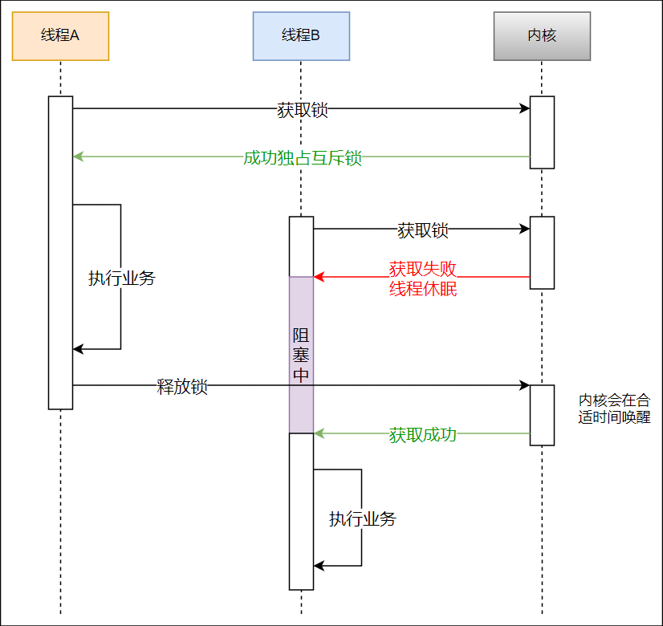
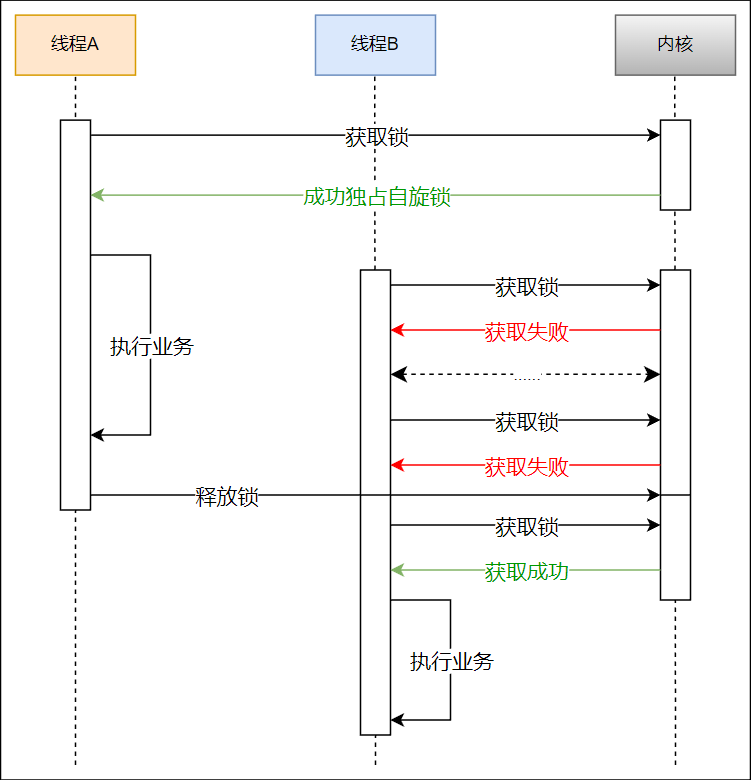

# 互斥锁和自旋锁

> 参考链接：[对比介绍：互斥锁 vs 自旋锁](https://zhuanlan.zhihu.com/p/297929103)

​	加锁的目的是保证共享资源在任意时间内，只有一个线程可以访问，以此避免数据共享导致错乱的问题。最底层的就是两种锁：互斥锁和自旋锁。至于其他高级锁，如读写锁、悲观锁、乐观锁等都是基于它们实现的。

## 1、互斥锁和自旋锁比较

​	互斥锁和自旋锁的区别主要在于加锁失败时的处理方式：

​	互斥锁：加锁失败后，线程释放CPU给其他进程，等待之后锁释放时自己被系统唤醒

​	自旋锁：加锁失败后，线程忙等待，一直尝试加锁，直到加锁成功

## 2、互斥锁

​	互斥锁加锁失败，就会从用户态陷入内核态，内核帮我们切换线程，这简化了互斥锁使用的难度，但是也存在性能开销，这个开销就是两次线程上下文切换的成本：

​	1）当线程加锁失败时，内核会把线程的状态从`“运行”`状态设置为`“睡眠”`状态，然后把CPU切换给其他线程运行。

​	2）接着，当锁被释放时，之前`“睡眠”`状态的线程会变为`"就绪"`状态，然后内核会在合适的时间，把CPU切换给该线程运行。

​	线程的上下文切换是什么？当两个线程是属于同一个进程，因为虚拟内存是共享的，所以在切换时，虚拟内存这些资源就保持不动，只需要切换线程的私有数据、寄存器等不共享的数据。

​	上下文切换需要几十纳秒到几微妙之间，如果锁住的代码执行时间极短，那花在两次上下文切换的时间就会远多于锁住代码的执行时长，显然这种情况下就不能使用互斥锁。

**互斥锁的原理**

先考虑单核场景：能不能硬件做一种加锁的原子操作呢？能! “test and set”指令就是做这个事情的，因为自己是一条硬件指令，最小执行单位，绝对不可能被打断。有了”test and set"原子指令，单核环境下，锁的实现问题得到了圆满的解决。

那么多核环境呢？简单嘛，还是“test and set”不就得了，这是一条指令，原子的，不会有问题的。真的吗？单独一条指令能够保证该指令在单个核上执行过程中不会被中断，但是两个核同时执行这个指令呢？再想想，硬件执行时还是得从内存中读取lock，判断并设置状态到内存，貌似这个过程也不是那么原子嘛，这可真是套娃啊。那多个核执行怎么办呢？首先我们得明白这个地方的关键点，关键点是两个核会并行操作内存而且从操作内存这个调度来看“test and set”不是原子的，需要先读内存然后再写内存，如果我们保证这个内存操作不能并行，那就回归单核场景了呀!刚好，硬件提供了锁内存总线的机制，我们在锁内存总线的状态下执行test and set操作，就能保证同时只有一个核来test and set，从而避免了多核下发生的问题。

在x86 平台上，CPU提供了在指令执行期间对总线加锁 的手段。CPU芯片上有一条引线`#HLOCK pin`，如果汇编语言的程序中在一条指令前面加上前缀"LOCK" ，经过汇编以后的机器代码就使CPU在执行这条指令的时候把`#HLOCK pin`的电位拉低，持续到这条指令结束时放开，从而把总线锁住，这样同一总线上别的CPU就暂时不能通过总线访问内存了，保证了这条指令在多处理器环境中的原子性。

> 能够和LOCK指令前缀一起使用的指令如下所示：
>
> * `BT, BTS, BTR, BTC (mem, reg/imm)`
> * `XCHG, XADD (reg, mem / mem, reg)`
> * `ADD, OR, ADC, SBB (mem, reg/imm)`
> * `AND, SUB, XOR (mem, reg/imm)`
> * `NOT, NEG, INC, DEC (mem)`

## 3、自旋锁

​	自旋的时间和被锁住代码执行的时间是成正比的关系。自旋锁开销少，在多核系统下一般不会主动产生线程切换，如果被锁住的代码执行时间过长，自旋的线程会长时间占用CPU资源。

**自旋锁原理**

反复尝试加锁的时候，包含两个步骤：

- 第一步，查看锁的状态，如果锁是空闲的，则执行第二步；
- 第二步，将锁设置为当前线程持有；

这个过程叫做「Compare And Swap」，简称「CAS」，它把上述两个步骤合并成一条硬件级指令，在「用户态」完成加锁和解锁操作，不会主动产生线程上下文切换，所以相比互斥锁来说，会快一些，开销也小一些。

上面说，不推荐while循环获取锁，Intel CPU提供的「PAUSE」指令，「PAUSE」指令是什么？那它如何解决无脑while循环占用CPU且低效率的问题呢？

其实自旋锁不会主动释放CPU，所以不可能解决占用CPU的问题，但能让这个过程更省电，抢占锁效率更高。

「PAUSE」指令通过让CPU休息一定的时钟周期，在此休息期间，耗电几乎停滞。休息的时钟周期，不同版本CPU不一样，大概在几十到上百时钟周期之间。以5Ghz主频运行的CPU为例，一个时钟周期就是0.2纳秒。

休息的时钟周期不是越大越好。比如Intel新一代的Skylake架构中，初期「PAUSE」指令的休息周期高达140个时钟周期。这直接导致MySQL在理论上性能更好的CPU上，数据库性能跑出了比前几年CPU更糟糕的成绩，挤出的牙膏吸回去了！在随后的步进中降低了「PAUSE」的时钟周期到上一代的10个时钟周期，数据库展现的性能才恢复了牙膏厂该有的水准（每代性能提升一丢丢）。

另一个优点跟流水线有关系，频繁的检测会让流水线上充满了读操作。另外一个线程往流水线上丢入一个锁变量写操作的时候，必须对流水线进行重排，因为CPU必须保证所有读操作读到正确的值。流水线重排十分耗时，影响lock()的性能。设想一下，当一个获得锁的工作线程W从临界区退出，在调用unlock释放锁的时候，有若干个等待线程S都在自旋检测锁是否可用，此时W线程会产生一个store指令，若干个S线程会产生很多load指令，在store之后的load指令要等待store在流水线上执行完毕才能执行，由于处理器是乱序执行，在没有store指令之前，处理器对多个没有依赖的load是可以随机乱序执行的，当有了store指令之后，需要reorder重新排序执行，此时会严重影响处理器性能，按照intel的说法，会带来25倍的性能损失。Pause指令的作用就是减少并行load的数量，从而减少reorder时所耗时间。