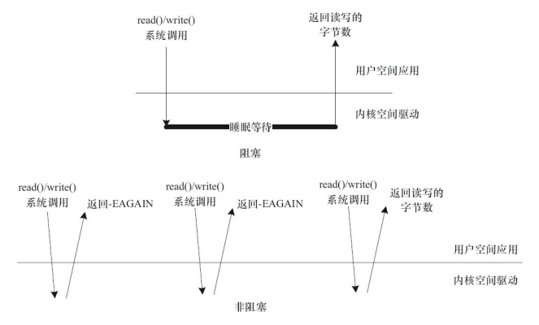
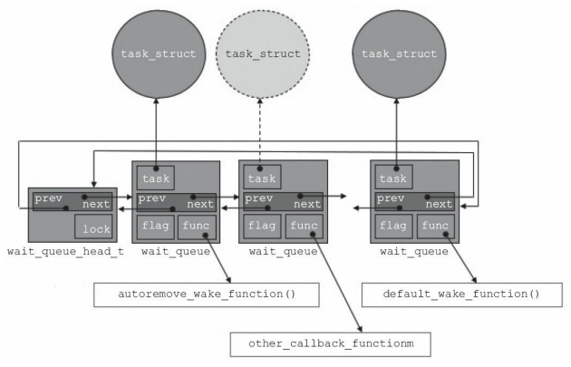
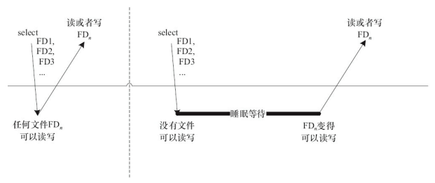

# 1、阻塞与非阻塞I/O

​	阻塞操作是指在执行设备操作时，若不能获得资源，则挂起进程直到满足可操作的条件后再进行操作。被挂起的进程进入休眠状态，被从调度器的运行队列移走，直到等待的条件被满足。而非阻塞操作的进程在不能进行设备操作时，并不挂起，它要么放弃，要么不停地查询，直至可以进行操作为止。

​	驱动程序通常需要提供这样的能力：当应用程序进行`read()`、`write()`等系统调用时，若设备的资源不能获取，而用户又希望以阻塞的方式访问设备，驱动程序应在设备驱动的`xxx_read()`、`xxx_write()`操作中将进程阻塞直到资源可以获取，此后，应用程序的`read()`、`write()`等调用才返回，整个过程仍然进行了正确的设备访问，用户并没有感知到：若用户以非阻塞的方式访问设备文件，则当设备资源不可获取时，设备驱动的`xxx_read()`、`xxx_write()`等操作应立即返回，`read()`、`write()`等系统调用也随机被返回，应用程序收到`-EAGAIN`返回值。

​	如图8.1所示，在阻塞访问时，不能获取资源的进程将进入休眠，它将CPU资源“礼让”给其他进程。因为阻塞的进程会进入休眠状态，所以必须确保有一个地方能够唤醒休眠的进程，否则，进程就真的“寿终正寝”了。唤醒进程的地方最大可能发生在中断里面，因为在硬件资源获得的同时往往伴随着一个中断。而非阻塞的进程则不断尝试，直到可以进行I/O。



​	以下代码演示了以阻塞和非阻塞方式读取串口一个字符：

```c
// 阻塞地读串口一个字符
char buf;
fd = open("/dev/ttyS1", O_RDWR);
/* ... */
res = read(fd, &buf, 1); /* 当串口上有输入时才返回 */
if(res==1)
printf("%c\n", buf);

// 非阻塞地读串口一个字符
char buf;
fd = open("/dev/ttyS1", O_RDWR| O_NONBLOCK);
/* ... */
while(read(fd, &buf, 1)!=1)
	continue; /* 串口上无输入也返回，因此要循环尝试读取串口 */
printf("%c\n", buf);

```

​	可以注意以上代码在使用`open()`函数打开文件时，使用`O_NONBLOCK`标志指定是以阻塞还是非阻塞方式。在文件打开后，也可以通过`ioctl()`和`fcntl()`改变读写的方式，如从阻塞变更为非阻塞或者从非阻塞变更为阻塞。例如，调用`fcntl(fd, F_SETFL, O_NONBLOCK)`可以设置`fd`对应的I/O为非阻塞。

## 1.1 等待队列

​	在Linux驱动程序中，可以使用等待队列（Wait Queue）来实现阻塞进程的唤醒。等待队列很早就作为一个基本的功能单位出现在Linux内核里了，它以队列为基础数据结构，与进程调度机制紧密结合，可以用来同步对系统资源的访问，第7章中所讲述的信号量在内核中也依赖等待队列来实现。

**1.定义等待队列头部**

```c
wait_queue_head_t my_queue;
```

**2.初始化等待队列头部**

```c
init_waitqueue_head(&my_queue);

/* 下面宏可以作为定义并初始化等待队列头部 */
DECLARE_WAIT_QUEUE_HEAD(name)
```

**3.定义等待队列元素**

​	下面宏用于定义并初始化一个名为name的等待队列元素

```c
DECLARE_WAITQUEUE(name, tsk)
```

**4.添加/移除等待队列**

```c
void add_wait_queue(wait_queue_head_t *q, wait_queue_t *wait);
void remove_wait_queue(wait_queue_head_t *q, wait_queue_t *wait);
```

​	`add_wait_queue()`用于将等待队列元素wait添加到等待队列头部q指向的双向链表中，而`remove_wait_queue()`用于将等待队列元素wait从由q头部指向的链表中移除。

**5.等待事件**

```c
wait_event(queue, condition)
wait_event_interruptible(queue, condition)
wait_event_timeout(queue, condition, timeout)
wait_event_interruptible_timeout(queue, condition, timeout)
```

​	等待第一个参数queue作为等待队列头部的队列被唤醒，而且第二个参数condition必须满足，否则继续阻塞。`wait_event()`和`wait_event_interruptible()`的区别在于后者可以被信号打断，而前者不能。`wait_evnet_timeout()`和`wait_event_interruptible_timeout()`意味着阻塞等待的超时时间，以`jiffy`为单位，在第三个参数`timeout`到达时，不论`condition`是否满足，均返回。

**6.唤醒队列**

```c
void wake_up(wait_queue_head_t *queue);
void wake_up_interruptible(wait_queue_head_t *queue);
```

​	上述操作会唤醒以`queue`作为等待队列头部的队列中所有的进程。`wait_up()`应该与`wait_event()`或`wait_event_timeout()`成对使用，而`wake_up_interruptible()`则应与`wait_event_interruptible()`或`wait_event_interruptible_timeout()`成对使用。`wake_up()`可唤醒处于`TASK_INTERRUPTIBLE`和`TASK_UNINTERRUPTIBLE`的进程，而`wake_up_interruptible()`只能唤醒处于`TASK_INTERRUPTIBLE`的进程。

**7.在等待队列上睡眠**

```c
sleep_on(wait_queue_head_t *q);
interruptible_sleep_on(wait_queue_head_t *q);
```

​	`sleep_on()`函数的作用就是将目前进程的状态置成`TASK_UNINTERRUPTIBLE`，并定义一个等待队列元素，之后把它挂到等待队列头部q指向的双向链表，直到资源可获得，q队列指向链接的进程被唤醒。

​	`interruptible_sleep_on()`与`sleep_on()`函数类似，其作用是将目前进程的状态置成`TASK_INTERRUPTIBLE`，并定义一个等待队列元素，之后把它附属到q指向的队列，直到资源可获得（q指引的等待队列被唤醒）或者进程收到信号。

​	`sleep_on()`函数应该与`wake_up()`成对使用，`interruptible_sleep_on()`应该与`wake_up_interruptible()`成对使用。

**示例**

​	下面代码演示了一个在设备驱动中使用等待队列的模板，在进行写`I/O`操作的时候，判断设备是否可写，如果不可写且为阻塞`I/O`，则进程睡眠并挂起到等待队列。

```c
static ssize_t xxx_write(struct file *file,
                         const char *buffer, size_t count, loff_t *ppos)
{
	...
	DECLARE_WAITQUEUE(wait, current); /* 定义等待队列元素 */
	add_wait_queue(&xxx_wait, &wait); /* 添加元素到等待队列 */

	/* 等待设备缓冲区可写 */
	do {
		avail = device_writable(...);
		if (avail < 0) {
			if (file->f_flags &O_NONBLOCK) { /* 非阻塞 */
				ret = -EAGAIN;
				goto out;
			}
			__set_current_state(TASK_INTERRUPTIBLE); /* 改变进程状态 */
			schedule(); /* 调度其他进程执行 */
			if (signal_pending(current)) { /* 如果是因为信号唤醒 */
				ret = -ERESTARTSYS;
				goto out;
			}
		}
	} while (avail < 0);

	/* 写设备缓冲区 */
	device_write(...)
out:
	remove_wait_queue(&xxx_wait, &wait); /* 将元素移出xxx_wait指引的队列 */
	set_current_state(TASK_RUNNING); /* 设置进程状态为TASK_RUNNING */
	return ret;
}
```

​	读懂以上代码对理解Linux进程状态切换非常重要，几个要点如下：

​	1）如果是非阻塞访问（`O_NONBLOCK`被设置），设备忙时，直接返回`-EAGAIN`。

​	2）对于阻塞访问，会调用`__set_current_state(TASK_INTERRUPTIBLE)`进行进程状态切换并显示通过`schedule()`调度其他进程执行。

​	3）醒来的时候要注意，由于调度出去的时候，进程状态是`TASK_INTERRUPTIBLE`，即浅度睡眠，所以唤醒它的有可能是信号，因此，我们首先通过`signal_pending(current)`了解是不是信号唤醒的，如果是，立即返回`-ERESTARTSYS`。

​	`DECLARE_WAITQUEUE`、`add_wait_queue`这两个动作加起来完成的效果如下图所示。在`wait_queue_head_t`指向的链表上，新定义的`wait_queue`元素被插入，而这个新插入的元素绑定了一个`task_struct`（当前做`xxx_write`的`current`，这也是`DECLARE_WAITQUEUE`使用`current`作为参数的原因）。



## 1.2 支持阻塞操作的`globalfifo`设备驱动

​	现在我们给`globalmem`增加这样的约束：把`globalmem`中的全局内存变成一个FIFO，只有当FIFO中有数据的时候（即有进程把数据写到这个FIFO而且没有被读进程读空），读进程才能把数据读出，而且读取后的数据会从`globalmem`的全局内存中被拿掉；只有当FIFO不满时（即还有一些空间未被写，或者写满后被读进程从这个FIFO中读出了数据），写进程才能往这个FIFO中写入数据。

​	现在，将`globalmem`重命名为`globalfifo`，在`globalfifo`中，读FIFO将唤醒写FIFO的进程（如果之前FIFO正好是满的），而写FIFO也将唤醒读FIFO的进程（如果之前FIFO正好是空的）。首先，需要修改设备结构体，在其中增加两个等待队列头部，分别对应于读和写，如下代码所示：

```c
struct globalfifo_dev {
	struct cdev cdev;
	unsigned int current_len;
	unsigned char mem[GLOBALFIFO_SIZE];
	struct mutex mutex;
	wait_queue_head_t r_wait;
	wait_queue_head_t w_wait;
};
```

​	增加了`current_len`成员以用于表征目前FIFO中有效数据的长度。`current_len`等于0意味着FIFO空，`current_len`等于`GLOBALFIFO_SIZE`意味着FIFO满。

​	这两个等待队列头部需要在设备驱动模块加载函数中调用`init_waitqueue_head()`被初始化，新的设备驱动模块加载函数如下代码所示：

```c
static int __init globalfifo_init(void)
{
	int ret;
	dev_t devno = MKDEV(globalfifo_major, 0);

	if (globalfifo_major)
		ret = register_chrdev_region(devno, 1, "globalfifo");
	else {
		ret = alloc_chrdev_region(&devno, 0, 1, "globalfifo");
		globalfifo_major = MAJOR(devno);
	}
	if (ret < 0)
		return ret;

	globalfifo_devp = kzalloc(sizeof(struct globalfifo_dev), GFP_KERNEL);
	if (!globalfifo_devp) {
		ret = -ENOMEM;
		goto fail_malloc;
	}

	globalfifo_setup_cdev(globalfifo_devp, 0);

	mutex_init(&globalfifo_devp->mutex);
	init_waitqueue_head(&globalfifo_devp->r_wait);
	init_waitqueue_head(&globalfifo_devp->w_wait);

	return 0;

fail_malloc:
	unregister_chrdev_region(devno, 1);
	return ret;
}
module_init(globalfifo_init);
```

​	设备驱动读写操作需要被修改，在读函数中需增加唤醒`globalfifo_devp->w_wait`的语句，而在写操作中唤醒`globalfifo_devp->r_wait`，如下代码所示：

```c
static ssize_t globalfifo_read(struct file *filp, char __user *buf, size_t count, loff_t *ppos)
{
	int ret;
	struct globalfifo_dev *dev = filp->private_data;
	DECLARE_WAITQUEUE(wait, current);

	mutex_lock(&dev->mutex);
	add_wait_queue(&dev->r_wait, &wait);

	while (dev->current_len == 0) {
		if (filp->f_flags & O_NONBLOCK) {
			ret = -EAGAIN;
			goto out;
		}
		__set_current_state(TASK_INTERRUPTIBLE);
		mutex_unlock(&dev->mutex);

		schedule();
		if (signal_pending(current)) {
			ret = -ERESTARTSYS;
			goto out2;
		}

		mutex_lock(&dev->mutex);
	}

	if (count > dev->current_len)
		count = dev->current_len;

	if (copy_to_user(buf, dev->mem, count)) {
		ret = -EFAULT;
		goto out;
	} else {
		memcpy(dev->mem, dev->mem + count, dev->current_len - count);
		dev->current_len -= count;
		printk(KERN_INFO "read %d bytes(s),current_len:%d\n", count, dev->current_len);

		wake_up_interruptible(&dev->w_wait);

		ret = count;
	}
out:
	mutex_unlock(&dev->mutex);;
out2:
	remove_wait_queue(&dev->w_wait, &wait);
	set_current_state(TASK_RUNNING);
	return ret;
}

static ssize_t globalfifo_write(struct file *filp, const char __user * buf, size_t count, loff_t *ppos)
{
	struct globalfifo_dev *dev = filp->private_data;
	int ret;
	DECLARE_WAITQUEUE(wait, current);

	mutex_lock(&dev->mutex);
	add_wait_queue(&dev->w_wait, &wait);

	while (dev->current_len == GLOBALFIFO_SIZE) {
		if (filp->f_flags & O_NONBLOCK) {
			ret = -EAGAIN;
			goto out;
		}
		__set_current_state(TASK_INTERRUPTIBLE);

		mutex_unlock(&dev->mutex);

		schedule();
		if (signal_pending(current)) {
			ret = -ERESTARTSYS;
			goto out2;
		}

		mutex_lock(&dev->mutex);
	}

	if (count > GLOBALFIFO_SIZE - dev->current_len)
		count = GLOBALFIFO_SIZE - dev->current_len;

	if (copy_from_user(dev->mem + dev->current_len, buf, count)) {
		ret = -EFAULT;
		goto out;
	} else {
		dev->current_len += count;
		printk(KERN_INFO "written %d bytes(s),current_len:%d\n", count, dev->current_len);

		wake_up_interruptible(&dev->r_wait);

		ret = count;
	}

out:
	mutex_unlock(&dev->mutex);;
out2:
	remove_wait_queue(&dev->w_wait, &wait);
	set_current_state(TASK_RUNNING);
	return ret;
}
```

​	`globalfifo_read()`通过第6行和第9行将自己加到了`r_wait`这个队列里面，但是此时读的进程并未睡眠，之后第16行调用`__set_current_state(TASK_INTERRUPTIBLE)`时，也只是标记了`task_struct`的一个浅度睡眠标记，并未真正睡眠，直到第19行调用`schedule()`，读进程进入睡眠。进行完读操作后，第40行调用`wake_up_interruptible(&dev->w_wait)`唤醒可能阻塞的写进程。`globalfifo_write()`的过程与此类似。

​	关注代码的第17行和第69行，无论是读函数还是写函数，进入`schedule()`把自己切换出去之前，都主动释放了互斥体。原因是如果读进程阻塞，实际意味着FIFO空，必须依赖写的进程往FIFO里面写东西来唤醒它，但是写的进程为了写FIFO，它也必须拿到这个互斥体来访问FIFO这个临界资源，如果读进程把自己调度出去之前不释放这个互斥体，那么读写进程之间就死锁了。所谓死锁，就算多个进程循环等待他方占有的资源而无限期地僵持下去。如果没有外力的作用，那么死锁涉及的各个进程都将永远处于封锁状态。因此，驱动工程师一定要注意：当多个等待队列、信号量、互斥体等机制同时出现时，谨防死锁。

​	现在回过来看一下上述代码的第12行和第63行，发现在设备驱动的`read()`、`write()`等功能函数中，可以通过`filp->f_flags`标志获得用户空间是否要求非阻塞访问。驱动中可以依据此标志判断用户究竟要求阻塞还是非阻塞访问，从而进行不同的处理。

​	代码中还有一个关键点，就是无论读函数还是写函数，在进入真正的读写之前，都要再次判断设备是否可以读写，见上述代码的第11行和第62行。主要目的是为了让并发的读或者并发的写都正确。设想如果两个读进程都阻塞在读上，写进程执行的`wake_up_interruptible(&dev->r_wait)`实际会同时唤醒它们，其中先执行的那个进程可能会率先将FIFO再次读空。

# 2、轮询操作

## 2.1 轮询的概念和作用

​	在用户程序中，`select()`和`poll()`也是与设备阻塞和非阻塞访问息息相关的论题。使用非阻塞`I/O`的应用程序通常会使用`select()`和`poll()`系统调用查询是否可对设备进行无阻塞的访问。`select()`和`poll()`系统调用最终会使设备驱动中的`poll()`函数被执行，在`Linux2.5.45`内核中还引入`epoll()`，即扩展的`poll()`。

​	`select()`和`poll()`系统调用的本质一样，前者在`BSD UNIX`中引入，后者在`System V`中引入。

## 2.2 应用程序中的轮询编程

​	应用程序中最广泛用到的是`BSD UNIX`中引入的`select()`系统调用，其原型为：

```c
int select(int numfds, fd_set *readfds, fd_set *writefds, fd_set *exceptfds,
          struct timeval *timeout);
```

​	其中`readfds`、`writefds`、`exceptfds`分别是被`select()`监视的读、写和异常处理的文件描述符集合，`numfds`的值是需要检查的号码最高的`fd`加一。`readfds`文件集中的任何一个文件变得可读，`select()`返回；同理，`writefds`文件集中的任何一个文件变得可写，`select`也返回。

​	如下图所示，第一次对n个文件进行`select()`的时候，若任何一个文件满足要求，`select()`就直接返回；第二次再进行`select()`的时候，没有文件满足读写要求，`select()`的进程阻塞且睡眠。由于调用`select()`的时候，每个驱动的`poll()`接口都会被调用到，实际上执行`select()`的进程被挂到了每个驱动的等待队列上，可以被任何一个驱动唤醒。如果`FDn`变得可读写，`select()`返回。



​	`timeout`参数是一个指向`struct timeval`类型的指针，它可以使`select()`在等待`timeout`时间后若仍然没有文件描述符准备好则超时返回。

**1.结构体定义**

```c
struct timeval {
    int tv_sec;		/* 秒 */
    int tv_usec;	/* 微秒 */
};
```

**2.清除一个文件描述符集合**

```c
FD_ZERO(fd_set *set)
```

**3.将一个文件描述符加入文件描述符集合中**

```c
FD_SET(int fd, fd_set *set)
```

**4.将一个文件描述符从文件描述符集合中清除**

```c
FD_CLR(int fd, fd_set *set)
```

**5.判断文件描述符是否被置位**

```c
FD_ISSET(int fd, fd_set *set)
```


​	`poll()`的功能和实现原理与`select()`相似，其函数原型为：

```c
int poll(struct pollfd *fd, nfds_t nfds, int timeout);
```

​	当多路复用的文件数量庞大、`I/O`流量频繁的时候，一般不太适合使用`select()`和`poll()`，此种情况下，`select()`和`poll()`的性能表现较差，我们宜使用`epoll`。`epoll`的最大好处是不会随着`fd`的数目增长而降低效率，`select()`则会随着`fd`的数量增大性能下降明显。

**1.创建`epoll`句柄**

```c
int epoll_create(int size);
```

​	创建一个`epoll`的句柄，`size`用来告诉内核要监听多少个`fd`。需要注意的是，当创建好`epoll`句柄后，它本身也会占用一个`fd`值，所以在使用完`epoll`后，必须调用`close()`关闭。

**2.监听事件**

```c
int epoll_ctl(int epfd, int op, int fd, struct epoll_event *event);
```

​	告诉内核要监听什么类型的事件。

参数说明：

* `epfd`：`epoll_create()`创建的句柄。
* `op`：表示动作，包含：
  * `EPOLL_CTL_ADD`：注册新的`fd`到`epfd`中
  * `EPOLL_CTL_MOD`：修改已经注册的`fd`的监听事件
  * `EPOLL_CTL_DEL`：从`epfd`中删除一个`fd`
* `fd`：要监听的`fd`
* `event`：告诉内核需要监听的事件类型，可以是以下几个宏的`“或”`：
  * `EPOLLIN`：表示对应的文件描述符可以读
  * `EPOLLOUT`：表示对应的文件描述符可以写
  * `EPOLLPRI`：表示对应的文件描述符有紧急的数据可读（这里应该表示的是有`socket`带外数据到来）
  * `EPOLLERR`：表示对应的文件描述符发生错误
  * `EPOLLHUP`：表示对应的文件描述符被挂断
  * `EPOLLET`：将`epoll`设为边缘触发（Edge Triggered），这是相对于水平触发（Level Triggered）来说的。LT（Level Triggered）是缺省的工作方式，在LT情况下，内核告诉用户一个`fd`是否就绪了，之后用户可以对这个就绪的`fd`进行`I/O`操作。但是如果用户不进行任何操作，该事件并不会丢失，而ET（Edge Triggered）是高速工作方式，在这种模式下，当`fd`从未就绪变为就绪时，内核通过`epoll`告诉用户，然后它会假设用户知道`fd`已经就绪，并且不会再为那个`fd`发送更多的就绪通知。
  * `EPOLLONESHOT`：意味着一次性监听，当监听完这次事件之后，如果还需要继续监听这个`fd`的话，需要再次把这个`fd`加入到`epoll`队列里。

**3.等待事件发生**

```c
int epoll_wait(int epfd, struct epoll_event *events, int maxevents, int timeout);
```

​	等待事件的产生，其中`events`参数是输出参数，用来从内核得到事件的集合，`maxevents`告诉内核本次最多收多少事件，`maxevents`的值不能大于`epoll_create()`创建的句柄的`size`，参数`timeout`是超时时间（以毫秒为单位，0意味着立即返回，-1意味着永久等待）。该函数的返回值是需要处理的事件的数目，如返回0，则表示已超时。

​	一般来说，当涉及的`fd`数量较少的时候，使用`select`是合适的，如果涉及的`fd`较多的时候，比如在大规模并发的服务器中侦听许多`socket`的时候，则不太适合选用`select`，而适合选用`epoll`。

## 2.3 设备驱动中的轮询编程

​	设备驱动中`poll()`函数的原型是：

```c
unsigned int (*poll)(struct file *filp, struct poll_table *wait);
```

​	第一个参数为file结构体指针，第二个参数为轮询表指针。这个函数进行两项工作：

​	1）对可能引起设备文件状态变化的等待队列调用`poll_wait()`函数，将对应的等待队列头部添加到`poll_table`中。

​	2）返回表示是否能对设备进行无阻塞读、写访问的掩码。


​	用于向`poll_table()`注册等待队列的关键`poll_wait()`函数的原型如下：

```c
void poll_wait(struct file *filp, wait_queue_head_t *queue, poll_table *wait);
```

​	`poll_wait()`函数的名称非常容易让人产生误会，以为它和`wait_event()`函数一样，会阻塞地等待某事件的发生，其实这个函数并不会引起阻塞。`poll_wait()`函数所做的工作是把当前进程添加到`wait`参数指定的等待列表（`poll_table`）中，实际作用是让唤醒参数`queue`对应的等待队列可以唤醒因`select()`而睡眠的进程。

​	驱动程序`poll()`函数应该返回设备资源的可获取状态，即`POLLIN`、`POLLOUT`、`POLLPRI`、`POLLERR`、`POLLNVAL`等宏的位“或”结果。每个宏的含义都表明设备的一种状态，如`POLLIN`（定义为`0x0001`）意味着设备可以无阻塞地读，`POLLOUT`（定义为`0x0004`）意味着设备可以无阻塞地写。

**示例**

```c
static unsigned int xxx_poll(struct file *filp, poll_table *wait)
{
	unsigned int mask = 0;
	struct xxx_dev *dev = filp->private_data; /* 获得设备结构体指针*/

	/* ... */
	poll_wait(filp, &dev->r_wait, wait); /* 加入读等待队列 */
	poll_wait(filp, &dev->w_wait, wait); /* 加入写等待队列 */

	if (...) /* 可读 */
		mask |= POLLIN | POLLRDNORM; /* 标示数据可获得（对用户可读）*/

	if (...) /* 可写 */
		mask |= POLLOUT | POLLWRNORM; /* 标示数据可写入*/
	/* ... */
	return mask;
}
```

# 3、支持轮询操作的`globalfifo`驱动

## 3.1 在`globalfifo`驱动中增加轮询操作

​	在`globalfifo`的`poll()`函数中，首先将设备结构体中的`r_wait`和`w_wait`等待队列头部添加到等待列表中（意味着因调用`select`而阻塞的进程可以被r_wait和w_wait唤醒），然后通过判断`dev->current_len`是否等于0来获得设备的可读状态，通过判断`dev->current_len`是否等于`GLOBALFIFO_SIZE`来获得设备的可写状态。

```c
static unsigned int globalfifo_poll(struct file *filp, poll_table * wait)
{
	unsigned int mask = 0;
	struct globalfifo_dev *dev = filp->private_data;

	mutex_lock(&dev->mutex);;

	poll_wait(filp, &dev->r_wait, wait);
	poll_wait(filp, &dev->w_wait, wait);

	if (dev->current_len != 0) {
		mask |= POLLIN | POLLRDNORM;
	}

	if (dev->current_len != GLOBALFIFO_SIZE) {
		mask |= POLLOUT | POLLWRNORM;
	}

	mutex_unlock(&dev->mutex);;
	return mask;
}

static const struct file_operations globalfifo_fops = {
    .poll = globalfifo_poll,
};
```

## 3.2 在用户空间中验证`globalfifo`设备的轮询

​	编写一个应用程序`globalfifo_poll.c`，以用`select()`监控`globalfifo`的可读写状态，程序代码如下所示：

```c
#define FIFO_CLEAR 0x1
#define BUFFER_LEN 20
void main(void)
{
	int fd, num;
	char rd_ch[BUFFER_LEN];
	fd_set rfds, wfds; /* 读/写文件描述符集 */

	/* 以非阻塞方式打开/dev/globalfifo设备文件 */
	fd = open("/dev/globalfifo", O_RDONLY | O_NONBLOCK);
	if (fd != -1) {
		/* FIFO清0 */
		if (ioctl(fd, FIFO_CLEAR, 0) < 0)
			printf("ioctl command failed\n");

		while (1) {
			FD_ZERO(&rfds);
			FD_ZERO(&wfds);
			FD_SET(fd, &rfds);
			FD_SET(fd, &wfds);

			select(fd + 1, &rfds, &wfds, NULL, NULL);
			/* 数据可获得 */
			if (FD_ISSET(fd, &rfds))
				printf("Poll monitor:can be read\n");
			/* 数据可写入 */
			if (FD_ISSET(fd, &wfds))
				printf("Poll monitor:can be written\n");
		}
	} else {
		printf("Device open failure\n");
	}
}
```

​	当没有任何输入，即FIFO为空时，程序不断地输出`Poll monitor: can be written`，当通过`echo`向`/dev/globalfifo`写入一些数据后，将输出`Poll monitor: can be read`和`Poll monitor: can be written`，如果不断地通过`echo`向`/dev/globalfifo`写入数据直至写满`FIFO`，则发现`pollmonitor`程序将只输出`Poll monitor: can be read`。对于`globalfifo`而言，不会出现既不能读，又不能写的情况。


​	编写一个应用程序`globalfifo_epoll.c`，以用`epoll`监控`globalfifo`的可读状态，程序代码如下所示：

```c
#define FIFO_CLEAR 0x1
#define BUFFER_LEN 20
void main(void)
{
	int fd;

	fd = open("/dev/globalfifo", O_RDONLY | O_NONBLOCK);
	if (fd != -1) {
		struct epoll_event ev_globalfifo;
		int err;
		int epfd;

		if (ioctl(fd, FIFO_CLEAR, 0) < 0)
			printf("ioctl command failed\n");

		epfd = epoll_create(1);
		if (epfd < 0) {
			perror("epoll_create()");
			return;
		}

		bzero(&ev_globalfifo, sizeof(struct epoll_event));
		ev_globalfifo.events = EPOLLIN | EPOLLPRI;

		err = epoll_ctl(epfd, EPOLL_CTL_ADD, fd, &ev_globalfifo);
		if (err < 0) {
			perror("epoll_ctl()");
			return;
		}
		err = epoll_wait(epfd, &ev_globalfifo, 1, 15000);
		if (err < 0) {
			perror("epoll_wait()");
		} else if (err == 0) {
			printf("No data input in FIFO within 15 seconds.\n");
		} else {
			printf("FIFO is not empty\n");
		}
		err = epoll_ctl(epfd, EPOLL_CTL_DEL, fd, &ev_globalfifo);
		if (err < 0)
			perror("epoll_ctl()");
	} else {
		printf("Device open failure\n");
	}
}
```

​	上述程序第25行将`globalfifo`对应的`fd`加入到了侦听的行列，第23行设置侦听读事件，第30行进行等待，若15秒内没有人写`/dev/globalfifo`，该程序会打印`No data input in FIFO within 15 seconds`，否则程序会打印`FIFO is not empty`。

# 4、总结

​	阻塞和非阻塞访问是`I/O`操作的两种不同模式，前者在暂时不可进行`I/O`操作时会让进程睡眠，后者则不然。

​	在设备驱动中阻塞`I/O`一般基于等待队列或者基于等待队列的其它`Linux`内核`API`来实现，等待队列可用于同步驱动中事件发生的先后顺序。使用非阻塞`I/O`的应用程序也可借助轮询函数来查询设备是否能立即被访问，用户空间调用`select()`、`poll()`或者`epoll`接口，设备驱动提供`poll()`函数。设备驱动的`poll()`本身不会阻塞，但是与`poll()`、`select()`和`epoll`相关的系统调用则会阻塞地等待至少一个文件描述符集合可访问或超时。
