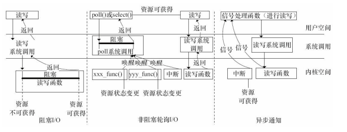
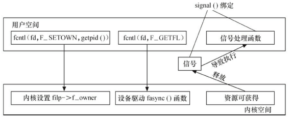

# 1、异步通知的概念与作用

​	阻塞与非阻塞访问、`poll()`函数提供了较好的解决设备访问的机制，但是如果有了异步通知，整套机制则更加完整了。

​	异步通知的意思是：一旦设备就绪，则主动通知应用程序，这样应用程序根本就不需要查询设备状态，这一点非常类似于硬件上“中断”的概念，比较准确的称谓是“信号驱动的异步I/O”。信号是在软件层次上对中断机制的一种模拟，在原理上，一个进程收到一个信号与处理器收到一个中断请求可以说是一样的。信号是异步的，一个进程不必通过任何操作来等待信号的到达，事实上，进程也不知道信号到底什么时候到达。

​	阻塞`I/O`意味着一直等待设备可访问后再访问，非阻塞`I/O`中使用`poll()`意味着查询设备是否可访问，而异步通知则意味着设备通知用户自身可访问，之后用户再进行`I/O`处理。由此可见，这几种`I/O`方式可以相互补充。

​	下图呈现了阻塞`I/O`，结合轮询的非阻塞`I/O`及基于`SIGIO`的异步通知在时间先后顺序上的不同。



​	这里要强调的是：阻塞、非阻塞IO、异步通知本身没有优劣，应该根据不同的应用场景合理选择。

# 2、Linux异步通知编程

## 2.1 Linux信号

​	使用信号进行进程间通信（`IPC`）是UNIX中的一种传统机制，Linux也支持这种机制。在Linux中，异步通知使用信号来实现，Linux中可用的信号及其定义如下表所示。

| 信号        | 值   | 含义                         |
| ----------- | ---- | ---------------------------- |
| `SIGHUP`    | 1    | 挂起                         |
| `SIGINT`    | 2    | 终端中断                     |
| `SIGQUIT`   | 3    | 终端退出                     |
| `SIGILL`    | 4    | 无效命令                     |
| `SIGTRAP`   | 5    | 跟踪陷阱                     |
| `SIGIOT`    | 6    | `IOT`陷阱                    |
| `SIGBUS`    | 7    | `BUS`错误                    |
| `SIGFPE`    | 8    | 浮点异常                     |
| `SIGKILL`   | 9    | 强行终止（不能被捕获或忽略） |
| `SIGUSR1`   | 10   | 用户定义的信号1              |
| `SIGSEGV`   | 11   | 无效的内存段处理             |
| `SIGUSR2`   | 12   | 用户定义的信号2              |
| `SIGPIPE`   | 13   | 半关闭管道的写操作已经发生   |
| `SIGALRM`   | 14   | 计时器到期                   |
| `SIGTERM`   | 15   | 终止                         |
| `SIGSTKFLT` | 16   | 堆栈错误                     |
| `SIGCHLD`   | 17   | 子进程已经停止或退出         |
| `SIGCONT`   | 18   | 如果停止了，继续执行         |
| `SIGSTOP`   | 19   | 停止执行（不能被捕获或忽略） |
| `SIGTSTP`   | 20   | 终端停止信号                 |
| `SIGTTIN`   | 21   | 后台进程需要从终端读取输入   |
| `SIGTTOU`   | 22   | 后台进程需要向从终端写出     |
| `SIGURG`    | 23   | 紧急的套接字事件             |
| `SIGXCPU`   | 24   | 超额使用CPU分配的时间        |
| `SIGXFSZ`   | 25   | 文件尺寸超额                 |
| `SIGVTALRM` | 26   | 虚拟时钟信号                 |
| `SIGPROF`   | 27   | 时钟信号描述                 |
| `SIGWINCH`  | 28   | 窗口尺寸变化                 |
| `SIGIO`     | 29   | I/O                          |
| `SIGPWR`    | 30   | 断电重启                     |

​	除了`SIGSTOP`和`SIGKILL`两个信号外，进程能够忽略或捕获其它的全部信号。一个信号被捕获的意思是当一个信号到达时有相应的代码处理它。如果一个信号没有被这个进程所捕获，内核将采用默认行为处理。

## 2.2 信号的接收

​	在用户程序中，为了捕获信号，可以使用`signal()`函数来设置对应信号的处理函数：

```c
void (*signal(int signum, void (*handler)(int)))(int);

/* 拆分如下 */
typedef void (*sighandler_t)(int);
sighandler_t signal(int signum, sighandler_t handler));
```

* `signum`：信号的值
* `handler`：针对前面信号值的处理函数。
  * `SIG_DFL`：采用系统默认方式处理信号
  * `SIG_IGN`：忽略该信号，即没有意义，代码执行仍将继续
  * 自定义函数：定义的特定函数来处理信号

​	如果`signal()`调用成功，它返回最后一次为信号`signum`绑定的处理函数的`handler`值，失败则返回`SIG_ERR`。

​	在进程执行时，按下`Ctrl+C`将向其发出`SIGINT`信号，正在运行`kill`的进程将向其发出`SIGTERM`信号，如下代码的进程可捕获这两个信号并输出信号值。

**示例**

```c
void sigterm_handler(int signo)
{
	printf("Have caught sig N.O. %d\n", signo);
	exit(0);
}

int main(void)
{
	signal(SIGINT, sigterm_handler);
	signal(SIGTERM, sigterm_handler);
	while(1);

	return 0;
}
```

​	除了`signal()`函数之外，`sigaction()`函数可用于改变进程接收到特定信号后的行为，它的原型是：

```c
int sigaction(int signum, const struct sigaction *act, struct sigaction *oldact);
```

* `signum`：信号的值，可以是除`SIGKILL`和`SIGSTOP`外的任何一个特定有效的信号
* `act`：指向结构体`sigaction`的一个实例的指针，在结构体`sigaction`的实例中，指定了对特定信号的处理函数，若为空，则进程会以缺省方式对信号处理
* `oldact`：指向的对象用来保存原来对相应信号的处理函数，可指定为`NULL`。如果把第二、三个参数都设为`NULL`，那么该函数可用于检查信号的有效性。

**示例**

```c
#include <sys/types.h>
#include <sys/stat.h>
#include <stdio.h>
#include <fcntl.h>
#include <signal.h>
#include <unistd.h>
#define MAX_LEN 100
void input_handler(int num)
{
	char data[MAX_LEN];
	int len;

	/* 读取并输出STDIN_FILENO上的输入 */
	len = read(STDIN_FILENO, &data, MAX_LEN);
	data[len] = 0;
	printf("input available:%s\n", data);
}

main()
{
	int oflags;

	/* 启动信号驱动机制 */
	signal(SIGIO, input_handler);
	fcntl(STDIN_FILENO, F_SETOWN, getpid());
	oflags = fcntl(STDIN_FILENO, F_GETFL);
	fcntl(STDIN_FILENO, F_SETFL, oflags | FASYNC);

	/* 最后进入一个死循环，仅为保持进程不终止，如果程序中没有这个死循会立即执行完毕 */
	while (1);
}
```

​	上述代码第24行为`SIGIO`信号设置`input_handler()`作为处理函数，第25行设置本进程为`STDIN_FILENO`文件的拥有者，没有这一步，内核不会知道应该将信号发给哪个进程。而为了启用异步通知机制，还需对设备设置`FASYNC`标志，第26、27行可实现此目的。整个程序的执行效果如下：

```shell
[root@localhost driver_study]# ./signal_test
I am Chinese.								-> 用户输入
input available: I am Chinese.				-> signal_test程序打印
I love Linux driver.						-> 用户输入
input available: I love Linux driver.		-> signal_test程序打印
```

​	当用户输入一串字符后，标准输入设备释放`SIGIO`信号，这个信号"中断"与驱使对应的应用程序中的`input_handler()`得以执行，并将用户输入显示出来。

​	由此可见，为了能在用户空间中处理一个设备释放的信号，它必须完成3项工作：

​	1）通过`F_SETOWN` `IO`控制命令设置设备文件的拥有者为本进程，这样从设备驱动发出的信号才能被本进程接收到。

​	2）通过`F_SETFL` `IO`控制命令设置设备文件以支持`FASYNC`，即异步通知模式。

​	3）通过`signal()`函数连接信号和信号处理函数。

## 2.3 信号的释放

​	在设备驱动和应用程序的异步通知交互中，仅仅在应用程序端捕获信号是不够的，因为信号的源头在设备驱动端。因此，应该在合适的时机让设备驱动释放信号，在设备驱动程序中增加信号释放的相关代码。

​	为了使设备支持异步通知机制，驱动程序中涉及3项工作：

​	1）支持`F_SETOWN`命令，能在这个控制命令处理中设置`filp->f_owner`为对应进程`ID`。不过此项工作已由内核完成，设备驱动无需处理。

​	2）支持`F_SETFL`命令的处理，每当`FASYNC`标志改变时，驱动程序中的`fasync()`函数将得以执行。因此，驱动中应该实现`fasync()`函数。

​	3）在设备资源可获得时，调用`kill_fasync()`函数激发相应的信号。

​	驱动中的上述3项工作和应用程序中的3项工作是一一对应的，下图为异步通知处理过程中用户空间和设备驱动的交互。



​	设备驱动中异步通知编程比较简单，主要用到一项数据结构和两个函数。数据结构是`fasync_struct`结构体，两个函数分别是`fasync_helper()`和`kill_fasync()`。

```c
/* 处理FASYNC标志变更的函数 */
int fasync_helper(int fd, struct file *filp, int mode, struct fasync_struct **fa);
/* 释放信号用的函数 */
void kill_fasync(struct fasync_struct **fa, int sig, int band);
```

​	和其他的设备驱动一样，将`fasync_struct`结构体指针放在设备结构体中仍然是最佳选择，下面代码给出了支持异步通知的设备结构体模板。

```c
struct xxx_dev {
	struct cdev cdev; /* cdev结构体*/
	/* ... */
	struct fasync_struct *async_queue; /* 异步结构体指针 */
};
```

​	在设备驱动的`fasync()`函数中，只需要简单地将该函数的3个参数以及`fasync_struct`结构体指针作为第四个参数传入`fasync_helper()`函数即可。下面代码给出了支持异步通知的设备驱动程序`fasync()`函数的模板。

```c
static int xxx_fasync(int fd, struct file *filp, int mode)
{
	struct xxx_dev *dev = filp->private_data;
	return fasync_helper(fd, filp, mode, &dev->async_queue);
}
```

​	在设备资源可以获得时，应该调用`kill_fasync()`函数释放`SIGIO`信号。在可读时，第三个参数设置为`POLL_IN`，在可写时，第三个参数设置为`POLL_OUT`。

**示例**

```c
static ssize_t xxx_write(struct file *filp, const char __user *buf, size_t count,
loff_t *f_pos)
{
	struct xxx_dev *dev = filp->private_data;
	/* ... */
	/* 产生异步读信号 */
	if (dev->async_queue)
		kill_fasync(&dev->async_queue, SIGIO, POLL_IN);
	/* ... */
}
```

​	最后，在文件关闭时，即在设备驱动的`release()`函数中，应调用设备驱动的`fasync()`函数将文件从异步通知的列表中删除。下面代码给出了支持异步通知的设备驱动`release()`函数的模板。

```c
static int xxx_release(struct inode *inode, struct file *filp)
{
	/* 将文件从异步通知列表中删除 */
	xxx_fasync(-1, filp, 0);
	/* ... */
	return 0;
}
```

# 3、支持异步通知的`globalfifo`驱动

## 3.1 在`globalfifo`驱动中增加异步通知

**增加异步通知后的`globalfifo`设备结构体**

```c
struct globalfifo_dev {
	struct cdev cdev;
	unsigned int current_len;
	unsigned char mem[GLOBALFIFO_SIZE];
	struct mutex mutex;
	wait_queue_head_t r_wait;
	wait_queue_head_t w_wait;
	struct fasync_struct *async_queue;
};
```

**支持异步通知的`globalfifo`设备驱动的`fasync()`函数**

```c
static int globalfifo_fasync(int fd, struct file *filp, int mode)
{
	struct globalfifo_dev *dev = filp->private_data;
	return fasync_helper(fd, filp, mode, &dev->async_queue);
}
```

**支持异步通知的`globalfifo`设备驱动的写函数**

```c
static ssize_t globalfifo_write(struct file *filp, const char __user *buf, size_t count, loff_t *ppos)
{
	struct globalfifo_dev *dev = filp->private_data;
	int ret;
	DECLARE_WAITQUEUE(wait, current);

	mutex_lock(&dev->mutex);
	add_wait_queue(&dev->w_wait, &wait);

	while (dev->current_len == GLOBALFIFO_SIZE) {
		if (filp->f_flags & O_NONBLOCK) {
			ret = -EAGAIN;
			goto out;
		}
		__set_current_state(TASK_INTERRUPTIBLE);

		mutex_unlock(&dev->mutex);

		schedule();
		if (signal_pending(current)) {
			ret = -ERESTARTSYS;
			goto out2;
		}

		mutex_lock(&dev->mutex);
	}

	if (count > GLOBALFIFO_SIZE - dev->current_len)
		count = GLOBALFIFO_SIZE - dev->current_len;

	if (copy_from_user(dev->mem + dev->current_len, buf, count)) {
		ret = -EFAULT;
		goto out;
	} else {
		dev->current_len += count;
		printk(KERN_INFO "written %d bytes(s),current_len:%d\n", count, dev->current_len);

		wake_up_interruptible(&dev->r_wait);

		if (dev->async_queue) {
			kill_fasync(&dev->async_queue, SIGIO, POLL_IN);
			printk(KERN_DEBUG "%s kill SIGIO\n", __func__);
		}

		ret = count;
	}

out:
	mutex_unlock(&dev->mutex);
out2:
	remove_wait_queue(&dev->w_wait, &wait);
	set_current_state(TASK_RUNNING);
	return ret;
} 
```

**增加异步通知后的`globalfifo`设备驱动的`release()`函数**

```c
static int globalfifo_release(struct inode *inode, struct file *filp)
{
	globalfifo_fasync(-1, filp, 0);
	return 0;
}
```

## 3.2 在用户空间中验证`globalfifo`的异步通知

**监控`globalfifo`异步通知信号的应用程序**

```c
static void signalio_handler(int signum)
{
	printf("receive a signal from globalfifo,signalnum:%d\n", signum);
}

void main(void)
{
	int fd, oflags;
	fd = open("/dev/globalfifo", O_RDWR, S_IRUSR | S_IWUSR);
	if (fd != -1) {
		signal(SIGIO, signalio_handler);
		fcntl(fd, F_SETOWN, getpid());
		oflags = fcntl(fd, F_GETFL);
		fcntl(fd, F_SETFL, oflags | FASYNC);
		while (1) {
			sleep(100);
		}
	} else {
		printf("device open failure\n");
	}
}
```

# 4、Linux异步I/O

## 4.1 `AIO`概念与`GUN`  C库`AIO`

​	`Linux`中最常用的`I/O`模型是同步`I/O`。在这个模型中，当请求发出之后，应用程序就会阻塞，直到请求满足为止。这是一种很好的解决方案，调用应用程序在等待`I/O`请求完成时不需要占用`CPU`。但是在许多应用场景中，`I/O`请求可能需要与`CPU`消耗产生交叠，以充分利用`CPU`和`I/O`提高吞吐率。

