# `CPU Cache`

> 主要参考链接：[一文搞懂cpu cache工作原理](https://zhuanlan.zhihu.com/p/593016449)
>
> 其它参考链接：[Cpu设计之缓存——cache（深度讲解篇）](https://zhuanlan.zhihu.com/p/636322548)

## 1、简介

`Cache`被称为高速缓冲存储器（`cache memory`），是一种小容量高速的存储器，属于存储子系统的一部分，存放程序常使用的指令和数据。

> 对于`service`开发工程师，可能很少关注这个模块，一般也不关心数据是在内存还是在`cache`里，毕竟大部分时候，上层程序只要遵循一定的开发规范，就不会太影响`cache`的工作。
>
> 但是对于底层开发（比如操作系统开发、固件开发、性能优化和编译器开发）工程师，`cache`是需要重点关注的模块，如果对`cache`理解不够深入，开发出来的程序不仅性能不好，并且可能会存在稳定性问题。

既然有了`DDR`，为什么还需要在`CPU`和`DDR`之间增加一个`cache`呢？主要是以下两个原因：一是`CPU`对`Cache`和`DDR`的访问、读写速度相差很大，二是减少`CPU`与其它模块争抢访存频率。

`DDR`的性能虽然也在提升，但是与`CPU`的差距越来越大，当前两者的速度相差几百倍，一条加载指令从`DDR`被读取到`CPU`内部的寄存器需要上百个时钟周期，这会导致`CPU`停滞等待加载指令，严重影响`CPU`的性能。`CPU`的运行速度和`cache`相差不大，并且程序运行遵循着时间、空间的局限性。因此通过在`CPU`与`DDR`之间增加一个`cache`，就可以很大的缓解`CPU`与`DDR`之间的速度差距。

> 既然`cache`的读写速度那么快，为什么不直接用`cache`替代`DDR`？因为`cache`的成本是`DDR`的几十倍，最主要的是`cache`的单位存储的面积也要比`DDR`大得多，`1G`的`cache`面积有一张`A4`纸大小，因此不论从成本，还是芯片面积的角度来看，基本上不能用`cache`替代`DDR`。

此外，具有访存需求的模块不仅有`CPU`，还有`CPU`、`DSP`、`DMA`等模块。这些模块协同工作，存在很大概率的并行、竞争访问`DDR`的时刻。在`CPU`与`DDR`之间增加`cache`，会减少`CPU`直接访问`DDR`的概率，这样对其它模块访问`DDR`的速度提升有帮助。

其实在微架构中，除了`CPU`与`DDR`之间有`cache`之外，还存在着其它的一些`cache`。比如，用于虚拟地址和物理地址转换的`TLB`（`Table Lookup Buffer`），用于指令流水线中的重排序缓冲区（`Re-Order Buffer`），用于指令乱序执行的内存重排缓冲区（`Memory Ordering Buffer`）等。

`cache`一般由集成在`CPU`内部的`SRAM`（`Static Random Access Memory`）和`Tag`组成。在`CPU`第一次从`DDR`中读取数据时，也会把这个数据缓存在`cache`里，当`CPU`再次读取时，直接从`cache`中取数据，从而大大提高读写速度。`CPU`读写数据的时候，如果数据在`cache`中，称为高速缓存命中（`cache hit`），如果数据不在`cache`中，称为高速缓存未命中（`cache miss`）。如果程序的高速缓存命中率比较高，不仅会提升`CPU`性能，还会降低系统功耗。

## 2、框架

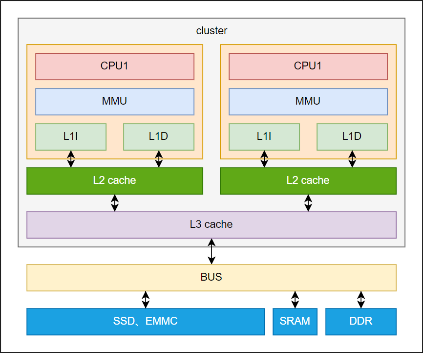

如上图是一个经典的`ARM64`体系结构处理器系统，其中包含了多级的`cache`。一个`CPU cluster`簇包含了两个`CPU`核，每个`CPU`都有自己的`L1 cache`及`L2 cache`，其中`L1 cache`分成`L1I`（`Level 1 Instruction`）、`L1D`（`Level 1 Data`）两种。不同`CPU`共享`L3 cache`，`L3 cache`位于`cluster`内。`cluster`通过`BUS`与`DDR`、`EMMC`、`SSD`等建立连接，这样`CPU`就可以访问到其中的数据。在程序执行时，会先将程序及数据从`SSD`或者`EMMC`加载到内存中，然后将内存中的数据加载到共享的`L3 cache`中，再加载到每个核独有的`L2 cache`，之后才进入到最快的`L1 cache`，最后才会被`CPU`读取。

在系统设计时，需要在`cache`的性能和成本之间做取舍，现在的`CPU`都采用多级`cache`设计方案。通常来说，越靠近`CPU`的`cache`，速度越快、成本越高、容量越小。不同存储器的访问速度、成本对比如下：

| 存储器     | 介质        | 单位成本（美元/MB） | 随机访问延时    |
| ---------- | ----------- | ------------------- | --------------- |
| `L1 cache` | `SRAM`      | 7                   | 4个CPU时钟周期  |
| `L2 cache` | `SRAM`      | 7                   | 11个CPU时钟周期 |
| `L3 cache` | `SRAM`      | 7                   | 39个CPU时钟周期 |
| `DDR`      | `DRAM`      | 0.015               | `100ns`         |
| 硬盘       | `SSD(NAND)` | 0.0004              | `150us`         |
| `Disk`     | `HDD`       | 0.00004             | `10ms`          |

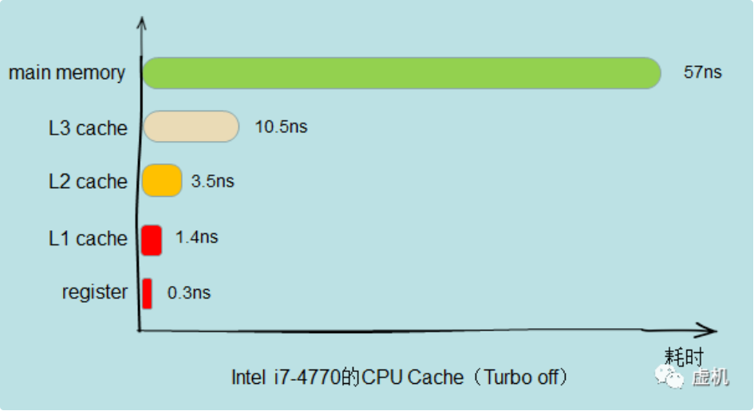

### 2.1 `cache`和`MMU`的关系

`cache`和`MMU`基本上都是一起使用的，会同时开启或同时关闭。因为`MMU`页表中的`entry`属性，控制着内存的权限和`cache`缓存的策略。`CPU`在访问`DDR`的时候用的地址是虚拟地址（`Virtual Address, VA`），经过`MMU`将`VA`映射成物理地址（`Physical Address, PA`），然后使用物理地址查询高速缓存，这种高速缓存称为物理高速缓存。物理高速缓存的缺点主要是，`CPU`查询`TLB`或`MMU`后才能访问`cache`，增加了流水线的延时。物理高速缓存的工作流程如下：

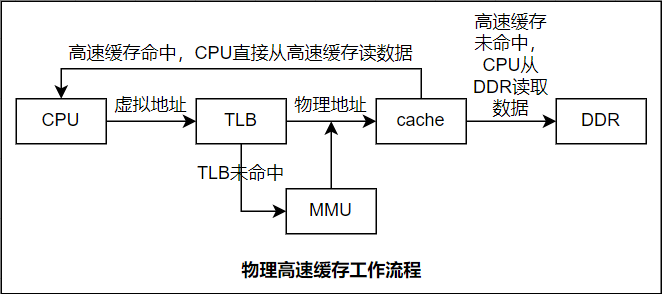

`CPU`使用虚拟地址寻址高速缓存，这种高速缓存称为虚拟高速缓存。`CPU`在寻址时，先把虚拟地址发送到高速缓存，若在高速缓存里找到所需数据，就不再访问`TLB`和`DDR`。虚拟高速缓存的工作流程如下：

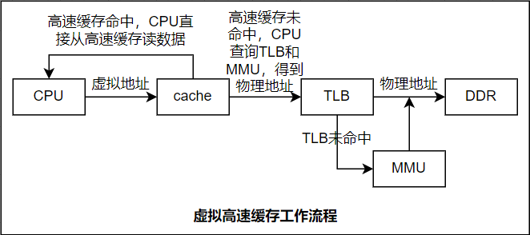

### 2.2 `L1/L2/L3 cache`

#### 2.2.1 `cache`分级的原因

`L1/L2/L3 cache`主要是由`SRAM`及`tag`组成的，其中`L1 cache`采用的是分离缓存方式：`L1I`（`Level 1 Instruction`）和`L1D`（`Level 1 Data`）。`L2/L3 cache`采用的却是统一缓存的方式，没有将数据、指令分开存储。从上面各种存储器的访问延时对比来看，`L1/L2/L3 cache`存在一定差异，但是成本相近，为什么要做成这种多级缓存形式，不直接将`L1 cache`做大，然后去掉`L2/L3 cache`呢？

单极缓存有两难：如果只做一个小而快的缓存，速度能接近`CPU`，但容量太小，命中率低，经常要访问主存；如果只做一大而命中率高的缓存，访问速度延迟高，面积大，功耗高，而且很难离每个`CPU`核都很近。所以不能靠一级缓存同时满足“低延迟”和“高命中率”。

`L1/L2/L3 cache`的区别是什么呢？`L1 cache`是为了更快的速度访问而优化过的。它用了更多、更复杂、更大的晶体管，从而更加昂贵和耗电。`L2 cache`是为提供更大的容量优化的，用了更少、更简单的晶体管，从而相对便宜和省电。`L3 cache`相对`L2 cache`的优化也是类似的道理。

#### 2.2.2 分离缓存

为什么`L1 cache`采用了分离缓存的方式，分成了`L1I`和`L1D`两种？主要原因如下：

* 原因一：避免取指令单元和取数据单元竞争访问缓存。
* 原因二：内存中数据和指令是相对聚焦的，分离缓存能提高命中率。

为什么`L2/L3 cache`采用统一缓存的方式？主要原因如下：

* 原因一：`CPU`直接和`L1 cache`打交道，`L1 cache`采用分离缓存后，已经解决了取指令单元和取数据单元的竞争访问缓存问题，所以`L2 cache`是否采用分离缓存影响不大。
* 原因二：当缓存容量较大时，分离缓存无法动态调节分离比例，不能最大化发挥缓存容量的利用率。例如数据缓存满了，但是指令缓存还有空闲，而使用统一缓存，则能够保证最大化利用缓存空间。

#### 2.2.3 `L3 cache`多核共享

最开始由于芯片工艺的限制，片内缓存不可能很大，不然芯片会非常大，因此`L2/L3 cache`缓存都是设计在板子上，而不是在芯片内的。后来，随着芯片制作工艺的提升，`L2/L3 cache`才逐渐集成到`CPU`芯片内部。片内缓存优于片外缓存的主要原因如下：

* 原因一：片内缓存物理距离更短，延迟更小，访问速度更快
* 原因二：片内缓存不占用系统总线，可以减轻系统总线负担

#### 2.2.4 多级`cache`的包含策略

多级`cache`的替换策略设计主要有三种方式，可以根据一个`cache`的内容是否同时存在于其它级`cache`来进行分类。

* 如果低级别`cache`中所有的`cache line`也存在于高级别`cache`中，则称高级别`cache`包含（`inclusive`）低级别`cache`。
* 如果高级别`cache`仅包含低级别`cache`不存在的`cache line`，则称高级别`cache`不包含（`exclusive`）低级别`cache`。
* 如果高级别`cache`既不严格包含，也不排除低级别`cache`，则称为非包含非排他（`non-inclusive non-exclusive, NINE`）

| 类型                                   | 集合关系                     | 同一块能否同时在 L1/L2   | 替换时的关键行为                                             |
| :------------------------------------- | :--------------------------- | :----------------------- | :----------------------------------------------------------- |
| **包含式 Inclusive**                   | L1 ⊆ L2，L2 包含 L1 的所有块 | 可以，且 L1 有则 L2 必有 | L2 淘汰某块时，若 L1 也有，必须**反向失效 L1**；L1 淘汰不影响 L2 |
| **排他式 Exclusive**（你说的“不包含”） | L1 ∩ L2 = ∅，互斥            | 不可以                   | L1 淘汰的块通常放入 L2；L1 缺失若在 L2 命中，要把块从 L2 移到 L1 |
| **非包含非排他 NINE**                  | 无约束                       | 可以同时有，也可以没有   | L2 淘汰不影响 L1，L1 淘汰通常也不影响 L2；允许副本，靠一致性协议维护 |

`L3`同样可以按上述三种策略来组织。区别在于：`L3`通常是最后一级缓存`LLC`，而且常被多个核共享，所以讨论的是`L3`和`L1/L2`之间的关系。不同层级可以混合使用，例如：`L1-L2`用`Inclusive`，`L1/L2-L3`用`NINE`。

> 由于`L1 cache`又分为`L1 Instruction-cache`和`L1 Data-cache`，所以`L1 I-cache`和`L1 D-cache`又分别可以和`L2 cache`拥有不同的替换策略。
>
> 接下来以`DynamlQ`架构中的`cortex-A710`的`L1 I-cache`、`L1 D-cache`、`L2 cache`的替换策略为例。
>
> 我们先看一下DynamIQ架构中的cache中新增的几个概念：
>
> (1) Strictly inclusive: 对应Inclusive Policy cache，所有存在于L1 cache的数据，必然也存在L2 cache中。
>
> (2) Weakly inclusive: 对应NINE（non-inclusive non-exclusive）Policy，当miss的时候，数据会被同时缓存到L1和L2，但在之后，L2中的数据可能会被替换。
>
> (3) Fully exclusive: 对应Exclusive Policy cache，当miss的时候，数据只会缓存到L1。L1中的数据会逐出到L2。
>
> 其实inclusive/exclusive属性描述的是 L1和L2之间的替换策略，这部分是硬件定死的，软件不可更改。
>
> 根据ARMV9 cortex-A710 trm手册中的描述，查看该core的cache类型如下：
>
> - L1 I-cache和L2之间是 weakly inclusive的，当发生I-cache发生miss时，数据缓存到L1 I-cache的时候，也会被缓存到L2 Cache中，当L2 Cache被替换时，L1 I- cache不会被替换。
> - L1 D-cache和L2之间是 strictly inclusive的，当发生D-cache发生miss时，数据缓存到L1 D-cache的时候，也会被缓存到L2 Cache中，当L2 Cache被替换时，L1 D-cache也会跟着被替换。
>
> dynamIQ 架构中 L1和L2之间的替换策略，是由core的inclusive/exclusive的硬件特性决定的，软无法更改。core cache之间的替换策略，是由SCU(或DSU)执行的[MESI协议](https://zhida.zhihu.com/search?content_id=219914824&content_type=Article&match_order=1&q=MESI协议&zhida_source=entity)中定义的，软件也无法更改。多cluster之间的缓存一致性，由 CCI/CMN 来执行维护，没有使用MESI协议。在L1 data cache TAG中，有记录MESI相关比特。将一个core内的cache看做是一个整体，core与core之间的缓存一致性，就由DSU执行MESI协议来维护，因此L1D遵从MESI协议。对于L1I cache来说，都是只读的，cpu不会改写L1I中的数据，所以也就不需要硬件维护多核之间缓存的不一致。

## 3、`cache`工作原理

### 3.1 高速缓存的映射方式

`CPU`访问`DDR`之前，都会先对`cache`进行操作，无论对`cache`数据检查、读取还是写入，`CPU`都需要知道访问的内存数据，对应于`cache`上的哪个位置，这就是内存地址与`cache`地址的映射问题。目前主要有三种映射方案。

* 直接相联映射（`Direct Mapped Cache`）
* 全相联映射（`Fully Associative Cache`）
* 组相联映射（`N-way Set Associative Cache`）

通常来说，内存块和缓存块大小是相同的。我们以内存有32个内存块，每个内存块大小是`64B`，`CPU cache`有8个缓存块，每个缓存块大小是`64B`为例讲解这三种映射方案。

#### 3.1.1 直接相联映射

直接相联映射的策略：在内存块和缓存块之间建立起固定的映射关系，一个内存块总是映射到同一个缓存块上。

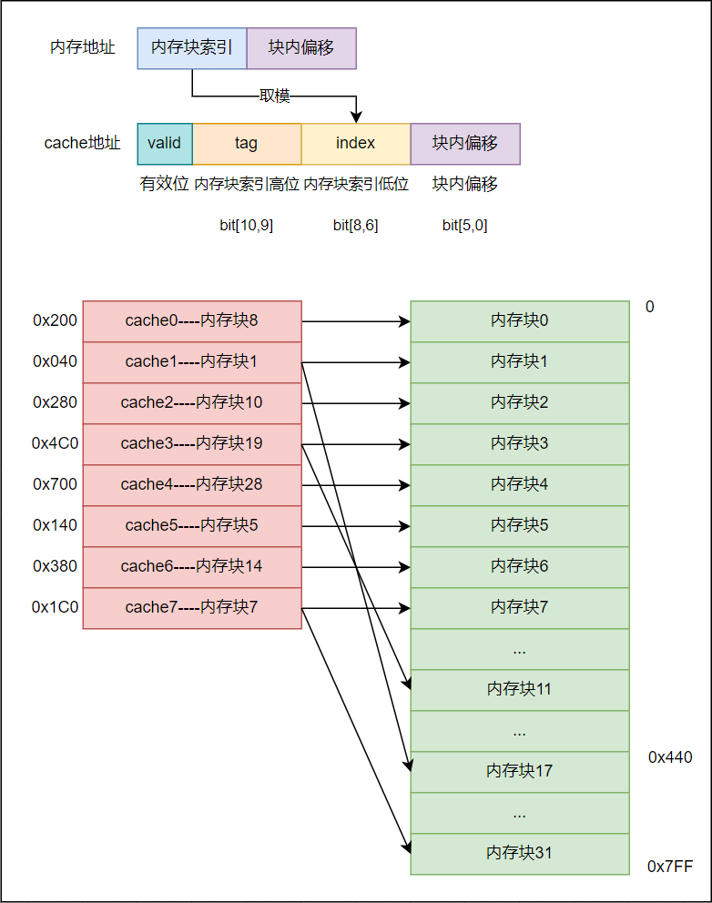

假设现在`CPU`想要访问`0x440`地址的数据：

* `step1`：内存块/`cache`块大小为`64Byte`，`0x440/64 = 17`

* `step2`：`cache`块数量为8，`index = 17 % 8 = 1`，所以该地址对应`cache1`
* `step3`：`cache`块数量为8，`tag = 17 / 8 = 2`
* 与当前`cache1`中的`tag = 0`值做对比，判断当前`cache`中不存在该地址的数据，所以需要从内存地址`0x440`中读取数据并填充到`cache1`中

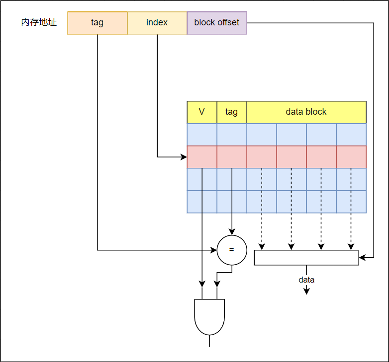

通过上面描述可以看出，对于所有`index`相同的`main memory`地址，都会寻址到同一个`cache line`，这就产生了冲突，这也是直接相联映射策略的一大缺点，如果两个`index`相同的`main memory`地址交互地访问`cache`，就会一直导致`cache miss`，严重地降低了`cpu`的执行效率。

同时直接相联映射缓存利用不充分，每个内存块只能映射到固定的位置上，即使`cache`上有空闲位置也不会使用。

直接相联映射在实现上最简单，他都不需要替换算法，但是它的执行效率也是最低的，现代的处理器很少使用这种方式了。

#### 3.1.2 全相联映射

全相联映射的策略：允许内存块映射到任何一个`cache`块上。

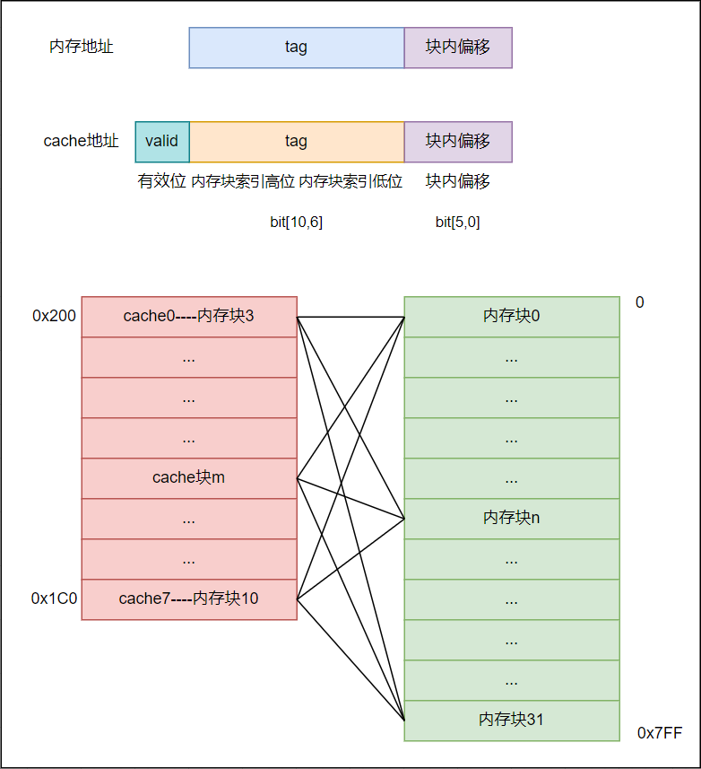

假设现在`CPU`想要访问`0x440`地址的数据：

* `step1`：内存块/`cache`块大小为`64Byte`，`tag = 0x440/64 = 17`

* `step2`：查询所有`cache`的`tag`，判断当前`cache`中是否存在该地址的数据，如果存在则直接获取，如果不存在则从内存中获取并填充`cache`

#### 3.1.3 组相联映射

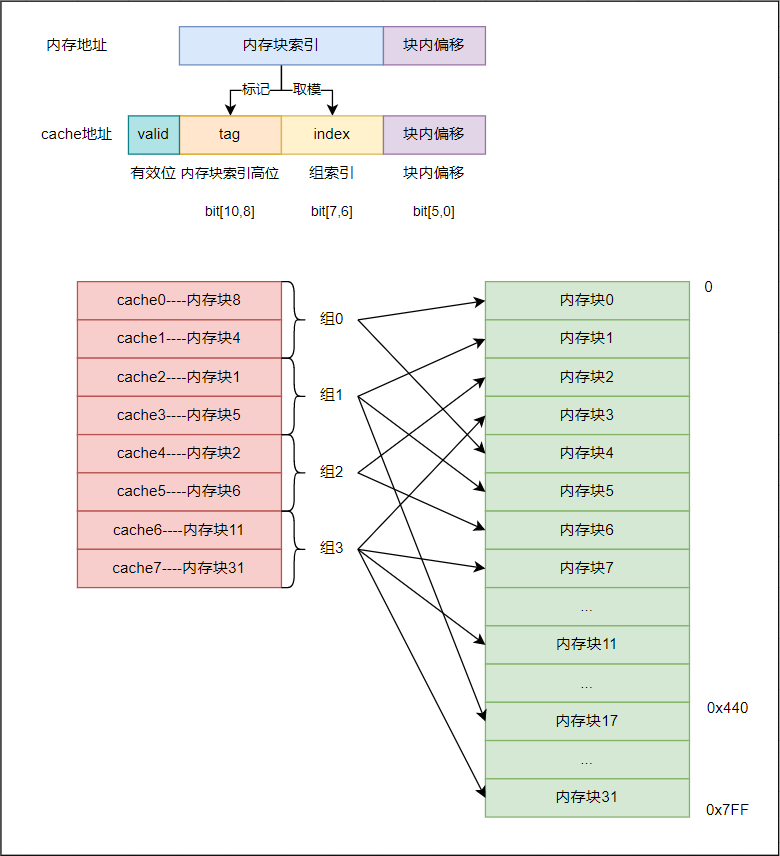

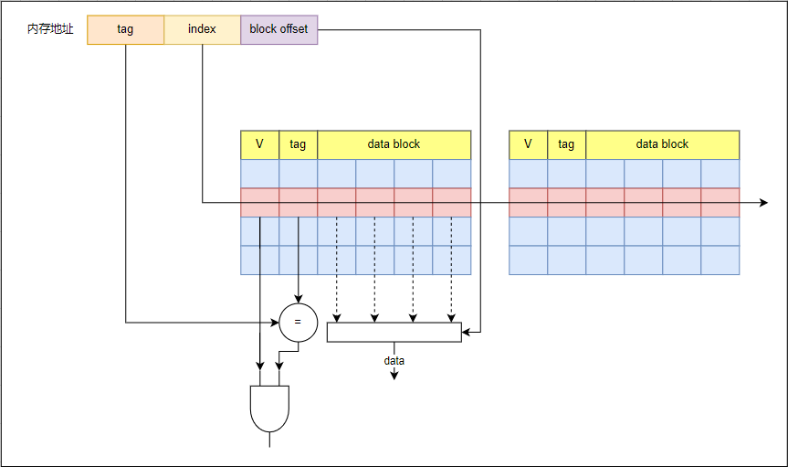

### 3.2 `cache`的基本结构

`cache`的基本结构如下图所示：

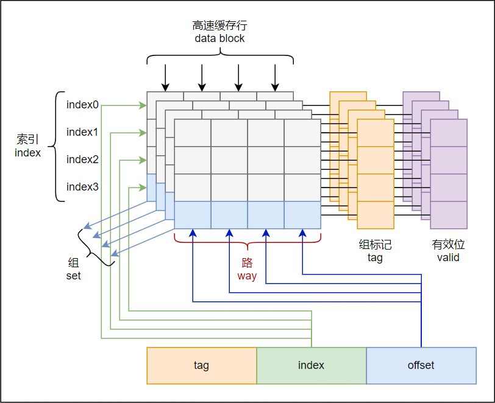

* 地址：`CPU`访问`cache`时的地址编码，分为三个部分：偏移量（`offset`）域、索引（`index`）域和标记（`tag`）域

* 高速缓存行：高速缓存中最小的访问单元，包含一小段`DDR`中的数据。常见的高速缓存行大小为`32/64 Bytes`

* 索引（`index`）：高速缓存地址编码的一部分，用于索引和查找地址在高速缓存行的那一组中
* 组（`set`）：由相同索引的高速缓存行组成
* 路（`way`）：在组相联的高速缓存中，高速缓存分成大小相同的几个块。如上每一路由四个缓存行组成。
* 标记（`tag`）：高速缓存地址编码的一部分，通常是高速缓存地址的高位部分，用于盘点高速缓存行中的数据地址，是否和处理器寻址的地址一致
* 偏移量（`offset`）：高速缓存行中的偏移量。`CPU`可以按字节来寻址高速缓存行的内容。

### 3.3 `cache`的体系结构

高速缓存可以设计成，通过虚拟地址或物理地址来访问，这在处理器设计时就定下来了。高速缓存可以分成如下三类：

* `VIVT`（`Virtual Index Virtual Tag`）：使用虚拟地址的索引域和虚拟地址的标记域，相当于虚拟高速缓存
* `PIPT`（`Physical Index Virtual Tag`）：使用物理地址的索引域和物理地址的标记域，相当于物理高速缓存
* `VIPT`（`Virtual Index Physical Tag`）：使用虚拟地址的索引域和物理地址的标记域

在当前`ARM`架构中，`L1 cache`都是`VIPT`，`L2 cache`和`L3 cache`都是`PIPT`。

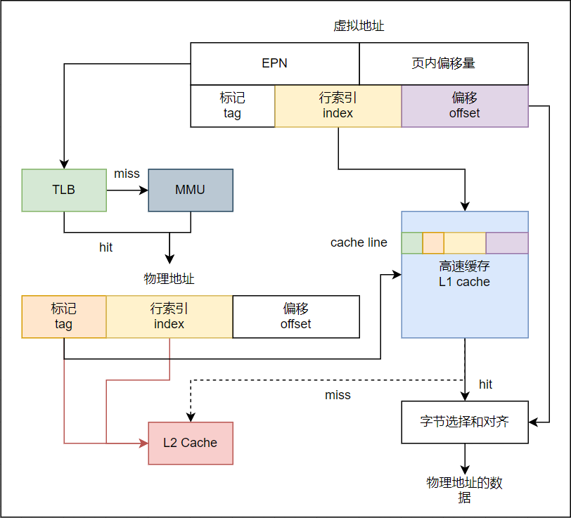

`VIVT`和`PIPT`在前文的`2.1 cache和MMU的关系`中已经介绍过了。

`VIPT`策略：`CPU`输出的虚拟地址会同时发送到`TLB`和`cache`。`TLB`是一个用于存储虚拟地址到物理地址的转换小缓存，处理器先使用有效页帧号（`Effective Page Number, EPN`），在`TLB`中查找最终的实际页帧号（`Real Page Number, RPN`）。如果期间发生`TLB`未命中（`TLB miss`），将会带来一系列严重的系统惩罚（笔者暂未知晓惩罚是什么，待后续补充），处理器需要查询页表。假设发生`TLB`命中（`TLB hit`），就会很快获得合适的`RPN`，并得到相应的物理地址。

同时，处理器通过虚拟地址的索引（`index`）域，可以很快找到`L1 cache`中对应的组。但是这里的组中包含多个拥有相同`index`的`cache line`，不一定是处理器需要的，因此有必要进行一些检查，将组中每个`cache line`的标记（`tag`）域和上述得到的物理地址的标记（`tag`）域进行比较，如果相同并且状态位匹配，就会发生`cache hit`，处理器通过字节选择和对齐部件，就可以获取所需要的数据。

### 3.4 `cache`的替换策略

在使用直接相联映射的`cache`中，由于每个主内存块都与某个`cache`块有直接映射关系，因此不存在替换策略。使用全相联映射或组相联映射的`cache`，由于主内存块与`cache`块没有固定的映射关系，当新的内存块需要加载到`cache`中时，且`cache`块没有空闲位置，则需要替换原有的`cache`块上的数据，此时就存在替换策略的问题。

常见的`cache`中数据的替换策略如下，`cache`中 数据的替换以`cache line`为单位：

* 随机法：使用一个随机数生成器，随机地选择要被替换的`cache`块。优点是实现简单，缺点是没有利用局部性原理，无法提高缓存命中率
* `FIFO`先进先出法：记录每个`cache`的加载事件，最早调入的块最先被替换。缺点同样是没有利用局部性原理，无法提高缓存命中率
* `LRU`最近最少使用法：记录各个`cache`块的使用情况，最近最少使用的块最先被替换。这种方法相对比较复杂，也有类似简化方法，即记录各个块最近一次使用时间，最久未访问的最先被替换。优点是利用了局部性原理，平均缓存命中率更高。

### 3.5 `cache`的分配策略

`cache`的分配策略是指我们什么情况下应该为数据分配`cache line`。`cache`分配策略分为读和写两种情况。

读分配（`read allocation`）是指当`CPU`读数据发生`cache`缺失时，会分配一个`cache line`，从主存读取的数据填充到缓存。默认情况下，`cache`都支持读分配。

写分配（`write allocation`）是指当`CPU`写数据发生`cache`缺失时，首先从主存中加载数据到`cache line`中（相当于先做个读分配动作），然后更新`cache line`中的数据。。而不支持写分配的情况下，写指令只会更新主存数据，然后就结束了。当我们支持写分配的情况下，

#### 3.5.1 写操作时，cache更新策略

一条存储器读写指令，通过取指、译码、发射和执行等一系列操作之后，会到达LSU（Load Store Unit）。LSU是指令流水线中的一个执行部件，连接指令流水线和高速缓存，包括加载队列（load queue）和存储队列（store queue）。存储器读写指令通过LSU后，会到达L1控制器，L1控制器先发起探测（probe）操作。对于读操作，发起高速缓存读探测操作，并带回数据。对于写操作，发起高速缓存写探测操作。发起写探测操作前，需要准备好待写的高速缓存行。探测操作返回时，会带回数据，存储器写指令获得最终数据，并进行提交操作后，才会将数据写入，这个写入可以采用直写（write through）模式，或者回写（write back）模式。

在探测过程中，对于写操作，若没有找到相应的高速缓存行，就出现写未命中（write miss）。否则就出现写命中（write bit）。对于写未命中的处理策略时写分配（write allocate），L1控制器将分配一个新的高速缓存行，之后和获取的数据合并，然后写入L1D。

若写未命中，存在两种不同的策略：

- 写分配（write allocate）策略：先把要写的数据加载到高速缓存中，然后修改高速缓存的内容。
- 不写分配（no write allocate）策略：不分配高速缓存，而直接把内容写入内存。

若写命中，存在两种不同的策略：

- 直写模式：进行写操作时，数据同时写入当前的高速缓存，下一级高速缓存，或主存储器中，cache和主存的数据始终保持一致。。直写模式可以降低高速缓存一致性实现的难度，缺点是消耗比较多的总线带宽，性能比回写模式差。
- 回写模式：在进行写操作时，数据直接写入当前高速缓存，而不会继续传递，当该高速缓存被替换出去时，被改写的数据才会更新到下一级高速缓存，或主存中。该策略增加了高速缓存一致性的实现难度，但是可有效减少总线带宽的需求。每个cache line中会有一个bit位记录数据是否被修改过，称之为dirty bit。我们会在数据写到cache中后，将dirty bit置位。主存中的数据只会在cache line被替换或者显式的clean操作时更新。因此，主存中的数据可能是未修改的数据，而修改的数据躺在cache中。cache和主存的数据可能不一致。此模式的优点是，数据写入速度快，因为不需要写存储。缺点是，一旦更新后的数据，未被写入存储时，出现系统掉电的情况，数据将无法找回。

无论是Write-through还是Write-back都可以使用写缺失的两种方式之一。只是通常Write-back采用Write allocate方式，而Write-through采用No-write allocate方式。因为多次写入同一缓存时，Write allocate配合Write-back可以提升性能，而对于Write-through则没有帮助。

#### 3.5.2读操作时，cache更新策略

对于读操作，若高速缓存命中，那么直接从高速缓存总获取数据。若未命中高速缓存，存在如下两种策略：

- 读分配（read allocate）策略：先把数据加载到高速缓存中，然后将数据返回给CPU。
- 读直通（read through）策略：不经过高速缓存，直接从内存中读取数据。