# 正则表达式

> 参考链接：[正则表达式学习笔记（超级详细！！！）| 有用的小知识](https://blog.csdn.net/LLLLQZ/article/details/118278287)

## 1、正则表达式

​	正则表达式是一组由字母和符号组成的特殊文本，它可以用来从文本中找出满足你想要的格式的句子。一个正则表达式是一种从左到右匹配主体字符串的模式。

## 2、正则表达式语法

### 2.1 元字符

​	正则表达式主要依赖于元字符。元字符不代表他们本身的字面意思，他们都有特殊的含义。一些元字符写在方括号中的时候有一些特殊的意思。以下是一些元字符的介绍：

| 元字符 | 描述                                           |
| ------ | ---------------------------------------------- |
| .      | 句号匹配任意单个字符除了换行符                 |
| []     | 字符种类。匹配方括号内的任意字符               |
| [^ ]   | 否定的字符种类。匹配除了方括号里的任意字符     |
| *      | 匹配>=0个重复的在*号之前的字符                 |
| +      | 匹配>=1个重复的在+号之前的字符                 |
| ？     | 标记？之前的字符为可选                         |
| {n,m}  | 匹配num个大括号之前的字符或字符集（n<=num<=m） |
| (xyz)  | 字符集，匹配与xyz完全相同的字符串              |
| \|     | 或运算符，匹配符号前或后的字符                 |
| \      | 转义字符，用于匹配一些保留的字符               |
| ^      | 从开始行开始匹配                               |
| $      | 从末端开始匹配                                 |

#### 2.1.1 点运算符"."

\<.\>是元字符中最简单的例子，匹配任意单个字符，但不匹配换行符。

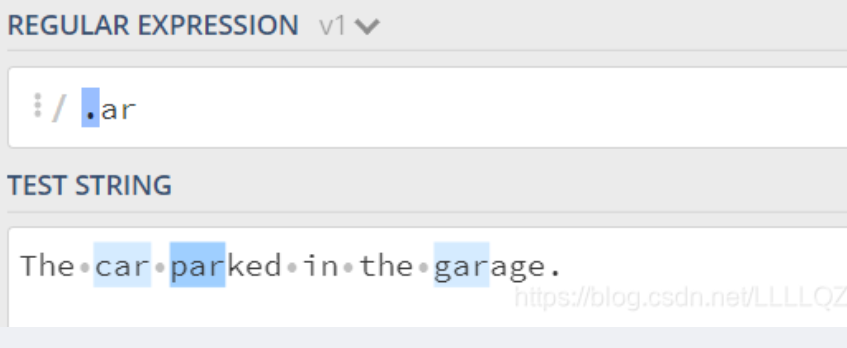

#### 2.1.2 字符集"[]"

​	字符集也叫做字符类。方括号用来指定一个字符集。在方括号中使用连字符来指定字符集的范围。在方括号中的字符集不关心顺序。

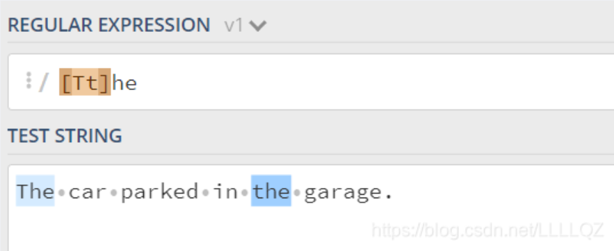

#### 2.1.3 否定字符集"^"

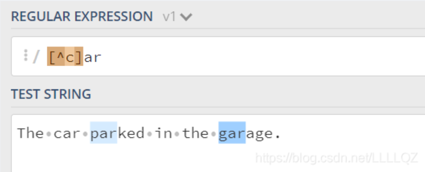

#### 2.1.4 \*号

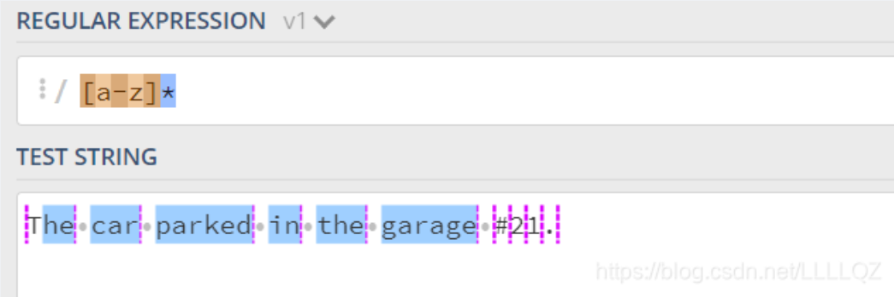

表达式`\s*cat\s*`匹配0或更多个空格开头和0或更多个空格结尾的`cat`字符串：

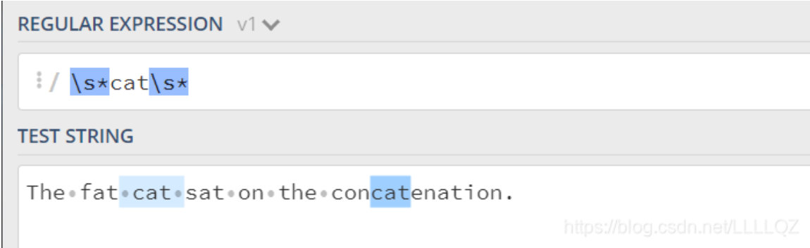

#### 2.1.5 \+号

​	`+`号匹配`+`号之前的字符出现`>=1`次。

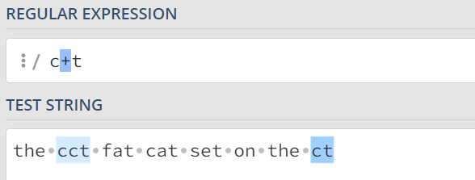

#### 2.1.6 ?号

​	在正则表达式中元字符`?`标记在符号前面的字符为可选，即出现0或1次。

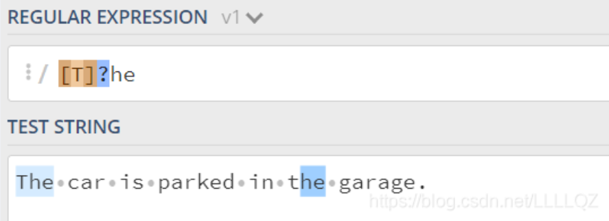

#### 2.1.7 {}号

​	在正则表达式中`{}`是一个量词，常用来限定一个或一组字符可以重复出现的次数。例如，表达式`[0-9]{2,3}`匹配最少2位最多三位的0~9的数字。

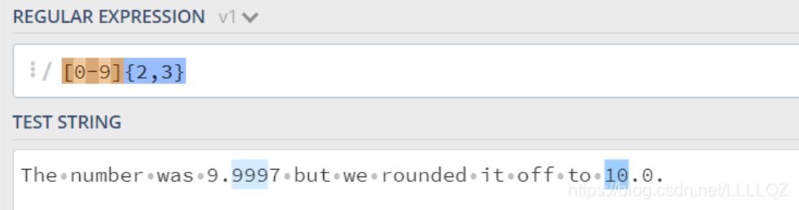

​	可以省略`{}`号中的部分参数，如`[0-9]{2,}`，`[0-9]{2}`

#### 2.1.8 (...)特征标群

​	特征标群是一组写在`(...)`中的子模式。`(...)`中包含的内容将会被看成一个整体，和数学中小括号的作用相同。例如，表达式`(ab)*`匹配连续出现0或者多个`ab`。如果没有使用`(...)`，那么表达式`ab*`将匹配连续出现0或者多个`b`。

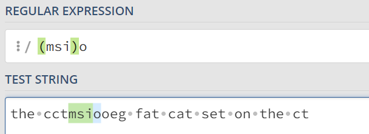

#### 2.1.9 `|`或运算符

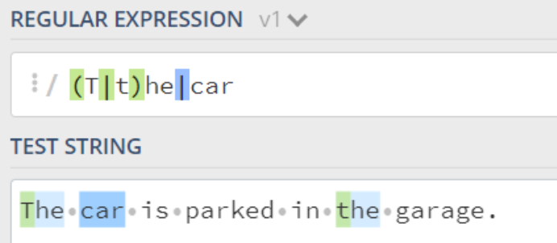

#### 2.1.10 转码特殊字符

​	反斜线`\`在表达式中用于转码紧跟其后的字符。用于指定`{}[]/\+*.$^|?`这些特殊字符。如果想要匹配这些特殊字符则要在其前面加上反斜线`\`。

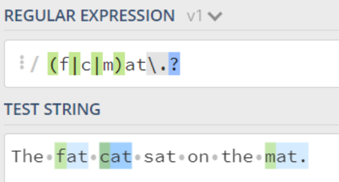

#### 2.1.11 锚点`^`和`$`

​	在正则表达式中，想要匹配指定开头或结尾的字符串就要使用到锚点。`^`指定开头，`$`指定结尾。

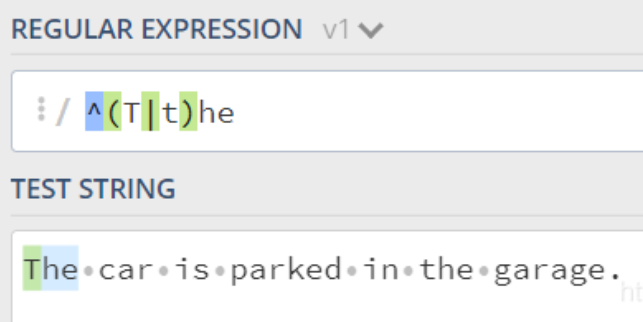

### 2.2 简写字符集

​	正则表达式提供一些常用的字符集简写。

| 简写 | 描述                                             |
| ---- | ------------------------------------------------ |
| .    | 除换行符外的所有字符                             |
| \w   | 匹配所有字母数字，等同于：`[a-zA-z0-9]`          |
| \W   | 匹配所有非字母数字，即符号，等同于：`[^\w]`      |
| \d   | 匹配数字：`[0-9]`                                |
| \D   | 匹配非数字：`[^\d]`                              |
| \s   | 匹配所有空格字符，等同于：`[\t\n\f\r\p{Z}]`      |
| \S   | 匹配所有非空格字符：`[^\s]`                      |
| \f   | 匹配一个换页符                                   |
| \n   | 匹配一个换行符                                   |
| \r   | 匹配一个回车符                                   |
| \t   | 匹配一个制表符                                   |
| \v   | 匹配一个垂直制表符                               |
| \p   | 匹配`CR/LF`（等同于`\r\n`），用来匹配DOS行终止符 |

### 2.3 零宽度断言

​	先行断言和后发断言都属于非捕获簇（不捕获文本，也不针对组合进行计数）。先行断言用于判断所匹配的格式是否存在另一个确定的格式之前，匹配结果不包含该确定格式（仅作为约束）。简单来说就是用来做判断的表达式，其本身只是一个条件。

​	零宽度断言如下：

| 符号 | 描述             |
| ---- | ---------------- |
| ?=   | 正先行断言--存在 |
| ?!   | 负先行断言--排除 |
| ?<=  | 正后发断言--存在 |
| ?<!  | 负后发断言--排除 |

#### 2.3.1 正先行断言

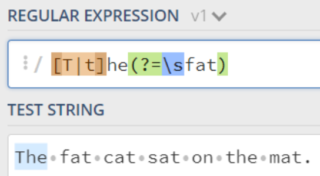

> 注意这里是要找出`The`和`the`后面紧跟着`(空格)fat`的字符串，但是正先行断言只是一个判断条件，它不会作为匹配被检索，所以最后匹配到的只是`The`。

#### 2.3.2 负先行断言

​	负先行断言`?!`用于筛选所有匹配结果，筛选条件为其后不跟随着断言中定义的格式。简单来说就是正先行断言的反例。

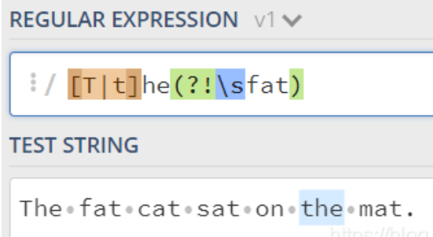

#### 2.3.3 正后发断言

​	正后发断言用于筛选所有匹配结果，筛选条件为其前跟随着断言中定义的格式。

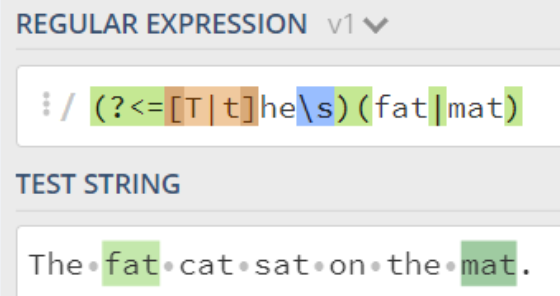

#### 2.3.4 负后发断言

​	负后发断言用于筛选所有匹配结果，筛选条件为其前不跟随着断言中定义的格式。

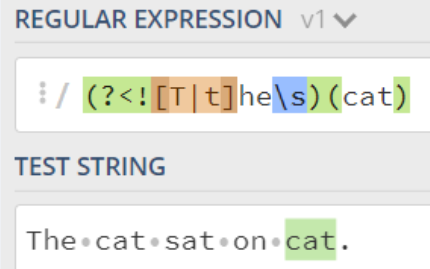

### 2.4 标志

​	标志也叫模式修正符，因为它可以用来修改表达式的搜索结果。这些标志可以任意的组合使用，它也是整个正则表达式的一部分。

| 标志 | 描述                                               |
| ---- | -------------------------------------------------- |
| i    | 忽略大小写                                         |
| g    | 全局搜索                                           |
| m    | 多行修饰符：锚点元字符`^`和`$`工作范围在每行的起始 |

#### 2.4.1 忽略大小写标志

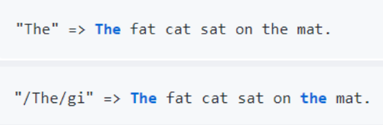

#### 2.4.2 全局搜索标志

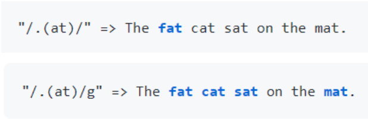

#### 2.4.3 多行修饰符标志

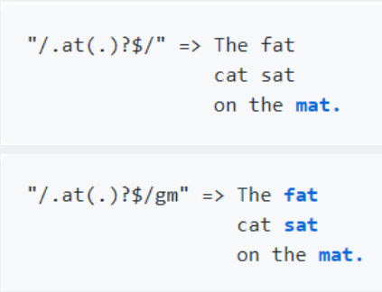

### 2.5 贪婪匹配和惰性匹配

​	正则表达式默认采用贪婪匹配模式，在该模式下意味着会匹配尽可能长的字串。我们可以使用`?`将贪婪匹配模式转化为惰性匹配模式。

贪婪匹配：

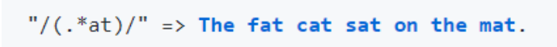

懒惰匹配：

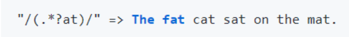

## 3、正则表达式的应用

### 3.1 验证一个用户名

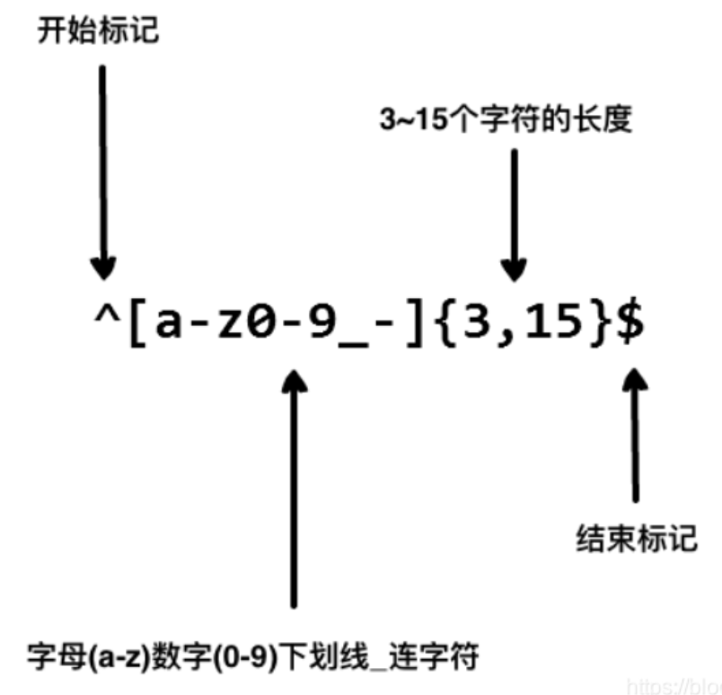

​	如`john_doe`、`jo-hn_doe`、`john12_as`等用户名均可以通过该正则表达式。

### 3.2 验证电话号码

验证电话号码：`^(\d{3,4})-\d{7,8}$`，正确格式：`xxx/xxxx-xxxxxxx/xxxxxxxx`
