# 红黑树

> [史上最好理解的红黑树讲解，让你彻底搞懂红黑树](https://blog.csdn.net/cy973071263/article/details/122543826)

平衡二叉树（AVL Tree），其实平衡二叉树最大作用是查找。平衡二叉树的查找、插入和删除在平均和最坏的情况下都是`O(logn)`。但是如果在平衡二叉树中插入或删除节点后，使得高度之差大于1，此时平衡二叉树的平衡状态就被破坏了，它就不再是一颗平衡二叉树；为了让它重新维持在一个平衡状态，就需要对其进行旋转处理，但是重新构建一颗平衡二叉树的成本其实不小。

## 1、红黑树简介

红黑树是一种自平衡的二叉查找树，是一种高效的查找树。它是由Rudolf Bayer于1978年发明，在当时被称为平衡二叉B树（symmetric binary B-trees）。后来，在1978年被`Leo J. Guibas`和`Robert Sedgewick`修改为如今的红黑树。红黑树具有良好的效率，它可在`O(logn)`时间内完成查找、增加和删除操作。

对于二叉搜索树，如果插入的数据是随机的，那么它就是接近平衡的二叉树，它的操作效率较高，时间复杂度是`O(logn)`。但是可能会出现一种极端的情况，那就是插入的数据是有序的（递增或者递减），那么所有的节点都会在根节点的右侧或者左侧，此时二叉树就变成了一个链表，它的操作效率也随之降低，时间复杂度为`O(n)`，所以可以认为二叉树的时间复杂度介于`O(logn)`和`O(n)`之间。为了应对这种情况，红黑树就出现了，它是具备了某些特性的二叉树，能解决非平衡树的问题，红黑树和平衡二叉树十分相似，但是它并没有平衡因子的概念，它只是靠着满足红黑节点的5条性质来维持一种接近平衡的结构，进而提升整体的性能，并没有严格的卡定某个平衡因子来维持绝对的平衡。

## 2、红黑树特性

在讲解红黑树性质之前，先简单了解以下几个概念：

- parent：父节点
- sibling：兄弟节点
- uncle：叔父节点（parent的兄弟节点）
- grand：祖父节点

首先，红黑树是二叉搜索树，它在每个节点增加了一个存储位记录节点的颜色——红和黑，通过任意一条从根到叶子简单路径上颜色的约束，红黑树保证最长路径不超过最短路径的两倍，因而近似平衡（最短路径就是全黑节点，最长路径就是一个红节点一个黑节点，当从根节点到叶子节点的路径上黑色节点相同时，最长路径刚好是最短路径的两倍）。

红黑树特性如下：

1. 节点是红色或黑色
2. 根节点是黑色
3. 叶子节点（外部节点，也是空节点）都是黑色（注意：黑色节点并不一定是叶子节点）。空节点的父节点不是叶子节点，叶子节点一定是空节点。
4. 红色节点的父节点和子节点都是黑色，两个红色节点不相邻。
5. 从任一节点到叶子节点的所有路径都包含相同数目的黑色节点。

根据以上性质，可以判断下面的树并不是红黑树（下图中并没有显示出叶子节点，读者可以自行添加后再进行判断）：

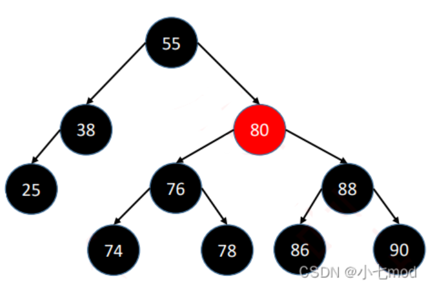

## 3、红黑树的效率

红黑树的查找、插入和删除操作，时间复杂度都是`O(logn)`。

查找操作时，它和普通的相对平衡的二叉树的效率相同，都是通过相同的方式来查找，并没有用到红黑树特有的特性。

插入和删除数据时，由于红黑树的每次操作平均要旋转一次和变换颜色，所以它比普通的二叉树效率要低一点，不过时间复杂度仍然是`O(logn)`。

总之，红黑树的优点就是对有序数据的查询操作不会慢到`O(logn)`的时间复杂度。

## 4、红黑树的操作

红黑树的基本操作和其他树型结构一样，一般都包括查找、插入和删除。前面说到，红黑树是一种自平衡的二叉树，既然是二叉树的一种，那么查找过程和二叉树一样，比较简单，这里不再赘述。相对于查找操作，红黑树的插入和删除操作就要复杂的多，尤其是删除操作，要处理的情况比较多，下面分情况进行讲解。

### 4.1 旋转操作

红黑树的旋转操作分为左旋和右旋。左旋是将某个节点旋转为其右孩子的左孩子，而右旋是将某个节点旋转为其左孩子的右孩子。所以左旋和右旋需要指明旋转的是哪个节点。如下：

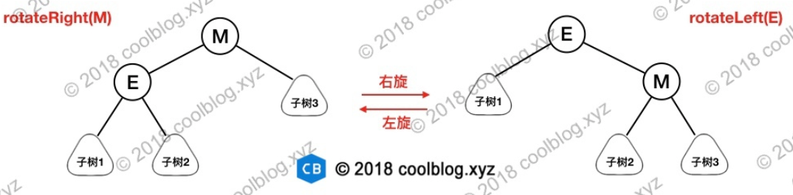

下面以右旋M节点为例进行具体步骤说明：

1. 将节点M的左孩子引用指向节点E的右孩子
2. 将节点E的右孩子引用指向节点M，完成旋转

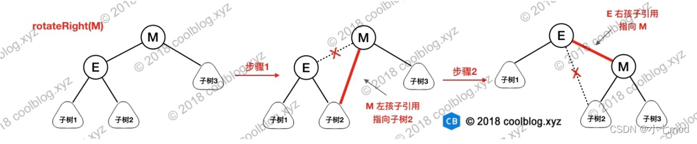

### 4.2 插入操作

红黑树的插入过程和二叉树插入过程基本类似，不同地方在于，红黑树插入新节点后，需要进行调整，以满足红黑树的性质。由于红黑树节点的颜色只能是红色或黑色，那么在插入新节点时，这个节点应该是红色还是黑色呢？答案是红色。

> 如果插入的节点是黑色，那么这个节点所在的路径比其他路径多出一个黑色节点，这个调整起来就会比较麻烦（参考红黑树的删除操作，就知道为什么多一个或少一个黑色节点时，调整起来这么麻烦了）。
>
> 如果插入的节点是红色，此时所有路径上的黑色节点数量不变，仅可能会出现两个连续红色节点情况。这种情况下，通过变色和旋转进行调整即可。
>
> 所以插入的时候将节点设置为红色，可以保证满足上述提到的1、2、3、5性质，只有性质4不一定满足，需要进行相关调整。当然，如果插入的是根节点，则将节点设定为黑色。

#### 4.2.1 红黑树等价变换

在插入新节点之前，我们需要先了解一个知识点——4阶B树。

1、以下面的红黑树为例：

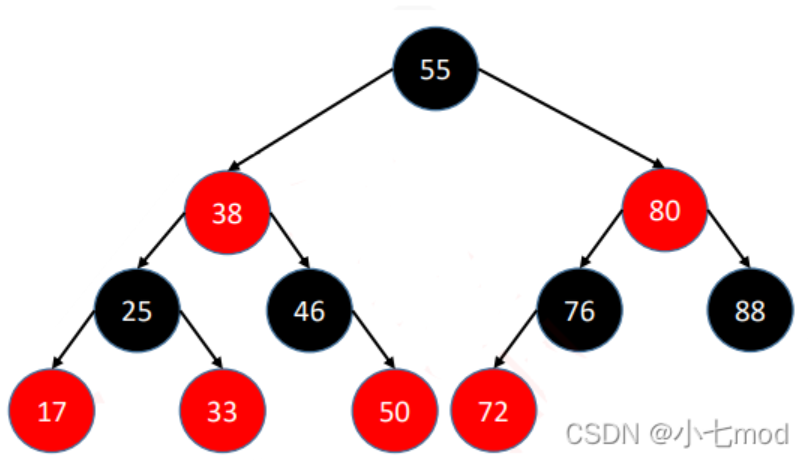

2、我们将所有红色节点上移到它们的父节点同一高度上，就会形成如下结构：

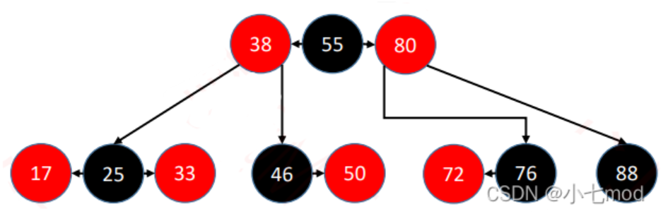

这个结构很明显是一颗四阶B树（一个节点最多放三个数据），如果画成如下结构应该更清晰：

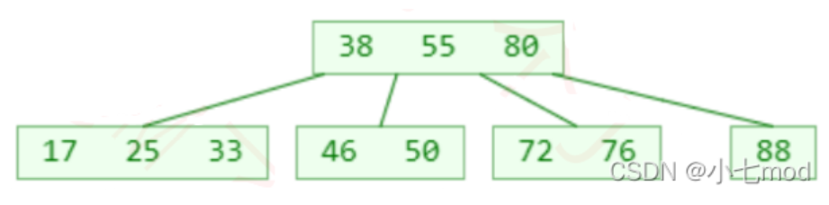

由以上的等价变换我们可以得到以下结论：

1. 红黑树和四阶B树具有等价性
2. 黑色节点与它的红色字节点融合在一起，形成一个B树节点
3. 红黑树的黑色节点个数与四阶B树的节点总个数相等
4. 在所有的B树节点中，永远是黑色节点的父节点，红色节点是子节点。黑色节点在中间，红色节点在两边

#### 4.2.2 插入操作的所有情况

以4.2.1节中使用的红黑树为例，在我们进行插入操作的时候，节点可以插入到所有的叶子节点中，总共有12种情况，其中4种情况满足红黑树性质4，8种情况不满足红黑树性质4。（红黑树性质4：红色节点的父节点和子节点都是黑色，两个红色节点不相邻）

##### 4.2.2.1 满足红黑树性质4

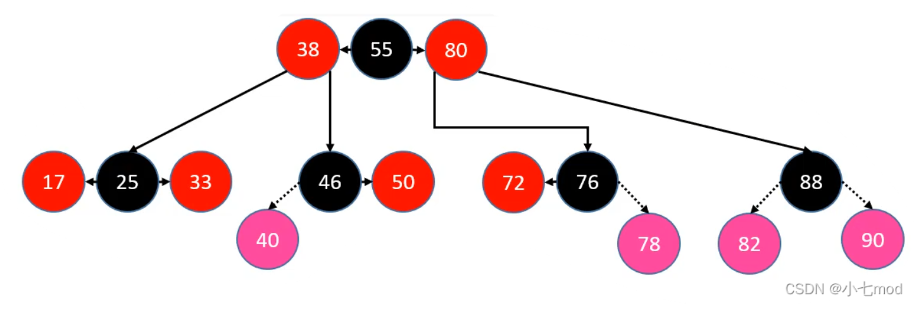

##### 4.2.2.2 不满足红黑树性质4

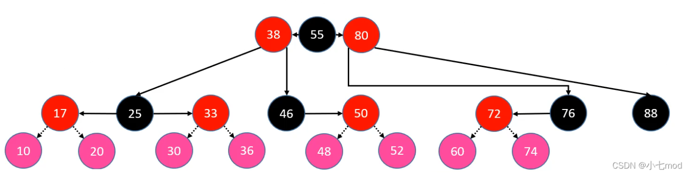

#### 4.2.3 RR和LL插入情况

如下图，插入52和60的位置分别是RR情况和LL情况。

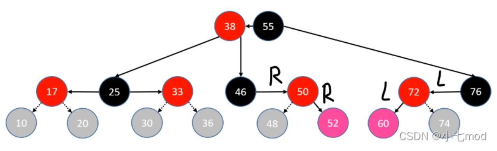

**判断条件**：

RR情况：父节点为祖父节点的右节点，插入节点为父节点的右节点

LL情况：父节点为祖父节点的左节点，插入节点为父节点的左节点

叔父节点不是红色节点。这里的两种情况，插入节点都是没有叔父节点的，所以叔父节点也不可能是红色。

这两种情况很明显，插入节点为红色，父节点也为红色，这显然违背了红黑树的性质4，我们需要对这种情况进行修复，使其重新满足红黑树性质。

**案例修复**：

我们在红黑树等价转换那一节讲过，红黑树等价转换成B树之后，B树节点的中间节点（父节点）都是黑色，两边节点（子节点）都是红色。但是上面两种情况插入后，插入位置的B树节点并不满足这个条件，所以我们对其进行修复，使其满足B树节点的条件之后，也就重新恢复了红黑树性质。

B树节点中的中间节点大小介于两个子节点之间。以上图RR情况为例，插入节点52的原父节点应该放在B树节点中间的位置，应当将其染成黑色。插入节点52的原祖父节点46，应当将其转换为插入节点原父节点的子节点，所以将其染成红色。LL情况同理。完成染色后，需要对原祖父节点进行单旋操作，来进行父节点、子节点的重新分配。

- RR情况应该将原祖父节点46左旋
- LL情况应该将原祖父节点76右旋

修复后的结果如下：

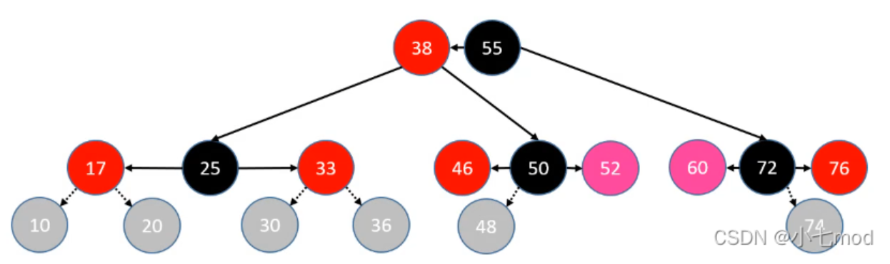

**修复步骤总结**：

1. 父节点染成黑色，祖父节点染成红色
2. 祖父节点进行单旋操作：
   1. LL：原祖父节点进行右旋
   2. RR：原祖父节点进行左旋

#### 4.2.4 LR和RL插入情况

如下图，插入48和74的位置分别是LR和RL情况。

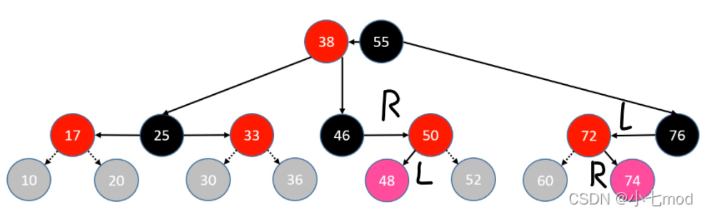

**判断条件**：

LR情况：父节点为祖父节点的左节点，插入节点为父节点的右节点

RL情况：父节点为祖父节点的右节点，插入节点为父节点的左节点

叔父节点不是红色节点。这里的两种情况，插入节点都是没有叔父节点的，所以叔父节点也不可能是红色。

这两种情况很明显，插入节点为红色，父节点也为红色，这显然违背了红黑树的性质4，我们需要对这种情况进行修复，使其重新满足红黑树性质。

**案例修复**：

B树节点中的中间节点大小介于两个子节点之间。以上图RL情况为例，插入节点48大小介于原父节点之间，它应该是B树节点中的中间节点，所以将插入节点48染成黑色，将原祖父节点46染成红色来作为插入节点的子节点。LR情况同理。完成染色之后，需要进行双旋操作，来进行父节点、子节点的重新分配。

- RL情况应该原父节点50右旋，将插入节点48上移到原父节点50的高度，然后将插入节点的原祖父节点46进行左旋，将插入节点48移动到中间位置，成为中间节点
- LR情况应该原父节点72左旋，将插入节点74上移到原父节点72的高度，然后将插入节点的原祖父节点76进行右旋，将插入节点74移动到中间位置，称为中间节点

修复之后结果如下：

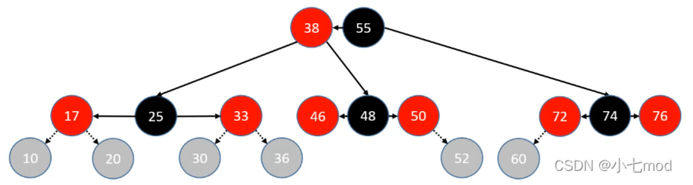

**修复步骤总结**：

1. 插入节点染成黑色，祖父节点染成红色
2. 进行双旋操作：
   1. LR：原父节点左旋，原祖父节点右旋
   2. RL：原父节点右旋，原祖父节点左旋

#### 4.2.5 上溢的LL插入情况

如下图，插入10的位置是上溢的LL情况。

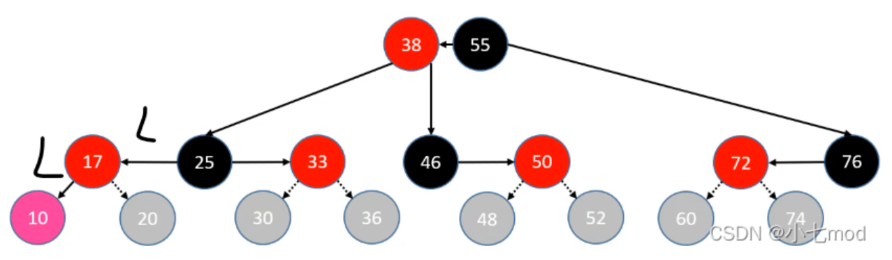

**判断条件**：

该情况下，父节点为祖父节点的左节点，插入节点为父节点的左节点。并且构成的新的B树节点已经超过了B树节点容量大小范围。插入节点为红色，父节点也为红色，这显然违背了红黑树的性质4，我们需要对这种情况进行修复，使其重新满足红黑树性质。叔父节点是红色节点。满足这个条件的就是上溢情况，上溢的修复只需要染色，不需要旋转。

**案例修复**：

像这种上溢的情况，就需要从溢出的B树节点中选出一个节点进行向上合并，选择B树节点中中间的树去进行向上合并，这里中间的两个节点就是原父节点17和祖父节点25，选这两个哪一个向上合并都是对的，但是我们最好选择以后方便操作的，很显然，应该选择原祖父节点25来进行向上合并，因为向上合并就是和最上层的38和55来组合成新的B树节点，向上合并的节点肯定是一个子节点，需要与上层相连，而祖父节点25本身就已经和上层连接了，相对更加方便后续的操作。原祖父节点向上合并后，将其染成红色。

原祖父节点向上合并后，它原来左右两边的节点需要分裂成两个子树，也就是原父节点17和插入节点10形成一个子树，原叔父节点33形成一个子树。这两个分裂形成的树都是以后25的子树。左边的子树由原父节点作为中间节点，染成黑色，右边的子树由原叔父节点作为中间节点，染成黑色。

修复之后结果如下：

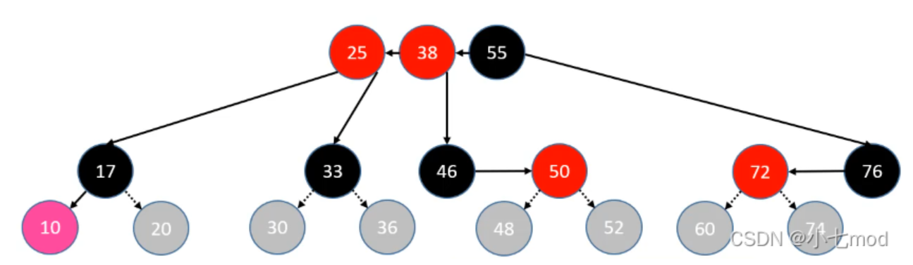

**修复步骤总结**：

1. 父节点、叔父节点染成黑色
2. 祖父节点向上合并，并将其染成红色，相对上一层，就当做是新添加的节点，再次来一遍插入情况的判断，进行处理。

> 祖父节点向上合并时，可能继续发生上溢，这种情况就继续递归调用修复方法就可以了。若上溢持续到根节点，只需将根节点染成黑色即可。（这个意思就是说不断向上上溢，一直上溢到B树的根节点位置了，只需要将向上合并的节点变成黑色作为红黑树的根节点即可。因为从B树根节点选择出来上溢的节点，肯定就是作为整个红黑树的根节点了）
>
> 后面所有的上溢情况都是一样的原理，因此在后面便不再赘述。

#### 4.2.6 上溢的RR插入情况

如下图，插入36的位置是上溢的RR情况。

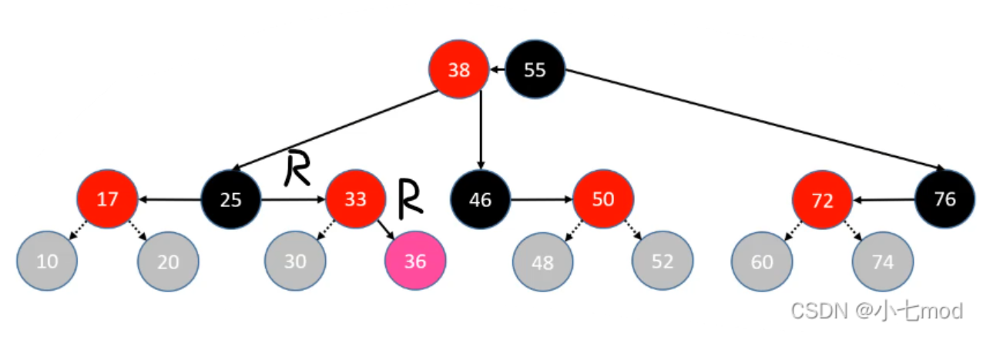

**判断条件**：

该情况下，父节点为祖父节点的左节点，插入节点为父节点的左节点。并且构成的新的B树节点已经超过了B树节点容量大小范围。插入节点为红色，父节点也为红色，这显然违背了红黑树的性质4，我们需要对这种情况进行修复，使其重新满足红黑树性质。叔父节点是红色节点。满足这个条件的就是上溢情况，上溢的修复只需要染色，不需要旋转。

**案例修复**：

上溢RR情况的修复，和上溢LL情况基本一致，只是修复的位置不同，这里中间的两个节点就是原父节点33和原祖父节点25，选择祖父节点25来进行向上合并，原祖父节点向上合并后，将其染成红色。

原祖父节点25向上合并后，它原来左右两边的节点需要分裂成两个子树，也就是原父节点33和插入子节点36形成一个子树，原叔父节点17形成一个子树。这两个分裂形成的树都是以后25的子树。左边的子树由原叔父节点作为中间节点，染成黑色，右边的子树由原父节点作为中间节点，染成黑色。

修复之后结果如下：

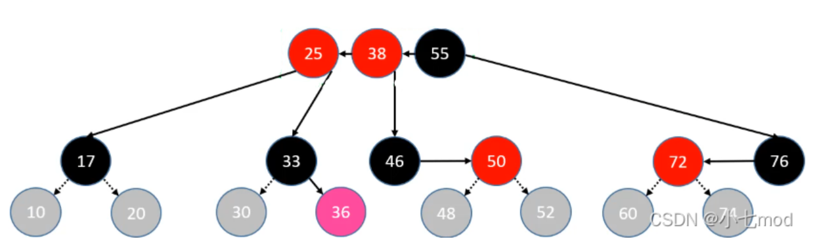

**修复步骤总结**：

1. 父节点、叔父节点染成黑色
2. 祖父节点向上合并，染成红色（其实染成红色就已经是完成了向上合并了，因为祖父节点和祖父节点的父节点的连接指向并没有改变），当做是新添加的节点进行处理 。

#### 4.2.7 上溢的LR插入情况

如下图，插入20的位置是上溢的LR情况。

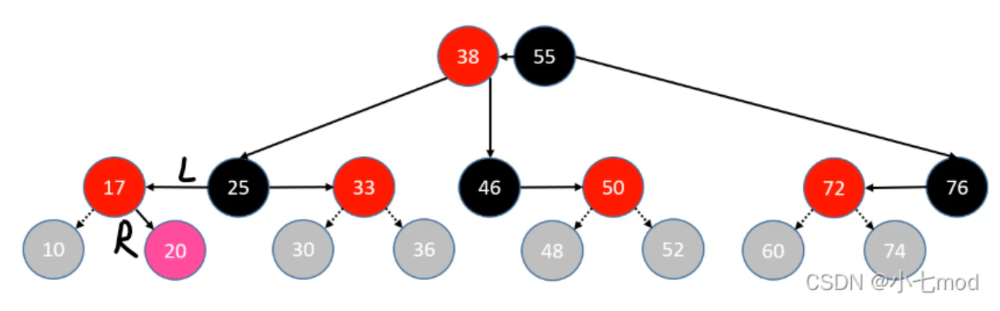

**判定条件**：

父节点为祖父节点的左节点，插入节点为父节点的右节点。并且构成的新的B树节点已经超过了B树节点容量大小范围。叔父节点是红色节点。

**案例修复**：

上溢LR情况的修复，和其他上溢情况基本一致，只是修复的位置不同，这里中间的两个节点就是原父节点17和原祖父节点25，选择原祖父节点25来进行向上合并，原祖父节点向上合并后，将其染成红色。

原祖父节点向上合并后，它左右两边的节点需要分裂成两个子树，也就是原父节点17和插入节点20形成一个子树，原叔父节点33形成一个子树，这两个分裂形成的树都是以后25的子树。左边的子树由原父节点作为中间节点，染成黑色，右边的子树由原叔父节点作为中间节点，染成黑色。

修复之后结果如下：

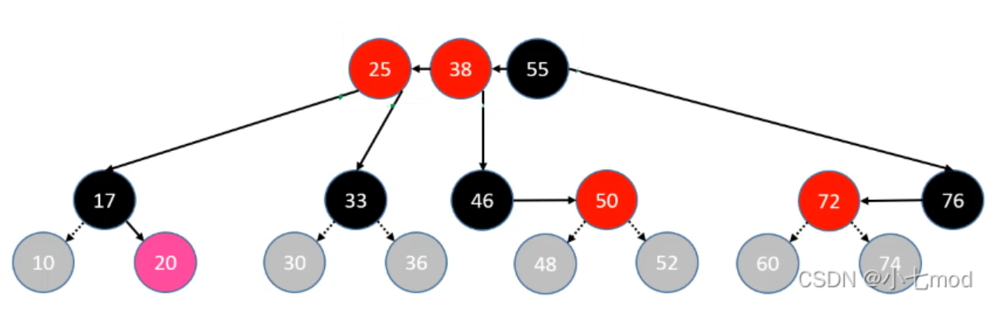

**修复步骤总结**：

1. 父节点、叔父节点染成黑色
2. 祖父节点向上合并，染成红色，当做是新添加的节点进行处理。

#### 4.2.8 上溢的RL插入情况

如下图，插入30的位置是上溢的RL情况

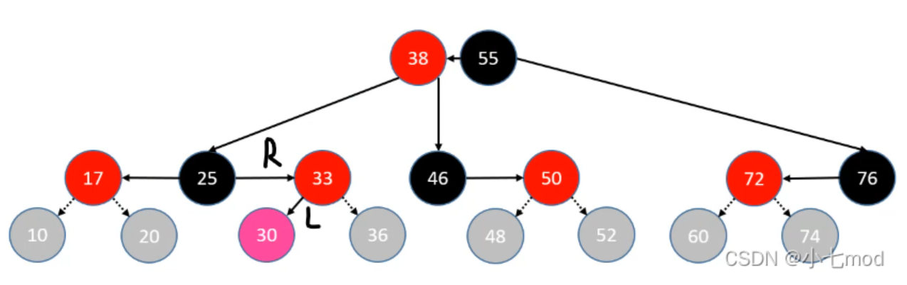

**判断条件**：

父节点为祖父节点的右节点，插入节点为父节点的左节点。并且构成的新B树节点已经超过了B树节点容量大小的范围。叔父节点是红色节点。

**案例修复**：

上溢RL情况的修复，和其他上溢情况基本一致，只是修复的位置不同，这里中间的两个节点就是原父节点33和原祖父节点25，选择原祖父节点25来进行向上合并，原祖父节点向上合并后，将其染成红色。

原祖父节点25向上合并后， 它原来左右两边的节点需要分裂成两个子树，也就是原父节点33和插入节点30形成一个子树，原叔父节点17形成一个子树。这两个分裂形成的树都是以后25的子树。左边的子树由原叔父节点作为中间节点，染成黑色，右边的子树由原父节点作为中间节点，染成黑色。

修复后结果如下：

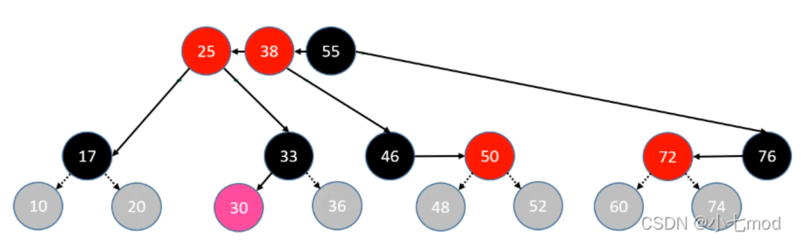

**修复步骤总结**：

1. 父节点、叔父节点染成黑色
2. 祖父节点向上合并，染成红色，当做是新添加的节点进行处理

#### 4.2.9 插入情况总结

插入一共有12种情况：

1. 插入节点的父节点是黑色（4种）

   这种情况仍然会维持红黑树的性质，则不需要进行额外处理。

2. 插入节点的父节点是红色（8种）

   这种情况不满足红黑树的性质4，需要进行额外的修复处理

   1. 叔父节点不是红色节点（4种）

      这些情况都是非上溢，需要通过重新染色和旋转来进行修复

   2. 叔父节点是红色节点（4种）

      这些情况都是上溢，只需要通过祖父节点上溢合并和染色即可完成修复

### 4.3 删除操作

相较于插入操作，红黑树的删除操作则要更为复杂一些。B树中，最后真正被删除的元素都在叶子节点中。所以在红黑树中，被删除的节点一定也在最后一层。

#### 4.3.1 删除操作的所有情况

上面我们说删除节点一定在最后一层，最后一层有红色节点和黑色节点，我们就删除节点的颜色来区分删除操作的所有情况。

##### 4.3.1.1 删除红色节点

如果删除的节点是红色则直接删除，不用做任何调整。因为删除最后一层的红色节点并不会影响红黑树的任何性质。

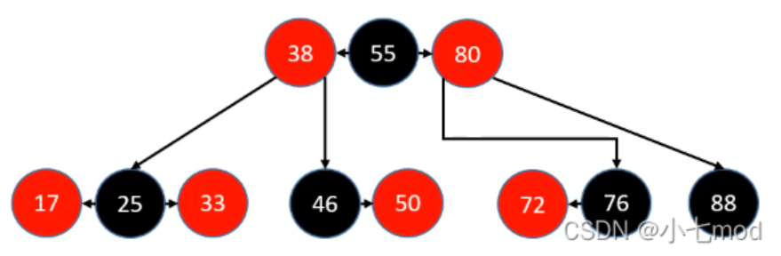

##### 4.3.1.2 删除黑色节点

分三种情况：

1. 拥有1个红色子节点的黑色节点
2. 黑色叶子节点
3. 拥有两个红色子节点的黑色节点（这种情况不可能被直接删除，因为会找到它的子节点替代删除，因此不用考虑这种情况）

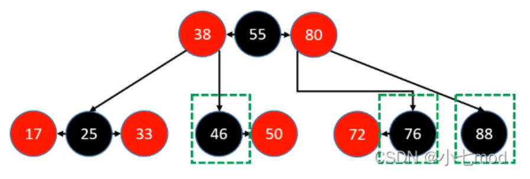

#### 4.3.2 删除拥有一个红色子节点的黑色节点

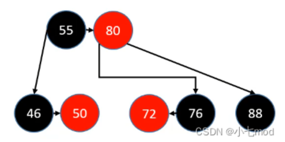

**判断条件**：

删除拥有一个红色子节点的黑色节点的情况，是需要我们做相关的处理的。这里删除的就是节点46和76，它们只有一个红色子节点。

对于一个二叉树来说，删除一个度为1的节点（度指的是一个节点的子节点个数），将其删除后需要用它唯一的子节点来进行替换。而红黑树的这种情况的判断条件，就是判断要替代删除节点的子节点是不是红色。

**案例修复**：

将需要删除节点的唯一子节点对其进行替代即可。经过以上处理后，我们可以得到如下树：

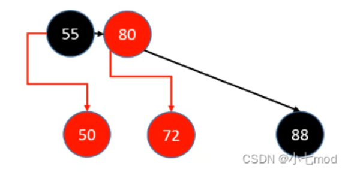

我们发现，80是红色节点，它的子节点72也是红色节点，这显然不符合红黑树性质，还需要进一步修复。将替代的子节点染成黑色即可保存红黑树性质。

> 注意：节点50的父节点55虽然是黑色，但是还是要把节点50染成黑色

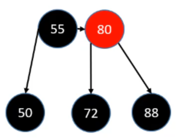

**修复步骤总结**：

1. 用删除节点的唯一子节点对其进行替代
2. 将替代节点染成黑色

#### 4.3.3 删除黑色叶子节点

这种删除情况前先简单举一个例子。

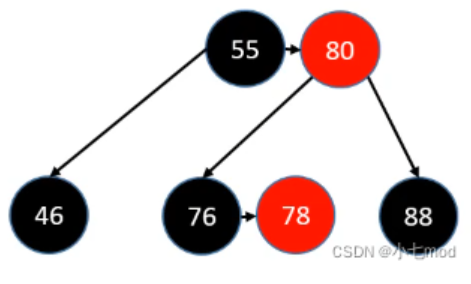

现在我们要删除节点88，该节点为黑色叶子节点，它的兄弟节点是黑色节点76。从B树的角度来看，如果删除88，因为四阶B树的节点中最少存有一个元素，如果不足，则会造成下溢。也就是需要从88的兄弟节点中借一个子节点出来。这就是这一节我们讨论的删除情况的核心修复思想。

##### 4.3.3.1 兄弟节点至少有一个红色子节点

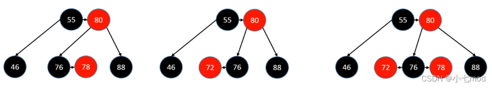

**判断条件**：

兄弟节点至少有一个红色子节点，所以可以借出一个节点来进行修复。

**案例修复**：

1. 兄弟节点有一个右子节点

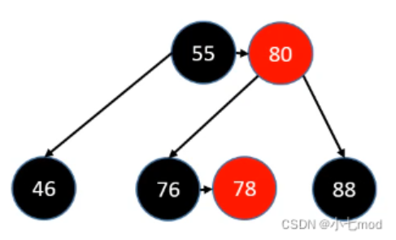

首先将节点88删除，删掉之后，从B树角度来看就出现了下溢，这个时候就需要父节点下来，在兄弟节点的子节点升上去代替。具体实现就是要对节点进行旋转。可以看出，80、76、78组成的树是一个LR情况。先对兄弟节点76进行左旋，然后再对父节点80进行右旋。旋转完之后，再对相关节点进行重新染色。节点78继承删除节点的父节点80的颜色，节点78的两个子节点染成黑色。修复后如下：

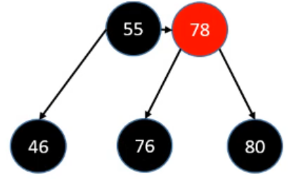

2. 兄弟节点有一个左子节点

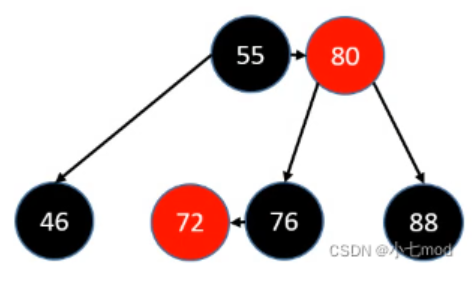

首先将节点88删除，删掉之后，从B树角度来看就出现了下溢，这个时候就需要父节点下来，在兄弟节点的子节点升上去代替。具体的实现就是对节点进行旋转。可以看出，80、76、72组成的树是一个LL情况。直接对删除节点的父节点80进行右旋。旋转完后，再对相关节点进行染色。节点76继承删除节点的父节点80的颜色，节点76的两个子节点染成黑色。修复后如下：

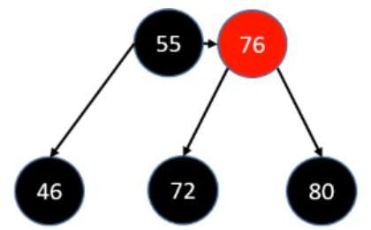

3. 兄弟节点有两个子节点

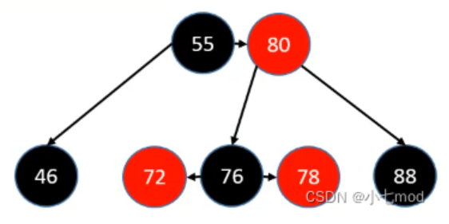

首先将节点88删除，删除之后，其实可以有两种旋转进行修复，既可以使用LR方式进行旋转，也可以使用LL方式进行旋转。因为LL方式只需要旋转一次，所以一般采用LL方式进行旋转。直接对节点80进行右旋。旋转完后，将旋转后的中心节点76进行染色，继承删除节点的原父节点80的颜色。最后再将78、72、76、80组成的树的左右两个节点染成黑色即可完成修复。修复后如下：

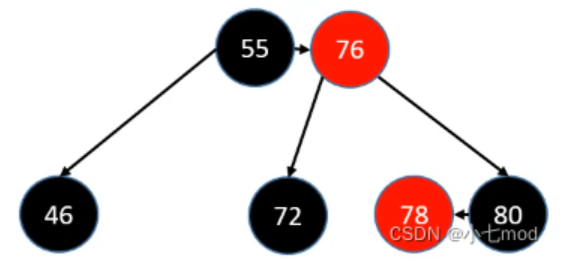

**修复步骤总结**：

1. 进行旋转操作
2. 旋转之后的中心节点继承删除节点的原父节点的颜色
3. 旋转之后的左右节点染成黑色

##### 4.3.3.2 兄弟节点没有红色节点

**判断条件**：

兄弟节点没有红色节点。当删除节点的兄弟节点没有红色节点可以借出的情况下，就需要父节点向下合并进行修复，父节点向下和兄弟节点合并成新的B树节点来解决下溢。

**案例修复**：

1. 父节点为红色

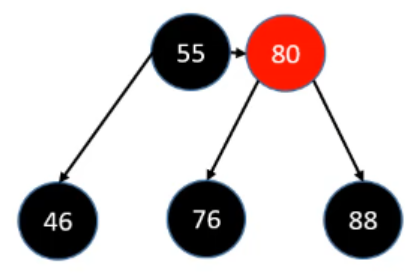

首先删除节点88，出现下溢，因为兄弟节点76没有可以借出的红色节点，所以需要父节点80向下与76合并进行修复。只需将80染成黑色，76染成红色即可。修复后如下：

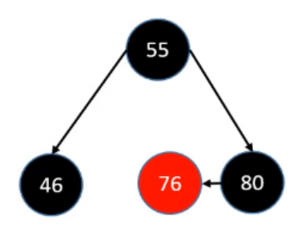

2. 父节点为黑色

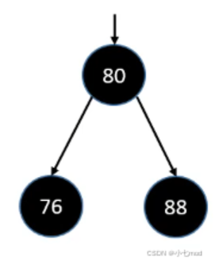

首先删除节点88，出现下溢，父节点80应该向下合并进行修复。但是因为父节点80为黑色，如果向下合并之后，其实就相当于80这个节点也出现了下溢。这时候只需要把父节点当作被删除的节点进行处理即可。修复后如下：

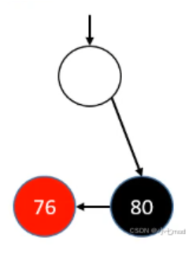

**修复步骤总结**：

1. 父节点向下与兄弟节点进行合并
2. 将兄弟节点染成红色，父节点染成黑色即可修复红黑树性质
3. 如果父节点出现下溢情况，则直接将父节点当成被删除节点进行处理即可

##### 4.3.3.3 兄弟节点为红色

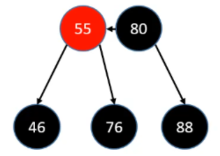

**判断条件**：

兄弟节点为红色。如果删除节点的兄弟节点为红色，这样删除节点出现下溢后没办法通过兄弟节点来进行修复。这就需要先把红黑树转换为兄弟节点为黑色的情况，再套用上面讲的修复方式来进行修复。

**案例修复**：

删除88节点之前，需要先转换成兄弟节点为黑色的情况，当前88的兄弟节点是红色55。可以将其看作是LL情况，对父节点88进行右旋转，这样节点55就被移动上去成为了80的父节点。76也被移动上去，成为了80的子节点。

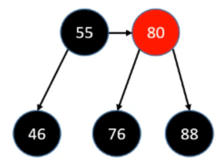

这种情况，删除节点88的兄弟节点就变成了黑色，并且没有红色节点，可以继续套用之前讲的方法来进行修复。修复后如下：

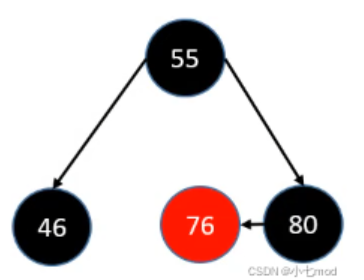

**修复步骤总结**：

1. 兄弟节点染成黑色，父节点染成红色，对父节点进行右旋
2. 于是回到兄弟节点是黑色的情况，继续使用兄弟节点为黑色的方法进行修复

## 5、红黑树的平衡

平衡二叉树是靠平衡因子来保存平衡的，比如平衡因子为1，那么左右子树的高度差就不能超过1，是一种强平衡。

对于红黑树而言，为什么那5条性质，就能保证红黑树是平衡的？因为那5条性质，可以保证红黑树等价于4阶B树。B树比较矮，它本身就是平衡的，高度越小越平衡。

红黑树就是能保证这个树高度不会特别高，红黑树的最大高度是`2*log2(n+1)`，依然是`O(logn)`级别，因为高度不会很大从而维持一种相对平衡的状态。相比平衡二叉树，红黑树的平衡标准比较宽松：没有一条路径会大于其他路径的两倍。这时一种弱平衡、黑高度平衡（黑高度只算黑色节点个数，红黑树的任何一条路径的黑色节点数一样，即黑高度都是一样的）。

## 6、红黑树的平均时间复杂度

* 搜索：O(logn)
* 添加：O(logn)，O(1)次的旋转操作
* 删除：O(logn)，O(1)次的旋转操作

## 7、AVL树和红黑树对比

### 7.1 AVL树

* 平衡标准比较严格：每个左右子树的高度差不超过1
* 最大高度是：$1.44 * \log_2n + 2 - 1.328$（100W个节点，最大树高28）
* 搜索、添加、删除都是`O(logn)`复杂度，其中添加仅需`O(1)`次旋转调整，删除最多需要`O(logn)`次旋转调整

### 7.2 红黑树

* 平衡标准比较宽松：没有一条路径会大于其他路径的2倍

* 最大高度是：$2 * \log_2(n+1)$（100W个节点，最大树高40）
* 搜索、添加、删除都是`O(logn)`复杂度，其中添加、删除都仅需`O(1)`次旋转调整

### 7.3 如何选择

* 搜索的次数远远大于插入和删除，选择AVL树；搜索、插入、删除次数几乎差不多，选择红黑树
* 相对于AVL树来说，红黑树牺牲了部分平衡性以换取插入/删除操作时少量的旋转操作，整体来说性能要优于AVL树

### 7.4 案例对比

使用如下数据组成一颗树：{10、35、47、11、5、57、39、14、27、26、84、75、63、41、37、24、96}

#### 7.4.1 二叉搜索树

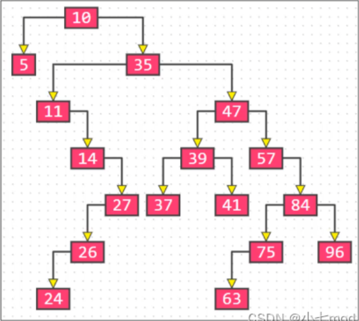

#### 7.4.2 AVL树

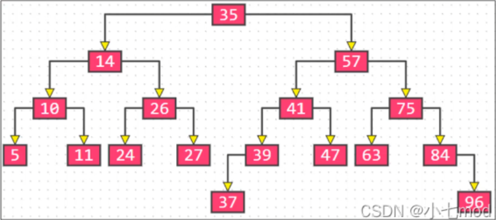

#### 7.4.3 红黑树

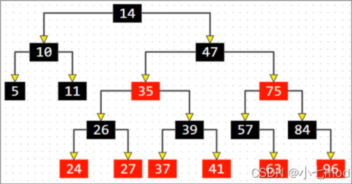
