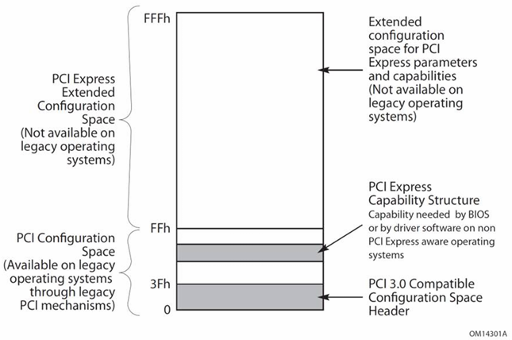
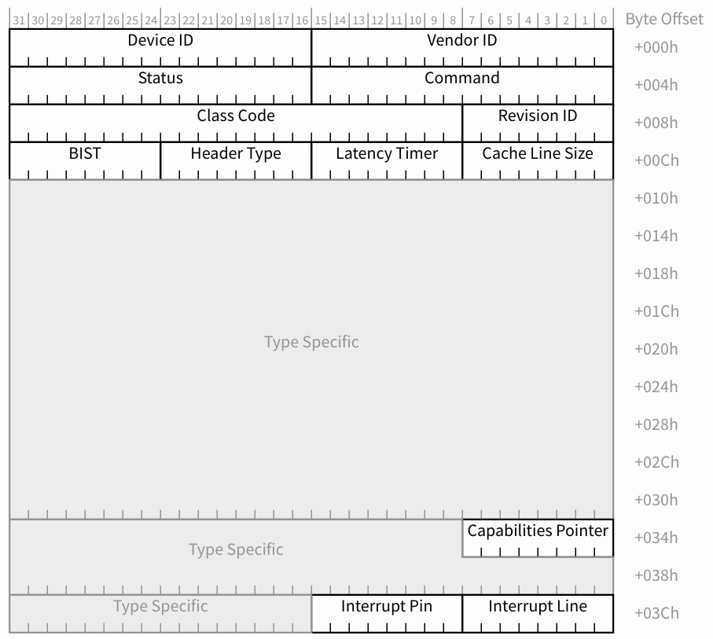
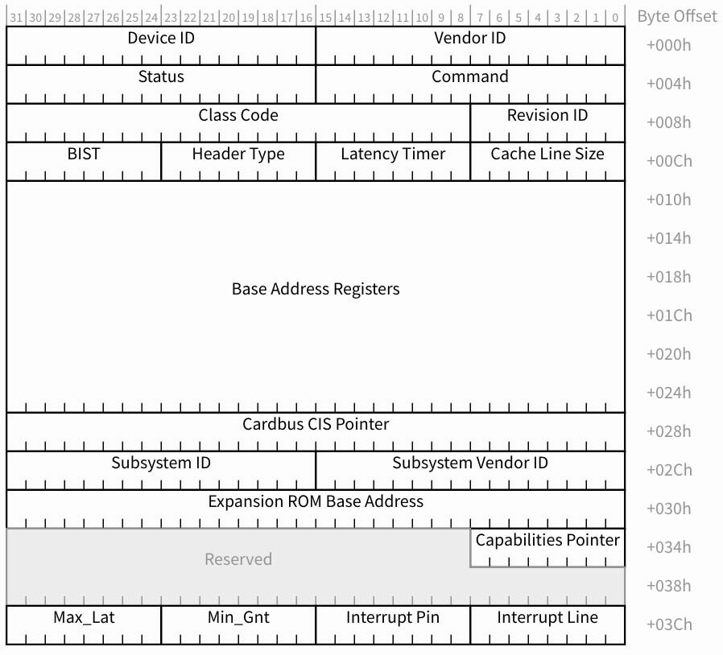

# `PCIe`配置空间（未完成）

> 参考链接：
> [PCIe总线-配置空间介绍（三）](https://www.cnblogs.com/linhaostudy/p/18668864)

## 1、概述

​	配置空间是`PCIe`设备/桥的标识符，其保存了设备/桥的信息。主机在枚举设备/桥的时候需要先访问配置空间，获取设备厂家、型号、类型、所需资源等信息，然后再分配资源，最后才能访问`PCIe`设备的存储或`IO`地址空间。`PCIe`总线规定了三种类型的配置空间，分别是`PCIe Agent`设备使用的配置空间、`PCIe`桥使用的配置空间和`Cardbus`桥片使用的配置空间，本文只介绍前两种。

## 2、配置空间布局

​	`BDF`（`Bus总线号 + Device设备号 + Function功能号`）构成了每个`PCIe`设备节点的身份证号，决定了唯一的目标设备；寻址基本单元是`Function`。一个`PCIe`系统最多有256条`Bus`，每条`Bus`上最多挂32个`Device`，每个`Device`最多能实现8个`Function`，每个`Function`对应着`4KB`的配置空间。

> 需要注意的是，`BDF`的逻辑定义是16位，但是在代码中常被表示为24位。
>
> | 特性   | 逻辑定义（`PCIe`总线协议）                            | 代码实现（`OS`寻址）                                    |
> | ------ | ----------------------------------------------------- | ------------------------------------------------------- |
> | 总位宽 | 16                                                    | 24                                                      |
> | 结构   | `Bus[16:8]:Dev[7:3]:Func[2:0]`                        | `Bus[24:16]:Dev[11:7]:Func[2:0]`                        |
> | 范围   | `0x0000`到`0xFFFF`                                    | `0x000000`到`0xFFFFF8`                                  |
> | 举例   | `Bus:0x40,Dev:0x12,Func:0x00`<br />逻辑定义为`0x4090` | `Bus:0x40,Dev:0x12,Func:0x00`<br />代码实现为`0x401200` |
>
> `OS`代码实现如下：
>
> ```c
> #define PCIE_CREATE_BDF(seg, bus, dev, func) ((seg << 24) | ((bus & 0xFF) << 16) | \
>                                              ((dev & 0xFF) << 8) | func)
> ```



> 值得一提的是，我们可以看到`PCI Express Capability Structure`空间段并没有和配置空间头（`00h-3Fh`）相邻，即前者的起始地址偏移并不一定是`40h`。我接触到一个实例，其`PCI Express Capability Structure`起始地址偏移为`80h`，在`40h-80h`之间的地址段的数据均为0，即无实际含义。

​	`00h-3Fh`（`64 Bytes`）是`PCI`兼容配置空间头，按类型可分为`Type 0`和`Type 1`两种。

​	`PCIe`设备使用`Type 0`配置空间头，`PCIe`桥使用`Type 1`配置空间头。

* 所有的`PCI`、`PCI-X`、`PCI`设备/桥必须支持64字节的配置空间头，即`00h-3Fh`。
* `40h-FFh`（`192 Bytes`）是`PCI/PCI-X`和`PCIe`扩展的配置空间，主要存放一些与`MSI`或者`MSI-X`中断机制和电源管理相关的`Capability Structures`。
* 支持中断的`PCI`、`PCI-X`、`PCIe`设备/桥必须支持`40h-FFh`的配置空间。
* `100h-FFFh`（`3840 Bytes`）是`PCIe`协议扩展的可选配置空间，主要存放`AER`、虚拟通道、设备序列号等`Capability Structures`。
* `00h-FFh`（`256 Bytes`）是`PCI`兼容配置空间，可通过传统的`PCI`方式（基于`ID`寻址）或`PCIe ECAM`（`Enhanced Configuration Access Mechanism`）访问。`100h-FFFh`只能通过`PCIe ECAM`访问。

> 基于`ID`寻址和`PCIe ECAM`两种方式类似于`QSPI`的间接和直接映射。

### 2.1 `Common Configuration Space Header`



| 字段                 | 含义                                                         | 偏移地址 | 宽度 |
| -------------------- | ------------------------------------------------------------ | -------- | ---- |
| Vendor ID            | 厂商ID，由PCI-SIG统一分配，如Intel的厂商ID为0x8086，         | 0x00     | 2B   |
| Device ID            | 设备ID，由PCI-SIG统一分配，如Intel 82571EB网卡的设备ID为0x105E | 0x02     | 2B   |
| Command              | 命令寄存器，初始化的时候默认值为0，具体见下面的解释          | 0x04     | 2B   |
| Status               | 保存PCIe状态                                                 | 0x06     | 2B   |
| Revision ID          | 保存PCIe版本号                                               | 0x08     | 1B   |
| Class Code           | 保存PCIe设备的分类，由Base Class Code、Sub Class Code和Interface组成。Base Class Code是设备的基本分类，如显卡、网卡、PCIe桥等设备。Sub Class Code则会将设备进一步细分。Interface定义编程接口。 | 0x09     | 3B   |
| Cache Line Size      | 保存主机处理器的Cache行长度，该寄存器由主机的系统软件设置。若PCIe设备不支持与Cache相关的总线事务，系统软件可不设置该寄存器。 | 0x0C     | 1B   |
| Latency Timer        | 控制PCI设备占用总线的时间，对PCIe总线无意义。                | 0x0D     | 1B   |
| Header Type          | 记录设备的类型。bit[7]=0表示单功能设备，bit[7]=1表示多功能设备，bit[6:0]=0表示PCIe Agent设备，bit[6:0]=1表示PCIe桥设备，bit[6:0]=2表示PCIe CardBus桥。 | 0x0E     | 1B   |
| BIST                 | 可选，用于内部自检                                           | 0x0F     | 1B   |
| Capabilities Pointer | Capabilities寄存器相对于配置空间的偏移地址，PCI-X和PCIe必须支持该功能 | 0x34     | 1B   |
| Interrupt Line       | 保存当前PCIe设备使用的中断向量号，由主机系统软件分配，通常不使用 | 0x3C     | 1B   |
| Interrupt Pin        | 保存PCIe设备使用的中断引脚，由主机系统软件分配，1表示INTA#，2表示INTB#，3表示INTC#，4表示INTD#，PCIe设备可使用INTx模拟INTA~D#中断 | 0x3D     | 1B   |

### 2.2 `Type 0 Header`


