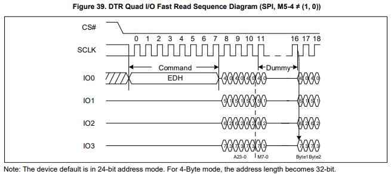

# `DTR`模式

​	在介绍`DTR`模式之前，我们先来解答一个问题——如何增大`Nor Flash`数据传输速度？我们可以增大时钟频率，或者修改传输协议。除此之外，还有一种特殊的方法可以增大数据传输速度——`DTR`模式。

​	`DTR`是`Dual Transfer Rate`的缩写，即在时钟信号`SCK`的双边沿均触发数据传输。从信号波形来看，即一个时钟信号传输两个`bit`的数据，如下所示。

