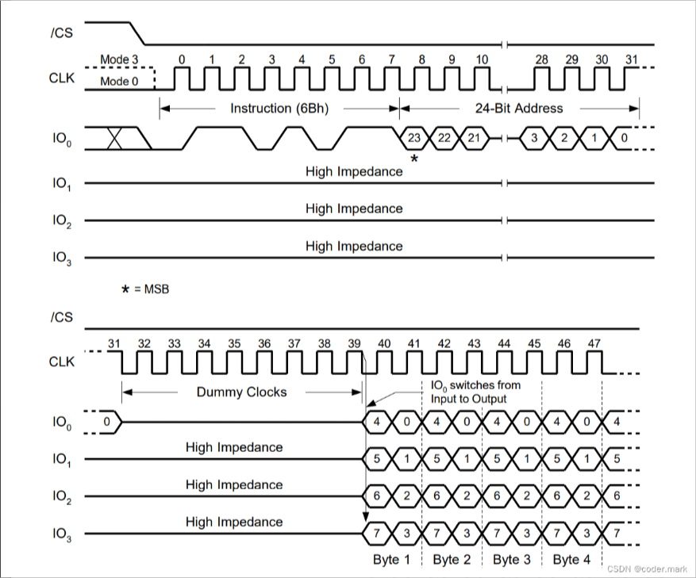
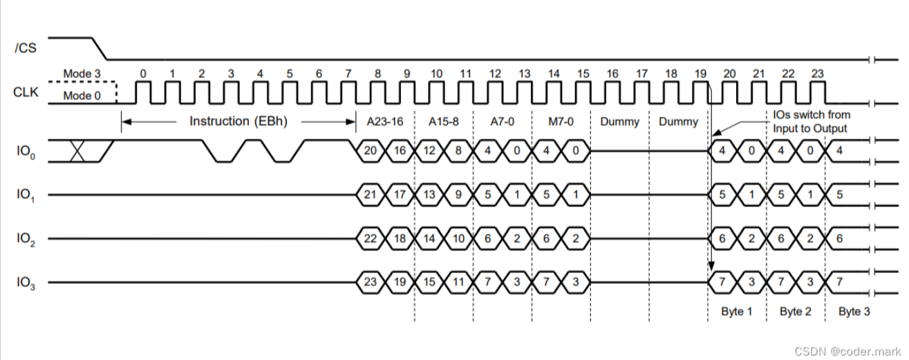
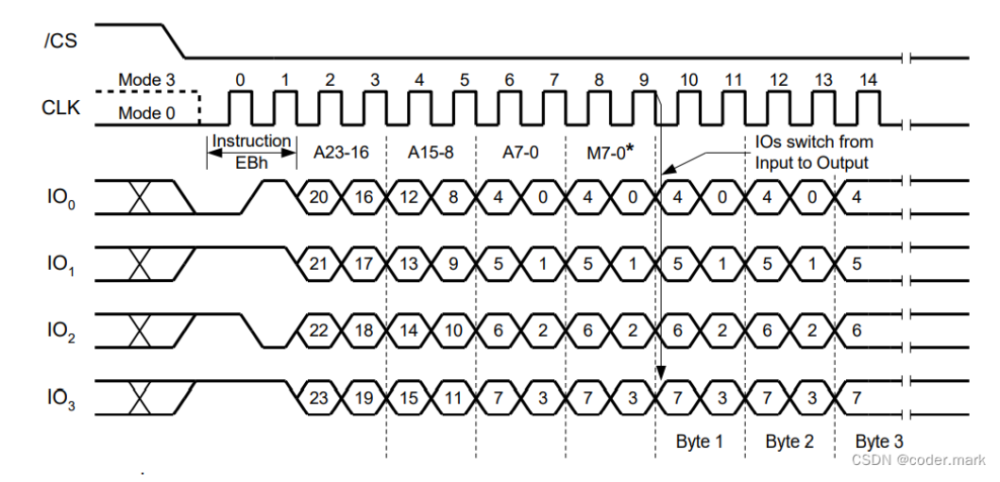
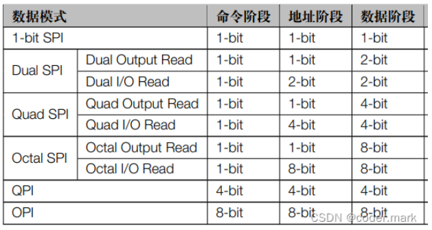

# `Quad SPI`和`QPI`的区别

> 参考链接：
>
> [理解SPI/Dual SPi/Quad SPI/QPI之间的区别](https://blog.csdn.net/tianizimark/article/details/124608851)

​	不论是`Quad SPI`还是`QPI`其实都是四线传输，只不过`Quad SPI`为`1-1-4`（`QOUT`）和`1-4-4`（`QIO`），而`QPI`为`4-4-4`。

## 1、`Quad SPI`

**`QOUT`**

​	只在数据阶段是四线传输，指令和地址阶段是标准`SPI`传输，这种形式的传输也叫做`QOUT`。

**`QIO`**

​	只在指令阶段是标准`SPI`传输，地址和数据阶段是四线传输，这种形式的传输也叫做`QIO`。

## 2、`QPI`

​	指令、地址以及数据阶段均是四线传输，这种形式的传输叫做`QPI`。

## 3、其它

