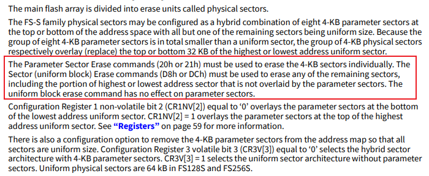

# `s25fs128s`型号的flash

## `s25fs128s`的特殊性质

​	查询`《s25fs128s数据手册》`，发现存在如下描述：



​	从以上描述可以看出，`s25fs128s`型号`flash`中存在两种扇区，一种是8个`4KB`参数扇区，另一种是统一扇区。必须使用`parameter Sector Erase commands（20h or 21h）`单独擦除`4KB`参数扇区，必须使用`Sector(uniform block) Erase commands (D8h or DCh)`擦除统一扇区。统一块擦除命令对参数扇区没有影响，参数扇区擦除命令对统一扇区也没有影响，即使用`20h`或`21h`擦除指令无法擦除统一扇区，只能擦除参数扇区，同样的，使用`d8h`或`dch`擦除指令无法擦除参数扇区，只能擦除统一扇区。

​	我们可以通过配置`Configuration Register 3`寄存器的`volatile bit 3`位（`CR3C[3]`）来设置是否关闭参数扇区。`CR3V[3]`的值为0时表示存在参数扇区，`CR3V[3]`的值为1时表示不存在参数扇区。`CR3V[3]`是只读的，而`s25fs128s`型号`flash`的该值为0。

## 擦除失败及原因

​	由于`s25fs128s`型号`flash`存在以上 性质，内核源码中对该型号`flash`的擦除指令设置为`d8h`。所以在测试`spi/qspi`时，如果使用该型号的`flash`，则会发现对其`0-0x8000`空间的擦除失败，如下所示：

```bash
root@ft:~# rw -r 4 0x1000000
[0000000001000000]: 00000000
root@ft:~# flash_erase /dev/mtd1 0 0x1
Erasing 64 Kibyte @ 0 -- 100 % complete
root@ft:~# rw -r 4 0x1000000
[0000000001000000]: 00000000
```

​	而如果使用`20h`擦除指令对该地址进行擦除操作，则可以擦除成功，如下所示：

```bash
root@ft:~# rw -w 4 0x28008010 0x6080000
root@ft:~# rw -w 4 0x2800801c 0
root@ft:~# rw -w 4 0x28008010 0x20088000
root@ft:~# rw -w 4 0x28008014 0
root@ft:~# rw -w 4 0x2800801c 0
root@ft:~# rw -w 4 0x28008010 0x5082000
root@ft:~# rw -r 4 0x2800801c
[000000002800801C]: 00000000
root@ft:~# rw -r 4 0x1000000 5
[0000000001000000]: FFFFFFFF
[0000000001000004]: FFFFFFFF
[0000000001000008]: FFFFFFFF
[000000000100000C]: FFFFFFFF
[0000000001000010]: FFFFFFFF
```

​	如果使用全片擦除指令（`c7h`）可以实现全片擦除，也就可以擦除`0-0x8000`空间地址。

## 文件系统挂载失败原因

​	同样的，由于`s25fs128s`型号`flash`存在以上性质，挂载`ext4`文件系统时会先擦除全片`flash`，然后写`0-0x1000`地址空间，最后还会对`0-0x1000`地址做块擦除，然后再写。所以在第二次擦除`0-0x1000`地址时会失败，也就导致第二次写`0-0x1000`地址失败，最后就会导致文件系统挂载失败。

​	有一种规避方法，可以对该`flash`做分区（第一个分区大小至少`64KB`），然后对第二个分区做文件系统格式化和文件系统挂载，这样可以成功挂载文件系统。