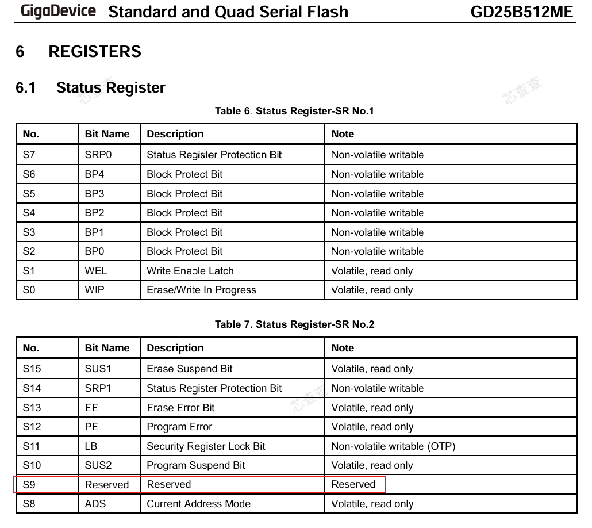

# flash驱动注册失败——错误码(-5)

> ​	可能出错位置：
>
> ​	1）`spi_nor_probe()->spi_nor_scan()->spi_nor_init()->spi_nor_quad_enable()->spi_nor_sr2_bit1_quad_enable()->spi_nor_write_16bit_cr_and_check()`


## 问题现象

​	使用`6.6`版本内核在`S5000C`上进行`qspi`测试时，使用两个相同型号的`flash`（`gd25b512`），其中一个`flash`能注册并正常获取大小，另一个`flash`无法正常注册并且也不能获取大小，报错如下：

```shell
spi-nor spi-PHYT8009:00: gd25b512 (65536 Kbytes)
1 acpi-fixed-partitions partitions found on MTD device spi-PHYT8009:00
Creating 1 MTD partitions on "spi-PHYT8009:00":
0x000000800000-0x000004000000 : "part0"
spi-nor: probe of spi-PHYT8009:01 failed with error -5
phytium-qspi PHYT0011:00: Flashes are of different sizes.
phytium-qspi: probe of PHYT0011:00 failed with error -22
Deleting MTD partitions on "spi-PHYT8009:00":
Deleting part0 MTD partition
```

​	通过加打印进一步确认，第一个`flash`能够读取正确的`JEDEC ID`并且获取到`mtd->size`，第二个`flash`也能够读取到正确的`JEDEC ID`，但是不能获取到`mtd->size`。

## 问题原因	

​	观察`ACPI`表发现两个`flash`的描述不相同，第一个`flash`使用的是1线模式，第二个`flash`使用的是4线模式，所以基本可以确定是这一点的不同导致的第一个`flash`能正常注册，第二个`flash`不能正常注册。

​	我们知道要使用`flash`的4线传输协议需要设置`quad enable`使能，即设置`flash`的状态寄存器的`quad enable`位（一般是状态寄存器2的`bit[1]`）。同时发现内核的`spi-core`层在设置`quad enable`使能时调用的函数`spi_nor_write_16bit_cr_and_check()`函数中返回值存在-5错误码。所以基本可以确定第二个`flash`无法正常注册的出错位置为其设置`quad enable`使能的地方。

​	定位到基本原因后，理论上分析有两种可能：

​	1）该`flash`不支持`quad enable`使能，即不支持4线模式，这时`ACPI`表中描述了该`flash`为4线就会出现异常；

​	2）该flash的设置`quad enable`使能的方法不是常规的设置状态寄存器2的`bit[1]`，而是设置状态寄存器1的`bit[6]`（如`gd25q256`）或其它`bit`位。

​	笔者通过查询出现该问题使用的`gd25b512`型号的`flash`对应的数据手册，发现该`flash`的状态寄存器2的`bit[1]`并不是`quad enable`使能位，并且也没有`quad enable`使能位，如下：



## 解决方法

​	1）将`ACPI`表中`qspi`控制器下的第二个`flash`的描述改成1线；

​	2）更换一个支持4线的同等大小的`flash`进行测试。