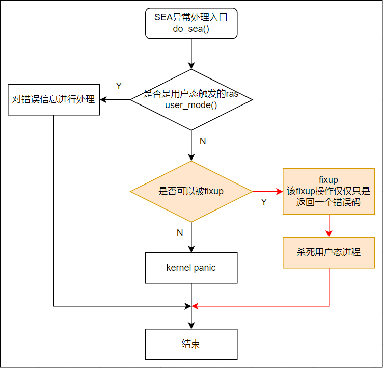

# machine check safe

> 参考链接：
>
> [arm64支持machine check safe](https://gitee.com/openeuler/kernel/issues/I8M74H)
>
> [Linux内核的异常修复原理](https://www.cnblogs.com/pengdonglin137/p/15173019.html)
>
> [Exception Table](http://blog.chinaunix.net/uid-20499746-id-821.html)
>
> [copy_{to, from}_user()的思考](http://www.wowotech.net/memory_management/454.html)

# 特性描述

内存工艺的提升，提升了内存的性能和容量等，但是内存出错的概率也在增加。内存硬件的可靠性不能进一步提升或提升有限的情况下，有必要通过软件减少内核因内存UCE错误引起的复位，提升产品可靠性和用户满意度。

目前OS判断如果是在用户态触发硬件内存错误时，处理方式是杀进程；如果是在内核态触发硬件内存错误时，处理方式是`kernel panic`。如下：

```c
static int do_sea(unsigned long far, unsigned int esr, struct pt_regs *regs)
{
	const struct fault_info *inf;
	unsigned long siaddr;

	inf = esr_to_fault_info(esr);

	if (user_mode(regs) && apei_claim_sea(regs) == 0) {
		/*
		 * APEI claimed this as a firmware-first notification.
		 * Some processing deferred to task_work before ret_to_user().
		 */
		return 0;
	}

	if (esr & ESR_ELx_FnV) {
		siaddr = 0;
	} else {
		/*
		 * The architecture specifies that the tag bits of FAR_EL1 are
		 * UNKNOWN for synchronous external aborts. Mask them out now
		 * so that userspace doesn't see them.
		 */
		siaddr  = untagged_addr(far);
	}
	arm64_notify_die(inf->name, regs, inf->sig, inf->code, siaddr, esr);

	return 0;
}

void arm64_notify_die(const char *str, struct pt_regs *regs,
		      int signo, int sicode, unsigned long far,
		      int err)
{
	if (user_mode(regs)) {
		WARN_ON(regs != current_pt_regs());
		current->thread.fault_address = 0;
		current->thread.fault_code = err;

		arm64_force_sig_fault(signo, sicode, far, str);
	} else {
		die(str, regs, err);
	}
}
```

在内核态触发硬件内存错误的处理方式是无差别的kernel panic，我们可以分析是否存在某些内核态触发内存错误的场景下可以无需panic，从而进一步提升系统可靠性。比如由硬件内存错误引起的后果不是致命的，仅仅影响相关的用户的进程，那么我们通过杀掉这个用户态进程并且隔离出错的内存页面就可以，而无需panic。

根据该思路，我们初步识别到如下场景下在触发硬件内存错误时的后果不是fatal的，仅仅是影响了某个进程：

1. uaccess用户态访问，如copy_{from, to}_user，{get, put}_user。
2. cow（copy on write）写时复制。
3. dump_user_range()。

以上的这些场景我们可以称之为machine check safe场景，对这些场景的细分处理本质上是一种RAS能力增强。

# Exception Table

此exception table不是用于处理硬件异常的，但它确实和硬件异常有一点关系，具体来说是和Page Fault有关系。

## put_user原理

put_user实现在`arch/arm64/include/asm/uaccess.h`中，如下：

```c
#define _ASM_EXTABLE(from, to)						\\
	"	.pushsection	__ex_table, \\"a\\"\\n"			\\
	"	.align		3\\n"					\\
	"	.long		(" #from " - .), (" #to " - .)\\n"	\\
	"	.popsection\\n"
	
	#define __put_mem_asm(store, reg, x, addr, err)				\\
	asm volatile(							\\
	"1:	" store "	" reg "1, [%2]\\n"			\\
	"2:\\n"								\\
	/* 注意，后面的代码在最终的目标文件中不是跟在标号2后的 */
	"	.section .fixup,\\"ax\\"\\n"				\\
	"	.align	2\\n"						\\
	"3:	mov	%w0, %3\\n"					\\
	"	b	2b\\n"						\\
	"	.previous\\n"						\\
	_ASM_EXTABLE(1b, 3b)						\\
	: "+r" (err)							\\
	: "r" (x), "r" (addr), "i" (-EFAULT))

#define __raw_put_mem(str, x, ptr, err)					\\
do {									\\
	__typeof__(*(ptr)) __pu_val = (x);				\\
	switch (sizeof(*(ptr))) {					\\
	case 1:								\\
		__put_mem_asm(str "b", "%w", __pu_val, (ptr), (err));	\\
		break;							\\
	case 2:								\\
		__put_mem_asm(str "h", "%w", __pu_val, (ptr), (err));	\\
		break;							\\
	case 4:								\\
		__put_mem_asm(str, "%w", __pu_val, (ptr), (err));	\\
		break;							\\
	case 8:								\\
		__put_mem_asm(str, "%x", __pu_val, (ptr), (err));	\\
		break;							\\
	default:							\\
		BUILD_BUG();						\\
	}								\\
} while (0)

#define __raw_put_user(x, ptr, err)					\\
do {									\\
	__chk_user_ptr(ptr);						\\
	uaccess_ttbr0_enable();						\\
	__raw_put_mem("sttr", x, ptr, err);				\\
	uaccess_ttbr0_disable();					\\
} while (0)

#define __put_user_error(x, ptr, err)					\\
do {									\\
	__typeof__(*(ptr)) __user *__p = (ptr);				\\
	might_fault();							\\
	if (access_ok(__p, sizeof(*__p))) {				\\
		__p = uaccess_mask_ptr(__p);				\\
		__raw_put_user((x), __p, (err));			\\
	} else	{							\\
		(err) = -EFAULT;					\\
	}								\\
} while (0)

#define __put_user(x, ptr)						\\
({									\\
	int __pu_err = 0;						\\
	__put_user_error((x), (ptr), __pu_err);				\\
	__pu_err;							\\
})
```

重点关注的`_ASM_EXTABLE` 和`__put_mem_asm` ，其中用到了两个section——`fixup`和`__ex_table` ，其中前者是修复程序的入口，后者用于存放触发异常的指令所长的地址和对应的修复程序的入口地址之间的映射关系。当标识`1b`处的写地址是个非法地址时，会产生page fault从而执行内核的do_page_fault()，在进行一系列检查处理后，fixup_exception()被调用，该函数会调用search_exception_tables()去查找exception table，找到`1b`对应的`__ex_table` 后，在异常返回时会跳转到修复程序入口，也就是`3b`处，然后将错误码`-EFAULT` 存入`err`中，最后跳转到`2b`处继续执行。

在每一个`__ex_table` 中存放了两个偏移量，分别是异常指令的地址`1b` 和修改指令的地址`3b` 相对当前地址的偏移，这样遍历`__ex_table` 数组的时候可以很容易获得`1b` 和`3b` 的地址。内核用结构体`struct exception_table_entry` 表示该格式，定义如下：

```c
struct exception_table_entry {
		unsigned long insn, fixup;
};
```


## __ex_table的生成

至此，整个过程都清楚了。当在内核不同的位置调用put_user()时，展开__put_user_asm宏都会将可能出错的地址和处理函数的地址存入该源文件对应的`.o` 文件的`__ex_table` 中。链接脚本如下：

```c
/*
 * Exception table
 */
#define EXCEPTION_TABLE(align)						\\
	. = ALIGN(align);						\\
	__ex_table : AT(ADDR(__ex_table) - LOAD_OFFSET) {		\\
		__start___ex_table = .;					\\
		KEEP(*(__ex_table))					\\
		__stop___ex_table = .;					\\
	}
```

将分散的`__ex_table` 收集起来产生一张完整的exception表，并将表的起始地址和结束地址记录在__start___ex_table和__stop___ex_table两个全局变量中，从而可以通过`search_exception_tables()`函数索引该表。

以上分析了`put_user` ，对应`get_user` 、`copy_to_user` 以及`copy_from_user` 都采用类似的方式来处理用户传递了非法的地址的情况。

# machine check safe



machine check safe的处理流程

`do_sea()`的实现在`/arch/arm64/mm/fault.c` 中，如下：

```c
static bool arm64_do_kernel_sea(void __user *addr, unsigned int esr,
				struct pt_regs *regs, int sig, int code)
{
	if (!IS_ENABLED(CONFIG_ARCH_HAS_COPY_MC))
		return false;

	if (user_mode(regs))
		return false;

	if (apei_claim_sea(regs) < 0)
		return false;

	if (!fixup_exception_mc(regs))
		return false;

	if (current->flags & PF_KTHREAD)
		return true;

	set_thread_esr(0, esr);
	arm64_force_sig_fault(sig, code, addr,
		"Uncorrected memory error on access to user memory\\n");

	return true;
}

static int do_sea(unsigned long far, unsigned int esr, struct pt_regs *regs)
{
	const struct fault_info *inf;
	unsigned long siaddr;

	inf = esr_to_fault_info(esr);

	if (user_mode(regs) && apei_claim_sea(regs) == 0) {
		/*
		 * APEI claimed this as a firmware-first notification.
		 * Some processing deferred to task_work before ret_to_user().
		 */
		return 0;
	}

	if (esr & ESR_ELx_FnV) {
		siaddr = 0;
	} else {
		/*
		 * The architecture specifies that the tag bits of FAR_EL1 are
		 * UNKNOWN for synchronous external aborts. Mask them out now
		 * so that userspace doesn't see them.
		 */
		siaddr  = untagged_addr(far);
	}
	
	if (!arm64_do_kernel_sea(siaddr, esr, regs, inf->sig, inf->code))
		arm64_notify_die(inf->name, regs, inf->sig, inf->code, siaddr, esr);

	return 0;
}
```

我们需要重点关注的是`fixup_exception_mc()`函数，其实现在`arch/arm64/mm/extable.c` 中，如下：

```c
int fixup_exception_mc(struct pt_regs *regs)
{
	const struct exception_table_entry *fixup;

	fixup = search_mc_exception_tables(instruction_pointer(regs));
	if (!fixup)
		return 0;

	regs->pc = (unsigned long)&fixup->fixup + fixup->fixup;
	return 1;
}
```

继续跟进`search_mc_exception_tables(instruction_pointer()` 函数，其定义在`kernel/extable.c` 中，如下：

```c
#ifdef CONFIG_ARCH_HAS_MC_EXTABLE
/* Given an address, look for it in the machine check exception table */
const
struct exception_table_entry *search_mc_exception_tables(unsigned long addr)
{
	const struct exception_table_entry *e;

	e = search_extable(__start___mc_ex_table,
			   __stop___mc_ex_table - __start___mc_ex_table, addr);
	if (!e)
		e = search_module_mc_extables(addr);

	return e;
}
#endif
```

其中，`search_extable()` 是从静态编译到内核中的异常表查找，`search_module_mc_extables()` 是从内核module中的异常表查找。