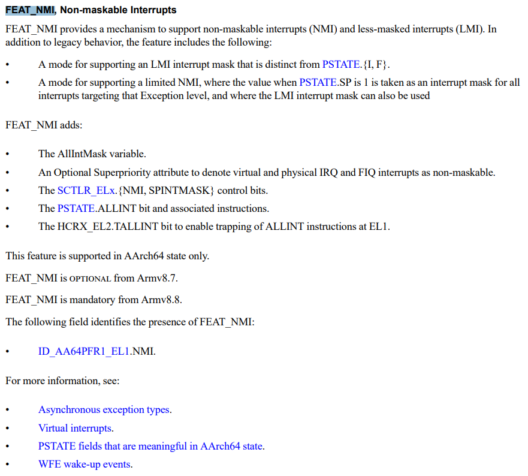
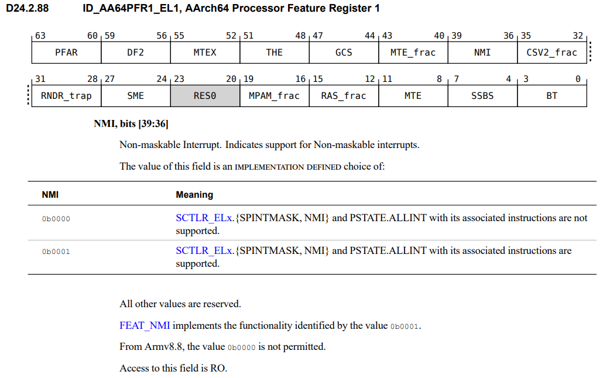

# NMI特性

**概述**





**检查硬件能力**

在开始功能测试前，必须先确认硬件是否具备该特性。处理器（PE）特性检查：通过读取系统寄存器`ID_AA64PFR1_EL1`的`NMI`字段来确认。

```c
#include <linux/module.h>
#include <linux/kernel.h>
#include <linux/init.h>

static int __init read_reg_init(void)
{
    unsigned long val;

    /*
     * 使用内联汇编执行 MRS 指令读取 S3_0_c0_c4_1。
     * 该寄存器在汇编语法中可直接使用 S3_0_C0_C4_1（大小写不敏感）。
     */
    asm volatile(
        "mrs %0, S3_0_C0_C4_1"
        : "=r" (val)          /* 输出：将寄存器值存入 val */
        :                     /* 没有输入 */
        :                     /* 没有被破坏的寄存器（MRS 不影响通用寄存器） */
    );

    pr_info("S3_0_c0_c4_1 register value: 0x%016lx\n", val);
    
    if (val & BIT(36))
        printk(KERN_ERR "support NMI!");

    return 0;
}

static void __exit read_reg_exit(void)
{
    pr_info("Module unloaded\n");
}

module_init(read_reg_init);
module_exit(read_reg_exit);

MODULE_LICENSE("GPL");
MODULE_DESCRIPTION("Read ARM64 system register S3_0_c0_c4_1 using inline asm");
MODULE_AUTHOR("Your Name");
```

