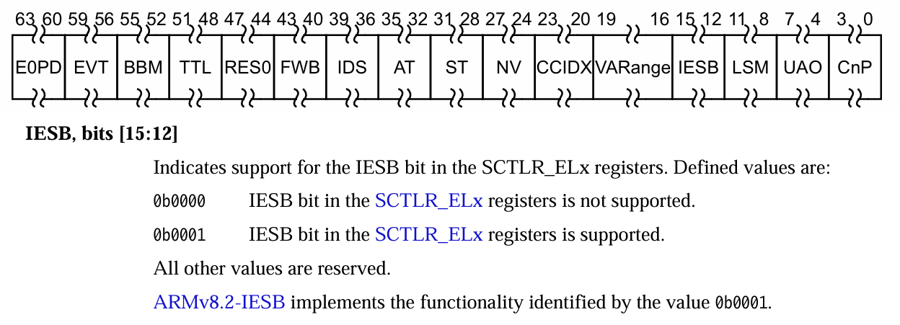
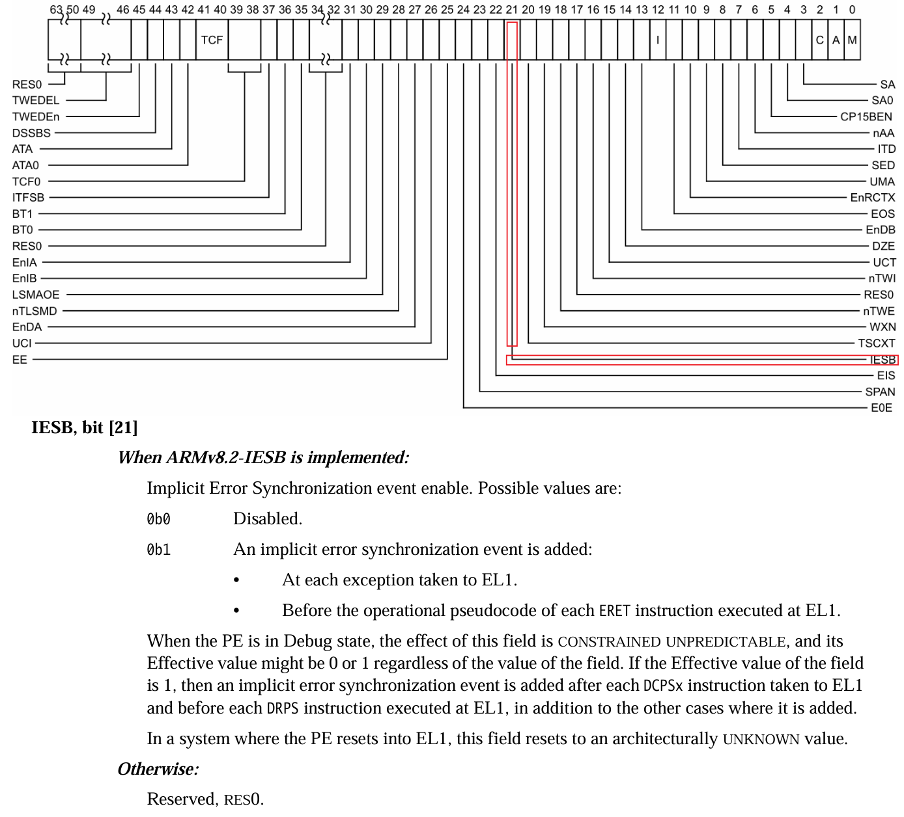
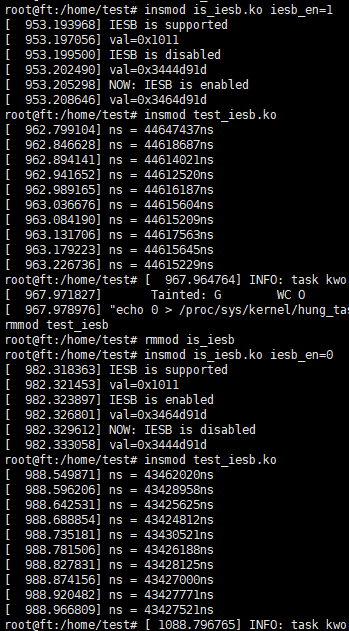

# `SCTLR_EL1.IESB`

**概述**
	在`ARM64`架构中，和`IESB`特性相关的系统寄存器有两个，分别是`ID_AA64MMFR2_EL1`和`SCTLR_EL1`。
	其中`ID_AA64MMFR2_EL1`寄存器描述如下：

	由上述描述可知`ID_AA64MMFR2_EL1.IESB`表示是否支持`IESB`特性（只读属性）。
	`SCTLR_EL1`寄存器描述如下：

	由上述描述可知`SCTLR_EL1.IESB`表示是否使能`IESB`特性（可读写属性)。
**验证方案**
	首先验证测试环境是否支持`IESB`，以及是否能控制使能/关闭`IESB`特性。可以通过以下模块工具实现，使用方式为`insmod is_iesb.ko iesb_en=0/1`（0表示关闭`IESB`，1表示使能`IESB`)

```c
#include <linux/module.h>
#include <linux/kernel.h>
#include <asm/sysreg.h>

bool iesb_en = 1;
module_param(iesb_en, bool, S_IWUSR);

unsigned long val, val2;

static int __init is_iesb_init(void)
{
        asm volatile("mrs %0, S3_0_C0_C7_2" : "=r" (val));
        if (val & BIT(12))
                printk(KERN_ERR "IESB is supported\n");
        else
                printk(KERN_ERR "IESB is not supported\n");
        printk(KERN_ERR "val=0x%llx\n", val);

        val = read_sysreg(sctlr_el1);
        if (val & BIT(21))
                printk(KERN_ERR "IESB is enabled\n");
        else
                printk(KERN_ERR "IESB is disabled\n");
        printk(KERN_ERR "val=0x%llx\n", val);

        if (iesb_en)
                val2 = val | BIT(21);
        else
                val2 = val & (~BIT(21));

        asm volatile("msr sctlr_el1, %0" : : "r"(val2));
        isb();
        isb();

        val = read_sysreg(sctlr_el1);
        if (val & BIT(21))
                printk(KERN_ERR "NOW: IESB is enabled\n");
        else
                printk(KERN_ERR "NOW: IESB is disabled\n");
        printk(KERN_ERR "val=0x%llx\n", val);

        return 0;
}
static void __exit is_iesb_exit(void)
{
}

module_init(is_iesb_init);
module_exit(is_iesb_exit);

MODULE_LICENSE("GPL");
```
​	由于`IESB`特性在启用时，某些操作（如缓存维护、加载/存储）会自动插入错误同步屏障，使得检测到错误（只能是`IESB`针对的特定的错误的同步，如外部`abort`）能够被立即报告。反之，关闭`IESB`时，错误可能会被延迟报告，直到执行到某个上下文同步事件才会报错。由于`IESB`针对的特定错误不好构造，笔者选取一种更直接简单的方式去验证`IESB`，方法如下：由于在启用`IESB`特性时，会在某些操作中自动插入错误同步屏障，所以我们可以通过大量执行这些操作来测量实际差异。需要注意的是，我们需要确保测试过程中没有实际错误发生，否则会影响测试结果。测试模块如下：
```c
#include <linux/module.h>
#include <linux/kernel.h>
#include <asm/sysreg.h>
#include <linux/ktime.h>
#include <linux/delay.h>

#define TEST_SIZE (1024 * 1024)
u8 *test_buffer;

static int __init test_iesb_init(void)
{
        ktime_t start, end;
        u64 ns[10], a = 0;
        int i,j;

        test_buffer = kmalloc(TEST_SIZE, GFP_KERNEL);
        if (!test_buffer) {
                printk(KERN_ERR "fail to malloc\n");
                return -1;
        }

        memset(test_buffer, 0, TEST_SIZE);

        for (i = 0; i < 10; i++) {
                u64 addr = (u64)test_buffer;
                start = ktime_get();

                for (j = 0; j < 1000000; j++) {
                        asm volatile(
                                "dc civac, %0\n"
                                : : "r"(addr) : "memory"
                        );
                }

                asm volatile("dsb sy");
                end = ktime_get();
                ns[i] = ktime_to_ns(ktime_sub(end, start));

                printk(KERN_ERR "ns = %lldns\n", ns[i]);
        }

        return 0;
}

static void __exit test_iesb_exit(void)
{
}

module_init(test_iesb_init);
module_exit(test_iesb_exit);

MODULE_LICENSE("GPL");
```
也可以用内核态程序测量耗时：

```c	
#define _GNU_SOURCE
#include <stdio.h>
#include <stdlib.h>
#include <unistd.h>
#include <time.h>
#include <string.h>
#include <sched.h>

#define ITERATIONS 10000000
#define WARMUP     100000

static inline unsigned long rdtsc(void)
{
	unsigned long val;
	asm volatile("mrs %0, cntvct_el0" : "=r" (val));
	return val;
}

static unsigned long get_cntfrq(void)
{
	unsigned long freq;
	asm volatile("mrs %0, cntfrq_el0" : "=r" (freq));
	return freq;
}

static struct timespec diff_time(struct timespec start, struct timespec end)
{
	struct timespec diff;
	if ((end.tv_nsec - start.tv_nsec) < 0) {
		diff.tv_sec = end.tv_sec - start.tv_sec - 1;
		diff.tv_nsec = 1000000000 + end.tv_nsec - start.tv_nsec;
	} else {
		diff.tv_sec = end.tv_sec - start.tv_sec;
		diff.tv_nsec = end.tv_nsec - start.tv_nsec;
	}
	return diff;
}

static void pin_cpu(int cpu)
{
	cpu_set_t set;
	CPU_ZERO(&set);
	CPU_SET(cpu, &set);
	if (sched_setaffinity(0, sizeof(set), &set) < 0) {
		perror("sched_setaffinity");
		exit(1);
	}
}

int main(int argc, char *argv[])
{
	int target_cpu = 0;
	unsigned long freq;

	if (argc > 1)
		target_cpu = atoi(argv[1]);

	pin_cpu(target_cpu);
	freq = get_cntfrq();

	printf("Pinned to CPU %d, timer frequency = %lu Hz\n", target_cpu, freq);
	printf("Running %d iterations of getpid() syscall...\n", ITERATIONS);

	/* warmup */
	for (int i = 0; i < WARMUP; i++)
		getpid();

	/* measure */
	unsigned long start = rdtsc();
	for (int i = 0; i < ITERATIONS; i++)
		getpid();
	unsigned long end = rdtsc();

	unsigned long cycles = end - start;
	double ns_per_call = (double)cycles / ITERATIONS * 1e9 / freq;
	double cycles_per_call = (double)cycles / ITERATIONS;

	printf("\n--- Results ---\n");
	printf("Total cycles : %lu\n", cycles);
	printf("Cycles/call  : %.2f\n", cycles_per_call);
	printf("Time/call    : %.1f ns\n", ns_per_call);
	printf("Total time   : %.3f s\n", (double)cycles / freq);

	return 0;
}
```

预期测试结果为：启用`IESB`耗时会比关闭`IESB`要长。


