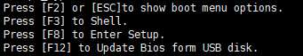
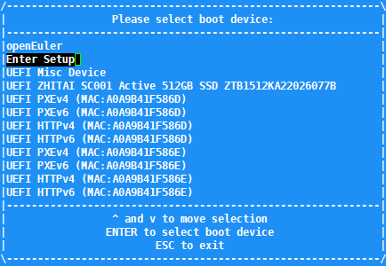
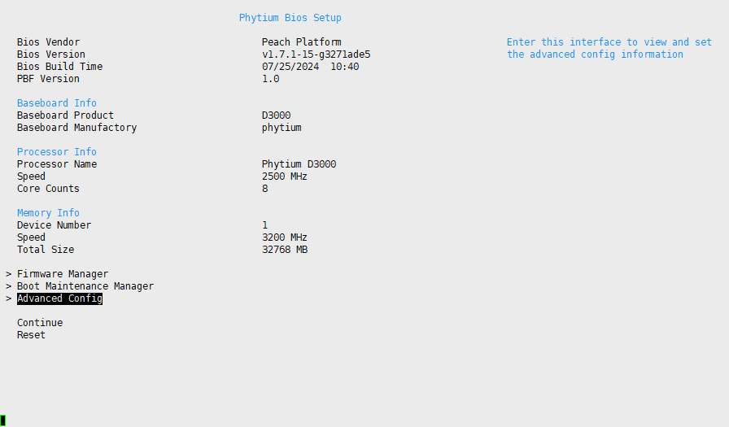
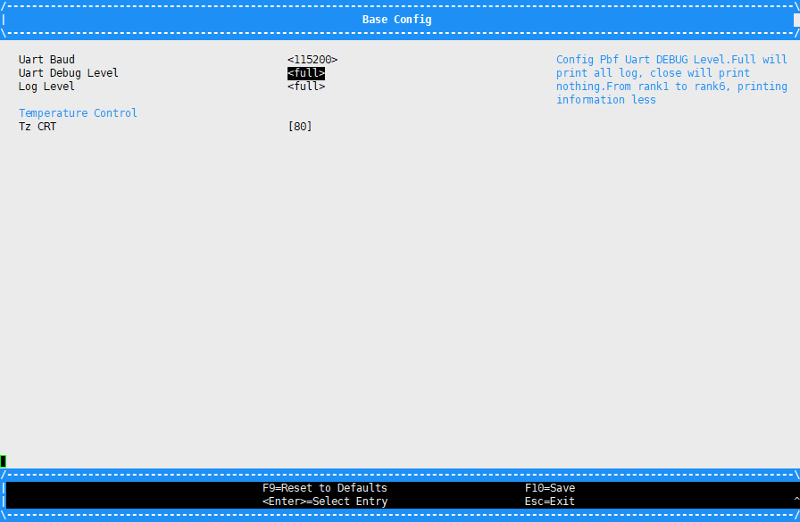
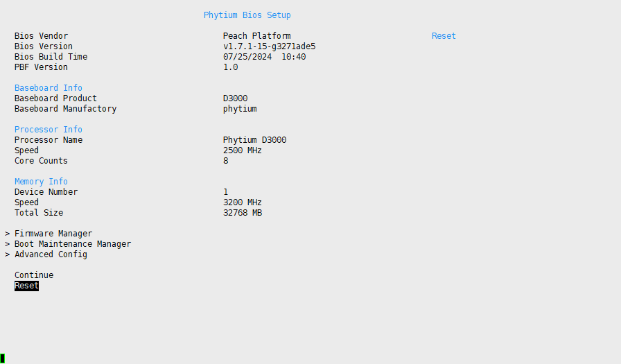

可以在系统启动选项中打开pbf打印，具体步骤如下：

1、在启动系统时按`F2`进入启动菜单选项。

2、选择`Enter Setup`选项进入`Phytium Bios Setup`

3、选择`Advanced Config->Feature->Base Config`，将`Uart Debug Level`和`Log Level`设置成`full`。

4、按`F10`保存设置，然后不断按`Esc`退回`Phytium Bios Setup`界面，最后选择`Reset`重启。

