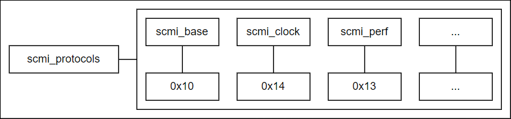

# `scmi_driver_init`

​	从最初的`scmi_driver_init()`函数开始，对整个`scmi`框架代码进行解析。

```c
/* drivers/firmware/arm_scmi/drivers.c */
static int __init scmi_driver_init(void)
{
	int ret;

	/* Bail out if no SCMI transport was configured */
	if (WARN_ON(!IS_ENABLED(CONFIG_ARM_SCMI_HAVE_TRANSPORT)))
		return -EINVAL;

	/* Initialize any compiled-in transport which provided an init/exit */
	ret = scmi_transports_init();
	if (ret)
		return ret;

	if (IS_ENABLED(CONFIG_ARM_SCMI_NEED_DEBUGFS))
		scmi_top_dentry = scmi_debugfs_init();

	scmi_base_register();

	scmi_clock_register();
	scmi_perf_register();
	scmi_power_register();
	scmi_reset_register();
	scmi_sensors_register();
	scmi_voltage_register();
	scmi_system_register();
	scmi_powercap_register();

	return platform_driver_register(&scmi_driver);
}
module_init(scmi_driver_init);
```

## `scmi_transports_init`

```c
/* drivers/firmware/arm_scmi/drivers.c */
static int __init scmi_transports_init(void)
{
	return __scmi_transports_setup(true);
}

static inline int __scmi_transports_setup(bool init)
{
	int ret = 0;
	const struct of_device_id *trans;

	for (trans = scmi_of_match; trans->data; trans++) {
		const struct scmi_desc *tdesc = trans->data;

		if ((init && !tdesc->transport_init) ||
		    (!init && !tdesc->transport_exit))
			continue;

		if (init)
			ret = tdesc->transport_init();
		else
			tdesc->transport_exit();

		if (ret) {
			pr_err("SCMI transport %s FAILED initialization!\n",
			       trans->compatible);
			break;
		}
	}

	return ret;
}

static const struct of_device_id scmi_of_match[] = {
#ifdef CONFIG_ARM_SCMI_TRANSPORT_MAILBOX
	{ .compatible = "arm,scmi", .data = &scmi_mailbox_desc },
#endif
#ifdef CONFIG_ARM_SCMI_TRANSPORT_OPTEE
	{ .compatible = "linaro,scmi-optee", .data = &scmi_optee_desc },
#endif
#ifdef CONFIG_ARM_SCMI_TRANSPORT_SMC
	{ .compatible = "arm,scmi-smc", .data = &scmi_smc_desc},
	{ .compatible = "arm,scmi-smc-param", .data = &scmi_smc_desc},
#endif
#ifdef CONFIG_ARM_SCMI_TRANSPORT_VIRTIO
	{ .compatible = "arm,scmi-virtio", .data = &scmi_virtio_desc},
#endif
	{ /* Sentinel */ },
};
```

​	遍历`scmi_of_match`结构，运行`scmi_of_match[i]->data->transport_init()`函数。其实，上面结构体中只有`scmi_virtio_desc`存在`transport_init()`，而我们一般用的是`mailbox`的传输方式，所以该函数一般直接返回。

## `scmi_debugfs_init`

```c
/* drivers/firmware/arm_scmi/drivers.c */
static struct dentry *scmi_debugfs_init(void)
{
	struct dentry *d;

	d = debugfs_create_dir("scmi", NULL);
	if (IS_ERR(d)) {
		pr_err("Could NOT create SCMI top dentry.\n");
		return NULL;
	}

	return d;
}
```

​	在`/sys/kernel/debug/`目录下创建`scmi`目录，便于后续在该目录下创建一些接口。

## `scmi_base_register`

```c
/* drivers/firmware/arm_scmi/base.c */
DEFINE_SCMI_PROTOCOL_REGISTER_UNREGISTER(base, scmi_base)

/* drivers/firmware/arm_scmi/protocols.h */
/* scmi_base_register函数定义 */
#define DEFINE_SCMI_PROTOCOL_REGISTER_UNREGISTER(name, proto)	\
static const struct scmi_protocol *__this_proto = &(proto);	\
								\
int __init scmi_##name##_register(void)				\
{								\
	return scmi_protocol_register(__this_proto);		\
}								\
								\
void __exit scmi_##name##_unregister(void)			\
{								\
	scmi_protocol_unregister(__this_proto);			\
}

/* scmi_base_register函数声明 */
#define DECLARE_SCMI_REGISTER_UNREGISTER(func)		\
	int __init scmi_##func##_register(void);	\
	void __exit scmi_##func##_unregister(void)
DECLARE_SCMI_REGISTER_UNREGISTER(base);
```

​	诸如`scmi_##name##_register`函数的声明和定义均遵循以上格式。

### `scmi_protocol_register`

```c
/* drivers/firmware/arm_scmi/drivers.c */
int scmi_protocol_register(const struct scmi_protocol *proto)
{
	int ret;

	if (!proto) {
		pr_err("invalid protocol\n");
		return -EINVAL;
	}

	if (!proto->instance_init) {
		pr_err("missing init for protocol 0x%x\n", proto->id);
		return -EINVAL;
	}

	spin_lock(&protocol_lock);
	ret = idr_alloc(&scmi_protocols, (void *)proto,
			proto->id, proto->id + 1, GFP_ATOMIC);
	spin_unlock(&protocol_lock);
	if (ret != proto->id) {
		pr_err("unable to allocate SCMI idr slot for 0x%x - err %d\n",
		       proto->id, ret);
		return ret;
	}

	pr_debug("Registered SCMI Protocol 0x%x\n", proto->id);

	return 0;
}
EXPORT_SYMBOL_GPL(scmi_protocol_register);
```

​	`idr_alloc()`函数的主要作用是分配`id`和存储指针，便于后续使用`idr_find()`函数通过`id`对`scmi_protocols`查找到对应的`scmi_xxx`指针。



## `platform_driver_register`

```c
static const struct of_device_id scmi_of_match[] = {
#ifdef CONFIG_ARM_SCMI_TRANSPORT_MAILBOX
	{ .compatible = "arm,scmi", .data = &scmi_mailbox_desc },
#endif
#ifdef CONFIG_ARM_SCMI_TRANSPORT_OPTEE
	{ .compatible = "linaro,scmi-optee", .data = &scmi_optee_desc },
#endif
#ifdef CONFIG_ARM_SCMI_TRANSPORT_SMC
	{ .compatible = "arm,scmi-smc", .data = &scmi_smc_desc},
	{ .compatible = "arm,scmi-smc-param", .data = &scmi_smc_desc},
#endif
#ifdef CONFIG_ARM_SCMI_TRANSPORT_VIRTIO
	{ .compatible = "arm,scmi-virtio", .data = &scmi_virtio_desc},
#endif
	{ /* Sentinel */ },
};

MODULE_DEVICE_TABLE(of, scmi_of_match);

static struct platform_driver scmi_driver = {
	.driver = {
		   .name = "arm-scmi",
		   .suppress_bind_attrs = true,
		   .of_match_table = scmi_of_match,
		   .dev_groups = versions_groups,
		   },
	.probe = scmi_probe,
	.remove = scmi_remove,
};
```

​	这就是最为常见的平台驱动注册函数，当设备树中的`compatible`描述与`scmi_of_match`一致时，设备和驱动就匹配上了，然后运行`scmi_probe()`函数。详细匹配流程本文不做详解。

### `scmi_probe`

```c
static int scmi_probe(struct platform_device *pdev)
{
	int ret;
	struct scmi_handle *handle;
	const struct scmi_desc *desc;
	struct scmi_info *info;
	bool coex = IS_ENABLED(CONFIG_ARM_SCMI_RAW_MODE_SUPPORT_COEX);
	struct device *dev = &pdev->dev;
	struct device_node *child, *np = dev->of_node;

	desc = of_device_get_match_data(dev);
	if (!desc)
		return -EINVAL;

	info = devm_kzalloc(dev, sizeof(*info), GFP_KERNEL);
	if (!info)
		return -ENOMEM;

	info->id = ida_alloc_min(&scmi_id, 0, GFP_KERNEL);
	if (info->id < 0)
		return info->id;

	info->dev = dev;
	info->desc = desc;
	info->bus_nb.notifier_call = scmi_bus_notifier;
	info->dev_req_nb.notifier_call = scmi_device_request_notifier;
	INIT_LIST_HEAD(&info->node);
	idr_init(&info->protocols);
	mutex_init(&info->protocols_mtx);
	idr_init(&info->active_protocols);
	mutex_init(&info->devreq_mtx);

	platform_set_drvdata(pdev, info);
	idr_init(&info->tx_idr);
	idr_init(&info->rx_idr);

	handle = &info->handle;
	handle->dev = info->dev;
	handle->version = &info->version;
	handle->devm_protocol_acquire = scmi_devm_protocol_acquire;
	handle->devm_protocol_get = scmi_devm_protocol_get;
	handle->devm_protocol_put = scmi_devm_protocol_put;

	/* System wide atomic threshold for atomic ops .. if any */
	if (!of_property_read_u32(np, "atomic-threshold-us",
				  &info->atomic_threshold))
		dev_info(dev,
			 "SCMI System wide atomic threshold set to %d us\n",
			 info->atomic_threshold);
	handle->is_transport_atomic = scmi_is_transport_atomic;

	if (desc->ops->link_supplier) {
		ret = desc->ops->link_supplier(dev);
		if (ret)
			goto clear_ida;
	}

	/* Setup all channels described in the DT at first */
	ret = scmi_channels_setup(info);
	if (ret)
		goto clear_ida;

	ret = bus_register_notifier(&scmi_bus_type, &info->bus_nb);
	if (ret)
		goto clear_txrx_setup;

	ret = blocking_notifier_chain_register(&scmi_requested_devices_nh,
					       &info->dev_req_nb);
	if (ret)
		goto clear_bus_notifier;

	ret = scmi_xfer_info_init(info);
	if (ret)
		goto clear_dev_req_notifier;

	if (scmi_top_dentry) {
		info->dbg = scmi_debugfs_common_setup(info);
		if (!info->dbg)
			dev_warn(dev, "Failed to setup SCMI debugfs.\n");

		if (IS_ENABLED(CONFIG_ARM_SCMI_RAW_MODE_SUPPORT)) {
			ret = scmi_debugfs_raw_mode_setup(info);
			if (!coex) {
				if (ret)
					goto clear_dev_req_notifier;

				/* Bail out anyway when coex disabled. */
				return 0;
			}

			/* Coex enabled, carry on in any case. */
			dev_info(dev, "SCMI RAW Mode COEX enabled !\n");
		}
	}

	if (scmi_notification_init(handle))
		dev_err(dev, "SCMI Notifications NOT available.\n");

	if (info->desc->atomic_enabled &&
	    !is_transport_polling_capable(info->desc))
		dev_err(dev,
			"Transport is not polling capable. Atomic mode not supported.\n");

	/*
	 * Trigger SCMI Base protocol initialization.
	 * It's mandatory and won't be ever released/deinit until the
	 * SCMI stack is shutdown/unloaded as a whole.
	 */
	ret = scmi_protocol_acquire(handle, SCMI_PROTOCOL_BASE);
	if (ret) {
		dev_err(dev, "unable to communicate with SCMI\n");
		if (coex)
			return 0;
		goto notification_exit;
	}

	mutex_lock(&scmi_list_mutex);
	list_add_tail(&info->node, &scmi_list);
	mutex_unlock(&scmi_list_mutex);

	for_each_available_child_of_node(np, child) {
		u32 prot_id;

		if (of_property_read_u32(child, "reg", &prot_id))
			continue;

		if (!FIELD_FIT(MSG_PROTOCOL_ID_MASK, prot_id))
			dev_err(dev, "Out of range protocol %d\n", prot_id);

		if (!scmi_is_protocol_implemented(handle, prot_id)) {
			dev_err(dev, "SCMI protocol %d not implemented\n",
				prot_id);
			continue;
		}

		/*
		 * Save this valid DT protocol descriptor amongst
		 * @active_protocols for this SCMI instance/
		 */
		ret = idr_alloc(&info->active_protocols, child,
				prot_id, prot_id + 1, GFP_KERNEL);
		if (ret != prot_id) {
			dev_err(dev, "SCMI protocol %d already activated. Skip\n",
				prot_id);
			continue;
		}

		of_node_get(child);
		scmi_create_protocol_devices(child, info, prot_id, NULL);
	}

	return 0;

notification_exit:
	if (IS_ENABLED(CONFIG_ARM_SCMI_RAW_MODE_SUPPORT))
		scmi_raw_mode_cleanup(info->raw);
	scmi_notification_exit(&info->handle);
clear_dev_req_notifier:
	blocking_notifier_chain_unregister(&scmi_requested_devices_nh,
					   &info->dev_req_nb);
clear_bus_notifier:
	bus_unregister_notifier(&scmi_bus_type, &info->bus_nb);
clear_txrx_setup:
	scmi_cleanup_txrx_channels(info);
clear_ida:
	ida_free(&scmi_id, info->id);
	return ret;
}
```

