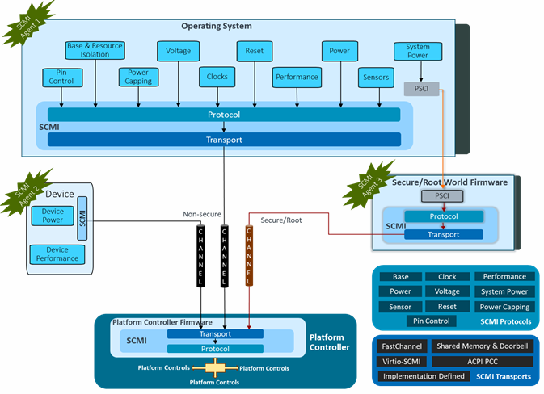
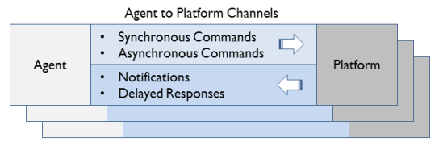
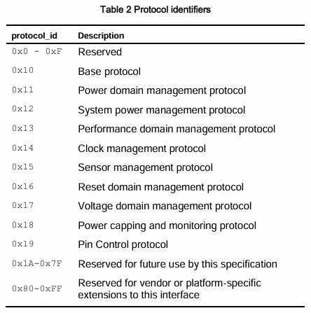
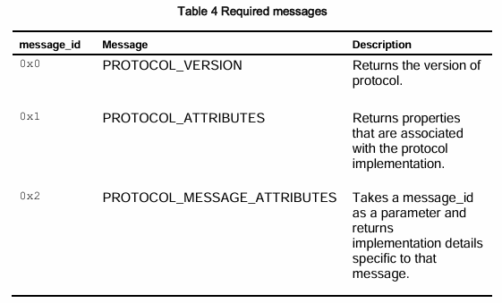
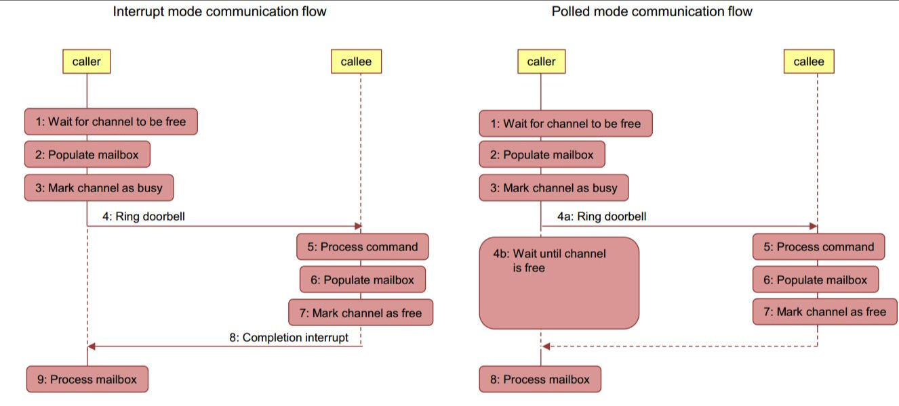

# `SCMI`协议总体概述

> 参考链接：[ARM系列 -- SCMI](https://www.cnblogs.com/linhaostudy/p/18934514)

​	`SCMI`抽象出协议和传输两层，协议层描述能够支持的命令，传输层定义了命令通过什么方式传输。`SCMI`的协议主要是为了协助操作系统做电源和性能管理，也就是协助完成`OSPM`（`Operating System Power Management`）。一般会把`OS`称为`agent`，而`SCP`及其管理的模块称为`platform`。

​	图中下方`platform controller`一般就是指`SCP`。`AP`发出`SCMI`命令，通过安全或者非安全通道发给`SCP`；`SCP`协调来自所有这些请求，并将硬件驱动到适当的电源或性能状态。图中上方部分，我们能看到，`SCMI`可以支持传感器，电源，电压，时钟，复位，性能的管理。

## 协议层

​	协议层有以下几个限制：

* 通道（`channel`）必须是分开独立的，一个`agent`至少要有一个专有的通道，通道不能和其它`agent`共享。
* `agent`必须是独立的操作系统
* 通道能够支持中断、轮询两种方式，让`agent`选择

​	从`agent`到`platform`的消息也称作命令，分为两种，同步命令和异步命令，为`A2P`通道。`P2A`通道上的消息也可以分为两类：通知（`notification`）和延迟响应（`delayed reponse`）。

* 同步（`synchronous`）命令：会阻塞通道，在当前命令没有完成前，agent不能再发新的同步命令，`agent`返回的时候对应的`platform`操作就已经完成了。
* 异步（`asynchronous`）命令，不会阻塞通道，`SCP`收到异步命令后会自行安排相应的后续管理操作，这样`SCP`可以接到异步命令后马上返回给`agent`一个响应，等命令完成后再返回一个额外的响应。

> ​	通道可以是标准的`SCMI`通道，或者是`FastCHannel`。`FastChannel`是一种轻型单向通道，专用于控制特定平台资源的单一`SCMI`消息类型。与标准通道不同，`FastChannel`不能用于承载多种消息类型，也不能显式控制多个平台资源。由于缺少多种消息类型及其标头要求，`FastChannel`可以为`agent`与`platform`通信提供潜在的低延迟机制。但是，与标准通道相比，`FastChannel`不能保证`platform`完成请求操作所需的时间较短。**在当前的`SCMI`版本（3.0）中，`FastChannel`仅支持性能管理协议。**通俗来说，就是`FastChannel`支持的消息类型少，且消息格式简单，所以传输延时会相对小一些，故名“快速”，但是也仅仅是传输快一些，并不能保证`SCP`完成请求的时间短。每个`agent`有自己专用的（可以是多个）通道，`agent`之间不能共享通道。`SCP`通过检查每个通道唯一的通道标识符来区分不同通道

​	对于标准通道上的消息，消息头总共有`32bit`，如下所示。

| Field     | Description              |
| --------- | ------------------------ |
| `[31:28]` | `Reserved, must be zero` |
| `[27:18]` | `Token`                  |
| `[17:10]` | `Protocol identifier`    |
| `[9:8]`   | `Message type`           |
| `[7:0]`   | `Message identifier`     |

​	`ARM`定义了多种协议，用来辅助`agent`与`platform`之间的通信，比如电源管理，时钟管理等等。但是在实际设计中，可能并没有实现所有的协议。只有基本协议是必须支持的。所以`agent`首先要做的一件事，就是给`platform`发命令，去查询`platform`支持多少协议。对于每组协议，都规定了哪些命令必须支持，哪些命令是可选项。

**[protocol_id]**

**[message_type]**

- Commands 的message type都是0。对于不支持的协议和message类型，platform都要回复 NOT_SUPPORTED
- Delayed responses 类型都是2
- Notifications 为3

**[message_id]**

## 传输层

​	关于传输，可以用共享存储方式来保存`AP`与`SCP`之间的消息。通信的流程可以采用中断，也可以采用轮询的方式去主动查询消息通道的状态。

