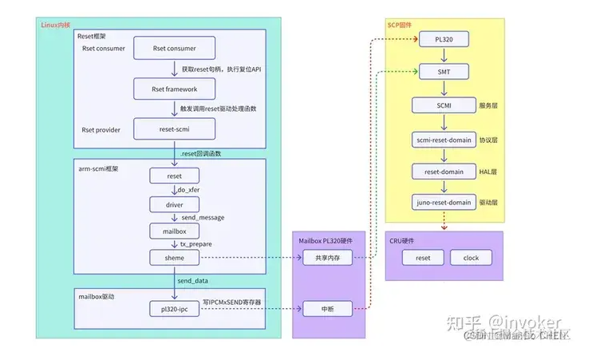

# 电源管理

> 参考链接：
>
> [电源管理——Linux SCMI框架](https://juejin.cn/post/7356878329004163072)


## 前言

​	本文重点关注`arm-scmi`作为许多子系统的`provide`与上层如何绑定，作为`SCMI`的发起者与`SCP`如何交流，以及自身和设备树如何配合进行初始化。

​	`SCMI`是电源管理核和`AP(linux)`核的通信协议，使用`PCSA`进行调用的一次流程如下：



​	本篇重点关注`Linux`的`arm-scmi`框架，实际应用中，`consumer`的代码不用太管，`arm-scmi`框架完全不用修改代码，`mailbox`通信机制和`SCP`固件中的`platform`相关代码是核心。`SCP`中的代码会在之后整理。

## 1、`SCMI`作用范围

​	在具体看设备树之前先看下`SCMI`的适用范围，`SCMI`框架是`Linux`中子系统的`provider`。将场馆的内核中`provider`具体实现，放在了`SCP firmware`中。

```
enum scmi_std_protocol {
        SCMI_PROTOCOL_BASE = 0x10,
        SCMI_PROTOCOL_POWER = 0x11,
        SCMI_PROTOCOL_SYSTEM = 0x12,
        SCMI_PROTOCOL_PERF = 0x13,
        SCMI_PROTOCOL_CLOCK = 0x14,
        SCMI_PROTOCOL_SENSOR = 0x15,
        SCMI_PROTOCOL_RESET = 0x16,
        SCMI_PROTOCOL_VOLTAGE = 0x17,
        SCMI_PROTOCOL_POWERCAP = 0x18,
}；
```

​	除了`BASE`承担`arm-scmi`框架自身的功能，`0x12 SYSTEM`在官方的设备树绑定里都没写咋用，代码里更是没有，`Power`是`SCMI`自身对`Power Domain`的实现。其它的每一项都会对应于`Linux`中的一个子系统，并成为这个子系统的`Provider`。`Voltage`对应`Regulator`，`Perf`对应`Cpufreq`，`Sensor`对应`HWMON`，`CLOCK RESET POWERCAP`都对应`Linux`下的同名子系统。

## 2、`SCMI`作为`platform device`

​	`SCMI platform`的身份完成了：

1. 自己的注册，通过`compatible`确定了`mailbox`的使用方式。
2. `Bus`的注册，方便后续子节点`device`和`driver`绑定。

​	`SCMI`为了方便自己的设备驱动和设备树配合绑定，自己弄了个`bus`，`match`条件也是对应上`Protocol ID`就将驱动注册（`scmi_dev_match_id`）。先设备树中的`scmi`节点如下：

```
firmware {
	optee: optee {
		compatible = "linaro,optee-tz";
		method = "smc";
	};

	scmi {
		compatible = "arm,scmi";
		mboxes = <&phy_mbox 0x00000000 &phy_mbox 0x00000001>;
		mbox-names = "tx", "rx";
		shmem = <&shmem0 &shmem1>;
		#address-cells = <0x00000001>;
		#size-cells = <0x00000000>;
		protocol@11 {
			reg = <0x00000011>;
			#power-domain-cells = <0x00000001>;
			phandle = <0x0000001c>;
		};
	};
}
```

​	和`spi`和`i2c`类似，`scmi`自己作为`platform_device`和驱动注册时会建立`scmi_bus`，方便子节点设备和驱动绑定。

## 3、`Compatible`

​	`compatible`在这里决定了和`mailbox`侧对接的格式。

```c
/* Each compatible listed below must have descriptor associated with it */
static const struct of_device_id scmi_of_match[] = {
#ifdef CONFIG_ARM_SCMI_TRANSPORT_MAILBOX
	{ .compatible = "arm,scmi", .data = &scmi_mailbox_desc },
#endif
#ifdef CONFIG_ARM_SCMI_TRANSPORT_OPTEE
	{ .compatible = "linaro,scmi-optee", .data = &scmi_optee_desc },
#endif
#ifdef CONFIG_ARM_SCMI_TRANSPORT_SMC
	{ .compatible = "arm,scmi-smc", .data = &scmi_smc_desc},
#endif
#ifdef CONFIG_ARM_SCMI_TRANSPORT_VIRTIO
	{ .compatible = "arm,scmi-virtio", .data = &scmi_virtio_desc},
#endif
	{ /* Sentinel */ },
};
```

​	如果是`arm，scmi`则用`Linux`下的`mailbox`框架。

## 4、`Bus`

**`init`阶段**

​	`bus_register`创造`bus`的标志，在`init`阶段即完成了`bus`的创建。

**`probe`阶段**

​	`scmi`在作为`platform_device`注册的过程中将解析子节点，并将子节点的`device`创建出来。

```c
static int __init scmi_bus_init(void)
{
        int retval;

        retval = bus_register(&scmi_bus_type);
        if (retval)
                pr_err("SCMI protocol bus register failed (%d)\n", retval);

        pr_info("SCMI protocol bus registered\n");

        return retval;
}
```

## 5、`protocol`

​	`init`阶段还做了一件事情，就是把`protocol`创建出来，`protocol`是`scmi_bus`和`scmi_device/driver`之间的桥梁。因为框架的原因，本来所有的`clock reset`信息都要在`provider`的`c`文件中存一份，编号在设备树的`h`文件中存一份。现在这两份都不存在了，设备树绑定的时候需要的信息需要从`SCP`侧拿。之前说过`scmi`框架是内核子系统的`provider`，所以在`scmi_device`和`scmi_driver`绑定的过程中，我们需要把`provider`必备的信息都获取到，最基础的比如：总共有几个`clock reset`。

​	`protocol`的核心有两个数据结构，一个是描述自身的`struct scmi_protocol`，另一个是描述自身提供的功能的`struct scmi_reset_proto_ops`。

​	`instance_init`是初始化时调用的，会从`SCP`拿点信息回来，`reset assert deassert`和内核中`reset`子系统的`api`对应，就是`consumer`调用过来的处理函数，最后都会调用到`SCP`，其它的几个是从`SCP`侧拿数据回来，之前`instance_init`时拿到的信息这时候用就行了，不用再去获取。

```c
// linux-6.6.1/drivers/firmware/arm_scmi/reset.c
static const struct scmi_protocol scmi_reset = {
         .id = SCMI_PROTOCOL_RESET,
        .owner = THIS_MODULE，
        .instance_init = &scmi_reset_protocol_init,
        .ops= &reset_proto_ops,
        .events = &reset_protocol_events,
};

static const struct scmi_reset_proto_ops reset_proto_ops = {
        .num_domains_get = scmi_reset_num_domains_get,
        .name_get = scmi_reset_name_get,
        .latency_get = scmi_reset_latency_get,
        .reset = scmi_reset_domain_reset,
        .assert = scmi_reset_domain_assert,
        .deassert = scmi_reset_domain_deassert，
}；
```

## 6、`scmi_driver`

​	有了`protocol`就已经有了作为`provider`的功能实现，现在还差怎么把自己注册到核心层中。`scmi_driver`实现这个功能，之前说到有两个重要的数据结构，一个是描述自己的，一个是描述功能的，这里的功能完全对应`protocol`中的功能，作为`ops`提供给核心层，完成`protocol`到核心层的连接。

```c
// linux-6.6.1/drivers/reset/reset-scmi.c
static struct scmi_driver scmi_reset_driver = {
        .name = "scmi-reset",
        .probe = scmi_reset_probe,
        .id_table = scmi_id_table,
};

static const struct reset_control_ops scmi_reset_ops = {
        .assert                = scmi_reset_assert,
        .deassert= scmi_reset_deassert,
        .reset                = scmi_reset_reset,
};
```

​	这个`scmi_driver`对应设备树里的`scmi`子节点，我们现在有了完成任务的信息和功能，只差组装一个`reset`的设备被注册到核心层里。`scmi_reset_probe`函数就做了这些事情。

```c
static int scmi_reset_probe(struct scmi_device *sdev)
{
        struct scmi_reset_data *data;
        struct device *dev = &sdev->dev;
        struct device_node *np = dev->of_node;
        const struct scmi_handle *handle = sdev->handle;
        struct scmi_protocol_handle *ph;

        if (!handle)
                return -ENODEV;

        reset_ops = handle->devm_protocol_get(sdev, SCMI_PROTOCOL_RESET, &ph);
        if (IS_ERR(reset_ops))
                return PTR_ERR(reset_ops);

        data = devm_kzalloc(dev, sizeof(*data), GFP_KERNEL);
        if (!data)
                return -ENOMEM;

        data->rcdev.ops = &scmi_reset_ops;
        data->rcdev.owner = THIS_MODULE;
        data->rcdev.of_node = np;
        data->rcdev.nr_resets = reset_ops->num_domains_get(ph);
        data->ph = ph;

        return devm_reset_controller_register(dev, &data->rcdev);
}
```

​	第16到26行是所有`reset provider`的经典写法，唯一不同的是，其它的`provider`信息要从设备树和`c`文件里面拿，`scmi`框架直接从`protocol`中拿就可以。值得注意的是在`devm_protocol_get`调用过程中，才会调用`protocol`的初始化，同时可以看到最关键的对上层的数据结构`struct scmi_protocol_handle ph`，该结构是每个`protocol`对应一个，通过它可以找到该`protocol`被正常调用的所需要的信息。

