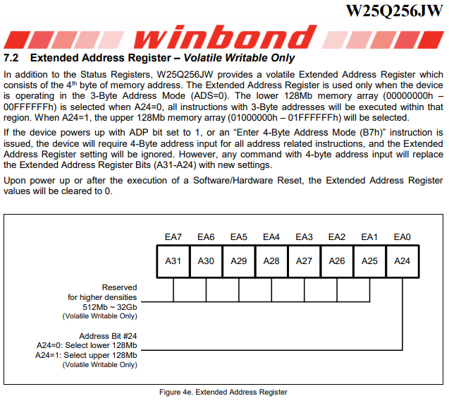
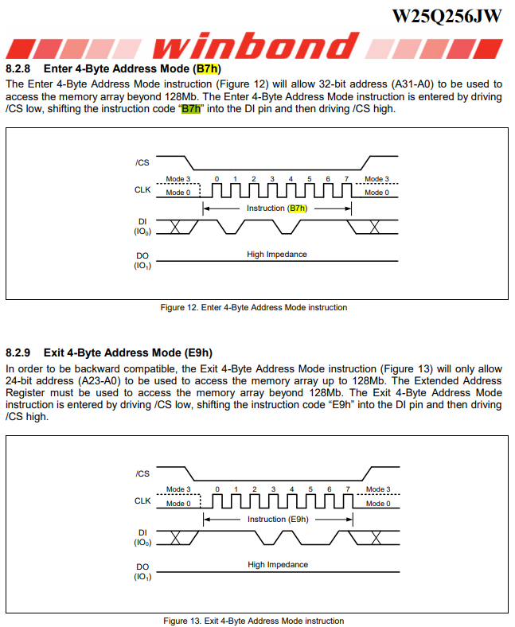

# 3bytes和4bytes地址

​	当flash容量大于16MB时，可以通过以下三种方法来实现对整片flash空间的读写擦除操作。

## 1、3bytes和4bytes指令

```c
/* drivers/mtd/spi-nor/core.c */
static void spi_nor_set_4byte_opcodes(struct spi_nor *nor)
{
	nor->read_opcode = spi_nor_convert_3to4_read(nor->read_opcode);
	nor->program_opcode = spi_nor_convert_3to4_program(nor->program_opcode);
	nor->erase_opcode = spi_nor_convert_3to4_erase(nor->erase_opcode);

	/* ... */
}

static int spi_nor_set_addr_width(struct spi_nor *nor)
{
    /* ... */

	/* Set 4byte opcodes when possible. */
	if (nor->addr_width == 4 && nor->flags & SNOR_F_4B_OPCODES &&
	    !(nor->flags & SNOR_F_HAS_4BAIT))
		spi_nor_set_4byte_opcodes(nor);

	return 0;
}
```

​	简单来说就是将3字节地址指令修改成4字节地址指令。

## 2、Extended Address Register

​	查看超过16MB大小的flash手册会发现如下描述：



​	`Extended Address Register`寄存器是flash内部的寄存器，可以通过设置该寄存器的值来实现对全片flash的读写擦除操作，具体原理如下：将flash分成多个128MB的区域，通过设置该寄存器的值来实现对哪一块区域的读写擦除。

​	如果flash为32MB大小，则只需要用到A24的bit位，如果flash为64MB大小，则只需要用到A24、A25两个bit位，以此类推，最大可支持32GB大小的flash。

> 需要注意的是，当用该寄存器去实现对全片flash的读写擦除时，指令仍然是3bytes的读写擦除指令，且flash不能进入`4-byte Address Mode`。也就是说改寄存器只能在`3-byte Address Mode`下使用。


​	在`<drivers/mtd/spi-nor/core.c>`文件中存在对应如下的代码：

```c
/**
 * spi_nor_write_ear() - Write Extended Address Register.
 * @nor:	pointer to 'struct spi_nor'.
 * @ear:	value to write to the Extended Address Register.
 *
 * Return: 0 on success, -errno otherwise.
 */
int spi_nor_write_ear(struct spi_nor *nor, u8 ear)
{
	int ret;

	nor->bouncebuf[0] = ear;

	if (nor->spimem) {
		struct spi_mem_op op =
			SPI_MEM_OP(SPI_MEM_OP_CMD(SPINOR_OP_WREAR, 0),
				   SPI_MEM_OP_NO_ADDR,
				   SPI_MEM_OP_NO_DUMMY,
				   SPI_MEM_OP_DATA_OUT(1, nor->bouncebuf, 0));

		spi_nor_spimem_setup_op(nor, &op, nor->reg_proto);

		ret = spi_mem_exec_op(nor->spimem, &op);
	} else {
		ret = spi_nor_controller_ops_write_reg(nor, SPINOR_OP_WREAR,
						       nor->bouncebuf, 1);
	}

	if (ret)
		dev_dbg(nor->dev, "error %d writing EAR\n", ret);

	return ret;
}
```

​	但是该函数并不是常用的方法，所以只是有该接口，而驱动并不使用该方式实现对全片flash的读写擦除操作。

​	值得注意的是，如果你全局搜索`spi_nor_write_ear()`函数，会发现在`drivers/mtd/spi-nor/winbond.c`文件中存在如下描述：

```c
/**
 * winbond_set_4byte_addr_mode() - Set 4-byte address mode for Winbond flashes.
 * @nor:	pointer to 'struct spi_nor'.
 * @enable:	true to enter the 4-byte address mode, false to exit the 4-byte
 *		address mode.
 *
 * Return: 0 on success, -errno otherwise.
 */
static int winbond_set_4byte_addr_mode(struct spi_nor *nor, bool enable)
{
	int ret;

	ret = spi_nor_set_4byte_addr_mode(nor, enable);
	if (ret || enable)
		return ret;

	/*
	 * On Winbond W25Q256FV, leaving 4byte mode causes the Extended Address
	 * Register to be set to 1, so all 3-byte-address reads come from the
	 * second 16M. We must clear the register to enable normal behavior.
	 */
	ret = spi_nor_write_enable(nor);
	if (ret)
		return ret;

	ret = spi_nor_write_ear(nor, 0);
	if (ret)
		return ret;

	return spi_nor_write_disable(nor);
}
```

​	之前说过，当用该寄存器来实现对整片flash的读写擦除操作时，flash不能进入`4-byte Address Mode`。相反，如果flash进入`4-byte Address Mode`，则该寄存器应该被清零。

## 3、`4-byte Address Mode`

​	查看超过16MB大小的flash手册会发现如下描述：

​	

​	flash默认处于`3-byte Address Mode`，可以通过向flash发送特殊的指令来让flash进入或退出`4-byte Address Mode`。当flash进入该模式后，读写擦除指令仍然是原`3-byte Address Mode`模式下的指令，只是地址由3bytes变成4bytes，如下所示。


> 需要注意的是，flash进入`4-byte Address Mode`后，`Extended Address Register`应该被清零。


​	在`<drivers/mtd/spi-nor/core.c>`文件中存在对应如下的代码：

```c
/* spi_nor_init() */
if (nor->addr_width == 4 &&
	nor->read_proto != SNOR_PROTO_8_8_8_DTR &&
    !(nor->flags & SNOR_F_4B_OPCODES)) {
	nor->params->set_4byte_addr_mode(nor, true);
}

/**
 * spi_nor_set_4byte_addr_mode() - Enter/Exit 4-byte address mode.
 * @nor:	pointer to 'struct spi_nor'.
 * @enable:	true to enter the 4-byte address mode, false to exit the 4-byte
 *		address mode.
 *
 * Return: 0 on success, -errno otherwise.
 */
int spi_nor_set_4byte_addr_mode(struct spi_nor *nor, bool enable)
{
	int ret;

	if (nor->spimem) {
		struct spi_mem_op op =
			SPI_MEM_OP(SPI_MEM_OP_CMD(enable ?
						  SPINOR_OP_EN4B :
						  SPINOR_OP_EX4B,
						  0),
				  SPI_MEM_OP_NO_ADDR,
				  SPI_MEM_OP_NO_DUMMY,
				  SPI_MEM_OP_NO_DATA);

		spi_nor_spimem_setup_op(nor, &op, nor->reg_proto);

		ret = spi_mem_exec_op(nor->spimem, &op);
	} else {
		ret = spi_nor_controller_ops_write_reg(nor,
						       enable ? SPINOR_OP_EN4B :
								SPINOR_OP_EX4B,
						       NULL, 0);
	}

	if (ret)
		dev_dbg(nor->dev, "error %d setting 4-byte mode\n", ret);

	return ret;
}

/* drivers/mtd/spi-nor/winbond.c */
static int winbond_set_4byte_addr_mode(struct spi_nor *nor, bool enable)
{
	int ret;

	ret = spi_nor_set_4byte_addr_mode(nor, enable);
	if (ret || enable)
		return ret;

	/* ... */
}
nor->params->set_4byte_addr_mode = winbond_set_4byte_addr_mode;


/* spi_nor_info_init_params() */
params->set_4byte_addr_mode = spansion_set_4byte_addr_mode;
```

​	以上代码看起来会有点混乱，笔者认为可能属于“屎山代码”，很容易造成读者的误解。下面说明为什么会有这样的理解。我们可以发现带`winbond_`和`spansion_`前缀的函数`xxx_set_4byte_addr_mode`是各个不同厂商自己型号的flash的设置`4-byte Address Mode`的方法，而`spi_nor_set_4byte_addr_mode`是通用的设置`4-byte Address Mode`的方法。

​	但是实际上初始化却是`params->set_4byte_addr_mode = spansion_set_4byte_addr_mode`，而不是`params->set_4byte_addr_mode = spi_nor_set_4byte_addr_mode`，所以此处就是第一个坑。

​	`spi_nor_init()`函数中看起来调用了`nor->params->set_4byte_addr_mode(nor, true)`，容易导致读者认为flash驱动使用`4-byte Address Mode`实现对4字节地址的访问。但是实际上一般型号的flash（上面提到winbond和spansion比较特殊）在判断条件!`(nor->flags & SNOR_F_4B_OPCODES)`时不通过（不难发现`nor->addr_width == 4`和`nor->read_proto != SNOR_PROTO_8_8_8_DTR`均为真），所以不会调用`nor->params->set_4byte_addr_mode(nor, true)`函数，此处是第二个坑。

​	下面解释为什么一般情况下，判断条件!`(nor->flags & SNOR_F_4B_OPCODES)`不通过。

​	全局搜索`SNOR_F_4B_OPCODES`宏，发现如下代码：

```c
/* spi_nor_scan() */
if (info->flags & SPI_NOR_4B_OPCODES)
	nor->flags |= SNOR_F_4B_OPCODES;
```

​	`info->flags`参数初始化如下（部分代码）：

```c
/* drivers/mtd/spi-nor/gigadevice.c */
static const struct flash_info gigadevice_parts[] = {
	{ "gd25q128", INFO(0xc84018, 0, 64 * 1024, 256,
			   SECT_4K | SPI_NOR_DUAL_READ | SPI_NOR_QUAD_READ |
			   SPI_NOR_HAS_LOCK | SPI_NOR_HAS_TB) },
	{ "gd25q256", INFO(0xc84019, 0, 64 * 1024, 512,
			   SECT_4K | SPI_NOR_DUAL_READ | SPI_NOR_QUAD_READ |
			   SPI_NOR_4B_OPCODES | SPI_NOR_HAS_LOCK |
			   SPI_NOR_HAS_TB | SPI_NOR_TB_SR_BIT6)
		.fixups = &gd25q256_fixups },
};

/* drivers/mtd/spi-nor/macronix.c */
static const struct flash_info macronix_parts[] = {
	/* Macronix */
	{ "mx25u12835f", INFO(0xc22538, 0, 64 * 1024, 256,
			      SECT_4K | SPI_NOR_DUAL_READ |
			      SPI_NOR_QUAD_READ) },
	{ "mx66u51235f", INFO(0xc2253a, 0, 64 * 1024, 1024,
			      SECT_4K | SPI_NOR_DUAL_READ |
			      SPI_NOR_QUAD_READ | SPI_NOR_4B_OPCODES) },
	{ "mx66l1g45g",  INFO(0xc2201b, 0, 64 * 1024, 2048,
			      SECT_4K | SPI_NOR_DUAL_READ |
			      SPI_NOR_QUAD_READ) },
};

static void macronix_default_init(struct spi_nor *nor)
{
	nor->params->quad_enable = spi_nor_sr1_bit6_quad_enable;
	nor->params->set_4byte_addr_mode = spi_nor_set_4byte_addr_mode;
}

/* drivers/mtd/spi-nor/winbond.c */
static int
w25q256_post_bfpt_fixups(struct spi_nor *nor,
			 const struct sfdp_parameter_header *bfpt_header,
			 const struct sfdp_bfpt *bfpt)
{
	/*
	 * W25Q256JV supports 4B opcodes but W25Q256FV does not.
	 * Unfortunately, Winbond has re-used the same JEDEC ID for both
	 * variants which prevents us from defining a new entry in the parts
	 * table.
	 * To differentiate between W25Q256JV and W25Q256FV check SFDP header
	 * version: only JV has JESD216A compliant structure (version 5).
	 */
	if (bfpt_header->major == SFDP_JESD216_MAJOR &&
	    bfpt_header->minor == SFDP_JESD216A_MINOR)
		nor->flags |= SNOR_F_4B_OPCODES;

	return 0;
}

static struct spi_nor_fixups w25q256_fixups = {
	.post_bfpt = w25q256_post_bfpt_fixups,
};

static const struct flash_info winbond_parts[] = {
    { "w25q256", INFO(0xef4019, 0, 64 * 1024, 512,
			  SECT_4K | SPI_NOR_DUAL_READ | SPI_NOR_QUAD_READ)
	  .fixups = &w25q256_fixups },
    { "w25q256jvm", INFO(0xef7019, 0, 64 * 1024, 512,
			     SECT_4K | SPI_NOR_DUAL_READ | SPI_NOR_QUAD_READ) },
};

static void winbond_default_init(struct spi_nor *nor)
{
	nor->params->set_4byte_addr_mode = winbond_set_4byte_addr_mode;
}
```

​	如`gd25q128`和`mx25u12835f`型号的flash大小均为16MB，所以不存在4字节地址；如`gd25q256`和`mx66u51235f`的`info->flag`参数包含`SPI_NOR_4B_OPCODES`，`w25q256`的`nor->flags`参数包含`SNOR_F_4B_CODES`，所以不会调用`nor->params->set_4byte_addr_mode(nor, true)`函数；如`mx66l1g45g`的`info->flag`参数不包含`SPI_NOR_4B_OPCODES`，所以会调用`nor->params->set_4byte_addr_mode(nor, true)`函数，但是可以发现在`macronix_default_init()`函数中已经设置`nor->params->set_4byte_addr_mode = spi_nor_set_4byte_addr_mode`（w25q256jvm同理）。

## 3、总结

​	总得来说，如果flash是支持4字节地址指令，那驱动优先还是采用4字节地址指令去访问flash，否则才会采用进入`4-byte Address Mode`（这个在`winbond`的flash中尤为常见），而`Extended Address Register`基本没有被使用。