# `SFDP`

​	大多数数据手册中只会告诉读者其使用的`SFDP`是哪个版本的，而没有具体的`SFDP register`数据表。该文档提供一些版本的`SFDP register`数据表，以作参考。

## `JEDEC Standard No.216`

​	`《GD25LQ128D.pdf》`文档中有`No.216`版本的`SFDP register`数据表。

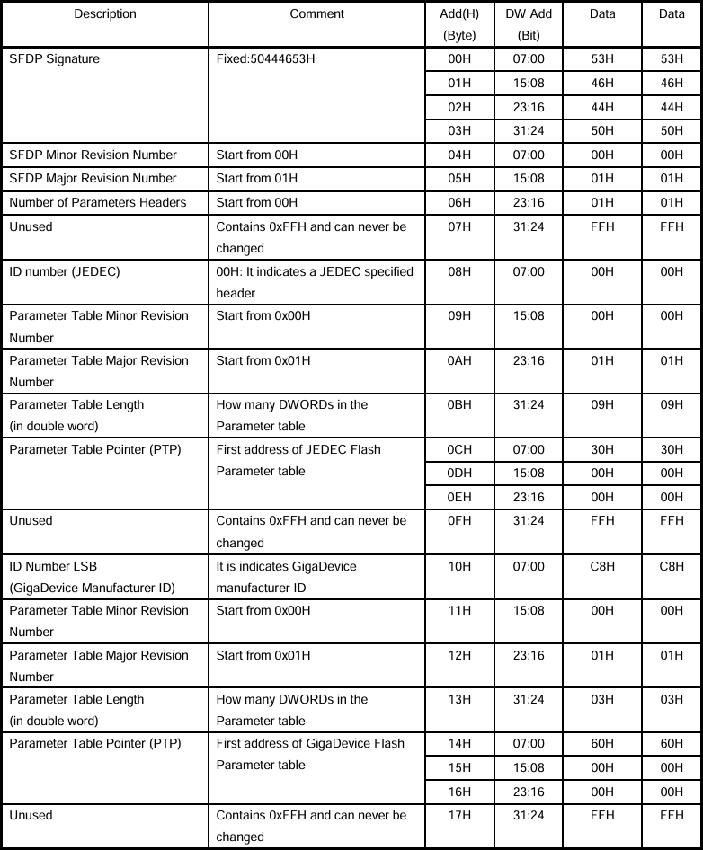

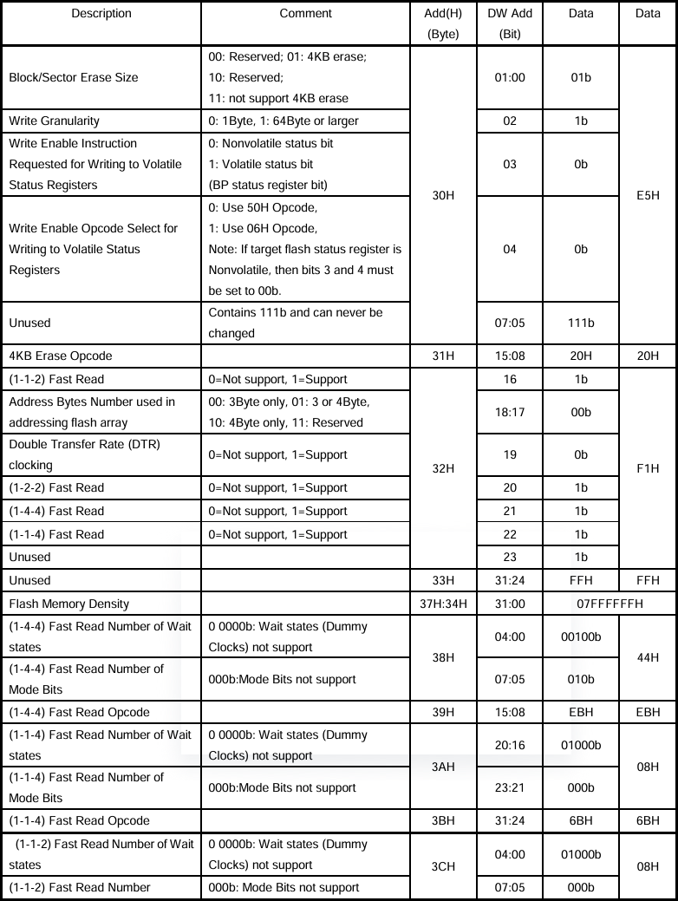

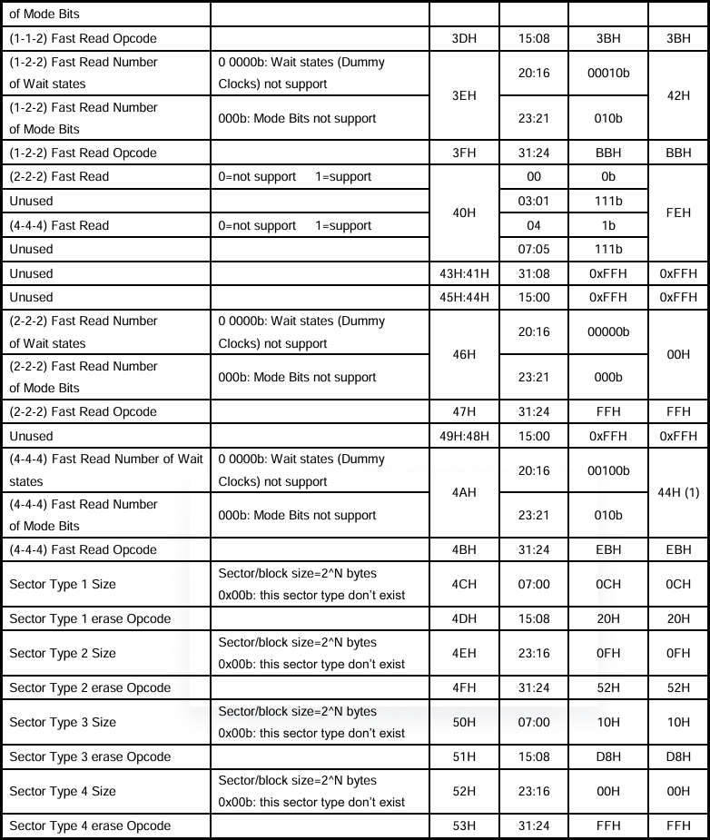

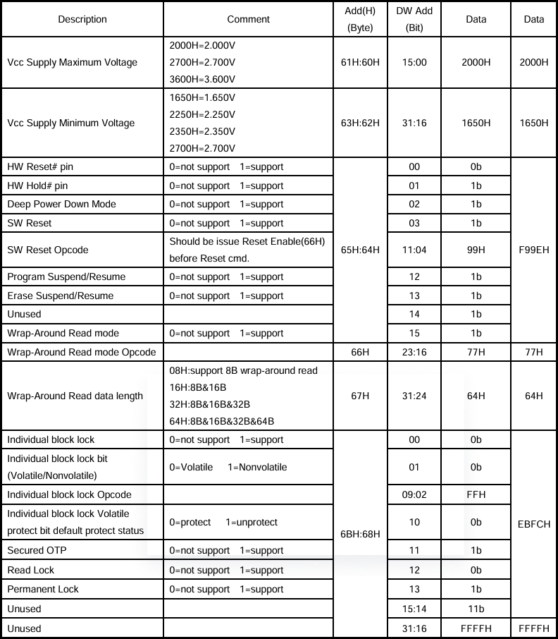

## `JEDEC Standard No.216B`

​	`《DS-00285-GD25Q256D-Rev2.1.pdf》`文档中有`No.216B`版本的`SFDP register`数据表。

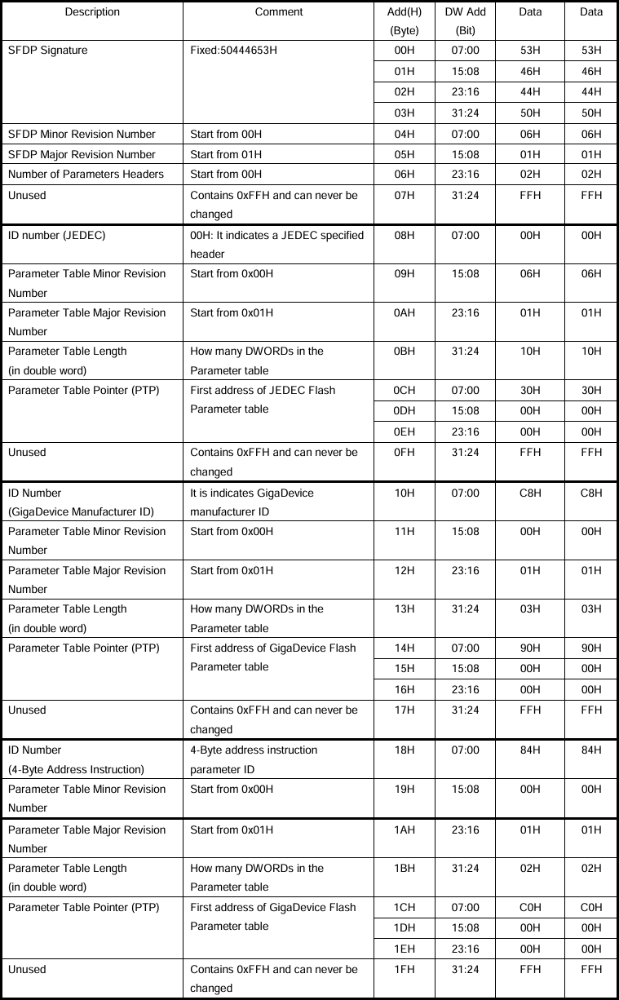

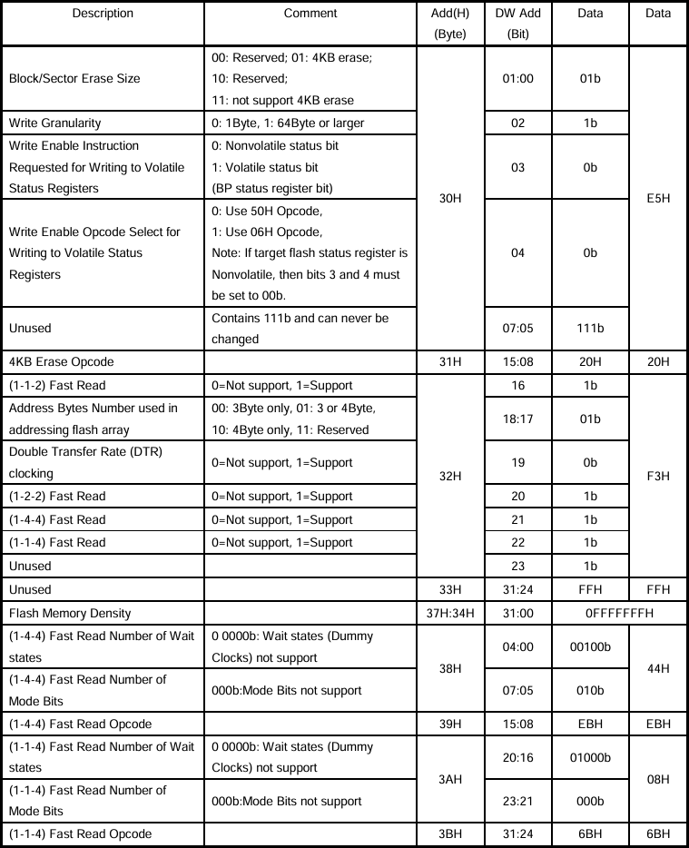

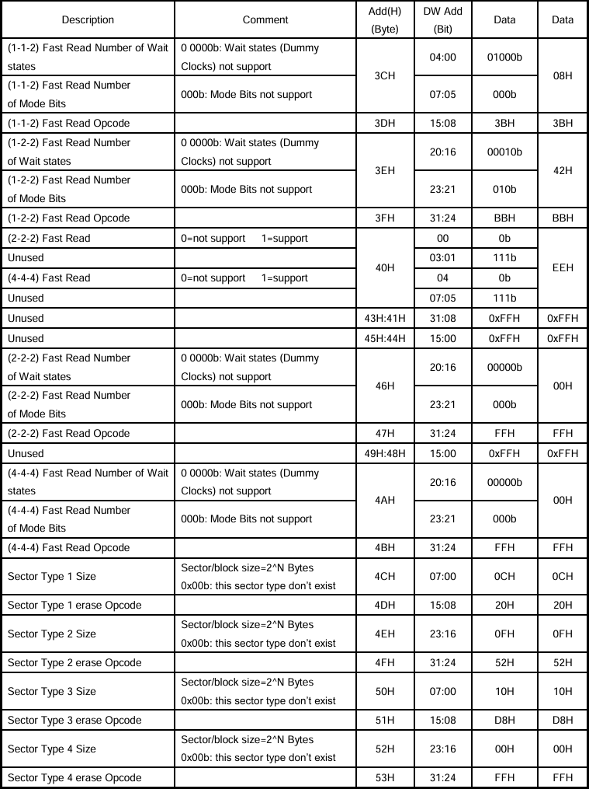

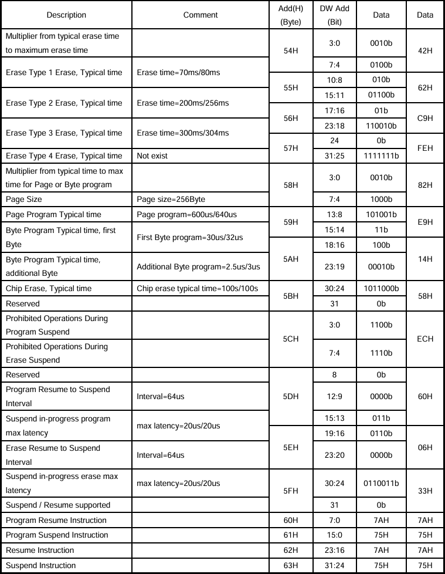

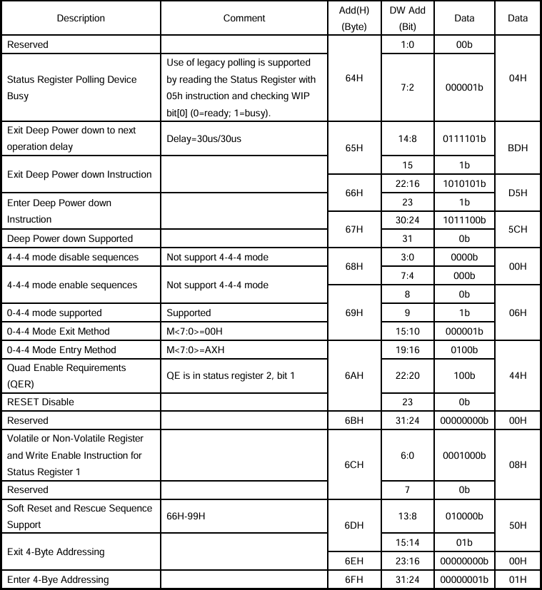

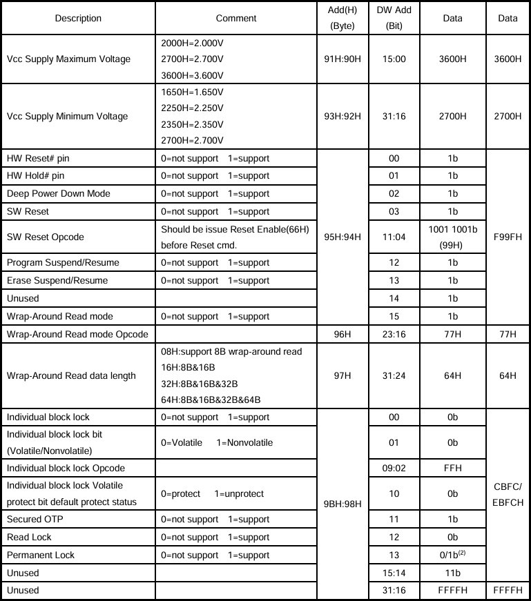

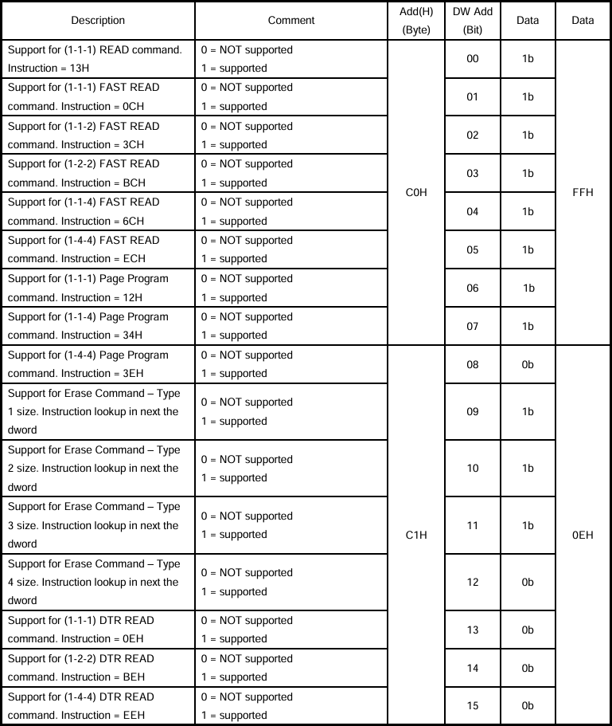

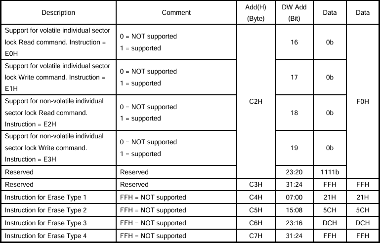