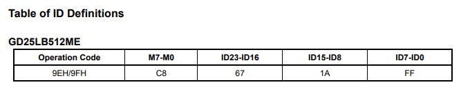
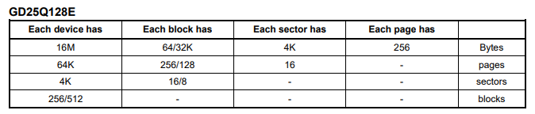

# flash_info各段数据解析

​	如果某`nor flash`厂家新出了一个型号的`flash`，这时现有的`Linux`内核中肯定是没有该型号`flash`的描述的，所以就需要在内核中添加该型号的`flash`描述，这样才能正常识别出该型号的`flash`。那么想要正确添加不同型号的`flash`型号描述，就需要了解`flash_info`结构体中各段数据的具体含义了，下面笔者将对该结构体的各段数据做解析。

​	如下是`gd25q128`型号的`flash`的`flash_info`数据描述：

```c
	{ "gd25q128", INFO(0xc84018, 0, 64 * 1024, 256,
			   SECT_4K | SPI_NOR_DUAL_READ | SPI_NOR_QUAD_READ |
			   SPI_NOR_HAS_LOCK | SPI_NOR_HAS_TB) },

/* Used when the "_ext_id" is two bytes at most */
#define INFO(_jedec_id, _ext_id, _sector_size, _n_sectors, _flags)	\
		.id = {							\
			((_jedec_id) >> 16) & 0xff,			\
			((_jedec_id) >> 8) & 0xff,			\
			(_jedec_id) & 0xff,				\
			((_ext_id) >> 8) & 0xff,			\
			(_ext_id) & 0xff,				\
			},						\
		.id_len = (!(_jedec_id) ? 0 : (3 + ((_ext_id) ? 2 : 0))),	\
		.sector_size = (_sector_size),				\
		.n_sectors = (_n_sectors),				\
		.page_size = 256,					\
		.flags = (_flags),
```

## 1、name

​	`gd25q128`为`flash`的名字，不同型号的`flash`的名字各不相同。在内核中其只做标识用，并不会用作匹配，所以理论上可以随意命名。不过正常情况下应该使其与后面的`JEDEC ID`相对应。

## 2、ID

​	内核中的`ID`分为`jedec id`（即`0xc84018`数据段）和`ext_id`（即`0`数据段）两部分，`jedec id`为3字节，`ext_id`为2字节。

​	目前市场上常用型号的`flash`都没有使用`ext_id`，仅使用`jedec id`就可以识别出不同类型的`flash`，所以读者在内核源码中可以发现，基本上所有型号的`flash`描述中，其`ext_id`的值都是`0`。

​	但是不论如何，`flash`驱动中使用`spi_nor_read_id()`函数读出的`ID`都为6个字节，以`gd25q128`为例，`flash`驱动读出它的`ID`为`c8 40 18 c8 40 18`。但是做匹配的时候并不会将读出的6字节的`ID`和描述中的`jedec id`、`ext_id`、`id`直接做比较，而是只比较`id_len`长度的数据，如下：

```c
static const struct flash_info *
spi_nor_search_part_by_id(const struct flash_info *parts, unsigned int nparts,
			  const u8 *id)
{
	unsigned int i;

	for (i = 0; i < nparts; i++) {
		if (parts[i].id_len &&
		    !memcmp(parts[i].id, id, parts[i].id_len))
			return &parts[i];
	}

	return NULL;
}
```

​	上述代码中，`parts[i].id`就是描述中的`id`，即`jedec id`和`ext_id`的组合，`id`就是`flash`驱动发送指令读到的6个字节的`ID`，`parts[i].id_len`就是有效的做比较的数据长度，一般为3，因为`ext_id`一般为`0`。

​	

​	笔者偶然间发现目前有一小部分型号的`flash`的`ID`有四个字节，如`gd25lb512me`型号的`flash`的`ID`如下：



​	`flash`驱动读取其`ID`为`c8 67 1a ff c8 67`，那么我们应该如何添加该型号的`flash`的描述呢？

​	由于`jedec id`为3个字节，`ext_id`为2个字节，而`gd25lb512me`型号的`flash`的`ID`为`c8671aff`，其后多出来的一个字节`ff`并不适合作为`ext_id`，而且前三个字节`c8671a`又不与其它型号的`flash`的`ID`冲突，所以笔者认为仍然可以只取其前三个字节作为其`jedec id`，即其描述如下：

```c
	{ "gd25lb512me", INFO(0xc8671a, 0, 64 * 1024,  1024,
			  SECT_4K | SPI_NOR_DUAL_READ | SPI_NOR_QUAD_READ |
			  SPI_NOR_HAS_LOCK | SPI_NOR_HAS_TB) },
```

## 3、Sector/Block

​	~~可以发现，`64*1024`表示`sector_size`，即一个扇区的大小，`256`表示`n_sectors`，即一共有多少各扇区，那么两个的乘积就是整个`flash`的大小。~~

​	但是后来笔者经过多次查验多种型号的`flash`发现，`64*1024`其实表示的是`block_size`，即一个块的大小，`256`表示`n_blocks`，即一共有多少块。同样，两个数的乘积就是整个`flash`的大小。

​	下面笔者将举例说明为什么上面提及的两个数据是和块有关而不是扇区。

​	`gd25q128`型号的`flash`描述如下：



​	由上图可知，每一个`block`大小为`64K Bytes`，即`64*1024`。该`flash`一共有`256 blocks`。

​	如果是和`sector`有关，那么每一个`secotr`大小为`4K Bytes`，即`4*1024`，该`flash`一共有`4K secotrs`，即`4096`。这显然和上述提及的两段数据不符。

> 不难发现`page_size`固定为256

## 4、flag

​	`flag`内容深度比较简单，但是涉及的种类又比较复杂，后续有时间笔者再进行补充。