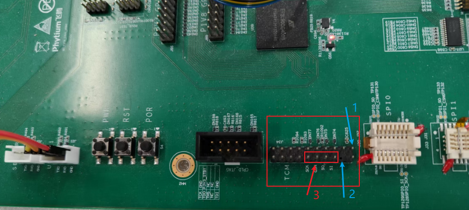
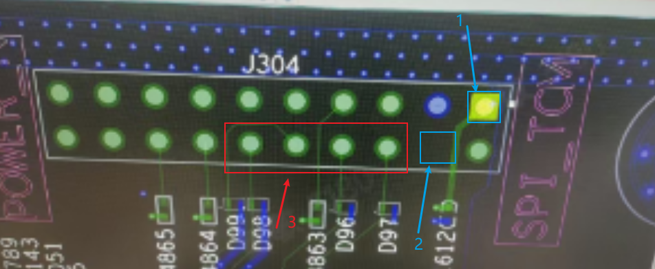
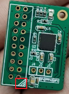
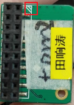

# `tpm-spi`测试问题汇总


## 1、`tpm`卡如何插到板子上

### 1.1 板子上的`tpm`卡插槽

​	首先找一块能测试`tpm`卡的板子，会发现板子上有类似如下的`tcm`插槽。



​	上图为`D3000`（`BO_TSTB_D5U1_V060-036`）板子，如上图所示，会发现有两排针脚，其中一排中有一个针脚是没有的（计为针脚2），而`tpm`使用的`spi`管脚（`SCK`、`CSN`、`SO`、`SI`）刚好也在这一排。与之对应的另一排针脚中，有一个靠近针脚2的针脚1，我们就是通过针脚1来判断如何插`tpm`卡。

### 1.2 板子的`tpm`插槽硬件原理图

​	`S5000C-80E`板子的`SPI_TCM`插槽的硬件原理图如下所示（对应针脚已标注，笔者不做赘述）。



### 1.3 `tpm`卡

​	常用的`tpm`卡（正反面）如下所示。



​	会发现`tpm`卡上有一个红框中的标识用作定位，离该标识最近的那个管脚记作`PIN`。正确的插法为`tpm`卡的`PIN`与板子上的针脚1对应。

> ​	需要注意的是，正确插上`tpm`卡并启动板子后，`tpm`卡上的`led`灯并不会亮。而插反的情况下启动板子，`tpm`卡上的`led`会亮。笔者曾被这样的现象误导了。

## 2、`tpm_tis_spi`驱动注册失败

### 2.1 问题现象

​	将`tpm`卡按正确方式插到`D3000`开发板上，进入`OS`后发现并没有生成`/dev/tpm*`设备，并且出现如下报错。

```
tpm_tis_spi: probe of spi0.0 failed with error -110
```

## 2.2 问题原因

​	裸机下测试`tpm`正常，并且检查设备树以及内核配置均无误。但是在裸机下测试`tpm`的时候发现只能在`5MHz`左右频率下测试`tpm`测试才正常。

​	检查设备树发现`tpm`描述频率为`12MHz`，修改为`5MHz`后重新测试，结果能够生成`/dev/tpm*`设备。

> ​	注意，`spi`控制器描述中需要加`global-cs`描述，否则也无法生成`/dev/tpm*`设备。

### 2.3 解决方法

​	修改设备树为正确描述（`spi`控制器描述中加`global-cs`属性，`tpm`描述中频率设置为`5MHz`），如下。

```
spi@28012000 {
        compatible = "phytium,spi";
        interrupts = <0x0 0x4e 0x4>; 
        reg = <0x0 0x28012000 0x0 0x1000>;
        clocks = <0xa>;
        num-cs = <0x4>;
        status = "ok";
        #address-cells = <0x1>;
        #size-cells = <0x0>;
        global-cs = <0x1>;

        tpm@0 {
                compatible = "tcg,tpm_tis-spi";
                spi-max-frequency = <0x4c4b40>;
                reg = <0x0>;
        };
};
```

