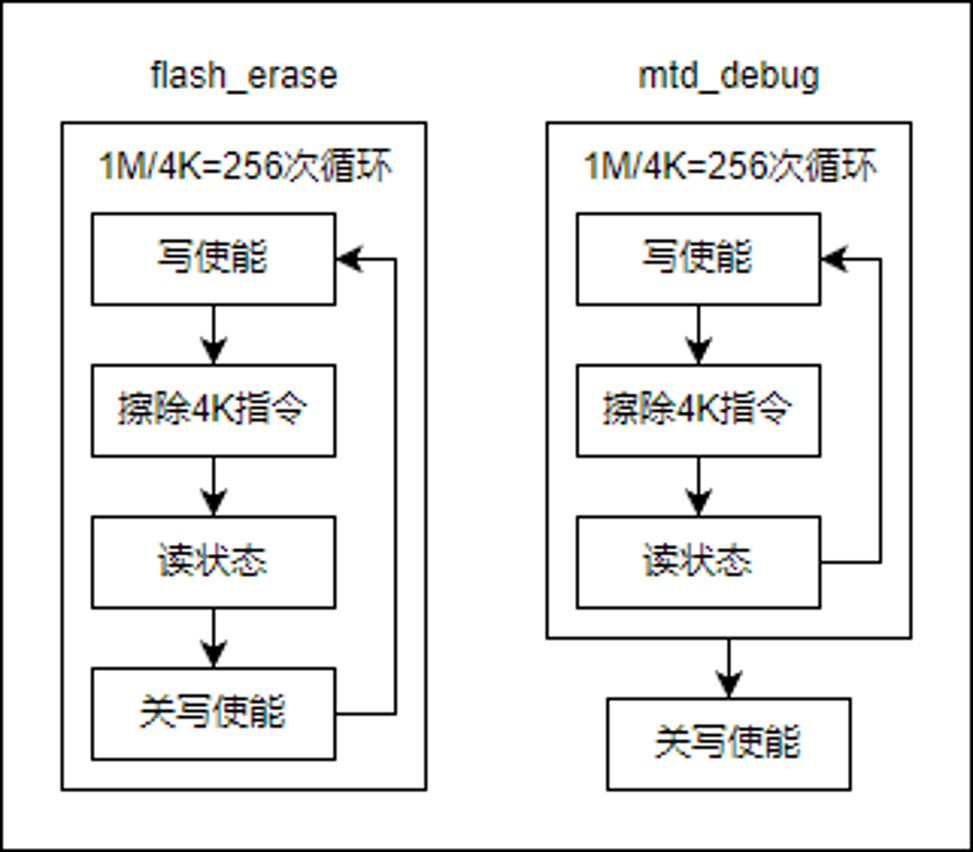

# 擦除

## 1、`mtd_debug`和`flash_erase`工具的不同

​	`mtd_debug`和`flash_erase`都可以对`flash`做擦除，但是两种工具在做擦除操作时流程有所不同，以擦除`16MB`大小的`flash`的`0-1MB`空间为例，如下所示：

```bash
$ mtd_debug erase /dev/mtd0 0 0x100000
$ flash_erase /dev/mtd0 0 0x100
```

​	`mtd_debug`执行擦除操作时需要直接输入擦除的大小，而`flash_erase`执行擦除操作时需要输入擦除扇区的个数，扇区大小一般为`4KB`。

​	查看两种工具的源码，如下：

```c
/* mtd_debug */
static int erase_flash(int fd, u_int32_t offset, u_int32_t bytes)
{
	int err;
	struct erase_info_user erase;
	erase.start = offset;
	erase.length = bytes;
	err = memerase(fd, &erase);
	/* ... */

	return 0;
}

static int memerase(int fd, struct erase_info_user *erase)
{
	return ioctl(fd, MEMERASE, erase);
}
```

```c
/* flash_erase */
erase_each_sector:
	for (eb = eb_start; eb < eb_start + eb_cnt; eb++) {
    	if (mtd_erase(mtd_desc, &mtd, fd, eb) != 0) {
			sys_errmsg("%s: MTD Erase failure", mtd_device);
			continue;
		}
        
    }

int mtd_erase(libmtd_t desc, const struct mtd_dev_info *mtd, int fd, int eb)
{
	return mtd_erase_multi(desc, mtd, fd, eb, 1);
}

int mtd_erase_multi(libmtd_t desc, const struct mtd_dev_info *mtd,
			int fd, int eb, int blocks)
{
	int ret;
	struct libmtd *lib = (struct libmtd *)desc;
	struct erase_info_user64 ei64;
	struct erase_info_user ei;

	ei64.start = (__u64)eb * mtd->eb_size;
	ei64.length = (__u64)mtd->eb_size * blocks;

	if (lib->offs64_ioctls == OFFS64_IOCTLS_SUPPORTED ||
	    lib->offs64_ioctls == OFFS64_IOCTLS_UNKNOWN) {
		ret = ioctl(fd, MEMERASE64, &ei64);
		/* ... */
	}

	return 0;
}
```

​	分析源码可知，`mtd_debug`在做擦除操作时，直接传输给内核的数据为起始地址`0x0`和擦除的总长度`0x100000`，而`flash_erase`在做擦除操作时，会先做扇区拆分，即先把要擦除的总长度拆分成多个`4KB`大小的扇区，然后再通过循环去一个一个擦除`4KB`的扇区。

​	需要注意的是，即使是使用`mtd_debug`进行擦除操作，最后到`core`层也会对擦除的总长度做`4KB`的扇区拆分。只不过`mtd_debug`的扇区拆分动作是在内核的`core`层，而`flash_erase`的扇区拆分动作是在用户态。

## 2、`core`层的擦除流程

​	`core`层的擦除函数如下：

```c
static int spi_nor_erase(struct mtd_info *mtd, struct erase_info *instr)
{
    /* whole-chip erase */
 	if (len == mtd->size && !(nor->flags & SNOR_F_NO_OP_CHIP_ERASE)) {
    	/* ... */
    /* "sector"-at-a-time erase */
    } else if (spi_nor_has_uniform_erase(nor)) {
        /* ... */
    /* erase multiple sectors */
    } else {
        ret = spi_nor_erase_multi_sectors(nor, addr, len);
    }
    
    ret = spi_nor_write_disable(nor);
    
    return ret;
}

static int spi_nor_erase_multi_sectors(struct spi_nor *nor, u64 addr, u32 len)
{
    /* ... */
	while (cmd->count) {
		dev_vdbg(nor->dev, "erase_cmd->size = 0x%08x, erase_cmd->opcode = 0x%02x, erase_cmd->count = %u\n",
			 cmd->size, cmd->opcode, cmd->count);

		ret = spi_nor_write_enable(nor);
		if (ret)
			goto destroy_erase_cmd_list;

		ret = spi_nor_erase_sector(nor, addr);
		if (ret)
			goto destroy_erase_cmd_list;

		ret = spi_nor_wait_till_ready(nor);
		if (ret)
			goto destroy_erase_cmd_list;

		addr += cmd->size;
		cmd->count--;
    }
    /* ... */

	return 0;
}
```

​	`core`层的擦除操作做了三种分类，第一种为全片擦除，第二种为一次性擦除，第三种为多扇区擦除。关于第二种擦除，可以简单理解为采用更快的擦除指令，比如如果flash支持擦除`64KB`的擦除指令，此时用户态使用`mtd_debug`工具传下来的数据中擦除大小为`1MB`，那么内核就会优先采用第二种擦除方式，对`1MB`的擦除大小做`64KB`的扇区拆分。当然，一般情况下代码是不会跑到第二种擦除的。

## 3、两种不同的擦除流程

​	`mtd_debug`和`flash_erase`的擦除流程如下：



